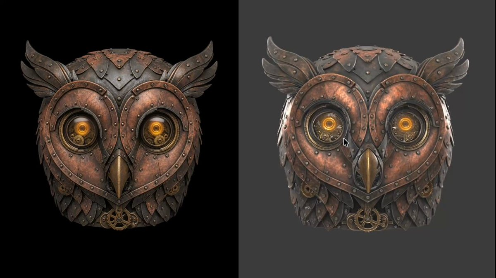

# Hitem3D 3.0: image-to-mesh at 2048³ with up to 5M faces, small details stay in geometry

> Source: https://x.com/Scenario_gg/status/2097724373515772361
> Author: Scenario (@Scenario_gg)
> Posted: 2026-09-09T16:30:39Z
> Stats (at capture): 8,697 views · 129 likes · 6 replies · 10 reposts · 112 bookmarks · 0 quotes
> Captured: 2026-09-21T14:35:05Z

## Post

Detail is the first thing lost going from image to mesh.

Hitem3D 3.0 generates at 2048³ with up to 5M faces, so even the small details stay in the geometry.

## Media

[media/media_0.mp4](media/media_0.mp4)

16.8s video (`media/media_0.mp4`, 1920×1080, 1.9 MB) + thumb (`media/thumb_0.jpg`, 98 KB). Original: https://video.twimg.com/ext_tw_video/2097724310509002752/pu/vid/avc1/1280x720/O6hlIrGHbQ1iB2yh.mp4?tag=12
Thumb original: https://pbs.twimg.com/ext_tw_video_thumb/2097724310509002752/pu/img/rgOgk3Bv87iBSGtI.jpg

## Author bio (at capture)

The creative AI engine studios actually use in production, at scale. Build custom pipelines & workflows across Images · Video · 3D · Audio. Your brand, your AI.
Location: San Francisco, CA 
Website: https://www.scenario.com

## Thread

None (`replying_to` null). No author self-replies recovered via bridge (0 reply articles visible).

## Comments

6 replies per API. 0 visible. Bridge (logged-in, own tab, page URL verified before every extract, 3–8 scroll rounds per tweet): conversation returned only the main-post `<article>`; 0 reply `<article>` elements visible on any of the 15 tweets (one transient 2nd `<article>` on 2097738059844657256 was the embedded X-Article card, not a reply). A loading skeleton sat unresolved behind the reply position; reload did not resolve it — conversation endpoint not serving children to this session. fx/vx APIs return counts only, no reply list. `r.jina.ai` on `x.com`: AbuseAlleviation 403; on `fixupx.com`: login wall.
