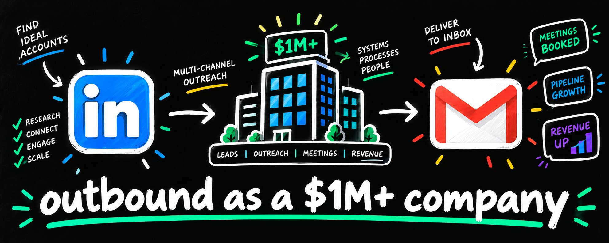

# The complete guide to running outbound as a $1M+ company (FULL COURSE)

> Source: https://x.com/draprints/status/2097738059844657256
> Author: Dra (@draprints)
> Posted: 2026-09-09T17:25:02Z
> Stats (at capture): 4,750 views · 27 likes · 2 replies · 2 reposts · 56 bookmarks · 2 quotes
> Captured: 2026-09-21T14:35:05Z

## Post

https://x.com/i/article/2096980671692423168

## Article

**the complete guide to running outbound as a $1M+ company (FULL COURSE)** (https://x.com/i/article/2096980671692423168)

Article cover (`media/article_cover.jpg`, 220 KB). Original: https://pbs.twimg.com/media/HRypj8IWQAAdgiu.jpg?name=orig

outbound at a million in revenue is a different operation to outbound at a hundred thousand.

the founder stops being the sender, the volume needs real infrastructure, and the failure points move.

we run this for 140+ companies across 30 industries at eaglerev, on 3-4 million cold dms sent.

this is the full operating model at that stage, including what to build in what order, who owns what, and the numbers to run it on...

[image]

### what changes at a million:

[image]

below a million, outbound is usually the founder sending messages between other work.

past it, 3 things break at once:

- the founder's time becomes the most expensive input in the business

- the volume needed to hit the pipeline number exceeds what one person can send

- replies arrive faster than anyone can work them

run the arithmetic on the first one.

a founder spending half their week on outbound at a $1m company is spending the most valuable hours available on work a system does better.

price it out. 

at $1m in revenue, a founder's hour carries the value of the highest-leverage work in the business, and list building is NOT IT.

the same half week back on product, partnerships, or closing is worth several times what an sdr salary costs.

the shape it has to take:

- a list layer producing qualified accounts weekly

- an infrastructure layer carrying volume safely

- a message layer tested by segment

- a routing layer getting replies to a human fast

- a reporting layer showing which part is broken

each layer needs an owner, even when the owner is one person wearing 5 hats.

what to build first. 

the routing layer, before the volume layer.

a company generating 30 conversations a month into an inbox nobody owns produces nothing, and adding volume makes the leak bigger.

fix where replies go, then increase how many arrive.

the build order that works:

1. routing, meaning where a reply goes and who owns it

2. the message, tested on a small list

3. the list layer, built properly once the message is proven

4. the infrastructure layer, scaled to the volume the list supports

5. the reporting layer, once there is enough data to read

most companies build 3, 4, 2, 1, which means the volume arrives before anyone can work it.

[image]

### the list layer:

at this stage the list stops being an export and becomes a maintained asset.

what that means in practice:

- the full addressable market mapped, not the first slice a database returns

- every record qualified against the icp before it enters a campaign

- a written reason attached to every drop

- deduplication against everyone already contacted

- a refresh cadence, since new companies, funding, and hires appear weekly

where to pull from. the sources that outperform a bought database:

- ats job feeds, which expose open roles as public json

- sec form d filings, which show a raise weeks before the announcement

- usaspending for federal contract winners

- the linkedin and meta ad libraries for companies already spending

- association directories and licensing registries

- linkedin's own free surfaces, meaning the alumni tool, event attendees, and post engagers

each carries a dated signal. a bought database carries a company name.

how many sources to run. 

2 or 3, worked properly, on a rotation.

a company at $1m does not need 40 sources.

it needs 2 that produce consistently and a process that keeps them fresh.

add the third only once the first 2 are producing meetings.

then qualify with a model. 

the scoring prompt needs your disqualifiers written with the same care as your criteria, 

since without them the model invents reasons a company qualifies.

read the drop reasons in bulk.

we qualified a pool of 12,479 before sending 4,905 messages on one campaign, and 1 in 4 replies came back genuinely interested. 

that ratio came from the filtering.

score what survives. 

signal scoring decides where the expensive effort goes.

score on things that indicate timing, meaning recent funding, hiring in the target function, a new executive in the relevant seat, or headcount growth.

accounts above the threshold get research and custom angles. 

everything below runs segment level messaging.

a workable scoring model:

- 3 points for a trigger inside 30 days

- 2 points for a trigger inside 90 days

- 2 points for headcount growth in the target function

- 2 points for relevant technology on their stack

- 1 point for revenue at the top of your range

5 or above gets the manual work. 

below that runs automated.

re-score monthly, since a company with no trigger in january often has one by march.

what to capture on every record:

- company name and domain

- contact name, title, and verified email

- the signal that surfaced them, with its date

- the qualification verdict and its written reason

- the source that produced the record

the signal column is what the copy opens on. 

a list missing it produces GENERIC asf messages.

the source column tells you which sources produce booked meetings, which is a different list to the ones producing the most rows.

[image]

### the infrastructure layer:

[image]

volume at this level requires a fleet.

on linkedin:

- aged profiles with real history, warmed over 3 to 4 weeks

- one clean consistent ip per account

- complete profiles with a photo, headline, about section, 500+ connections, and recent activity

- volume spread evenly so no single profile spikes

- activity paced across working hours with randomized gaps

route the volume through open profiles. 

connection requests cap at roughly 100 a week.

on email:

- secondary domains only, with 2 to 3 mailboxes each

- spf, dkim, and dmarc configured correctly on every domain

- dmarc set to none through the ramp

- 2 to 3 weeks of warmup before real volume

- verification before every send

- roughly 20% of the fleet warming continuously as replacements

why run both. 

some prospects live in their inbox and never open linkedin, and there is no way to tell which from the outside.

running both surfaces covers the account either way, and a prospect seeing your name in 2 inboxes recognizes it by the third touch.

the sequence we run:

- a linkedin touch first for senior contacts

- a short email 3 days later on the same problem

- a linkedin follow-up if they engaged

- a final email with a different angle

the order flips for a founder who runs the business from their inbox.

each touch names a consistent problem, so it reads as one approach.

who owns the infrastructure at this stage.

below roughly $3m, one person can own the whole layer part-time if the tooling is right.

above that, it becomes a real job. domains burn, mailboxes degrade at 6 to 9 months, profiles get warnings, and someone has to watch all of it weekly.

the decision is whether that person is a hire or a partner. a hire costs you a salary plus the ramp. 

a partner costs a retainer and arrives with the fleet already warmed.

that cost comparison is the actual argument for outsourcing this layer.

[image]

### the message and the handover:

the message structure holds across every market we have run:

- something real and recent about them

- the problem that creates, in their internal language

- one result from a comparable company, with a number and a timeframe

- one small ask, answerable in a word

the proof line decides the campaign.

we have run the identical structure above 20% reply rate and watched it produce 3%, with the case study as the only variable.

then the handover.

across 140+ companies, the campaigns producing nothing were rarely short of conversations. 

they were losing the ones they already had.

the failure modes repeat:

- a positive reply sits for 2 days before anyone answers

- an interested lead gets a generic pitch instead of a question

- no single person owns the inbox, so threads fall between people

- qualification gets deferred to the call, so expensive hours go to bad fits

the rules that fix it:

- every reply worked within the hour during business days

- one named owner per thread

- qualification completed in the conversation before a call gets booked

- a real human on the phone with every interested lead

- the rep receives context, meaning the signal, the message sent, and the reply

a rep walking into a meeting knowing the company raised in march, is hiring 2 sdrs,

and said their current setup is failing runs a completely different call to one holding a calendar invite.

the handover package:

- who the company is and why they were targeted

- the signal that put them on the list, with a date

- what was sent and what they replied

- the qualification answers, meaning budget, timeline, and current setup

- who else at the account has been contacted

- any objection already raised

decide where this lives before you scale. a crm field, a shared doc, or a channel all work. 

what fails is context living in the head of whoever ran the campaign.

when to hire for this.

the first hire is whoever works the replies, not whoever sends the messages.

sending scales with tooling. reply handling scales with people, and a reply sitting for 2 days is a lead you already paid for and lost.

the second hire is list building, once the volume of qualified records needed weekly exceeds what one person can produce alongside their other work.

closing comes last, since a founder at $1m closes better than any early hire will.

[image]

### the numbers to run it on:

[image]

track the funnel by stage so a bad number points at a layer.

- reply rate tells you about the list

- positive reply rate tells you about the message

- meeting booked rate tells you about the handover

- show rate tells you about the qualification

- close rate tells you about the fit

each metric has a different owner.

a low reply rate is a targeting problem and rarely a rep problem. a low show rate means you booked people who were never serious.

review weekly. 

a month of a broken list is a month of expensive hours spent on conversations that were never going to convert.

then hold the timeline.

message market fit shows up around days 60 to 90, so the first 6 weeks produce data.

budget for the full period at the start, since a campaign funded for 6 weeks gets cut in the window where the answers arrive.

what to expect at each stage:

- weeks 1 to 3, infrastructure and warmup, producing deliverability data

- weeks 4 to 8, the first real volume and the first reply signal by segment

- days 60 to 90, message-market fit, meaning you learn which segment and which angle work

- after 90, close rate and pipeline value by segment

each stage has its own diagnostic, so a bad number points at the layer to fix instead of sending you back to rewrite copy.

the weekly review that keeps it running.

30 minutes, same time every week, on 5 questions:

- what is the reply rate by segment, and which segment is carrying it

- what is the time to first response on positive replies

- how many accounts are warming, sending, or resting

- what did the drop reasons say about the icp this week

- which single variable are we changing next

that last question matters because a team changing 4 things at once learns nothing from any of them.

what a healthy operation looks like at $1m to $5m:

- 2 to 3 lead sources on rotation, refreshed monthly

- a warmed fleet with 20% in reserve

- reply rate tracked by segment

- every positive reply answered inside the hour

- one variable under test at a time

- a 90-day view on the numbers

[image]

- dra

also, DM me "$1M" if you run a 7 figure or larger B2B business and you want us to run our linkedin + email outbound system for your business

we've done this for over 140 companies across 30 industries

or just book a call @ calendly.com/eaglerev/eaglerev-strategy-call

## Author bio (at capture)

increasing deal flow for firms selling expensive products & services @ http://eaglerev.io
Location: run linkedin at scale ➡️ 
Website: http://inmailer.ai

## Thread

None (`replying_to` null). No author self-replies recovered via bridge (0 reply articles visible).

## Comments

2 replies per API. 0 visible. Bridge (logged-in, own tab, page URL verified before every extract, 3–8 scroll rounds per tweet): conversation returned only the main-post `<article>`; 0 reply `<article>` elements visible on any of the 15 tweets (one transient 2nd `<article>` on 2097738059844657256 was the embedded X-Article card, not a reply). A loading skeleton sat unresolved behind the reply position; reload did not resolve it — conversation endpoint not serving children to this session. fx/vx APIs return counts only, no reply list. `r.jina.ai` on `x.com`: AbuseAlleviation 403; on `fixupx.com`: login wall.

## Links

- https://x.com/i/article/2096980671692423168
- https://calendly.com/eaglerev/eaglerev-strategy-call
