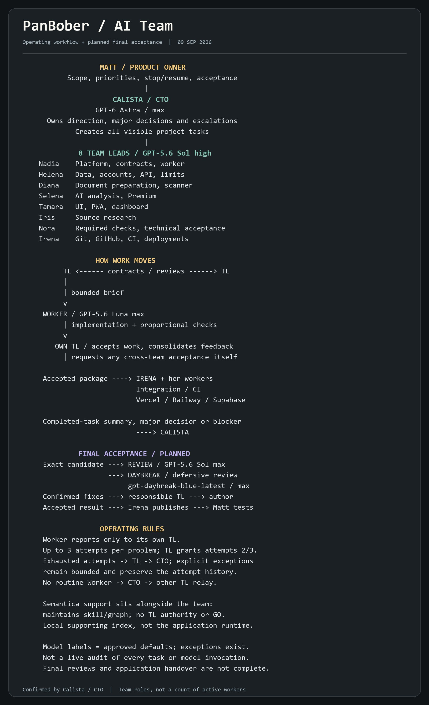

# @Voxyz_ai mine actual project — everything works very well (reply with demo screenshot)

> Source: https://x.com/zxdubx/status/2097837324688146698
> Author: Matt (@zxdubx)
> Posted: 2026-09-09T23:59:28Z
> Stats (at capture): 13,919 views · 91 likes · 6 replies · 1 reposts · 173 bookmarks · 0 quotes
> Captured: 2026-09-21T14:35:05Z

## Post

@Voxyz_ai Mine actual project 🫡 everything works very well

## Media

Photo (`media/media_0.jpg`, 1800×2955, 332 KB). Original: https://pbs.twimg.com/media/HR0D7O5b0AAGbrB.jpg?name=orig

## Author bio (at capture)

AI Product Builder
Time to write something serious here...
nah I'm just an honest guy working with AI

## Thread

Reply to @Voxyz_ai ([parent status](https://x.com/Voxyz_ai/status/2097814698204832116)). No further author self-replies recovered (`replying_to` set; parent out of batch scope).

## Comments

6 replies per API. 0 visible. Bridge (logged-in, own tab, page URL verified before every extract, 3–8 scroll rounds per tweet): conversation returned only the main-post `<article>`; 0 reply `<article>` elements visible on any of the 15 tweets (one transient 2nd `<article>` on 2097738059844657256 was the embedded X-Article card, not a reply). A loading skeleton sat unresolved behind the reply position; reload did not resolve it — conversation endpoint not serving children to this session. fx/vx APIs return counts only, no reply list. `r.jina.ai` on `x.com`: AbuseAlleviation 403; on `fixupx.com`: login wall.

## Links

- https://x.com/Voxyz_ai/status/2097814698204832116
