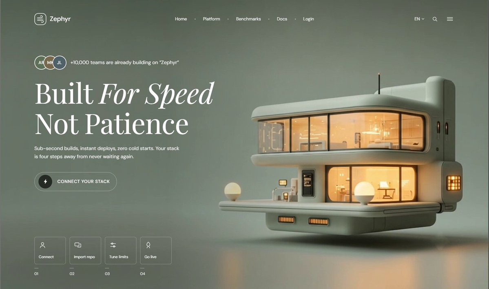

# Engineer a $15,000 premium 3D-driven SaaS hero: React, Three.js/WebGL, Tailwind, Framer Motion

> Source: https://x.com/himanshubuildss/status/2097912217207517412
> Author: Himanshu Hingorani (@himanshubuildss)
> Posted: 2026-09-10T04:57:04Z
> Stats (at capture): 14,966 views · 206 likes · 4 replies · 25 reposts · 253 bookmarks · 0 quotes
> Captured: 2026-09-21T14:35:05Z

## Post

99% of SaaS landing pages are just boring blocks of text and flat screenshots. 

🛑  Here is how to engineer a $15,000 premium, 3D-driven hero section with cinematic lighting and a floating WebGL focal point. 

☁️  I used Claude Code to build this ultra-clean frontend architecture from scratch. Zero bloated code.  

The exact frontend tech stack:  
✅ React & Next.js (Core component architecture)  
✅ Three.js / WebGL (Floating 3D render integration)  
✅ Tailwind CSS (Muted sage color palette & pixel-perfect grid)  
✅ Framer Motion (Smooth hover states & progressive navigation)  Stop building generic SaaS templates. Start building premium frontend web design that actually converts.  

Copy my exact AI build prompt below 🧵👇

## Media

[media/media_0.mp4](media/media_0.mp4)

9.0s video (`media/media_0.mp4`, 1678×992, 1.9 MB) + thumb (`media/thumb_0.jpg`, 81 KB). Original: https://video.twimg.com/amplify_video/2097912044351893504/vid/avc1/1678x992/0LjE0KzyVcjwNfsn.mp4?tag=29
Thumb original: https://pbs.twimg.com/amplify_video_thumb/2097912044351893504/img/r1ZmPFYm0zPBeFEf.jpg

## Author bio (at capture)

Founder @ http://www.scrolltide.co
Turning static websites into interactive experiences with AI ✦
200+ prompts & web inspiration ↓
Collab: himanshu@scrolltide.co
Website: https://www.scrolltide.co/

## Thread

None (`replying_to` null). No author self-replies recovered via bridge (0 reply articles visible).

## Comments

4 replies per API. 0 visible. Bridge (logged-in, own tab, page URL verified before every extract, 3–8 scroll rounds per tweet): conversation returned only the main-post `<article>`; 0 reply `<article>` elements visible on any of the 15 tweets (one transient 2nd `<article>` on 2097738059844657256 was the embedded X-Article card, not a reply). A loading skeleton sat unresolved behind the reply position; reload did not resolve it — conversation endpoint not serving children to this session. fx/vx APIs return counts only, no reply list. `r.jina.ai` on `x.com`: AbuseAlleviation 403; on `fixupx.com`: login wall.
