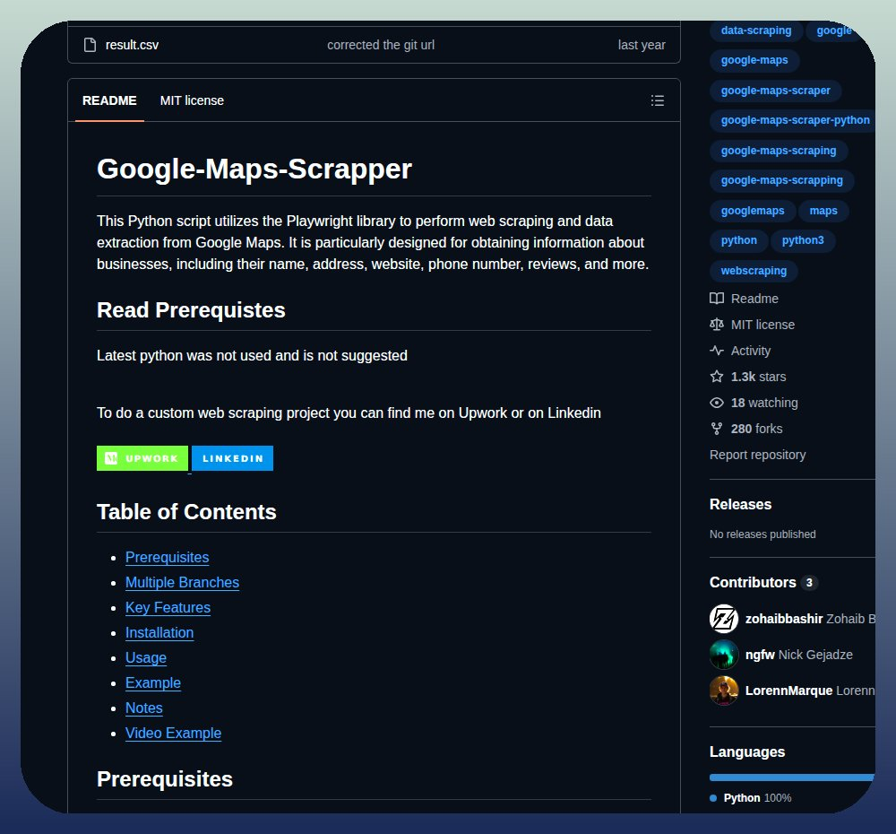

# Extracts business names, addresses, websites, contact details, and reviews from Google Maps listings and exports the

> Source: https://x.com/tom_doerr/status/2097920782823305690
> Author: Tom Dörr (@tom_doerr)
> Posted: 2026-09-10T05:31:06Z
> Stats (at capture): 27,264 views · 502 likes · 3 replies · 52 reposts · 802 bookmarks · 4 quotes
> Captured: 2026-09-21T14:34:50Z

## Post

@tom_doerr

Extracts business names, addresses, websites, contact details, and reviews from Google Maps listings and exports the data to a CSV.

https://github.com/zohaibbashir/Google-Maps-Scrapper

## Media

Photo (`media/photo.jpg`) — original: https://pbs.twimg.com/media/HR1P1Zka8AAuMr8.jpg?name=orig (1000x930)

## Author bio (at capture)

Follow for posts about GitHub repos, DSPy, and agents
Subscribe for top posts
DM to share your AI project (Due to volume of DMs I'll prioritize subscribers)

## Comments

### An_yhl ([@An_yhl](https://x.com/An_yhl)) — [2098153656189165933](https://x.com/An_yhl/status/2098153656189165933)

> Now organizing the local business list is so much easier.

### winspyredotcom ([@winspyredotcom](https://x.com/winspyredotcom)) — [2098107455121113477](https://x.com/winspyredotcom/status/2098107455121113477)

> Nice

### Pluvio9yte ([@Pluvio9yte](https://x.com/Pluvio9yte)) — [2101831273224311035](https://x.com/Pluvio9yte/status/2101831273224311035)

> 13h
> Translated from Chinese
> Show original
> Jev has been blowing up lately. If you've got the Jev API but don't know how to play around with it yet, you can just copy this checklist.
> 
> 1. jev-ultrafast
> A high-speed browser Agent built with Browser Use. Jev only judges "what to do, which element to click" at each step, and
> Show more
> GitHub - browser-use/jev-ultrafast: i. am. speed.

## Links

- https://github.com/zohaibbashir/Google-Maps-Scrapper
