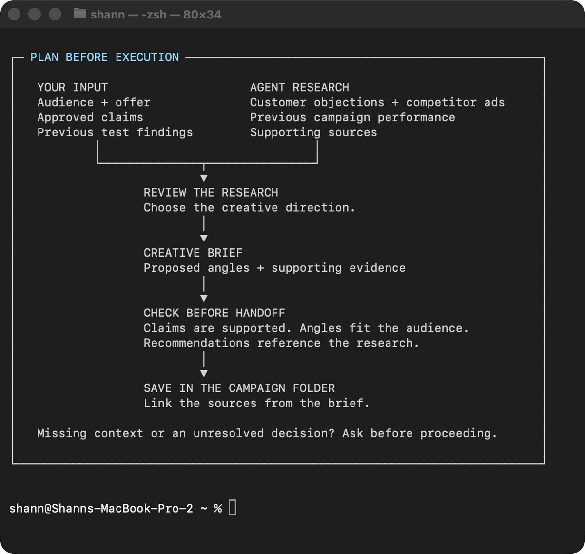
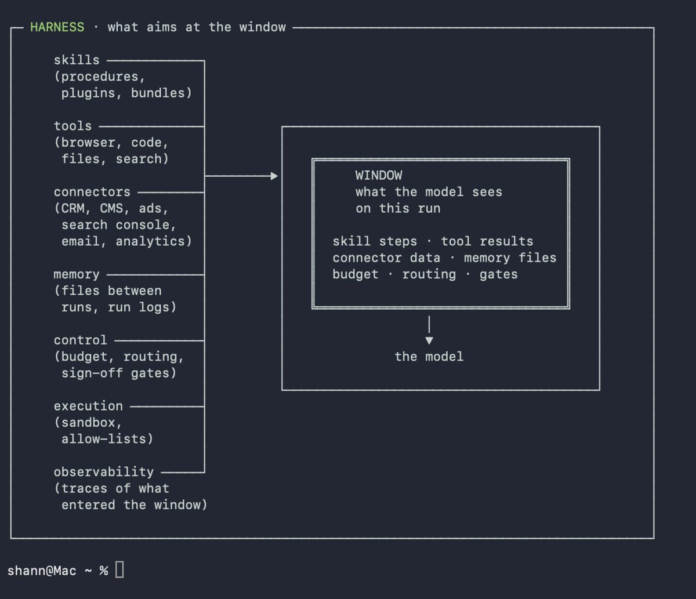
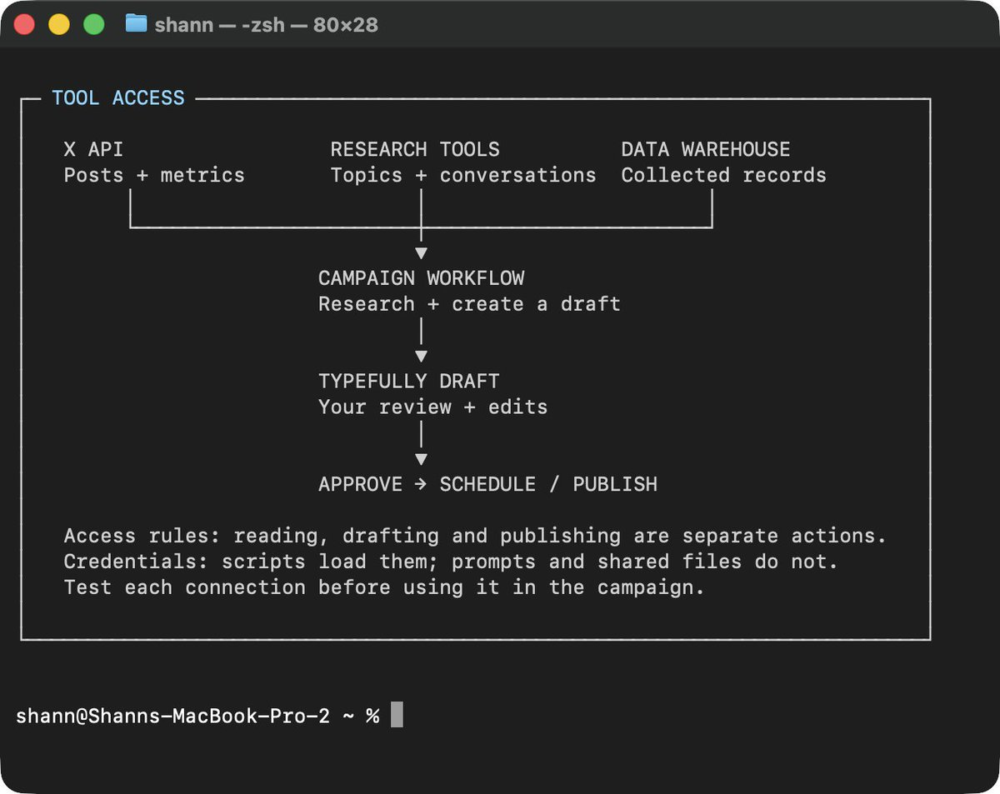
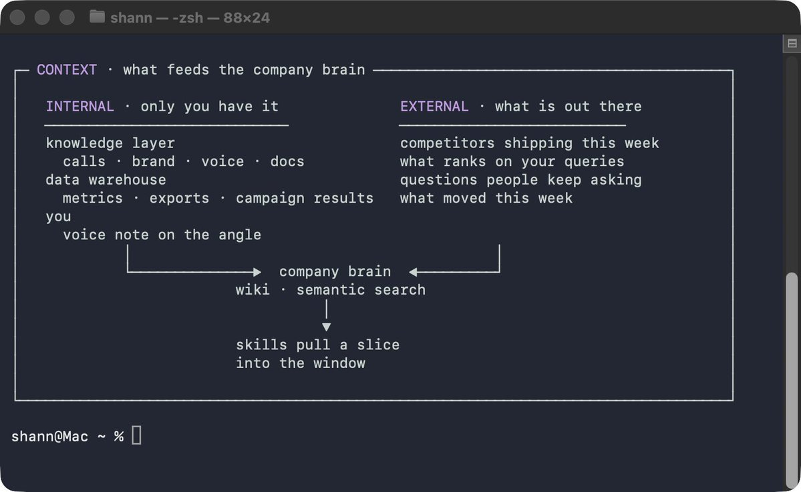
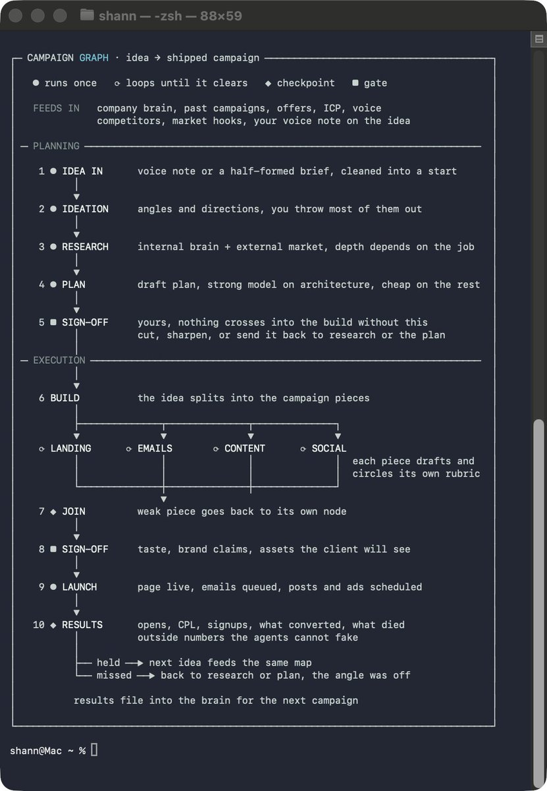
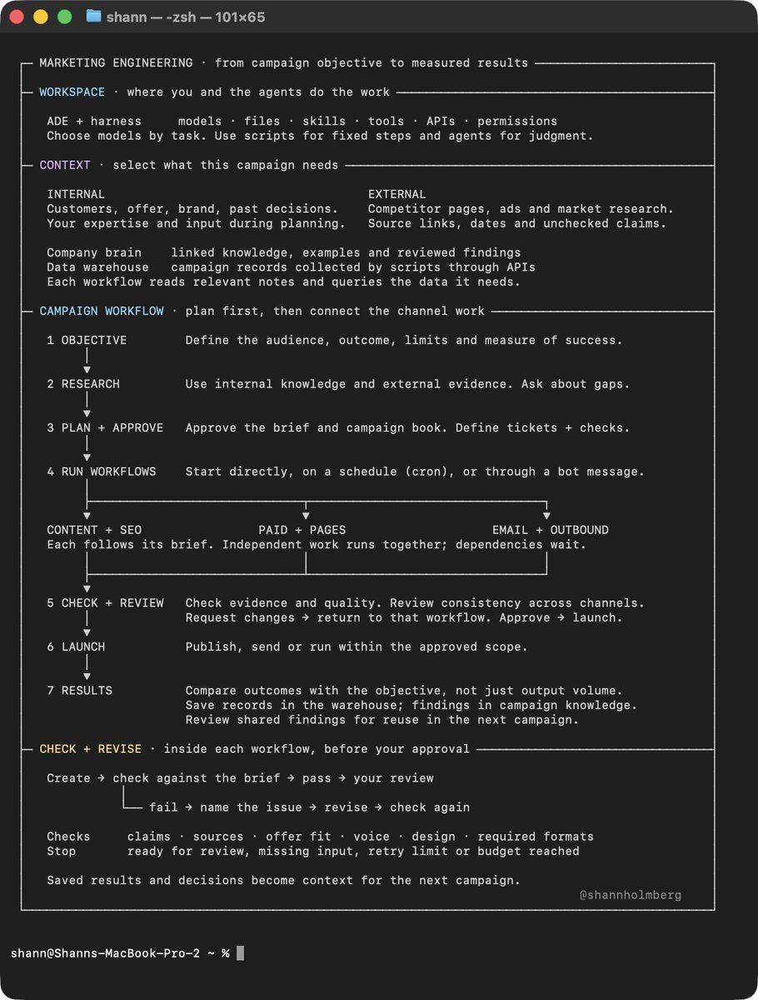
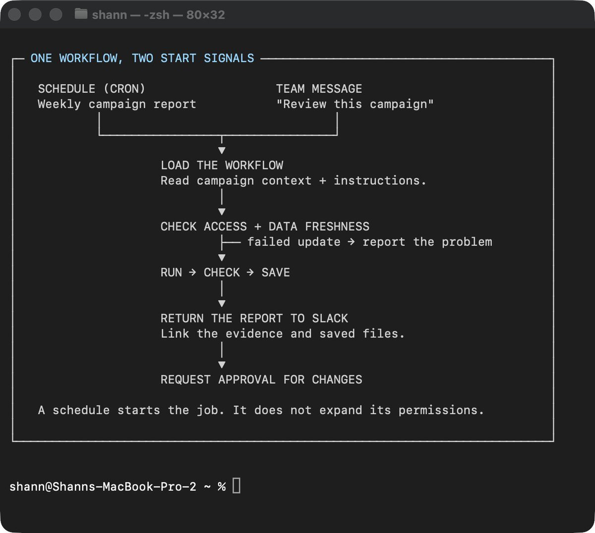
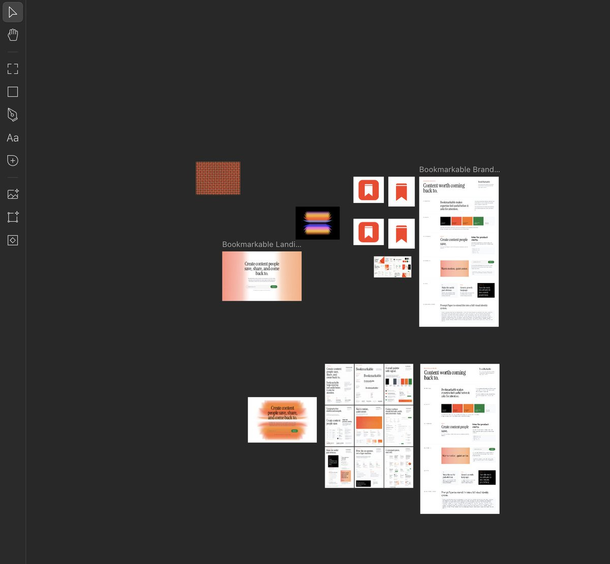

# https://x.com/i/article/2097715216951750656

> Source: https://x.com/shannholmberg/status/2098004743536750869
> Author: Shann³ (@shannholmberg)
> Posted: 2026-09-10T11:04:44Z
> Stats (at capture): 266,232 views · 871 likes · 30 replies · 86 reposts · 2,048 bookmarks · 9 quotes
> Captured: 2026-09-21T14:34:50Z

## Post

@shannholmberg

https://x.com/i/article/2097715216951750656

## Author bio (at capture)

I cover AI marketing & growth. Sharing every framework as I build it. 

Growth @lunarstrategy @turtledotxyz

## Linked article

[How to Become a Marketing Engineer](https://x.com/i/article/2097715216951750656)

marketing engineers build the systems behind the marketing. learn how to connect your knowledge, data and agents into workflows that research, plan and run campaigns.

I started bringing more of my marketing work into agent workspaces:

researching markets, planning campaigns, writing content and building landing pages.

across those projects, agents needed much of the same information. who we were targeting, what we were selling, what we’d tried before and what the results told us.

that meant connecting our knowledge and data, building workflows for different marketing tasks, and figuring out where agents needed my input.

over time, I could connect more of the campaign: research feeding the brief, the brief guiding production, and results informing what we tried next.

this is how I approach marketing engineering. this article walks through how to build those systems, starting with a task from your own workload.

> Embedded post: https://x.com/i/status/2089089731980406984

### What Is a Marketing Engineer?

a marketing engineer builds systems that do marketing work, using agents, connected data and context from the business.

that could be a content system that researches topics, develops campaign angles and creates assets using your customer research, offer and voice guide.

you review the work before publishing. connected workflows then track performance and save the results back into your knowledge database, ready to inform the next campaign.

your marketing knowledge shapes how the system works.

you decide what the agents need to know, which sources they should use, how to check their output and where the work needs your input.

take a launch campaign. the goal is to research 20 launches in your niche and use the findings to develop your own campaign.

a research workflow gathers launch posts, offers, landing pages and available performance data. your criteria guide which companies are relevant and what the agents should investigate, with instructions to separate evidence from assumptions.

that research joins your own context: audience, product, positioning, budget and previous campaign results.

agents can then suggest campaign angles and explain what informed them. after you review the direction and give feedback, connected workflows help produce the approved campaign.

if the suggestions are generic, there’s something to investigate. was the research too broad? was useful customer context missing? did the instructions leave out an important constraint?

improving those inputs and instructions is part of building the system too.

the role brings together skills from across marketing and engineering:

> Embedded post: https://x.com/i/status/2068816251229794671

you don’t need to cover every marketing vertical.

START WITH THE WORK YOU KNOW.

if you know content marketing, start there. that experience helps you choose useful sources, give agents better direction and recognize when a draft misses the point.

build a workflow around a task from your workload, use it and improve the context and instructions based on what comes back.

```
```markdown
SHARED KNOWLEDGE          CAMPAIGN CONTEXT
audience + offer         brief + research
        │                       │
        └───────────┬───────────┘
                    ↓
              WORKFLOW RUN
                    ↓
             drafts + review
                    ↓
            approved deliverables
                    ↓
             campaign results
                    ↓
          findings + your feedback
                    ↓
        context for the next campaign
```
```

### Start Working Directly With Agents

I do around 70% of my marketing work inside an Agent Development Environment, or ADE. my main workspace is Orca.

research, campaign planning, production assets, running subagents and reviewing what they return all happen here.

three terms worth understanding before we go further:

```
| source | what it can contribute |
|---|---|
| ad platform | campaigns, ads, spend, impressions and clicks |
| website analytics | visits, landing-page activity and tracked conversions |
| CRM | lead quality, sales outcomes and revenue |
| experiment records | the audience, offer and creative angle tested |
```



THE SETUP MATTERS

for a campaign, I want agents to read the project files, research using relevant sources and save their findings somewhere I can review them.

from there, we can work through the plan, create assets and check the output. I can give feedback, change direction or run other agents on separate tasks.

the brief, research and outputs stay in the workspace, so we can refer back to them as the campaign develops.

this includes production work that goes live. I’m not only using the ADE to prototype.

I also prototype with autonomous agents like Hermes, although open-ended work can burn through more tokens. I usually get more value from giving them something concrete to execute.

we’ll cover those bots later, including agents that support a team directly inside Slack.

first, let’s look at how to organize the marketing workspace.



### Build Your Marketing Agent Workspace

each project needs somewhere to keep its context, run its workflows and save what it produces.

I organize this by marketing vertical. content has its own area, SEO has another, and so on. shared knowledge sits alongside them so each vertical can use the same company information.

a basic setup could look like this:

```
| what happened | what to investigate |
|---|---|
| the research covered irrelevant companies | selection criteria and research instructions |
| recommendations missed an important customer objection | available customer context |
| the report used old numbers | data updates and freshness checks |
| the output looked correct but wasn’t useful | the brief and how you defined a good result |
```

START WITH ONE VERTICAL.

there’s no need to create all of this before doing anything useful. if you’re building a content workflow, start with the content folder and add what it needs.

> Embedded post: https://x.com/i/status/2085714361222369608

for a launch campaign, the content workflow might read the offer from shared knowledge, the voice guide from content knowledge and the brief from the active campaign folder.

research and drafts get saved into that campaign’s work area. approved assets go into outputs. after publishing, performance data and your review go into results and learnings.

the folder names alone won’t tell an agent how to work.

add a short Markdown file explaining where to find things, which sources to use and where to save the output. individual workflows can then reference the files they need.

we’ll get into skills, agents and workflows as we go. for now, the aim is to give your first project a setup you and your agents can use.

the folders give the work somewhere to live. next, we need to connect the tools and data the workflows will use.

### Connect Your Tools and Data

for my content workflow to work properly, it needs access to X and Typefully.

the X connection lets it retrieve posts and available performance data for research and analysis. the Typefully connection lets it create drafts where I can review, edit and schedule them.

these connections use APIs, a way for software to request information or take actions in another tool.

start with what the workflow needs to do:

```
| connection | what it makes possible |
|---|---|
| X API | research posts and retrieve available performance data |
| Typefully API | create drafts and schedule approved content |
| research tools and skills | investigate topics, competitors and conversations beyond your own accounts |
| your data warehouse | query the data you’ve collected across marketing sources |
```

each API connection needs an integration or script that handles the requests. the agent needs instructions explaining when to use it and what it can do.

```
```md
# produce the paid creative set

assigned to: paid creative agent
status: waiting for approval of the offer and campaign book

## before starting
confirm the offer and campaign book are approved.
use creative-brief.md for the angles, formats and deliverables.
use approved-claims.md for what the ads can promise.

## produce
- editable designs following the campaign book
- exports in each format specified in the brief
- a review report linking each ad to its angle and checks

## ready for my review when
- [ ] every deliverable in the brief is accounted for
- [ ] claims match approved-claims.md
- [ ] formats and dimensions match the brief
- [ ] exported images have readable text and accurate product details
- [ ] designs, exports and review report are linked in this ticket

## update this ticket
if blocked, name the missing input or decision.
otherwise, mark ready for review. do not publish.
```
```

YOU DON’T HAVE TO BUILD EVERY CONNECTION YOURSELF.

I also use /last30days for recent conversations and developments around a topic.

it combines research across sources such as X, Reddit, YouTube and the web, using APIs and tools underneath. the sources available depend on your setup and credentials. skill documentation

for a content campaign, I might use it to investigate what people in our niche have been discussing over the past month. what questions keep coming up? what are people frustrated with? which topics are getting attention?

the useful findings get saved into the campaign’s research files, alongside our customer knowledge and previous results.

the skill provides the research process, and its connections provide access to the sources. we still need to check the findings and decide what’s relevant.

where do the API keys go?

some connections require an API key or another form of authentication.

in a local setup, credentials can be loaded from a .env file, a configuration file that your scripts read. keep it excluded from Git and out of shared folders. don’t put keys in prompts, campaign briefs or knowledge files.

workspace instructions can explain how to use an integration without including its credentials.

> Embedded post: https://x.com/i/status/2087539757052285200

access needs limits too.

researching posts requires permission to read data. creating a draft and publishing it are separate actions.

for my content workflow, I want to review the draft before anything goes live. that approval step needs to be part of the workflow, with publishing access restricted where the tool supports it.

start by testing a small task: retrieve a few posts or create a draft. check that it worked before connecting it to the rest of the campaign.

later, we’ll cover how data from these sources gets collected, updated and stored in your Marketing Data Layer.

### Build Your Knowledge Layer

a workflow needs to understand the audience, the offer, what you want to achieve and what’s already been tried.

I split that context into internal and external knowledge.

```
| recurring job | what it does | where the result goes |
|---|---|---|
| daily data update | collect new campaign records and refresh performance metrics | data warehouse |
| weekly competitor review | research changes to relevant offers, ads and landing pages | research files and a team summary |
| weekly campaign report | compare performance with campaign goals and flag questions | campaign ticket and Slack |
| pre-launch check | check scheduled assets for dates, links and offer consistency | review report |
```

CONNECT WHAT THE BUSINESS KNOWS WITH WHAT’S HAPPENING OUTSIDE IT.

say you’re planning a campaign.

customer calls might reveal a question buyers keep asking before purchasing. external research can investigate how people discuss that problem, what they search for and how competitors address it.

combine those findings with your product information and previous campaign results, and agents have useful material to develop campaign angles from.

```
| internal context | external context |
|---|---|
| product details, offers and positioning | competitor products, offers and campaigns |
| customer calls, CRM notes and support conversations | public discussions, reviews and customer questions |
| your expertise, examples and input during planning | industry research and market developments |
| previous campaigns, warehouse data and results | search demand and keyword research |
```

```
```md
/goal prepare a creative brief for the next round of paid ads.

use audience.md, approved-claims.md, campaign-book/
and previous-test-results.md as context.

research and propose 3 angles. explain who each angle is for,
what informed it and how it differs from previous tests.
link the supporting sources and flag assumptions.

check each angle against the audience and approved claims.
save the brief to creative-brief.md in the campaign folder.

stop when the brief is ready for my review.
do not produce or publish ads. ask if required context is missing.
```
```

the workflow needs instructions for what to investigate, which sources to use and where to save the findings. /last30days could support the conversation research; a search-data API could supply keyword data.

YOUR EXPERTISE NEEDS TO MAKE IT INTO THE CONTEXT TOO.

take a paid campaign. an agent can research competitor ads and suggest creative directions, but it also needs your offer, customer objections, past test results and the claims you can actually support.

your input during planning matters here. a voice note explaining why a previous campaign attracted the wrong buyers can help shape the next brief.

when reviewing new ad concepts, save the reasoning behind your feedback. “this promises a result our product doesn’t deliver” gives the next run something specific to check.

a basic knowledge setup could look like this:

```
```markdown
READY TICKET
     ↓
create or revise ←──────────────┐
     ↓                         │
run checks                     │
     ├── fail → specific fixes ┘
     │          within retry budget
     ├── blocked / budget reached → ask for input
     │
     └── pass → ready for your review
                        │
             ┌──────────┴──────────┐
             ↓                     ↓
       request changes          approve
       → revise again           → next task
```
```

.md files are plain-text documents you and your agents can read and edit.

competitor ads and landing pages provide external context. customer knowledge, campaign results and your feedback provide internal context.

the workflow brings the relevant material into the creative brief. performance numbers can stay in the warehouse, with findings in the knowledge files pointing back to the supporting data.

keep campaign-specific research with its campaign. move useful, reusable findings into the shared or vertical knowledge files when they’re relevant beyond that project.

```
```markdown
shared-knowledge/
├── audience.md
├── product-and-offer.md
└── positioning.md

paid-and-creative/knowledge/
├── customer-objections.md
├── approved-claims.md
└── creative-test-learnings.md
```
```

each workflow should reference the material it needs. a research agent might need the audience, offer and research brief. the production agent also needs the approved direction, campaign book and examples.

include sources and dates with research, and label assumptions or ideas that haven’t been checked. agents need to distinguish an approved positioning decision from something someone suggested in a meeting.

> Embedded post: https://x.com/i/status/2094704183345922356

### Build Your Marketing Data Layer

say you’re using agents to plan the next round of ad creative.

they need to know what happened with the last round. which ads brought visitors, which visitors converted, and whether those conversions became customers.

that information often lives in different tools:



a data warehouse brings those records into one place where your workflows can query them. it can start as a small database.

a script can fetch and store campaign data. an agent can use that data to investigate performance and draft recommendations.

```
```markdown
AD PLATFORM + WEBSITE ANALYTICS + CRM
                    ↓
        scheduled collection and updates
                    ↓
              DATA WAREHOUSE
                    ↓
       campaign analysis and creative briefs
```
```

AN API CONNECTION DOESN’T KEEP THE DATA UPDATED BY ITSELF

scripts or integrations need to collect new records and refresh existing ones. recurring jobs can run those updates on a schedule, often using cron jobs, which start a task at a set time.

```
| ticket | depends on | status |
|---|---|---|
| approve campaign offer | customer and competitor research | needs my input |
| build landing page | approved offer and campaign book | waiting |
| produce paid creative | approved offer and campaign book | waiting |
| check ad-to-page consistency | landing page and paid creative | waiting |
```

the records also need a way to connect.

campaign and ad IDs identify what ran. tracking parameters on links help identify where website visits came from. where that information carries through to the CRM, you can connect leads and sales back to the campaign.

those connections won’t always be complete. the workflow should flag missing tracking or unavailable data rather than confidently attribute every sale.

START WITH A QUESTION YOU WANT ANSWERED.

> which creative angles brought qualified leads last month, and what should we test next?

answering that requires more than click counts. the workflow needs campaign spend, lead outcomes and a record of which angle each ad tested.

with those records connected, an agent can compare results and prepare recommendations using the campaign brief and customer context.

your review might add something the numbers don’t explain: sales followed up late, the offer changed halfway through, or one ad made a promise that attracted the wrong buyers.

save those findings alongside the campaign, with references to the supporting data. the next planning workflow can use both the results and your explanation of them.

### Build Your First Workflow

pick a task you already do often enough to recognize a good result.

for paid campaigns, that might be turning customer research and previous campaign results into a brief for the next round of creative.

that’s enough for a first workflow. publishing ads and changing budgets can come later.

PLAN IT BEFORE YOU RUN IT.

I usually start by talking through what I need for 5–10 minutes with a transcription tool.

the goal, the campaign context, what I’ve already tried, what I’m unsure about. it doesn’t need to come out neatly. that’s what the planning session is for.

then I work through it with an agent, using Matt Pocock’s planning skills to question the brief and build out the plan.

this is where I spend time answering questions and adding context. if the agent asks what makes a lead qualified, the answer affects which campaign results it should use. if we haven’t agreed on the offer, we’re not ready to generate creative around it.

the plan should make a few things clear:

```
```md
/goal produce the paid creative set listed in campaign-plan.md.

use campaign-book.md and approved-claims.md.
run the checks in creative-checklist.md.
fix failed checks and save the exports with a review report.

stop when the checks pass and the set is ready for my review.
do not publish. ask if an unresolved decision blocks progress.
```
```

once the plan and context files are ready, you could start with this:

```
| draws from | how it helps you build |
|---|---|
| product marketing | give agents the customer, positioning and offer context they need |
| content & creative | define voice, provide examples and review the assets produced |
| growth & performance | build workflows around campaign tests and measurable outcomes |
| marketing ops & automation | connect tools and define how work moves between them |
| analytics | give agents reliable data and check their interpretation of results |
| engineering | connect APIs, write code with agents and test workflows |
```

```
| workflow | how it works |
|---|---|
| **competitor website monitoring** | collect competitor pages on a schedule → detect changes → have an agent explain what changed → send a briefing with source links |
| **competitor creative library** | collect new competitor ads → transcribe videos and analyze images → save searchable references → use them alongside customer research when developing campaign angles |
| **podcast-to-team content** | collect transcripts from selected industry podcasts → extract relevant insights → combine them with each team member’s expertise → draft posts for review → schedule approved content |
| **SEO production** | research keywords and competing pages → develop the angle with your input → create the outline, draft and visuals → run writing and visual checks → prepare for publishing |
| **paid ad creative and testing** | review previous campaign results, customer objections and competitor ads → propose test angles → produce assets using the campaign book → approve and launch → feed results into the next brief |
| **content repurposing** | take an approved article, webinar or interview → identify ideas worth adapting → create channel-specific posts, emails and clips → check accuracy and formatting → review and schedule |
| **email campaign production** | combine the offer, audience segments and customer questions → plan the sequence → draft copy and layouts → check links, timing and segment rules → approve sending → review results |
| **landing-page production and testing** | combine the campaign brief, incoming ad messages and customer objections → build the page → check design, forms and tracking → approve launch → use results to propose the next test |
| **creator campaign research** | research relevant creators → compare audience fit, previous results and rates → prepare a shortlist and briefs → approve partnerships → track delivery and performance |
```

RUN IT WITH YOUR INPUT FIRST

have the agent work through the plan, saving the research and decisions as it goes.

review what comes back. if the competitor research is irrelevant, fix the selection criteria before it feeds the brief. if the proposed angles ignore a customer objection, check whether that information was available and whether the instructions asked the agent to use it.

as the process takes shape, save the steps as a reusable workflow. point it to the files, tools and checks it needs, and make clear which inputs change between campaigns.

the first version will need adjustments. use it on a campaign, keep the changes that improve the result and test it again on the next brief.

### Connect Workflows Across a Campaign

I overbuilt an earlier version of my content system. four agents for what was essentially three production steps and a feedback loop. improving the context feeding the writer mattered more than adding agents.

you can plan the whole campaign upfront. build the workflows around what it needs to produce, then decide where separate agents help.

the multi-channel example below shows how those workflows connect. you don’t need a bot for every vertical before you start.

say you’re launching a product. the campaign needs a landing page, paid creative, launch content, email sequences and outbound.

each vertical has its own workflow, but they all need to work from the same offer, audience and launch plan.

PLAN THE CAMPAIGN TOGETHER & BUILD THROUGH THE VERTICALS

I’d start with a campaign planning session using Matt’s skills, working through the objective, research, channels, deliverables and decisions that need my input.

```
```markdown
┌───────────────────────────────────────────────┐
│ RESEARCH                                      │
│ Save the finding, source and date.            │
│ Label unverified claims.                      │
└───────────────────────┬───────────────────────┘
                        │
                        ▼
┌───────────────────────────────────────────────┐
│ YOUR REVIEW                                   │
│ Check the evidence and campaign relevance.    │
│ Record your decision and its reason.          │
└───────────────────────┬───────────────────────┘
                        │
            ┌───────────┴─────────────┐
            ▼                         ▼
┌───────────────────────┐ ┌───────────────────────┐
│ CAMPAIGN KNOWLEDGE     │ │ SHARED KNOWLEDGE       │
│ Findings for this     │ │ Reviewed findings     │
│ campaign.             │ │ useful across         │
│                       │ │ campaigns.            │
└───────────────────────┘ └───────────────────────┘
```
```

the result becomes a shared campaign brief. each vertical gets a more specific brief referencing it.

> Embedded post: https://x.com/i/status/2094145545824829841

GIVE THE CAMPAIGN A SHARED VISUAL REFERENCE.

for a specific campaign, I like to use Paper or Figma to create a visual moodboard and campaign book that every vertical can reference.



the moodboard helps explore the direction: imagery, typography, colors and layouts. the campaign book records what we’ve approved, with examples for ads, landing pages, social posts and email.

with the right tools connected, agents can use that direction to build layouts and visual assets in code, then produce variations across formats and channels. I can review the designs, give feedback and have those changes applied across the asset set.

the same book provides references for image-generation models. for product shots, that might include approved product images, lighting, backgrounds and composition, alongside instructions for what must stay accurate.

generated images can then be placed into the coded layouts to produce the campaign assets.



once we have a direction and templates that work, we can produce more variations without briefing every asset from scratch. the outputs still need review, especially product details, text and consistency with the approved design.



research can serve several workflows. customer objections might inform the landing page, ad concepts and email sequence.

save that research once in the campaign folder and have the relevant workflows reference it. their outputs can stay inside each vertical’s work area, with links from the campaign plan.

WHAT CAN RUN IN PARALLEL?

competitor research, a review of previous campaigns and prospect research can run at the same time.

final copy needs an agreed offer. ads need a destination. follow-up emails need to match what someone actually signed up for.

```
```
┌────────────────────────┐    ┌────────────────────────┐    ┌────────────────────────┐    ┌────────────────────────┐    ┌────────────────────────┐
│ CHANNEL DATA           │    │ SCRIPT                 │    │ WAREHOUSE              │    │ AGENT ANALYSIS         │    │ YOUR REVIEW            │
│                        │    │                        │    │                        │    │                        │    │                        │
│ ads, analytics + CRM   ├───▶│ fetch + check records  ├───▶│ linked campaign data   ├───▶│ read data + context    ├───▶│ check the evidence     │
│ activity + results     │    │ update stored data     │    │ queryable history      │    │ propose next tests     │    │ choose the next tests  │
│                        │    │                        │    │                        │    │                        │    │                        │
└────────────┬───────────┘    └────────────────────────┘    └────────────────────────┘    └────────────────────────┘    └────────────┬───────────┘
             ▲                                                                                                                       │
             │                                                                                                                       │
             │                                                                                                                       ▼
┌────────────┴───────────┐                                  ┌────────────────────────┐                                  ┌────────────┴───────────┐
│ CAMPAIGN EXECUTION     │                                  │ NEXT CAMPAIGN BRIEF    │                                  │ SAVE                   │
│                        │                                  │                        │                                  │                        │
│ run approved tests     ◀──────────────────────────────────┤ use saved findings     ◀──────────────────────────────────┤ record decisions       │
│ generate new results   │                                  │ plan + approve tests   │                                  │ link the evidence      │
│                        │                                  │                        │                                  │                        │
└────────────────────────┘                                  └────────────────────────┘                                  └────────────────────────┘
```
```

TRACK THE CAMPAIGN THROUGH TICKETS

during planning, we break the campaign into tickets that agents can work through.

each ticket describes the deliverable, references the relevant context and lists the checks required before it’s ready for review. it also records dependencies, who or which agent is handling it, and links to the output.

```
```markdown
campaign/
├── brief.md              ← audience, offer, goal
├── campaign-book/        ← approved visual direction
├── research/             ← shared across channels
├── tickets/              ← tasks and dependencies
├── landing-page/
├── paid/
├── email/
└── results/              ← informs the next campaign
```
```

a production ticket could look like this:

> Embedded post: https://x.com/i/status/2070153493747495170

the coordinating agent reads the tickets, identifies which ones are ready and assigns them to specialist agents. a specialist runs its workflow and review loop, then updates the ticket with the output, check results and any questions.

if a task needs a decision from me, the ticket records the specific question. other independent work can continue.

I can review the campaign through that same board: what’s running, what needs my attention and what’s ready to approve.

each specialist gets the relevant campaign context, its vertical instructions and a clear deliverable. the shared plan gets updated as work is completed or decisions change.

if I change the offer during review, that affects several channels. the coordinator needs to identify the affected assets and send them back for revision before launch.

REVIEW THE CAMPAIGN AS A WHOLE TOO

individual assets can pass their checks and still disagree with each other.

does the ad promise what the landing page delivers? does the email use the same offer? are the dates, links and claims consistent?

after launch, results from each channel feed the campaign review. findings worth reusing go back into the relevant knowledge files, so future workflows can use them.



### Use Loops to Work Toward a Goal

once a workflow has clear steps and checks, you can have an agent repeat parts of it until the output meets the requirements.

that’s a loop.

for the campaign we just planned, take a set of paid creative assets. the agent builds them using the approved brief and campaign book, then checks the exports.

are the dimensions correct? is any text clipped? does the offer match the landing page? are the product details accurate?

failed checks go back with specific feedback. the agent revises the affected assets and checks again.

> Embedded post: https://x.com/i/status/2091804800757494169

DEFINE WHAT DONE LOOKS LIKE.

“make the creative better” gives the agent very little to work with.

a useful goal names the deliverable, points to the plan and defines when to stop. for example:

```
| vertical | what its workflow produces | context it needs |
|---|---|---|
| landing page / CRO | page copy, page build and tracking setup | offer, audience, approved claims and conversion goal |
| paid & creative | ad concepts, assets and test plan | campaign messaging, budget, previous tests and landing page |
| content | launch posts and supporting assets | campaign angles, product details and channel examples |
| lifecycle / email | launch and follow-up sequences | offer, audience segments, timing and signup events |
| outbound | prospect research and outreach drafts | account criteria, buying signals and approved messaging |
```

I use /goal for this kind of work. the prompt stays short, while the supporting files hold the research, requirements and decisions from planning.

the loop also needs limits: a time or token budget, a retry limit and instructions for when to ask for help.

if it keeps failing the same check, I want to know why. it might need a missing product reference, a different tool or a decision from me.

PASSING THE CHECKS DOESN’T MEAN I’LL LIKE THE CREATIVE

some checks are straightforward to automate, like dimensions or missing files. others need visual review and marketing judgment.

an independent review agent can help identify problems, but I still review the creative direction and decide what goes live. that feedback can become part of the next run’s instructions.

across a larger campaign, several workflows can run their own loops at the same time. paid creative can go through revisions while email checks its sequence and the landing-page workflow tests the page.

an agent picks up a ready ticket and works through its workflow. the loop checks the output and sends failures back for revision.

once the checks pass, the agent adds the output and review report to the ticket and marks it ready for my review.

### Recurring Jobs and Autonomous Bots

some marketing work needs to happen regularly: refreshing campaign data, checking competitor activity or preparing the weekly performance report.

once a workflow can handle that task reliably, you can give it a recurring job.

a cron job starts a task on a schedule. it might run every morning or once a week. the workflow defines what happens after it starts.

```
| area | what belongs here |
|---|---|
| shared knowledge | company information used across verticals: product, audience, positioning and brand guidelines |
| vertical knowledge | relevant research, examples and guidance, such as a voice guide or SEO research |
| work | active campaigns, briefs, plans and work in progress |
| workflows | the steps and connections that take a task from its inputs to a finished output |
| skills, agents & code | reusable instructions, agent definitions and scripts those workflows use |
| outputs | the assets and deliverables produced |
| results & learnings | performance reports, feedback and findings worth using again |
```

A SCHEDULE DOESN’T FIX AN UNFINISHED WORKFLOW

test the task first. define what it can access, what it should produce, how to check the result and what happens if something fails.

a reporting job should flag a failed data update. it shouldn’t quietly write a confident report using last week’s numbers.

for work that changes or sends something, decide what needs approval. preparing a report, creating a draft and changing an ad budget need different permissions.

YOUR TEAM CAN GIVE AGENTS WORK TOO

a bot is a dedicated agent your team can give work to, with its own instructions, tools and access to relevant context. it can respond to messages or run jobs on a schedule.

a Hermes agent inside Slack is one example. someone could ask:

> review last week’s paid campaign results, compare them with the previous week and prepare a creative brief for the next test.

the bot needs access to the relevant data, campaign context and workflow. it can return the report and brief to the conversation, with links to the saved files and any questions that need a decision.

the same bot might answer questions from company knowledge or run a scheduled report. a message starts one job; a schedule starts another.

```
```markdown
APPROVED CAMPAIGN BOOK
references + layouts + product images
                 │
         ┌───────┴────────┐
         ↓                ↓
    coded layouts    image generation
    page / ad / email  product / scene
         │                │
         └───────┬────────┘
                 ↓
        assembled campaign designs
                 ↓
         your visual review
                 ↓
          approved variations
```
```

a workflow can stay in the main workspace, run as a recurring job or become part of a dedicated bot. choose based on how the work needs to happen and how much input it needs from you.

### Marketing Workflows You Can Build

these are examples of jobs you can build workflows around. choose one that fits your workload and the data you can access.

```
| term | what it means |
|---|---|
| model | the AI you choose for a task, such as researching, planning or writing |
| harness | the software around the model that gives it access to files, tools and code execution, and controls what it can do |
| ADE | Agent Development Environment: the interface where you work directly with agents, review their actions and guide the work |
```

creator campaign research specifically can be combined with toolings like @creator_wire, that we´re currently building out. 

### Build a Workflow for a Task You Already Do

pick a task you understand well enough to judge the result.

it could be researching competitors for an upcoming launch, preparing a paid creative brief or reviewing where leads drop out of an email sequence.

choose a task from your current workload, so you have a deadline, requirements and someone who will use the output.

MAKE THE FIRST WORKFLOW USEFUL

give it the context and access that task requires. work through the plan with an agent, then run it with your input.

keep track of where you step in. those moments tell you what needs improving:



fix what you find, then run the workflow again for the next campaign or reporting period. that helps you see whether it’s reusable or was relying on instructions buried in the previous conversation.

once it’s useful, connect the next step. a research workflow can feed a brief. an approved brief can feed production. campaign results can feed the next planning session.

add loops where repeated checking helps. use recurring jobs where the task needs to happen regularly. create a bot when there’s a defined job it can handle for you or the team.

KEEP THE EVIDENCE OF WHAT YOU BUILT.

save the brief, workflow, example output and results. record what still needs your input, what failed and what you changed.

that gives you something concrete to improve, and something you can show a teammate

you don’t need every piece of this article running before you start doing marketing engineering.

pick a task from your workload, open a workspace and build your first workflow.

- shann


## Comments

30 replies on the original per API; no other replies rendered in the logged-in bridge session at capture.

## Links

- https://x.com/i/article/2097715216951750656
- https://x.com/i/status/2089089731980406984
- https://x.com/i/status/2068816251229794671
- https://x.com/i/status/2085714361222369608
- https://github.com/mvanhorn/last30days-skill
- https://x.com/i/status/2087539757052285200
- https://x.com/i/status/2094704183345922356
- https://x.com/i/status/2094145545824829841
- https://x.com/i/status/2070153493747495170
- https://x.com/i/status/2091804800757494169
