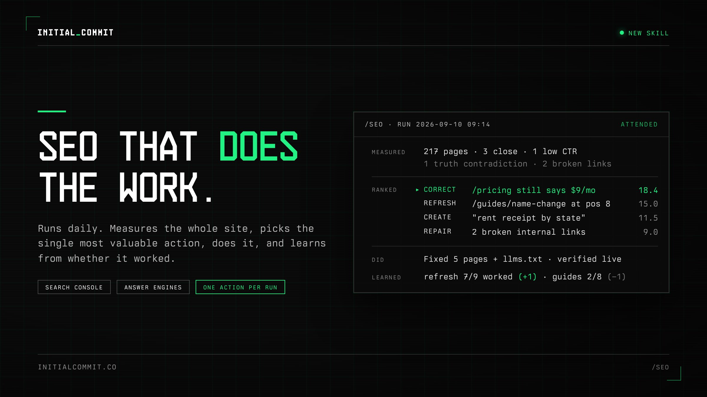

# Massive new Initial Commit skill drop! An 89-file behemoth! https://initialcommit.co/library/skills/seo Most SEO tools

> Source: https://x.com/Shpigford/status/2098030074683367691
> Author: Josh Pigford (@Shpigford)
> Posted: 2026-09-10T12:45:23Z
> Stats (at capture): 52,856 views · 148 likes · 12 replies · 2 reposts · 542 bookmarks · 3 quotes
> Captured: 2026-09-21T14:34:50Z

## Post

@Shpigford

Massive new Initial Commit skill drop! An 89-file behemoth!

https://initialcommit.co/library/skills/seo

Most SEO tools tell you what to do. /seo does it: each run measures your site, ranks every possible action on one scale (fix a wrong claim, repair a broken redirect, refresh a page sitting at position 8, consolidate duplicates, write the next piece, build a free tool, get cited by ChatGPT), and executes the single best one. 

It scores its own past actions against your site's real numbers, so a month in, it knows which moves work on your site and which don't.

- One action per run. Ranks every possible fix, refresh, and new piece on one scale, does the winner.
- Learns from results. Scores past actions against real Search Console data and adjusts.
- Truth check. Finds live pages that contradict your pricing, features, or facts, and fixes them first.
- Answer-engine visibility. What ChatGPT, Claude, Perplexity and AI Overviews say and cite.
- Whole-site census. Every URL judged. Pruning scores like publishing.
- Outside-in demand. Reddit, Hacker News, on-site search, competitors, seasonality.
- Weekly deltas. Competitor pages and keywords, lost backlinks, inbound 404s, unlinked mentions.
- Internal link finder. Pages that mention a topic but don't link to the page that ranks for it.
- Files, CMS, or database. Database fixes ship as migrations or drafts.
- Runs on Search Console alone. Suggests new data sources along with what each added connection unlocks.

You basically just run /seo repeatedly. Daily. Multiple times a day. Weekly. On a /loop. Whatever you want. It just constantly improves your SEO.

On the content-production front, it's optimized for a TON of content types...

Editorial
- Pillar guide
- How-to / tutorial
- Listicle / roundup
- Definition / answer page
- Comparison
- Data study / original research
- Resource / template library
- Opinion
- Case study / teardown

Programmatic
- /alternatives/[competitor]
- /for/[use-case] and /for/[audience]
- /compare/[a]-vs-[b]
- /playbooks/[topic]
- /tools/[axis], one tool template across an entity axis
- Plus twelve playbooks for the data side: templates, curation, conversions, comparisons, examples, locations, personas, integrations, glossary, translations, directory, profiles

Free tools (interactive, built and shipped)
- Calculator
- Generator
- Analyzer / checker
- Tester / preview
- Lookup / database
- Converter / formatter
- Quiz / assessment

Not new content, but output
- Corrections and refreshes to existing pages
- Schema / JSON-LD
- llms.txt, robots and sitemap fixes
- Social drafts, outreach and directory briefs

I've been running various iterations of this a dozen times a day for months.

## Media

Photo (`media/photo.jpg`) — original: https://pbs.twimg.com/media/HR2yA1SW0AcyZm6.jpg?name=orig (2400x1350)

## Author bio (at capture)

✨ dabbler 🙅‍♂️ building http://knockoff.co to protect ecommerce brands from imposters 🪨 http://granite.co 🫶 http://keptwell.org 🧊 http://nurb.app

## Comments

12 replies on the original per API; no other replies rendered in the logged-in bridge session at capture.

## Links

- https://initialcommit.co/library/skills/seo
