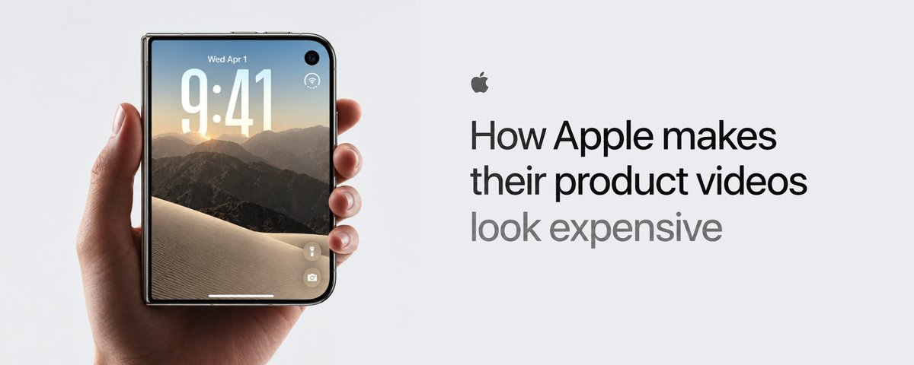
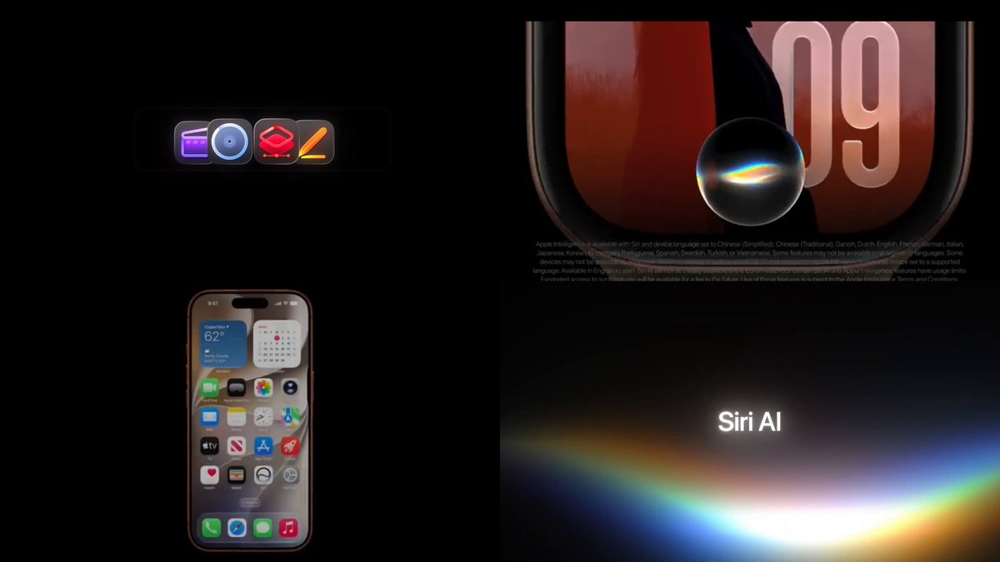
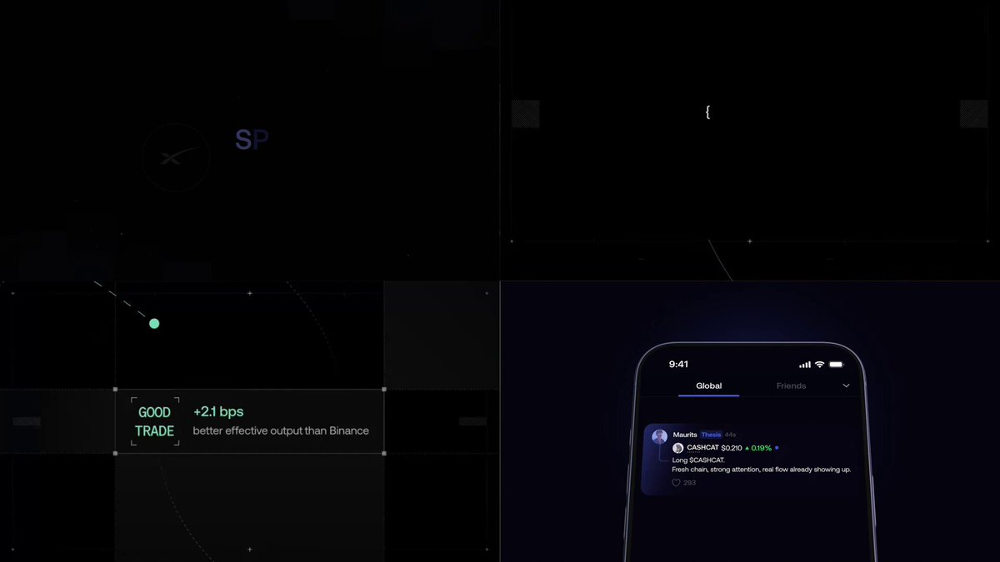
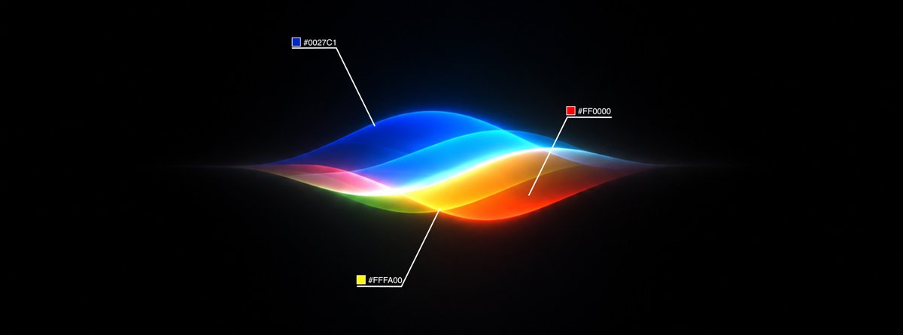
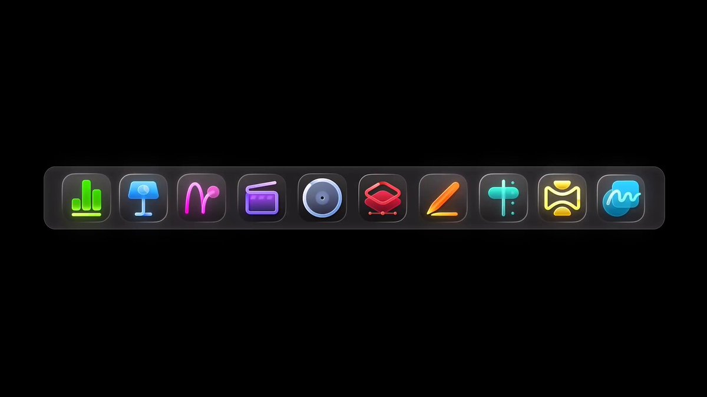
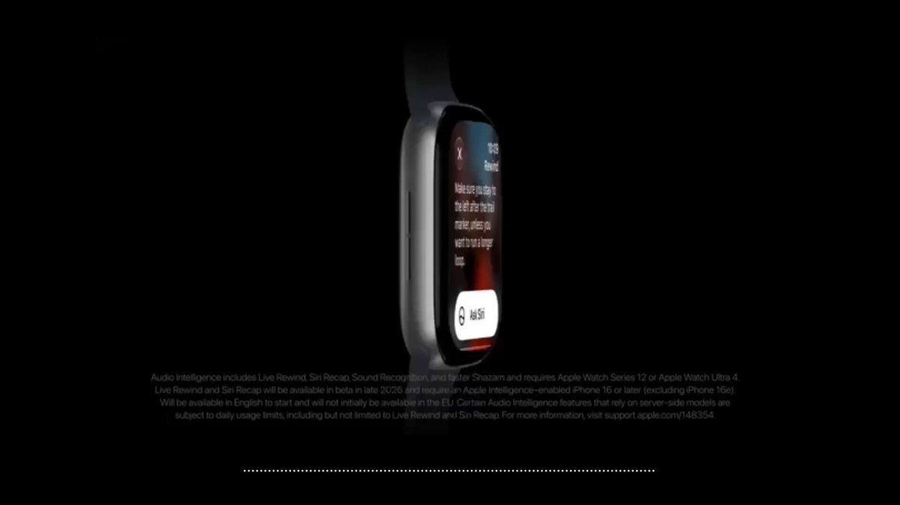
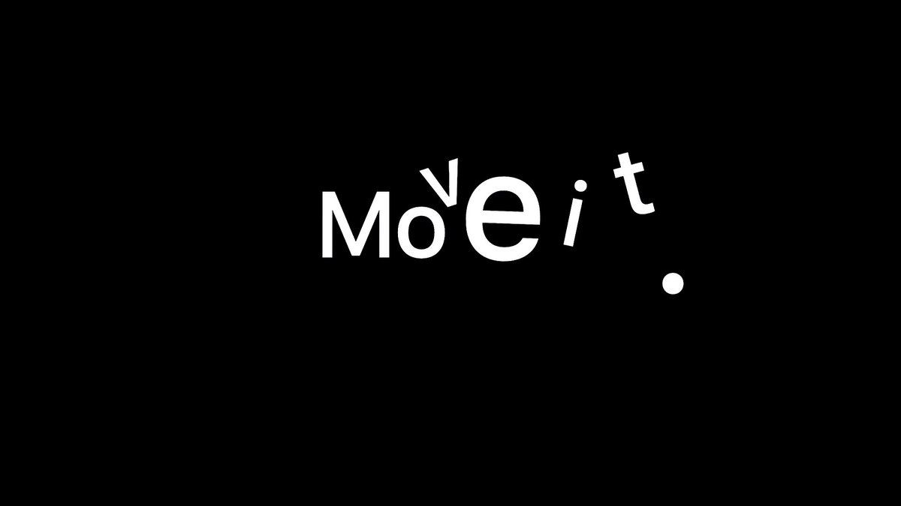
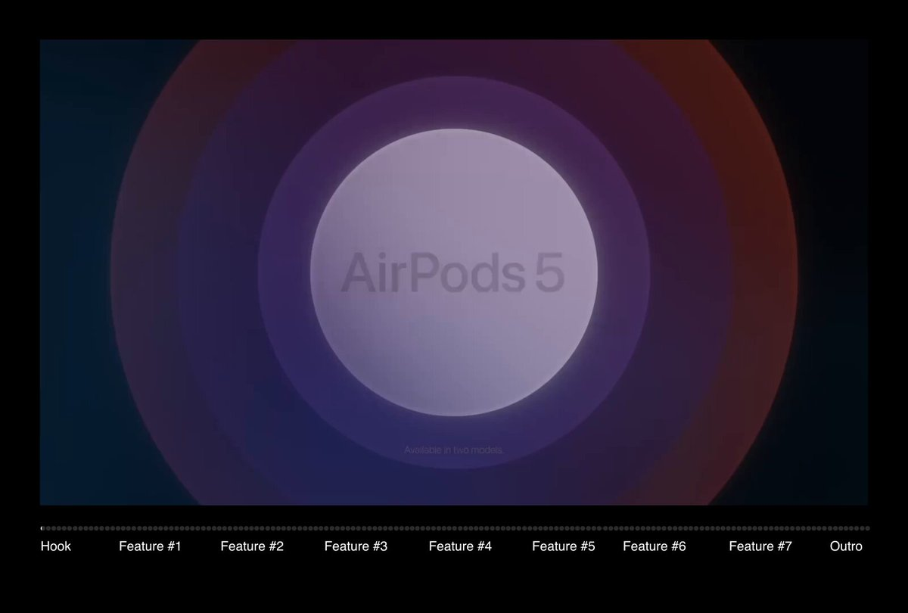

# How Apple makes their product videos look expensive (Steal it) — https://t.co/1e96kXOu9u

> Source: https://x.com/leomeethewoo/status/2098032450731720823 — leo (@leomeethewoo) — Thu Sep 10 12:54:50 +0000 2026 — likes 1879 · reposts 176 · replies 24 · views 1458638 — captured 2026-09-21T13:54:06Z

> Author bio: Building @IntentlyBiz → Product Videos for Fintech

Trusted by @jito @fomo & 30+ companies

## Post

**Author:** leo (@leomeethewoo)
**URL:** https://x.com/leomeethewoo/status/2098032450731720823

https://t.co/1e96kXOu9u

## Article

**Title:** How Apple makes their product videos look expensive (Steal it)
**Article URL:** https://x.com/i/article/2097951598844813312
**Preview:** Every new Apple Launch is literally product video P*rn
 
They mastered the art of brand awareness like nobody else
I've produced over 50 Product Videos in the last 4 months for leading fintech

Every new Apple Launch is literally product video P*rn
They mastered the art of brand awareness like nobody else
I've produced over 50 Product Videos in the last 4 months for leading fintech companies with my studio @IntentlyBiz  
And in this article we'll breakdown why Apple Videos look expensive together
## 1.  Composition
Apple's videos are stupidly simple

They don't try to show everything. One shot = one idea. Every scene has space to "Breathe"

Most brands add flashy backgrounds, glow and multiple effects in the same frame. Apple does the opposite. They keep it simple and focus on the key objects.

That emptiness creates the expensive look. Minimalism.
## 2.  Typography
Apple sticks to their brand fonts
A couple typefaces max, always from the brand system. Titles, UI, disclaimer- same rules the whole video.

People remember that. Not consciously. They just feel it's Apple.
## 3. Color Palette
Background is usually just black or white. Dead quiet.

Then the thing in the middle goes loud — blue, purple, pink, red, yellow. All the color lives on the product or the UI. The room around it stays empty on purpose.

They almost never put bright color on bright color. If the phone is copper, the void behind it is black. If the type is pink, the plate is black. Contrast does the work.

Lifestyle shots are the only place it opens up — warmer light, greens, oranges. Then it snaps back to the black void for the next product beat.

So it's not "minimal colors." It's controlled. One loud thing. Quiet everything else.
## 4. Transitions
Apple's cuts almost disappear

One shot slides into the next and you barely catch it. No flashy transitions. No hard jumps that pull you out

The edit stays invisible on purpose.
## 5. Sound Design
Sound is the cherry on top

The music is premium and locked to the cut - same tempo as the film, not some random track under it.

SFX almost aren't there. Only the hits that matter. Never loud. Never fighting the picture.
## About us
@Intentlybiz  is a studio that makes Product Videos for FinTech companies, here's some of our recent work: 
More work/case studies here: https://intently.agency/
Thanks for reading <3

## Media

Original: https://pbs.twimg.com/media/HR1xqCxaIAAkGDS.jpg

[media/media_1.mp4](media/media_1.mp4)
Original: https://video.twimg.com/amplify_video/2097978034989219840/vid/avc1/3840x2160/WkvyWCud60H3oAcw.mp4?tag=29

Original: https://pbs.twimg.com/amplify_video_thumb/2097978034989219840/img/fU3D2HYt1eCF4woA.jpg

[media/media_3.mp4](media/media_3.mp4)
Original: https://video.twimg.com/amplify_video/2098030794958843904/vid/avc1/1920x1080/5Qdz58Z8YIzc7I9k.mp4?tag=29

Original: https://pbs.twimg.com/amplify_video_thumb/2098030794958843904/img/IeiLJXbdK0RYjF3d.jpg

Original: https://pbs.twimg.com/media/HR2a5k6bAAAx4To.jpg

[media/media_6.mp4](media/media_6.mp4)
Original: https://video.twimg.com/amplify_video/2098004147136266240/vid/avc1/1920x1080/eW8y2IBxUcrj1Cex.mp4?tag=29

Original: https://pbs.twimg.com/amplify_video_thumb/2098004147136266240/img/qvBPmMD77NsWF3wO.jpg

[media/media_8.mp4](media/media_8.mp4)
Original: https://video.twimg.com/amplify_video/2098008635213598721/vid/avc1/1920x1080/ITS01-gaFZOBkMvR.mp4?tag=29

Original: https://pbs.twimg.com/amplify_video_thumb/2098008635213598721/img/Zy9I8MKRAVnb0Rpz.jpg

[media/media_10.mp4](media/media_10.mp4)
Original: https://video.twimg.com/amplify_video/2098014739423219712/vid/avc1/1920x1080/WkykVFDp1o6TyUyj.mp4?tag=29

Original: https://pbs.twimg.com/amplify_video_thumb/2098014739423219712/img/aMzMfe_p0zXPCpn7.jpg

[media/media_12.mp4](media/media_12.mp4)
Original: https://video.twimg.com/amplify_video/2098029643790196736/vid/avc1/1600x1080/w1KHgx2H_x-DlARz.mp4?tag=29

Original: https://pbs.twimg.com/amplify_video_thumb/2098029643790196736/img/W3nAUyS2EkVw0TED.jpg

## Thread

(no author self-replies found)

## Comments

### @aka_ssy
**URL:** https://x.com/aka_ssy/status/2098119664090104117

The sneakiest flex is the sound design—those tiny clicks and swells landing a few frames late would kill the polish. Your eyes get the credit, but your ears are doing overtime.

### @AdityaOnMedium
**URL:** https://x.com/AdityaOnMedium/status/2098327928539173002

Few weeks ago, I tried to recreate Apple Event keynote slides within the Keynote app on Mac and boy, it was a task…

### @tonugamu
**URL:** https://x.com/tonugamu/status/2098260586463432958

by copying samsung apparently

### @shubh_building
**URL:** https://x.com/shubh_building/status/2098497847398175150

@DBran27621
 let’s steal it

### @rejexvisions
**URL:** https://x.com/rejexvisions/status/2098461245183775155

good one man! ty

### @Eyeson_Studio
**URL:** https://x.com/Eyeson_Studio/status/2098039360520171969

tnx for sharing

### @editorhan_
**URL:** https://x.com/editorhan_/status/2098496944414846976

goated insights

### @Rayanvisuals
**URL:** https://x.com/Rayanvisuals/status/2098406671865569742

Insane value

### @pmarkesinis22
**URL:** https://x.com/pmarkesinis22/status/2098169148027064554

@kaybahadir

### @yoannpavy
**URL:** https://x.com/yoannpavy/status/2098177180232454424

@Aknaimi_

### @Chiron73942
**URL:** https://x.com/Chiron73942/status/2098451865814110367

Dope Bro

## Links

- https://x.com/i/article/2097951598844813312
