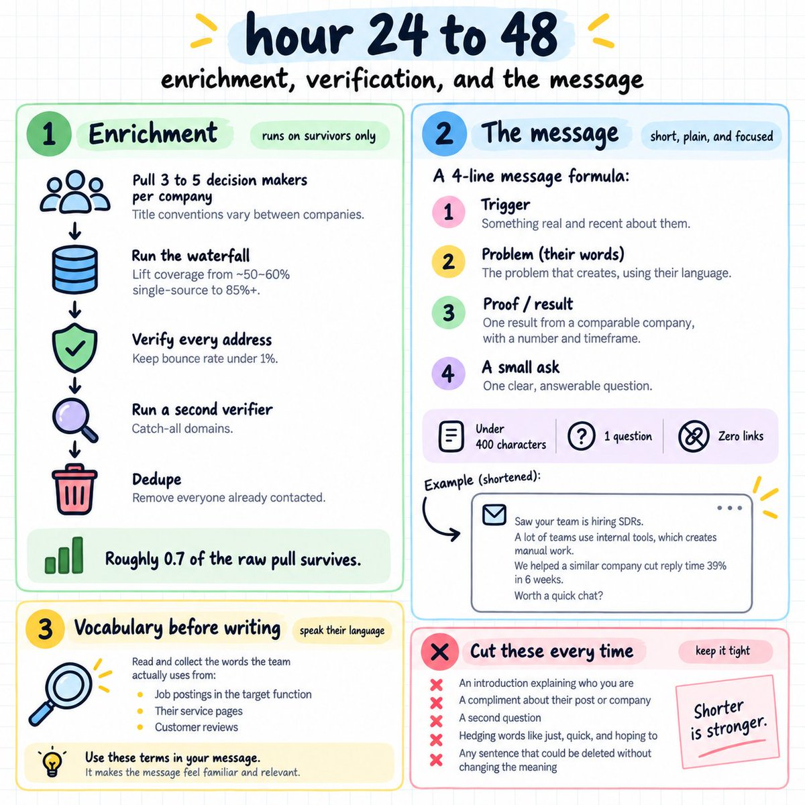
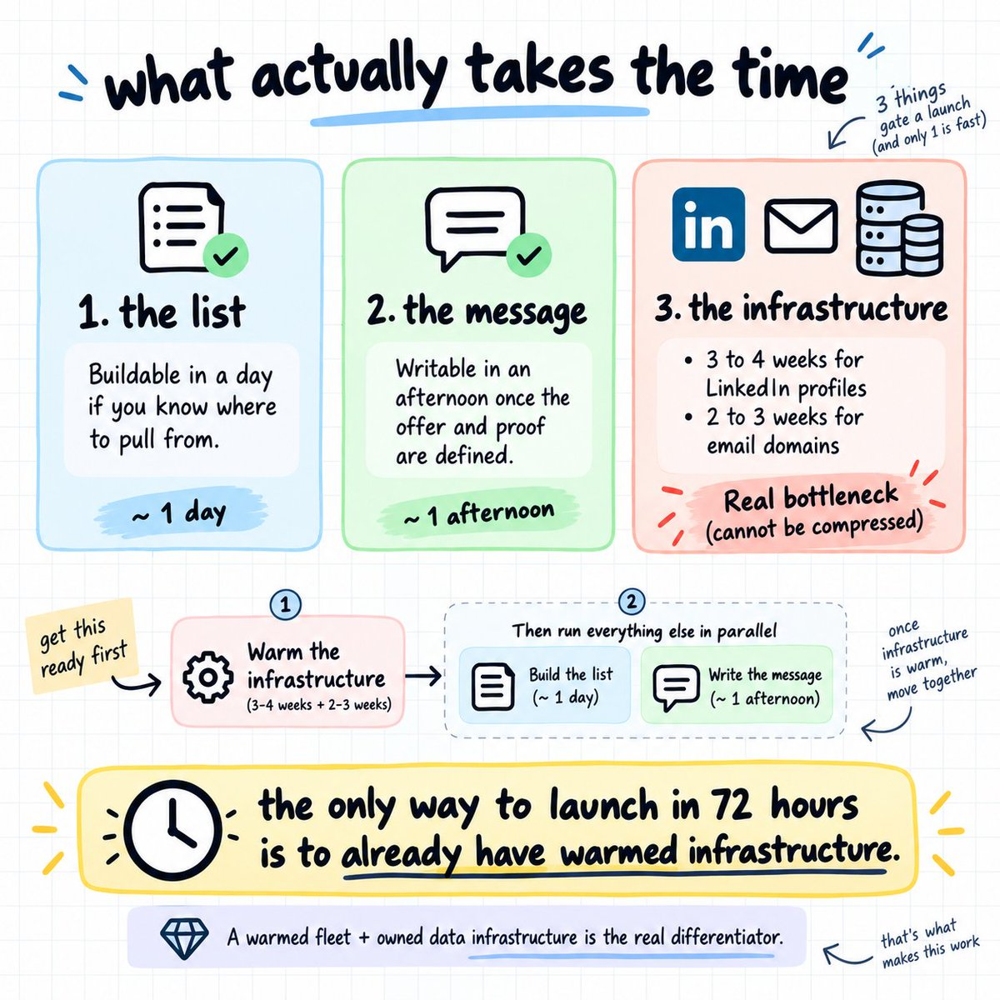
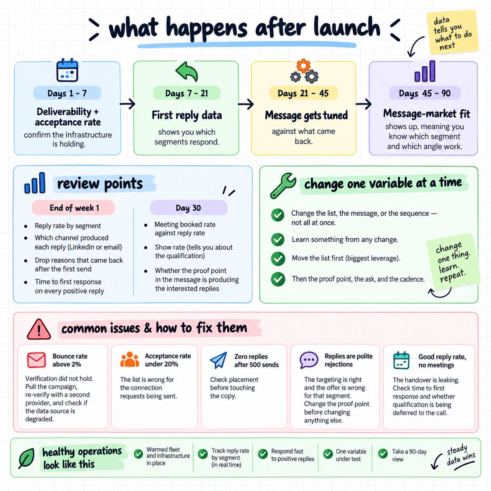

# https://x.com/i/article/2097777583719055360

> Source: https://x.com/DinScales26/status/2098095107819893069
> Author: Din (@DinScales26)
> Posted: 2026-09-10T17:03:49Z
> Stats (at capture): 10,768 views · 48 likes · 3 replies · 7 reposts · 94 bookmarks · 2 quotes
> Captured: 2026-09-21T14:34:50Z

## Post

@DinScales26

https://x.com/i/article/2097777583719055360

## Author bio (at capture)

Scaling Offers https://calendly.com/eaglerev/eaglerev-strategy-call

## Linked article

[launch a full linkedin + email outbound system in 72 hours ](https://x.com/i/article/2097777583719055360)

we take clients live within 72 hours at eaglerev, across 140+ companies and 30 industries.

most agencies take 4 to 6 weeks, and the difference is entirely about what exists before the client signs.

(by this i mean what we already have set up

this is the full build. 

what can be compressed, what cannot, the exact order, the templates, and what breaks in week 1.

work through it in sequence because every step assumes the one before it is done...

---

### what actually takes the time:

3 things gate a launch, and only 1 of them is fast.

the list. 

its buildable in a day if you know where to pull from.

the message. 

writable in an afternoon once the offer and the proof are defined.

the infrastructure. 

3 to 4 weeks for linkedin profiles and 2 to 3 weeks for email domains.

that third one is the constraint, and it cannot be compressed.

a linkedin profile created this month cannot carry volume. 

a domain sending cold on day 3 gets filtered.

so the only way to launch in 72 hours is to have the infrastructure already built AND warmed before the client arrives.

that is the actual differentiator. 

we run a warmed fleet and our own data infrastructure continuously, so a new client plugs into capacity that already exists.

a company building this alone is looking at a month before the first real send, and the work below still has to happen inside that month.

so the sequence for a company starting from zero is to begin warming on day 1 and run everything else in parallel.

buy the domains and source the profiles first, before the offer is even finalised, because those are the only pieces with a fixed waiting period.

### hour 0 to 24: the offer, the icp, and the list:

nothing gets built until the offer and the proof are DEFINED.

what has to be established first:

- the strongest client result and the exact type of company that produced it
- the revenue floor where the offer makes sense
- the function that owns the problem
- the disqualifiers, meaning who gets declined even when they raise a hand
- a tam of at least a few thousand companies
the proof point determines the market.

we have run the identical message structure above 20% reply rate and watched it produce 3%, 

with the case study in the middle as the only variable.

so you find the vertical where the strongest result lands, then build the list against that.

the offer test before anything else.

write one sentence describing what the client does, for whom, and what result it produces.

if that sentence needs a paragraph of context to make sense, 

the offer is not ready and the campaign will fail REGARDLESS of the list.

then the list. 

sources that can be pulled the same day:

- sales navigator, with account search first and lead search inside those accounts
- ats job feeds from greenhouse, lever, and ashby
- sec edgar and usaspending, both free with public apis
- the linkedin and meta ad libraries
- association directories and licensing registries
- the linkedin alumni tool on any relevant university page
- event attendee lists from events in the client's market
which source to pick first. 

just match it to the client's icp and run that one properly.

funded tech goes to edgar form d filings and the yc directory. 

companies with a physical footprint go to maps by zip code. 

professional services go to licensing registries. 

anyone selling into a function goes to ats job feeds.

pulling 6 sources badly on day 1 ends up producing a worse list than pulling 1 source properly.

check the tam before building. 

linkedin's campaign manager audience estimator returns the exact number of people matching any title, industry, and company size combination, 

and you never have to run an ad.

if it comes back at 400 people, the campaign was never going to work lol.

how to size it properly. 

test 3 variations of the icp in the estimator and compare.

a title band that returns 400 might return 12,000 when you add the adjacent titles that own the same problem, 

and that tells you whether the definition or the market is the constraint.

then qualify. 

a model reads each company against the icp and returns keep or drop with a written reason.

the prompt we run:

> you are qualifying b2b leads. my icp: [revenue floor], [headcount band], [what they sell], [who they sell to], [geography]. my disqualifiers: [company types i decline even when they raise a hand].

> for each record, read the company website including the about, services, and careers pages. return: a verdict of keep or drop, a one-line reason, a fit score out of 100, the buying signal you found and its date or none, and the likely decision maker title.

> never invent a signal. if you cannot find one, return none. if the site is unreachable, return no site data.

test the prompt on 50 records first. 

include 10 you would definitely take, 10 you would definitely decline, and 30 you are unsure about.

check the verdicts against your own judgment before pointing it at the full list.

a loose prompt at scale produces a list you cannot trust and no way to find where it went wrong.

read the drop reasons in bulk before enriching anything. 

when a few thousand records get cut for the same cause, the definition needs fixing first.

sample the keeps too. 

pull 50 at random and check them by hand.

if more than a handful should have been dropped, the criteria are too loose and everything downstream inherits that error.

on one campaign we qualified a pool of 12,479 before sending 4,905 messages, and 1 in 4 replies came back genuinely interested.

---

### hour 24 to 48: enrichment, verification, and the message

---

enrichment runs on the survivors ONLY. 

enriching contacts at companies you already dropped burns credits on roughly half the file.

the order:

- pull 3 to 5 decision makers per company, since title conventions vary between companies
- run the waterfall, taking coverage from 50 to 60% single-source to 85%+
- verify every address, keeping bounce rate under 1%
- run a second verifier on catch-all domains
- dedupe against everyone already contacted
expect roughly 0.7 of the raw pull to survive.

then the message. 

4 lines:

- the trigger, meaning something real and recent about them
- the problem that creates, in the words their team uses internally
- one result from a comparable company, with the number and the timeframe
- one small ask, answerable in a word
under 400 characters, 1 question, zero links.

the subject line stays under 40 characters and plain.

learn the vocabulary before writing. 

read 10 job postings from the target function in that industry and note the words that repeat. those are the terms the team uses daily.

their own services pages and the reviews their customers left do the same job.

a law firm says matter flow. a broker says shipper accounts. 

using the wrong term basically marks you as an outsider in the first sentence.

the message template we run:

> saw [trigger]. usually means [problem in their vocabulary]. we got [comparable company type] [result] in [timeframe]. worth me sending [small thing]?

each line has a job. 

the trigger proves you looked, which buys the second line. 

the problem proves you understand their world, which buys the third.

and the result proves you can fix it, which buys the ask.

pull any line out and the one after it loses all of its support.

what gets cut every time:

- an introduction explaining who you are
- a compliment about their post or their company
- a second question
- hedging words like just, quick, and hoping to
- any sentence that could be deleted without changing the meaning
write 3 versions of the message before launch, each with a different proof point, so day 1 produces a comparison instead of a single data point.

on the proof point specifically, we have run the identical structure above 20% reply rate and watched it produce 3%, 

with the case study in the middle as the only variable.

a result from a company the prospect sees as their own kind makes them read themselves into it. 

and a result from one industry over gets them to decide it does not apply.

build the variation layer. 

3 to 5 versions of every line, rotated across the send, with the trigger and company pulled in as variables.

### hour 48 to 72: routing, splitting, and launch:

split the list by channel.

check open profile status during list building. 

a large share of senior people have it enabled without knowing, so an inmail reaches them with no connection request and no credit spent.

- open profiles receive inmails
- closed profiles receive connection requests, which cap at roughly 100 a week
- everyone with a verified address also enters the email sequence
on one campaign, 4,705 of 4,905 sends were inmails and connection requests carried 200.

set the sequence.

- a linkedin touch first for senior contacts
- a short email 3 days later on the same problem
- a linkedin follow-up if they engaged
- a final email with a different angle
the order flips for a founder who runs the business from their inbox.

wire the routing before the first send.

- reply detection firing the moment a message lands
- positive replies routed to a dedicated channel
- one named owner per thread
- a target of responding inside the hour
then launch at a fraction of target volume for the first 48 hours.

watch bounce rate, acceptance rate, and placement before scaling to full volume.

what to check before scaling:

- bounce rate under 1%, which confirms the verification held
- acceptance rate above 30% on connection requests
- seed inboxes showing primary placement
- no warning banners on any sending account
if any of those fail, hold volume where it is and fix the layer before adding sends.

a campaign scaled on a broken foundation burns a month of infrastructure in a week.

the 72 hour checklist, in order:

- offer sentence written and tested
- icp defined with disqualifiers in writing
- tam confirmed above a few thousand companies
- source selected and raw list pulled
- qualification prompt tested on 50 records
- full list qualified, drop reasons read
- enrichment run on survivors only
- every address verified, bounce risk under 1%
- list deduped against prior contacts
- 3 message versions written with different proof points
- list split into open profiles, closed profiles, and email
- reply routing wired with a named owner
- first sends at 20% of target volume
- 48-hour placement and acceptance check before scaling
---

### what happens after launch:

---

the first week produces data.

- days 1 to 7, deliverability and acceptance rate confirm the infrastructure is holding
- days 7 to 21, the first reply data tells you which segments respond
- days 21 to 45, the message gets tuned against what came back
- days 45 to 90, message market fit shows up, meaning you know which segment and which angle work
the 45 day sprint exists for exactly that reason.

it agrees a qualified meeting number up front and validates the market before anyone commits to a longer engagement.

what to review at the end of week 1:

- reply rate by segment, since one segment usually carries the campaign
- which channel produced each reply, meaning linkedin or email
- the drop reasons that came back after the first sends
- time to first response on every positive reply
what to review at day 30:

- meeting booked rate against reply rate, which tells you about the handover
- show rate, which tells you about the qualification
- which proof point in the message is producing the interested replies
what to change and when.

change one variable at a time. 

changing the list, the message, and the sequence in the same week means you learn NOTHING from any of them.

the list first, since it moves the number more than anything else. 

then the proof point, the ask, and the cadence.

what breaks in week 1, and what to do about each.

bounce rate above 2%. 

the verification did not hold. pull the campaign, re-verify with a second provider, and check whether the data source itself degraded.

acceptance rate under 20%. 

the list is wrong for the connection requests being sent. 

stop sending requests and route that volume through open profiles while you tighten the targeting.

zero replies across every segment after 500 sends. 

check placement before touching the copy. 

run a seed test across gmail and outlook and confirm the mail is landing in primary.

replies arriving but all polite rejections. 

the targeting is right and the offer is wrong for that segment. 

change the proof point before changing anything else.

one account flagged with a warning. 

pull it from rotation for 2 weeks. restart at week 2 volumes, not where it left off.

good reply rate, no meetings. 

the handover is leaking. check time to first response, and whether qualification is being deferred to the call.

each of those points at a different layer, so the fix is specific.

- din

also, DM me "OUTBOUND" if you want us to setup this full linkdin + email outbound system (and more) for your business in 72 hours...

(must be making over $10k/month)

we've done this for over 140 companies across 30 industries

or just book a call @ calendly.com/eaglerev/eaglerev-strategy-ca

## Comments

3 replies on the original per API; no other replies rendered in the logged-in bridge session at capture.

## Links

- https://x.com/i/article/2097777583719055360
- https://calendly.com/eaglerev/eaglerev-strategy-call
