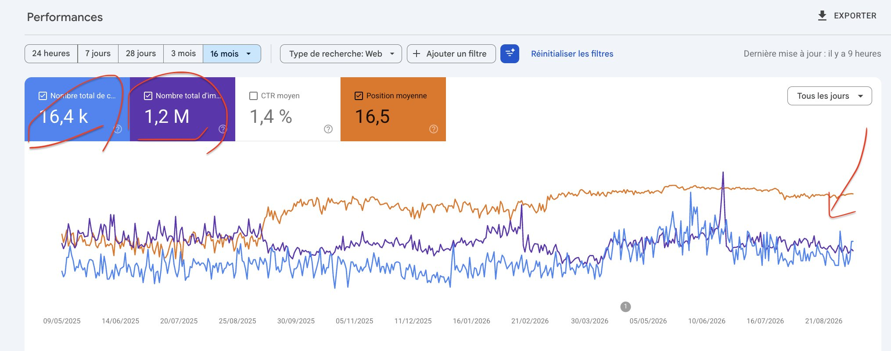

# COMMENT EXPLOSER SON SEO SANS ACHETER DE BACKLINKS ? Je te donne 5 conseils : 1. construire une autorité thématique

> Source: https://x.com/Timseo_/status/2098102265659986001
> Author: TimSEO (@Timseo_)
> Posted: 2026-09-10T17:32:15Z
> Stats (at capture): 20,398 views · 228 likes · 7 replies · 18 reposts · 467 bookmarks · 1 quotes
> Captured: 2026-09-21T14:34:50Z

## Post

@Timseo_

COMMENT EXPLOSER SON SEO SANS ACHETER DE BACKLINKS ? Je te donne 5 conseils :  

1. construire une autorité thématique AUTOUR d'un mot-clé  (pas 150!)

Puis, il faut identifier un ensemble de requêtes autour de ta verticale principale : 
→ questions techniques 
→ requêtes commerciales 
→ requêtes décisionnelles

## Media

Photo (`media/photo.jpg`) — original: https://pbs.twimg.com/media/HR3009iacAAh_hC.jpg?name=orig (2030x800)

## Author bio (at capture)

✝️ + SEO IA

Free skills SEO IA : https://organikk.co/skills/

## Thread

### Timseo_ ([@Timseo_](https://x.com/Timseo_)) — [2098102268277244175](https://x.com/Timseo_/status/2098102268277244175)

> 2. tu n'as pas besoin d'un outil pour trouver des mots-clés. Tu as besoin d'agréger ta propre data.
> 
> Avant d’ouvrir un outil classique, je ne veux pas qu’il me donne des requêtes sur lesquelles tout le monde se bat déjà. 
> 
> Je cherche les formulations réellement utilisées par mes prospects autour de mon produit ou de mon service.
> 
> Je récupère notamment :
> 
> → les questions posées pendant les calls
> → les tickets SAV
> → les objections commerciales
> → les raisons des deals perdus dans le CRM
> → les questions posées avant un achat
> → les requêtes GSC associées aux pages qui génèrent des leads
> → les requêtes GSC des clients qui ont effectivement signé

### Timseo_ ([@Timseo_](https://x.com/Timseo_)) — [2098102270508638629](https://x.com/Timseo_/status/2098102270508638629)

> 3. si ChatGPT peut déjà produire une meilleure réponse que moi, je reflechis à 2X avant de rédiger la page
> 
> en vrai, on rédige une page pour 3 raisons : 
> 1. pour ranker sur un mot clé
> 2. pour la sémantique
> 3. pour le parcours client
> 
> Pour le 2 et le 3, si Chatgpt peut répondre, il faut quand même y aller.
> 
> Mais si c'est juste pour ranker, alors je ne produis pas la page.
> 
> Prenons : qu’est-ce qu’un panneau solaire ? 
> 
> Un LLM peut produire une définition, expliquer son fonctionnement et donner les principaux avantages en quelques secondes.
> 
> Une page qui reproduit simplement :
> 
> → définition
> → fonctionnement
> → avantages
> → inconvénients
> → FAQ
> 
> Je n'ai pas pas grand-chose à apporter à la requête.
> 
> Je cherche plutôt des requêtes pour lesquelles l’utilisateur doit faire quelque chose :
> → calculer
> → comparer
> → simuler
> → configurer
> → choisir
> → diagnostiquer

### Timseo_ ([@Timseo_](https://x.com/Timseo_)) — [2098102272698032288](https://x.com/Timseo_/status/2098102272698032288)

> 4. toujours apporter une information nouvelle que les autres n'ont pas encore donné
> 
> Ne SURTOUT pas confondre couvrir un sujet et apporter quelque chose de nouveau au sujet.
> 
> Pour une requête comme :
> 
> « plombier Paris »
> 
> il va falloir donner une information dont votre ICP a besoin pour prendre sa décision.
> 
> MAIS, ça ne suffit pas.
> 
> Il faut aussi apporter une information que les autres pages n’ont pas.
> 
> Par exemple :
> → le prix moyen observé sur 500 interventions
> → le délai moyen d’intervention calculé sur tes données
> → un relevé de terrain
> → une analyse de 1 000 devis
> → un benchmark réalisé à partir de tes propres données
> 
> Une statistique générique trouvée sur Internet n’apporte rien de nouveau. 
> 
> Si tout le monde peut la reprendre, ce n’est pas une information qui t’appartient et donc peut de chance de te faire une place sur Google.

## Comments

7 replies on the original per API; 3 author self-replies captured above in Thread; no other replies rendered in the logged-in bridge session at capture.

## Links

- (none)
