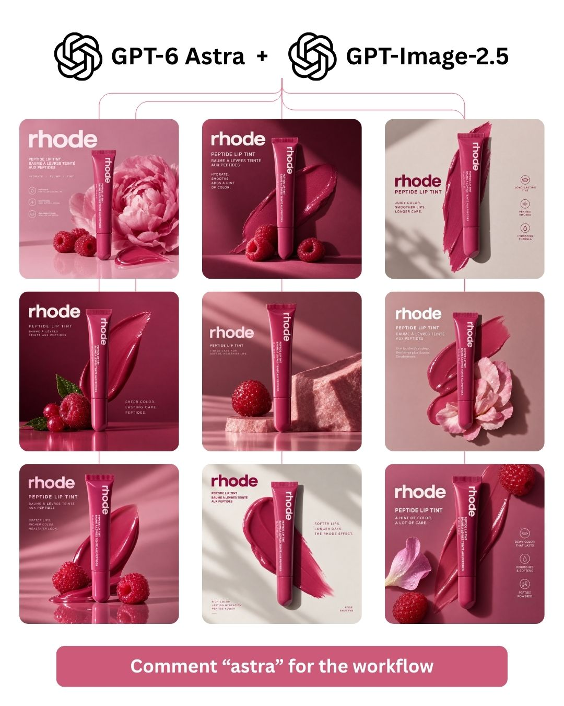

# RIP CREATIVE STRATEGISTS GPT-IMAGE-2.5 + GPT-6 ASTRA Both dropped in the same week. Together they cover the entire

> Source: https://x.com/spect3ral/status/2098112484552929671
> Author: Ahad Shams | AI Ads Guy (@spect3ral)
> Posted: 2026-09-10T18:12:52Z
> Stats (at capture): 34,428 views · 578 likes · 434 replies · 63 reposts · 852 bookmarks · 2 quotes
> Captured: 2026-09-21T14:34:50Z

## Post

@spect3ral

RIP CREATIVE STRATEGISTS

GPT-IMAGE-2.5 + GPT-6 ASTRA

Both dropped in the same week. Together they cover the entire strategy-to-finished-static workflow in one sitting.

Here's the pipeline.

GPT-6 Astra is the strategist.

→ Watches competitor ads — not the transcripts, the actual creative — and pulls the hooks that are still running after 60 days
→ Maps the angles to how your buyer actually decides, not to what the category keeps repeating
→ Writes full concepts with visual direction: composition, product size, headline weight, where the eye lands first
→ Writes copy that belongs to the angle instead of sounding like every ad it just analysed
→ Outputs a spec sheet, one per concept, ready to render

GPT-Image-2.5 is the executor.

→ Takes each spec and produces the finished static
→ Headline, CTA, product placement and hierarchy exactly as briefed — and it holds them across edits instead of drifting by version three
→ Product pulled from your reference photo, not reinvented
→ Six to ten variations per angle, same afternoon

Strategy to finished creative used to be a week and two teams. Now it's one session and one person.

This isn't AI writing ad copy.

This is a creative strategist that researches, decides, and ships — and a designer that executes the brief without arguing about it.

I've written the full workflow up — every prompt, the spec-sheet template that connects the two models, and the setup.

Comment "astra" and I'll send it. 
(must be following)

## Media

Photo (`media/photo.jpg`) — original: https://pbs.twimg.com/media/HR399VJboAA34oG.jpg?name=orig (1080x1350)

## Author bio (at capture)

Running experiments with AI to create banger ads | Sharing and productizing workflows with @heyoz_ai

## Comments

434 replies on the original per API; no other replies rendered in the logged-in bridge session at capture.

## Links

- (none)
