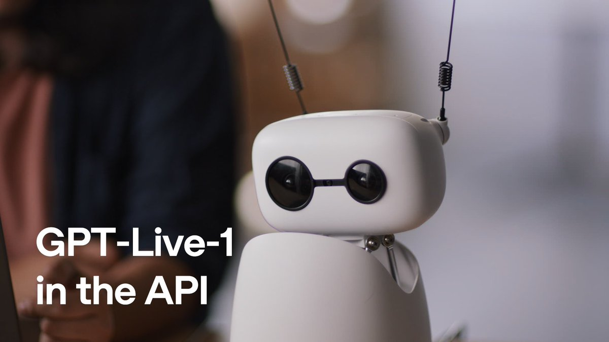

# It's actually quite good! And $0.05/min is a quite competitive pricing (~2x-5x cheaper compared to most voice agent

> Source: https://x.com/adriablancafort/status/2098192424136798617
> Author: Adria Blancafort (@adriablancafort)
> Posted: 2026-09-10T23:30:31Z
> Stats (at capture): 114,662 views · 612 likes · 29 replies · 16 reposts · 788 bookmarks · 4 quotes
> Captured: 2026-09-21T14:34:50Z

## Post

@adriablancafort

It's actually quite good!

And $0.05/min is a quite competitive pricing (~2x-5x cheaper compared to most voice agent platforms)

Testing it with self-hosted @livekit (on Hetzner)
https://x.com/OpenAIDevs/status/2098099269551149398

## Media

Video (`media/video.mp4`, 1620x1080, 193.536s) — original: https://video.twimg.com/amplify_video/2098185734519988224/vid/avc1/1620x1080/uwBZym4x-r4QSMOg.mp4?tag=29
Thumbnail (`media/thumb.jpg`) — original: https://pbs.twimg.com/amplify_video_thumb/2098185734519988224/img/dx_HPM26OGP7F2iU.jpg

## Author bio (at capture)

AI @factorialapp

## Quoted post

[OpenAI Developers (@OpenAIDevs)](https://x.com/OpenAIDevs/status/2098099269551149398) — 2026-09-10T17:20:21Z · 7,340,356 views · 18,135 likes · 570 replies · 1,467 reposts

GPT-Live-1 is now available in the API.

Bring ChatGPT’s natural back-and-forth to your app, with voice agents that listen while they speak and work with the models and harness you choose.

Quoted video (`media/quoted-video.mp4`, 1920x1080, 76.701s) — original: https://video.twimg.com/amplify_video/2098099188697600000/vid/avc1/1920x1080/RI4peZFCIG-MU__I.mp4?tag=16

## Thread

### adriablancafort ([@adriablancafort](https://x.com/adriablancafort)) — [2098466616572788838](https://x.com/adriablancafort/status/2098466616572788838)

> Thanks for the comment! Awesome product btw. It's going to change the Voice AI landscape. Speech-to-Speech is the future

## Comments

### charlierguo ([@charlierguo](https://x.com/charlierguo)) — [2098463847711658458](https://x.com/charlierguo/status/2098463847711658458)

> love seeing this running on a self-hosted stack

### Hormold ([@Hormold](https://x.com/Hormold)) — [2098279309932941508](https://x.com/Hormold/status/2098279309932941508)

> How do you like LiveKit? Any feedback for the team?

## Links

- https://x.com/OpenAIDevs/status/2098099269551149398
