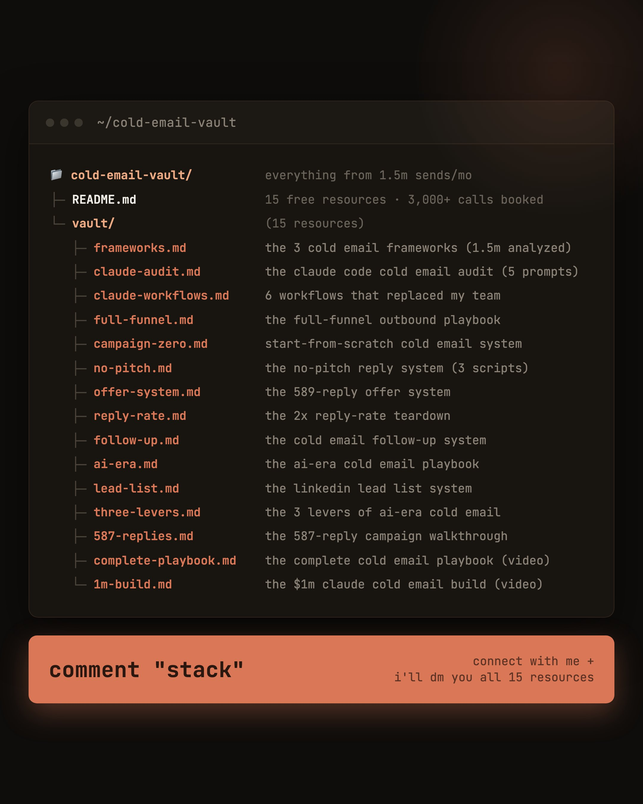

# i fed claude fable the exact systems we use to send 2M cold emails a month and book 3,000+ calls a year for clients

> Source: https://x.com/AaronxShepherd/status/2098200023888511208
> Author: Aaron | GrowthFlare (@AaronxShepherd)
> Posted: 2026-09-11T00:00:43Z
> Stats (at capture): 7,363 views · 79 likes · 180 replies · 6 reposts · 111 bookmarks · 0 quotes
> Captured: 2026-09-21T14:34:50Z

## Post

@AaronxShepherd

i fed claude fable the exact systems we use to send 2M cold emails a month and book 3,000+ calls a year for clients across e-com, b2b service, and saas.

this is the whole library we run internally, in one folder.

15 guides, playbooks, prompt packs, and walkthroughs:

→ the 3 cold email frameworks (1.5m emails analyzed)
→ the claude code audit that ranks your winners in 30 minutes
→ the 6 claude code workflows that replaced my team
→ the full-funnel outbound playbook (the zero-to-42-calls model)
→ campaign zero, the start-from-scratch system
→ the 587-reply campaign walkthrough
→ the $1m claude cold email build

... 15 resources total

go through all of it and it becomes pretty hard to NOT start booking calls from cold email.

want it?

1. connect with me
2. comment "STACK"

and i'll send the whole folder over.

## Media

Photo (`media/photo.jpg`) — original: https://pbs.twimg.com/media/HR5NzHAWIAwl4R5.jpg?name=orig (2160x2700)

## Author bio (at capture)

Founder | Deal Origination and Go-to-Market Strategy | 3000+ meetings booked in the last 12 months |

## Comments

### KristianBi25423 ([@KristianBi25423](https://x.com/KristianBi25423)) — [2098340626605412450](https://x.com/KristianBi25423/status/2098340626605412450)

> stack

## Links

- (none)
