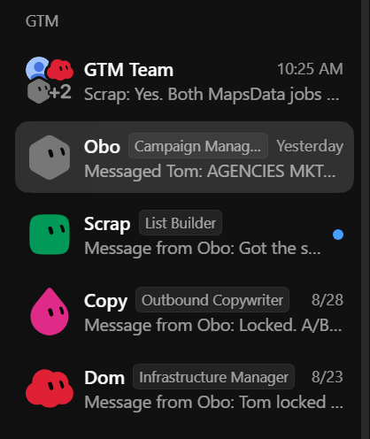

# how to use GPT-6 Astra with Grok Bot to create a $3M/yr GTM team

> Source: https://x.com/levikmunneke/status/2098278839206187158 — Levi Munneke (@levikmunneke) — Fri Sep 11 05:13:54 +0000 2026 — likes 51 · reposts 4 · replies 4 · views 56472 — captured 2026-09-21T13:54:06Z

> Author bio: ☦️ | b2b cold outbound | https://t.co/jvrTPWpN3a

## Post

**Author:** Levi Munneke (@levikmunneke)
**URL:** https://x.com/levikmunneke/status/2098278839206187158

https://t.co/PI3NEuc7zh

## Article

**Title:** how to use GPT-6 Astra with Grok Bot to create a $3M/yr GTM team
**Article URL:** https://x.com/i/article/2098271477783248896
**Preview:** A cold email campaign is a chain of artifacts. a verified lead list. a hypothesis about what to test. a sequence of copy. a campaign built inside a sending tool. a daily read on sending health. each

A cold email campaign is a chain of artifacts. a verified lead list. a hypothesis about what to test. a sequence of copy. a campaign built inside a sending tool. a daily read on sending health. each artifact has one owner, one set of inputs and one definition of done, which is exactly the shape an agent can hold.
we run all of it off written SOPs. the interesting thing about porting those SOPs to agents is how little rewriting they need. the handoff points were already there, because the handoff points were where one human stopped and another picked up.
two tools make this work in september 2026.
grokbot gives you named, persistent agents. each bot gets its own cloud computer with a browser, a filesystem and a terminal, signs into apps with your credentials rather than through an api, keeps running when your laptop is shut, and can delegate to other bots inside a shared thread. you can also record yourself doing a workflow once and it becomes a skill the bot repeats.
gpt-6 astra is the code layer. state of the art on computer use, browsing and software engineering, with a million token context window and a price of $10 and $50 per million input and output tokens. it writes and runs the scrapers, the enrichment jobs and the reporting queries.
so grokbot holds the roles and does the clicking. astra holds the code and the numbers.
## the four bots
list builder
owns every verified lead list. mapsdata.ai is the primary source. The bot logs into the company account on its own cloud computer and works the ui the way a person does.
its run looks like this:
- pick the business category, set the country, then narrow to states, cities or single zip codes from the client strategy doc
- scrape wide. maps scrapes cost close to nothing relative to a list's value, so volume target is "as much as the search will give", not the week's sending requirement
- filter for personal emails only and cap contacts at five per company
- run verification, wait out the 15 to 60 minutes, download the verified file
- upload to the client leads folder, open as a sheet, delete the csv
- post the list name and the verified row count into the shared thread
the qualification check is the part worth automating properly. our sop has a human clicking into 10 to 15 companies and reading their sites before a list gets approved. the bot hands a sample of domains to astra, gets back categories, services and short descriptions, compares them against the icp, and either approves the list or adds exclusion keywords and re-runs the search. a list that fails twice gets escalated with the mismatched keywords attached.
when a client needs linkedin-shaped data, the same bot drives the apollo path: build the search, save it, order the scrape through a third party scraper, run the file through verification, store it in the same folder with the same naming convention.
outbound copywriter
owns all sequence copy. it reads the most recent iteration draft in the client's campaign inputs, reads the copywriting reference as standing context, and writes into the subtab the campaign manager created.
the rule that makes its output usable is one changed variable per script. if the split test is offer framing, the framing moves and everything else stays frozen. if the split test is the winning script, it copies the winner and touches one small thing. that constraint is what lets the data mean anything two weeks later.
its output is a full sequence: subject line, body, and one or two follow-ups written as replies with the subject line left blank. two to three steps in nearly every case. spintax on the variable phrases, a signature placeholder, two or three lines per message, a single open-ended ask to close.
campaign manager
owns the hypothesis, the build, and the other bots. grokbot supports a chief-of-staff pattern where one named bot coordinates specialists, and this is the bot that fills it.
on the strategy side it reads the weekly performance table astra compiles, finds the gap between what's hitting kpi and what isn't, and writes a testable hypothesis into the campaign inputs. it sets the split test variable from a fixed menu: offer, offer framing, targeting, risk reversal, cta, case study, enrichment, firstline, copy, winning script. multiple tests are allowed, but each one lives in its own script. it names the campaign after the list it targets plus any data point that matters, then tags the list builder and the copywriter in the thread with the inputs each needs.
on the build side it assembles inside instantly once both artifacts land:
- upload the verified csv and map the headers, using company name for emails rather than the raw company field
- paste step one, add the follow-ups, set the delays to two days and then four
- select the sending schedule template for the list's timezone, or create one running roughly 6:00 to 18:00 local, monday through saturday
- set the daily send ceiling to the full capacity of the inboxes attached
- apply the settings block, then launch or schedule
a few of those settings never vary regardless of client: stop sending on reply, stop on auto-reply, open tracking off, text-only on, auto-optimise off, risky emails off. the bot treats them as constants and flags any campaign that disagrees.
one input it validates before anything else is timezone spread. a list where the leads sit more than three to five hours apart gets split into separate campaigns rather than one schedule that sends at 6am to half of them.
infrastructure manager
owns sending health, and it's the only bot on a fixed daily schedule. one run per client, after the overnight data sync.
it reads the domain summary, sets the window to four weeks, checks reply rate per contact both with and without auto-replies to see how much of the volume is automatic, then works the domain table. orange reply rate means below target. bounce above 3% means troubleshoot. it expands rows into per-inbox detail, because that's the only way to tell a burnt domain from one bad inbox inside a healthy one. it filters by tag to review a single batch at a time.
(can code a visual front end for this with Astra as well)
then it acts. quarantine for a burnt domain, which pulls those inboxes out of campaigns and returns them to warmup. reserve to bench a healthy domain for a future swap. release and take out to reverse either one. two hard rules sit above all of it: never pause or unpause a sending account, because that kills warmup, and never quarantine on thin data, because a handful of sends in the window proves nothing.
after that it cross-checks the sending tool for things a dashboard smooths over. one provider carrying replies while another shows none. bounce concentrating on a single esp instead of spreading evenly. accounts disconnected, in error, or with warmup stopped.
last it checks rotation. a green "next rotation" line means on schedule. an overdue callout means preview, review, execute, then confirm on the calendar that the old batch stops where the new one starts. a gap or an overlap means the previous rotation didn't finish. if a domain swap comes back partial it continues the run rather than restarting it.
anything it can't resolve goes into the thread with the numbers attached and a human name on it.
## how the bots talk to each other
the thread is per client and every bot sits in it. messages are pointers rather than payloads, because the artifacts already live somewhere addressable.
"list ready. chiropractors | 10-50 | texas | 14k. 11,412 verified rows in the leads folder."
that's the whole message. the copywriter doesn't need the rows, it needs to know the list exists and what's in it.
three things make the handoffs reliable:
naming as the join key. campaign name equals list name. a copy draft, a lead list and a campaign build all carry the same string, so no bot has to ask which thing belongs to which.
task state as the trigger. every sop ends with marking the task complete in the client's project board. that completion fires a webhook, the webhook wakes the next bot, and the next bot reads its inputs from the artifacts rather than from the conversation. nothing waits on a human forwarding a message.
blocking out loud. a bot missing an input posts what it needs and stops. it doesn't guess an offer, invent a head count or pick a timezone. the campaign manager either supplies it or escalates.
## where gpt-6 astra sits
astra runs as the coding agent behind the bots, and it has four standing jobs.
custom scraping. sources outside maps and apollo. directory sites, association member lists, marketplace pages, whatever a niche actually lives on. astra writes the scraper, runs it, dedupes against the suppression list and everything already scraped for that client, then writes output into the same column schema mapsdata produces. one schema for every source is what keeps the rest of the pipeline from caring where a lead came from.
enrichment. crawl each verified domain and pull the details the copy needs: services offered, locations, review counts, signals about team size. write them into the columns the firstline variable reads. run it after verification so the crawl budget only goes to live addresses.
outbound data analysis. pull the sending tool's api into a small database and keep history. reply rate and positive reply rate broken out by script, by split test variable, by sequence step, by domain, by esp and by list segment. the weekly output is a single table that answers which variable moved, which is the only question the iteration sop actually asks.
infrastructure tracking. a nightly job holding bounce and reply history per domain and per inbox, so "below the minimum reply rate across the lookback window" becomes a query with a fixed answer. the flagged list gets posted into the thread before the infra bot starts its run, which means that bot opens the dashboard already knowing what it's looking for.
## the loop
daily, the infra bot reviews sending health and astra refreshes the data tables. weekly, the campaign manager reads the table, writes a hypothesis and assigns work. the copywriter drafts the split test. the list builder builds a new list when the test calls for new targeting, and skips that step entirely when it's a new version of an existing campaign. the campaign manager assembles, launches, and the next data pull starts measuring it.
no step waits on a person to notice something. each one is fired by the completion of the step before it.
## what you give each bot
the sop itself is the standing instruction, close to verbatim. on top of that:
- the campaign strategy doc, for icp, offer and kpi
- the campaign scripts doc, so drafts land where the next bot looks
- thresholds as numbers: minimum reply rate, bounce ceiling, lookback window, quarantine period, reserve inbox tag
- credentials, held as live login sessions on the bot's own cloud computer
- recordings of the ui-heavy steps, which grokbot converts into repeatable skills
when a bot underperforms it's usually a missing number. a judgement call with no threshold behind it gets guessed, and a guess repeated daily turns into a pattern nobody asked for.
## what stays human
changing the offer. anything the sop already marks as escalate. and the first few runs of every bot, reviewed before it runs unattended.
## rough cost
grokbot seats start around $120 a month, astra runs $10 and $50 per million tokens, mapsdata plans sit between $19 and $99 a month.
the honest constraint is that none of this works without the sops and the systems. the bots aren't inventing a process, they're executing one that was already written down to the click.
if you want all of our prompts and sops or you want this full system built for you -> book a call: cal.com/leviwelch/intro

## Media

Original: https://pbs.twimg.com/media/HR6VRBmaQAA9BqC.jpg

Original: https://pbs.twimg.com/media/HR6PoA9bQAACxtd.png

## Thread

(no author self-replies found)

## Comments

### @Atheerium
**URL:** https://x.com/Atheerium/status/2099276835938877782

great

## Links

- https://x.com/i/article/2098271477783248896
