# 4700 word labor of love. I've seen all the patterns and heard every story about in-house brand/creative studio teams.

> Source: https://x.com/PaulJun_/status/2098386367898079729 — @PaulJun_ — captured 2026-09-21T12:52:00Z
> Author: Paul Jun (@PaulJun_)
> Posted: Fri Sep 11 12:21:10 +0000 2026
> Stats (at capture): 286277 views · 859 likes · 78 replies · 69 reposts · 1955 bookmarks
> Captured: 2026-09-21T12:52:00Z

## Post

@PaulJun_

4700 word labor of love. I've seen all the patterns and heard every story about in-house brand/creative studio teams.

This is my vision for where brand teams can go (and why I joined @tryramp). 

Brand systems that behave like jazz. Brand as software. https://x.com/i/article/2086411767148634112

## Article

[Brand as software](https://x.com/i/article/2086411767148634112)

Preview: Why settle for noise when you can make music?
I recently gave a talk about the future of brand to a room of designers from Ramp and Notion. Some people left energized. Others left worried. Both

Why settle for noise when you can make music?

I recently gave a talk about the future of brand to a room of designers from Ramp and Notion. Some people left energized. Others left worried. Both reactions make sense: the same technology that threatens to flood the world with more forgettable work gives creative teams a chance to escape an operating model that has misused them for decades.

Since the talk, the question kept following me: Will AI finally free in-house creative teams from being a service desk, or will it simply flood them with more of it?

Most companies will use AI to clear a faster queue. But I think there’s a larger opportunity — to turn a company’s point of view into a living system, then give its best creative people more time to make the kind of work no system can predict or generate.

I call the opportunity “brand as software.”

[article media: 2093293713858478080]

At Ramp, we have a Slack channel where anyone can ask for help. In my first six months, more than 375 requests came through it: whitepapers, landing pages, sales decks, product graphics, swag, customer logos, and everything in between. That number did not include the private messages or hallway requests that never reached the channel.

Every request made sense on its own. A salesperson had an important meeting. A product marketer needed a page for a launch. Someone had written a report and wanted it to look like it came from the same company as everything else.

Together, the requests revealed a broken operating model has existed across the tech industry for as long as I’ve been in it. Highly skilled designers were spending much of their time reproducing decisions the team had already made. When the queue grew too long, other teams found a way around it. They hired an agency, opened Figma, prompted AI, or shipped whatever they could make before the deadline.

In our case, the brand began to die by a thousand papercuts. The queue was not a failure of effort. Everyone was doing what the company had asked them to do. The queue — which many companies have — reveals a fundamentally broken system that has existed for too long.

AI will increase the volume of this work. Companies can already build products, launch campaigns, and enter new markets faster than they could a few years ago. Every new product creates another bundle of pages, presentations, reports, advertisements, product graphics, sales materials, and customer communications. If the structure of the brand team remains the same, AI will make the same bad system move faster.

Buckminster Fuller said, “You never change things by fighting the existing reality. To change something, build a new model that makes the old model obsolete.”

The better opportunity is to build new systems.

## How did we get here?

To understand why so many brand teams now function like internal service desks, it helps to understand where the creative team came from.

In 1941, an unemployed copywriter named Bill Bernbach walked into the William Weintraub agency in Manhattan looking for a job. Like most copywriters at the time, Bernbach wrote the words and passed them down to a layout department, where a room of artists turned the copy into an advertisement.

Passed down is the important phrase.

Writers and designers worked separately, often on different floors. The writer developed the idea. The artist made it presentable.

Nothing about this arrangement looked broken. It was efficient, familiar, and built for the tools and economics of its time. Operating models rarely survive because they are obviously foolish. They survive because they once made sense, then outlive the conditions that created them, because change is hard for groups of people.

Weintraub had appointed Paul Rand as Head of Art. Rand did not treat the visual as decoration added after the thinking was complete. He saw the words, image, composition, and idea as one problem.

Bernbach saw what became possible when a talented writer and art director worked together from the beginning. He later built DDB around that pairing, helping establish the creative-team model that transformed advertising. The agency’s Volkswagen campaign, especially “Think Small,” remains influential because the writing and art direction are impossible to separate. The restraint was part of the argument. The layout delivered the joke.

[article media: 2093305584799891457]

[article media: 2093305821408923648]

We remember the Creative Revolution for the work it produced, but its deeper innovation was organizational. It changed who sat together, when they entered the process, and what they were trusted to decide. The work changed because the workflow changed.

Creative work did not move directly from Madison Avenue into Silicon Valley. Strong in-house design organizations existed long before tech became a destination for designers. Retailers and apparel companies built internal teams because brand designers touched the product itself. Target is a useful example: its designers shaped sub-brands, packaging, stores, print, campaigns, and the experience of shopping there. Abercrombie & Fitch and Hollister built their own worlds across clothing, photography, stores, and marketing. For designers coming out of school, these were real destinations: a steadier path than agency life, with the chance to shape a brand from the inside.

[article media: 2094392982463995905]

What changed was not the existence of in-house teams. Software changed the economics of making. A salesperson at a retailer could not redesign a soap package, send it to a printer, put it into distribution, and get it onto shelves before lunch. The barriers were obvious: specialized tools, production knowledge, vendors, manufacturing, and retail operations.

[article media: 2093295539483770880]

Today, anyone at a software company can duplicate a Figma file or prompt Claude, create a deck with the wrong product graphics, the wrong messaging, and ship it before the brand team sees it out in the world.

The old in-house gatekeeping model entered a world where everyone could make, and it did not scale. Software lowered the barrier to production without distributing judgment or taste. Now AI lowers it again. That is the double edge: as each person can make more, the company expects more from everyone.

And who has to solve all of that? Brand and creative teams.

Technology companies also created a consequential split. Product designers moved closer to engineers and became part of building the product. Brand designers moved closer to marketing and became responsible for how the product appeared in the market. The arrangement was reasonable: product designers needed to work with engineers every day, while marketing teams needed people who could make campaigns, websites, events, and sales materials. Maybe the bigger question is why can’t marketing people make it, and why do they manage designers and not the other way around — but that’s for another essay.

The structure taught the company something dangerous. Product design became part of making decisions about the thing customers pay for. Brand design often arrived after the product, message, audience, and deadline had already been decided. Its job was to make the decision look finished.

Bernbach once said, “An idea can turn to dust or magic, depending on the talent that rubs against it.” Why settle for dust when you could have magic?

In 1981, design critic Ralph Caplan called the role of a designer the “exotic menial.” The designer appeared to possess mysterious abilities, yet was invited in only after the consequential business decisions had been made. The exotic menial never disappeared. The floor changed.

Now the work is passed down through a Notion document, a Jira ticket, or a Slack message that begins with, “Quick ask.”

This is no one person’s fault. The salesperson needs the deck. The marketer needs the landing page. The designer wants to protect the quality of the brand. The leader wants the company to move faster. Everyone is trying to do their job well.

The operating model never decided what should be self-serve, what should remain expert work, and how good decisions should travel between the two. When the brand team cannot help in time, everyone else does what rational people do: they figure it out.

The cost is not merely the number of hours spent polishing slide 47. It is everything the designer cannot do while polishing it: talk to customers, work with product, expand the identity, shape an important launch, or create something the company has never seen before. The company loses vision while everyone stays busy.

AI is the obvious change agent. With the right leadership and team structure, it gives us a chance to redesign the DNA of an in-house brand team.

## Brand as guidelines were built for a slower era

Brand teams have always known they could not make everything themselves. The traditional answer was governance: write the guidelines, build the portal, make the templates, host the training, and trust everyone to follow the rules.

[article media: 2093296323315236864]

This was a sensible response to the tools available at the time. A brand team made a finite set of decisions, documented them carefully, and distributed those decisions to the rest of the company. The system worked best when production remained scarce and trained specialists did most of the making.

The weakness was hidden inside the handoff. A guideline might explain the typography, photography, voice, messaging, and layout principles, but the person still had to interpret everything correctly. We expected someone to read the manual and somehow acquire the judgment, taste, and command of the tools required to make a strong deck, landing page, product graphic, or advertisement.

Once you state the premise plainly, it begins to look absurd. A company hires talented people to spend months developing an identity, then tries to package their judgment into an IKEA manual and hand it to people with entirely different expertise. When the work falls short, everyone blames the person who misread the instructions. The old system distributed rules without distributing judgment. How could it?

It also assumed the brand would remain relatively stable. At first, the guideline works. Then the company launches a product the system never anticipated. Product invents a component. Growth hires an agency. Sales builds a new deck. Each local fix is reasonable, but no one feeds the decision back into the system. Six months later, the homepage, product, campaign, and sales story feel as if they came from different companies. The guideline was not violated so much as outgrown.

A guideline can describe the brand. It cannot participate in the work.

That sentence would have sounded impossible a few years ago. Now an AI agent can carry the context of a brand into the work: the audience, product truths, promises, voice, visual system, approved examples, and the rules for when a human needs to step in. For the first time, the guideline can answer back. Genuinely, what the fuck.

Suppose you are building a landing page for a mid-market construction company in the heartland. The system can read recent customer calls, understand what this audience worries about, find the relevant product proof, choose the right components, and draft copy for that specific customer. A human still sets the direction and judges the result. The context no longer has to be reconstructed from six documents and three Slack threads.

This matters because brand strategy was always supposed to be more than a presentation. A strong strategy is a decision-making framework. It answers two basic questions: 

What do we believe? How will we behave?

The point is to turn words into works. A belief becomes a product decision. A promise becomes an experience. A point of view becomes language, symbols, partnerships, policies, and behavior.

That translation is where most strategies fail. The company usually has plenty of ideas. The problem is that they live in different places, age at different speeds, and depend on different people remembering them.

Most companies lose something in that translation. The strategy lives in one presentation. The latest product truth lives in another. Customer research is buried in a database. Approved assets sit in several libraries. The founder’s point of view exists in a recording no one has watched. Corrections disappear into Slack by lunch. Then hundreds or thousands of people are expected to behave like one company.

For years, I have argued that brand strategy is an operating system for how a company thinks and behaves. Until now, that operating system mostly lived inside people’s heads, presentations, guidelines, and templates. If your leaders are not champions for it, that PDF has the resilience of a wet napkin.

It could inform the work, but it could not participate in it.

AI changes that. The brand can now do work.

## What brand as software means

[article media: 2093302047432982528]

By brand as software, I mean software that carries a company’s point of view, its values, its constraints and design decisions, into the work itself. It knows what the company believes, what is true about the product, who it is speaking to, how the work should look and feel, and where its own judgment ends.

Over time, every company will build some version of a brain: a central layer connected to customer calls, product data, analytics, Slack, Notion, and the systems where the company stores what it knows. Brand as software draws from that memory, along with the standards and examples created by the brand team, to assemble the right material for the situation.

Think of this less as one giant database and more as institutional memory with hands. Today, a company knows things in fragments: a salesperson remembers the objection that changed a deal, a designer knows why one composition works, a product marketer knows which claim is current, and a researcher knows what customers are actually afraid of. A shared intelligence layer gathers those fragments, keeps them current, and uses them when someone needs to make something. It does not replace the people. It keeps the company from forgetting what it has already learned.

The salesperson would still have to review the work, understand it, and own the conversation. The software removes the scavenger hunt and the hours spent reconstructing what the company already knows.

Much of this work amounts to transportation: moving approved words, images, and decisions from one box into another. We are space monkeys on a hurtling rock, spending our brief lives copying and pasting. Let the machine carry the boxes. Let the people maximize what they’re great at.

The real value is that the company’s best decisions begin to compound. It also helps companies move at the speed of culture. Imagine there was a ripe opportunity to expand into a new vertical or market. When a company is truly moving as one unit, where everyone is singing from the same songsheet, the ability to develop the product that customers want, brand it, tell a compelling story, and go to market is the game that companies will have to play.

The correction no longer dies inside the project that produced it.

[article media: 2093302862776270848]

This is where brand as software differs from a folder of templates or a chatbot trained on a brand guideline. The system has memory. It can be versioned, tested, evaluated, and improved. The brand becomes a living body of decisions rather than a finished set of files. Let’s be real: usually a PDF no one opens.

The recognizable center stays clear while the expression gains range. The company can respond to a new product, audience, format, or cultural moment without waking up as a different brand every six months. That is how a brand moves at the speed of culture without chasing it.

## A brand system should behave like jazz

Music is an apt metaphor for building a brand over time.

Look at the bodies of work from Beyoncé, Prince, Bowie, Elton John, or Ella Fitzgerald. No one would describe their work as visually or sonically consistent from beginning to end. Their work changed because they changed. Yet you can still hear the thread: the choices, obsessions, timing, and point of view that make the work theirs.

[article media: 2093302944426758144]

The old brand model prized consistency. Use the same color, typeface, photography, and layout until the market remembers you. That discipline still matters, especially when a company is young. But consistency eventually becomes a cage. A living brand needs coherence: a recognizable center with enough freedom at the edges to respond to the moment.

Consistency says, “We always look like this.”

Coherence says, “We evolve, and you still know it is us.”

The trick is to see a brand’s expression on a spectrum, from quiet to loud moments and everything in between. A product tooltip should not behave like a billboard. A financial report should not have the same energy as an event. The identity needs multiple modes, with clear relationships between them, so the company can adapt without improvising from scratch — like jazz.

The nicest proof came later. A designer saw one of the launch images on LinkedIn and recognized Ramp before realizing our logo was not even present.

[article media: 2093304247248932866]

[article media: 2093304281432547330]

That is the test. Recognition did not depend on repeating one template or one color or any one element. It came from the relationships among type, color, composition, voice, product, and behavior.

It was experienced as, I hope, music.

The system needs the same range. If the identity only knows one move, automation will scale sameness. To produce work people trust, the system must understand where the brand can be loud, where it should be restrained, and what must remain true in either mode.

## The demo is the easy part

A useful AI demo can be built in an afternoon. Someone enters a prompt, the machine generates a plausible deck, everyone stares at it for a moment, and the future appears to have arrived. 

Then a real person tries to use it.

The product truth is stale. The wrong template is selected. The logo is three pixels off. The system cannot access the Figma file. The output looks acceptable but cannot be edited. It replies inside the wrong Slack thread. The designer has to rebuild the artifact with less time than they had before.

[article media: 2093304477956677632]

The gap between a clever demo and a working system becomes obvious the moment real people depend on it. A tool can generate something plausible and still make the job slower.

My experiments with creative tooling have made this painfully clear. I have seen promising outputs across decks, landing pages, asset retrieval, documents, and other recurring needs. I have also watched tools create more administrative work when the intake was wrong, the context was missing, or the artifact could not be edited.

One version of this became real during a four-week overhaul of our brand. We knew a new identity would not solve much if every recurring format still required a designer, so we started where the queue formed fastest: slide decks, whitepapers, and one-pagers. Artists defined the layouts, narrative patterns, typography, and standard of quality. Builders worked beside us to turn those decisions into a system. This is not a concept demo; it is already in use.

Today, someone can @ mention an agent in Slack, attach a Markdown file, Google Doc, or Notion page, and ask for a deck. In one pass, the system returns a final presentation in HTML, PDF, and PowerPoint, ready to upload into Google Slides. The person can edit the copy, rearrange slides, or change the structure without waiting for a designer. This is what I mean when I say we should never have to touch these slides again.

The work did not disappear. It moved upstream. Artists and builders study what people are trying to make, add new patterns, clarify edge cases, and improve the system when an output falls short. We have applied the same approach to whitepapers and one-pagers and now landing pages. We are close to doing it with product graphics: accurate, editable visuals that explain the value of a feature and feel as if a brand designer made them, because the designer’s decisions already live inside the system.

The practical promise is simple. Repeatable production becomes infrastructure. Judgment compounds. The people we hired to imagine what comes next get more time to do it.

Success is not that the model rendered something. The right work has to be clarified, grounded, created, editable, reviewable, routed, and visible to the team.

A seventy-percent result can be worse than no tool when the remaining thirty percent forces a designer to rebuild the whole thing under a deadline. It creates the wrong culture that undermines creative people again. That does not mean every output must be fully autonomous. The system must be honest about where it is reliable and route unfamiliar problems to a person. Otherwise, it is simply a worse brief wearing a nice shirt.

Brand as software has to be treated like a product, a living and breathing system within your company, almost like a security or infra team. It needs owners, builders, evaluation, maintenance, feedback, and a roadmap. Someone has to define what the system should know, how quality will be judged, which mistakes are acceptable, and where human review remains mandatory.

The boundary matters. Brand-defining work should remain close to the people with the deepest judgment and taste. A new identity, campaign platform, product experience, or cultural idea cannot be created by averaging what the company has already made. These are unfamiliar problems. They require original thought, taste, courage, and occasionally a leap no evaluation framework could have predicted.

Repeatable production is different. Every launch creates a familiar bundle of outputs: landing pages, decks, print materials, product graphics, social assets, banners, and sales materials. When a company reinvents that wheel every time, it wastes time, slows the market response, and burns out the people it hired to imagine something better. Once the team has made a stable decision and proven that it works, that decision should become infrastructure.

[article media: 2093305411713609728]

Taste remains human. Repetition becomes software.

## What is the future brand and creative team?

Creative teams are products of their workflows. The writer-and-art-director pairing emerged because the old handoff could no longer produce the best work. AI is changing the workflow again, which means the shape of the team should change with it. I believe the next brand team will pair artists and builders.

Artists (brand designers) create the original language. They set the bar, the standard of quality. They develop the point of view, identity, voice, campaign platform, photography, motion, and product moments that did not exist before.

Builders turn those decisions into components, tools, agents, skills, libraries, workflows, and evaluations. They make judgment available throughout the company without forcing the brand team to begin again every time someone needs an asset.

The goal is simple: make the brand easy to love and impossible to misuse.

Turning every designer into an engineer would repeat the same misuse of talent in a new direction. Brand teams need actual engineers, design technologists, and creative coders who care about quality, working beside artists who understand what systems can make possible.

Together, they form a brand engineering function that works the entire company. The team no longer measures its value by how many requests it completed. Its value appears in how much good judgment it made reusable, how many people can move without lowering quality, and how quickly the company can learn without losing itself.

This will not eliminate the need for brand designers. It gives them a better job.

Picture the week before a launch. The brand team is not resizing eighteen assets or hunting for the newest headline. They are not looped in last. The system already knows the audience, product truths, brand strategy, and design systems available. Sales gets a deck suited to the account. Support gets language for the questions that will follow. The launch page, product graphics, event materials, and social posts arrive from the same voice.

The designers spend their time on the part the system could not have predicted: the idea, the feeling, the experience that makes the launch worth noticing. Builders codify the decisions, so the next launch begins from a higher floor. The company moves faster because care is built into the way the work gets made.

That is the future I want for the industry and everyone in it: brand teams no longer arriving at the end to make the decision look finished, but helping the company decide, create, and learn. 

The system carries the score, giving people more time to make the music.

## Final note

[article media: 2094453938183430144]

Over the last few years, I have spoken with dozens of people across brand, product, marketing, and design. I used to hear their frustration as complaints about work. Eventually I understood that they were mourning the work they could not do.

I have come to believe that brand designers are some of the most misused talent. Creative people are not afraid of hard work. They are exhausted by waste: rebuilding the same deck, resizing the same assets, being talked down to by people who could never do what they do. We hire them for imagination, then spend their days asking them to repair the consequences of a broken system. The loss is larger than morale or efficiency. It is all the work that never gets imagined.

I know another way is possible because I have seen flashes of it. Recently, another company acquired a product adjacent to something we had already built and were using internally at Ramp. The move clarified an opportunity that had been sitting inside our strategy. Our CEO bought Router.com. A small group across brand, product, engineering, communications, and partnerships rallied around one idea. Within 48 hours, we had a name, a story, a designed and developed site, customer proof, shareable assets, and a launch. Partnerships to save customers time and moneyt ensued.

 At 2:30 p.m., it went live. An hour later, our CEO was talking about it on Bloomberg.

That kind of speed is still rare. We did not get there by typing faster or caring less. We got there because the people, context, authority, and craft were close enough to carry an idea from strategy into the world without translating it through a dozen handoffs. The speed came from coherence. The speed came from the systems that enable it.

Now imagine that this is not the heroic launch that exhausts everyone, but the normal metabolism of a company. A fifty-person team where brand designers are not fixing decks, resizing logos, or cleaning up after decisions they never helped make. The system carries the known work. Artists spend their time on what has not been solved: inventing the next language, expanding the identity for a new audience, shaping the product, finding the image or sentence that makes people stop and care. Builders codify the decisions that work so the next person, project, and launch begin from a higher floor.

As the company grows into new products, verticals, and audiences, the brand grows with it. It can whisper or shout. It can change tempo without losing the song. A partnership email, event booth, sales deck, launch page, and product graphic feel as if they came from one company with one point of view. The customer hears music instead of five departments tuning their instruments in public.

This is what I want to spend my career building. Systems that protect the human work instead of burying it. Teams with the trust and range to take an idea from research and strategy through execution, then learn from what happened. Companies where creative people are not begging for a seat at the table because they are helping build the table, the room, and the future around it.

The future I care about is one where the machine absorbs the repetition that has kept too many people from making the work they are capable of. Brand as software gives the company a memory. Memory is not imagination. People still have to decide where to go.

Most companies will use AI to make more noise. A few will learn how to make music.

[article media]

Lots of love for the team making this possible: the brand team, Drew Minns, Burak Aslan, Mary Jiang, Sidd Seghal, Emerline Ji, Yash Wagh.

Thank you to Caroline Cala for editing. Thanks to Mark Johnson, Pedro Marques, Michael Casebolt, Nick Ace, Ryan Davis, and Katie Siu for reading early drafts and providing helpful feedback.

Thank you to my colleagues Diego Zaks and Elizabeth Lin for supporting my talk.

## Media

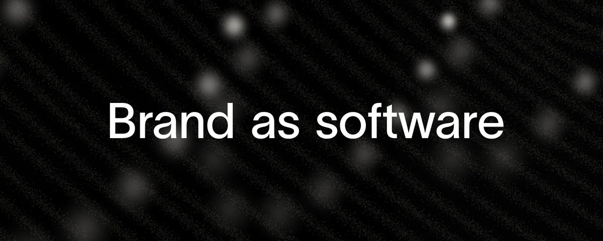
Original (article-cover, 1920x768): https://pbs.twimg.com/media/HRJpGKtXkAAu1D1.jpg

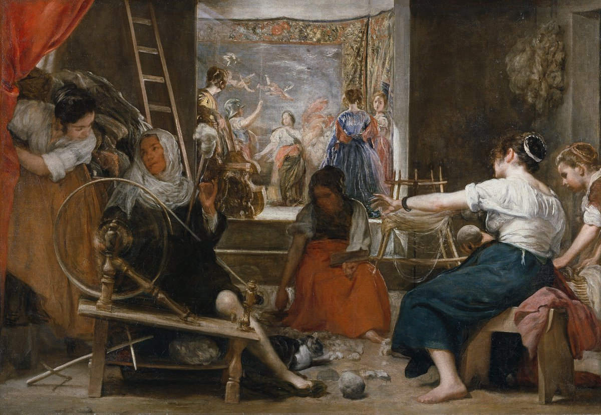
Original (article-image, 2911x2008): https://pbs.twimg.com/media/HQzfisEXwAA94Wd.jpg

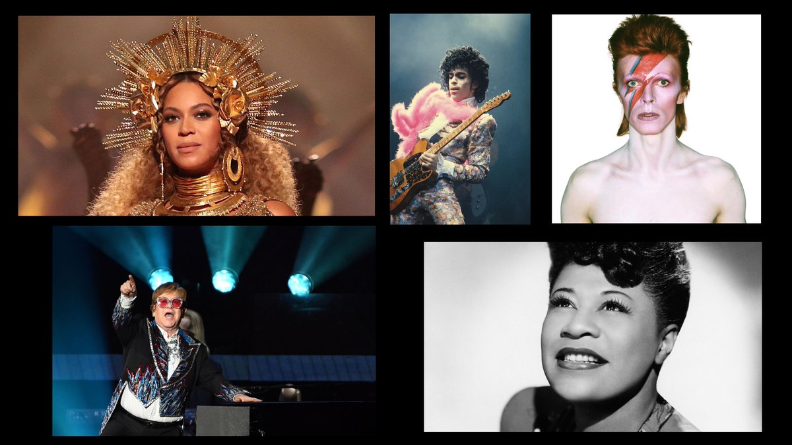
Original (article-image, 3840x2160): https://pbs.twimg.com/media/HQzn7-nWEAAJyhS.jpg

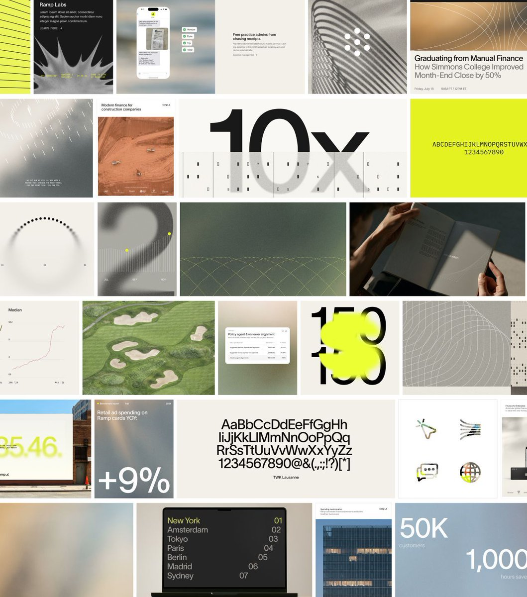
Original (article-image, 1280x1451): https://pbs.twimg.com/media/HQzpJzWXYAIHGgU.jpg

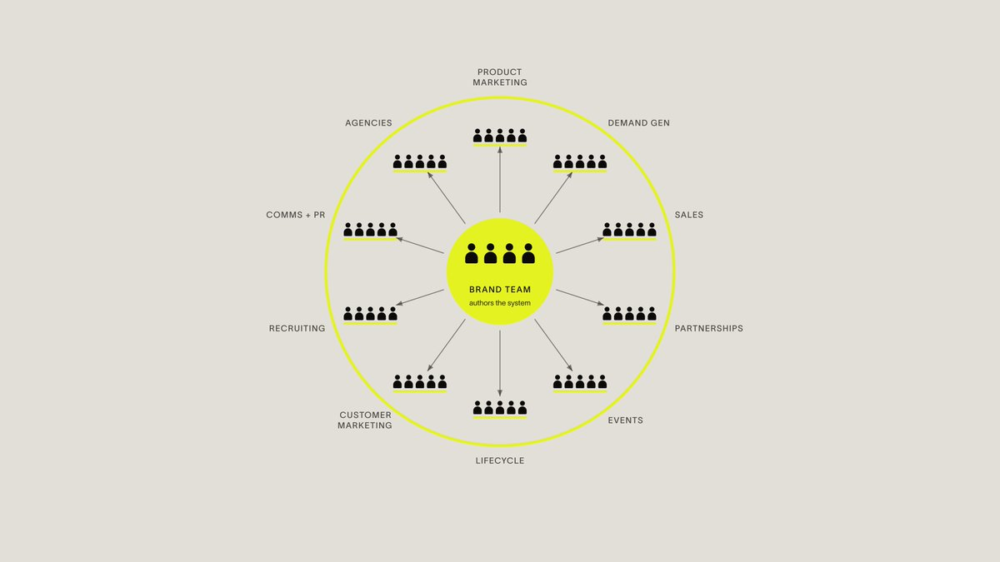
Original (article-image, 3840x2160): https://pbs.twimg.com/media/HQzqLl-XsAA4iIB.jpg

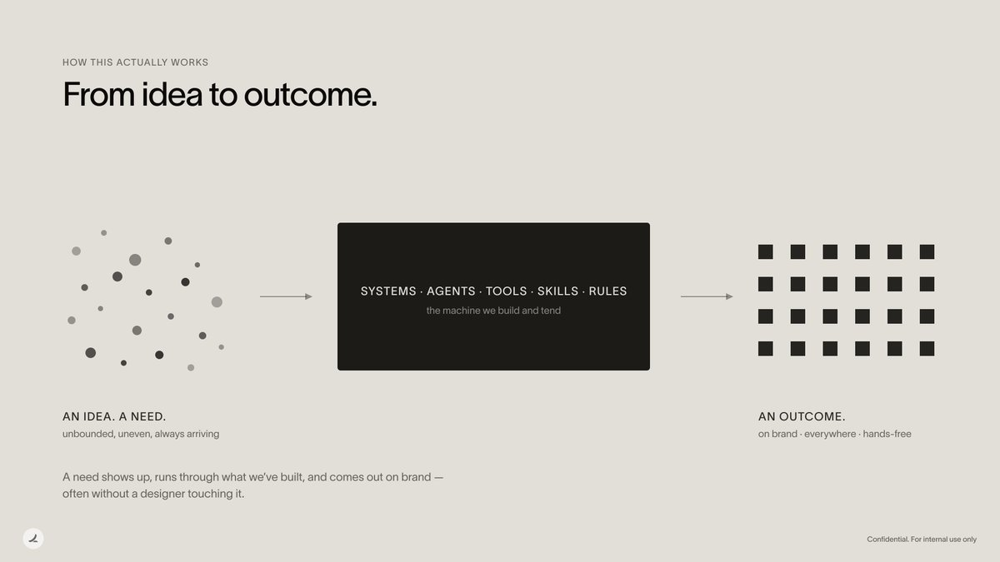
Original (article-image, 3840x2160): https://pbs.twimg.com/media/HQznHxDXQAAVoSD.jpg

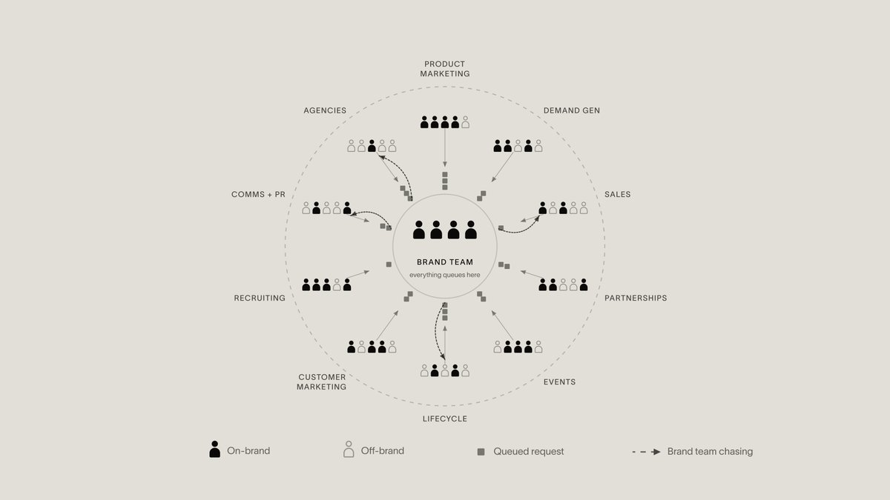
Original (article-image, 3840x2160): https://pbs.twimg.com/media/HQzh6lDWAAAkFkd.jpg

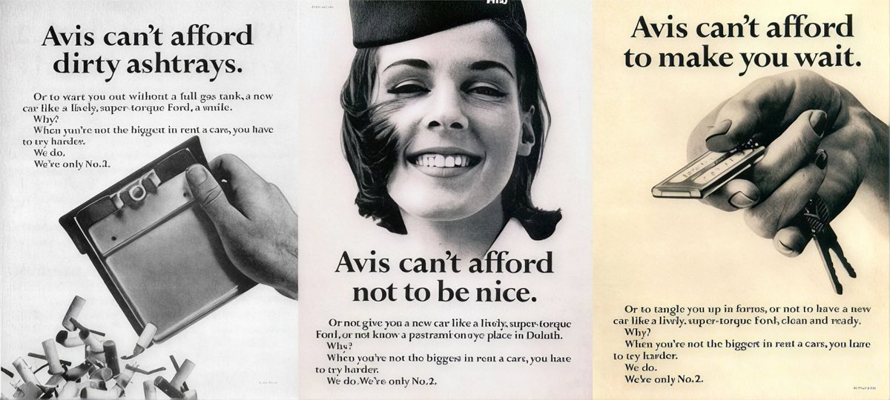
Original (article-image, 2730x1228): https://pbs.twimg.com/media/HQzqjcNWEAAa5GM.jpg

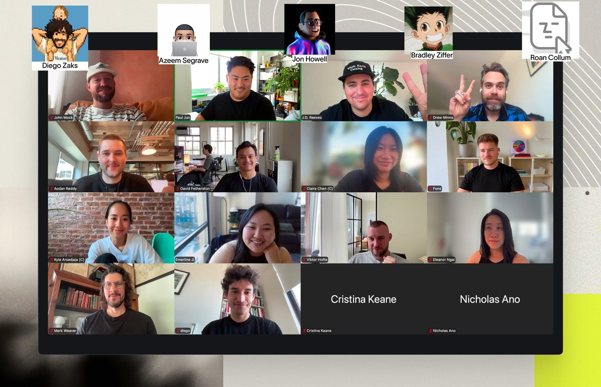
Original (article-image, 4096x2638): https://pbs.twimg.com/media/HRD-wofXYAAjeML.jpg

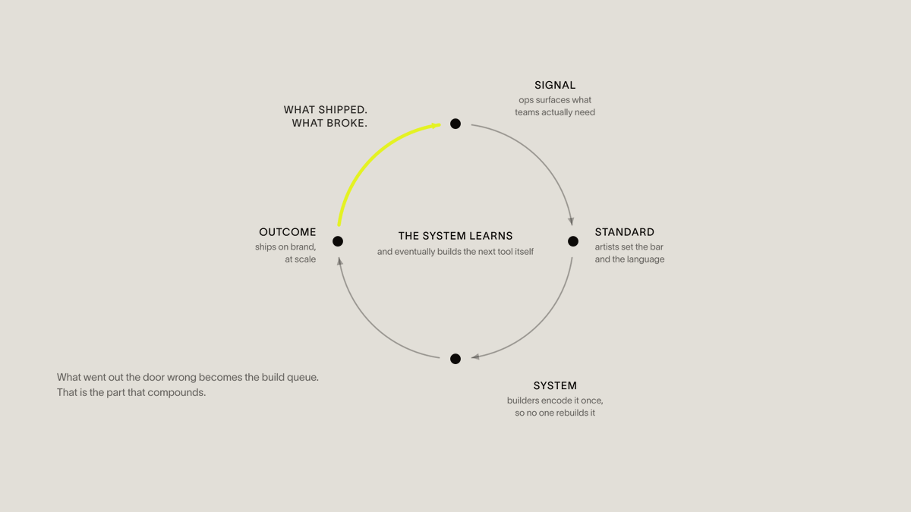
Original (article-image, 3840x2160): https://pbs.twimg.com/media/HQzn3OcWgAARkwo.png

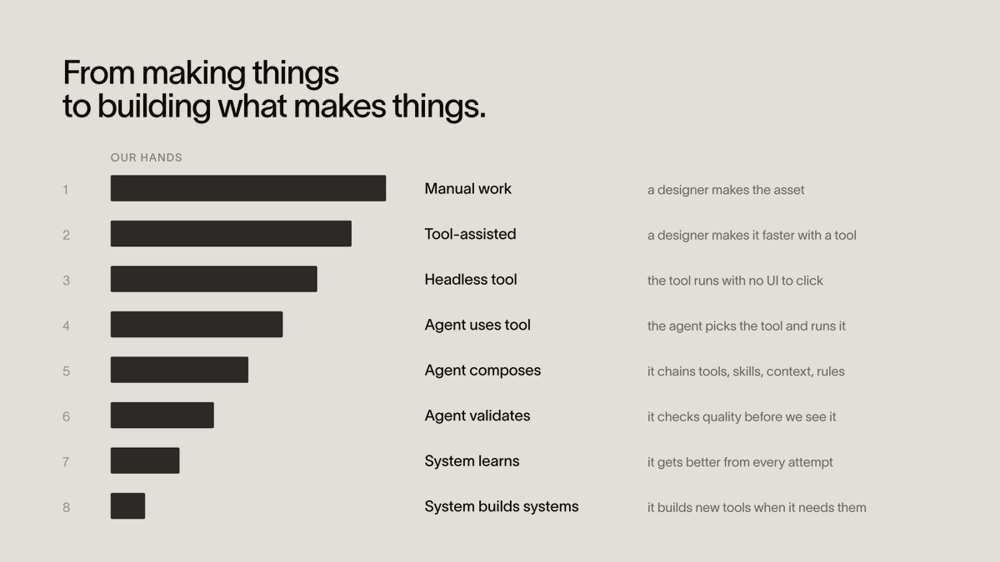
Original (article-image, 3840x2160): https://pbs.twimg.com/media/HQzpVPdXoAAjOvP.png

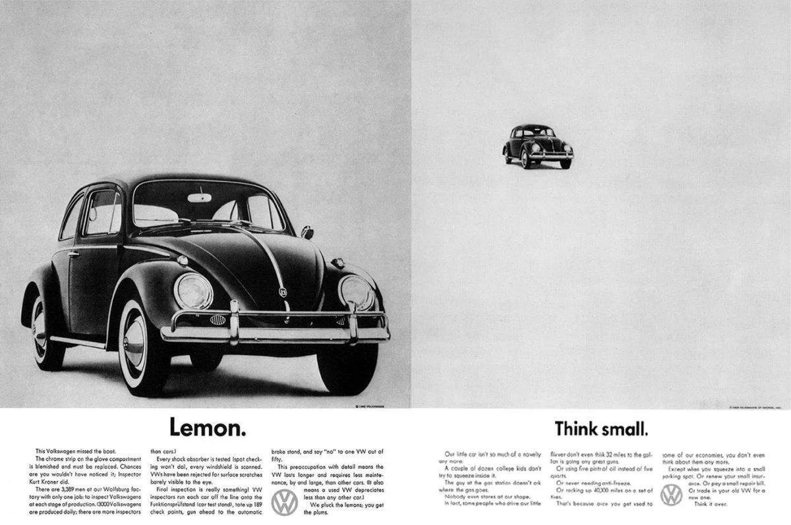
Original (article-image, 2482x1648): https://pbs.twimg.com/media/HQzqVqxWwAElrit.jpg

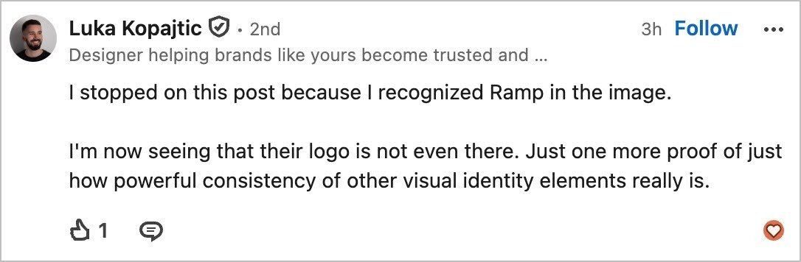
Original (article-image, 1086x356): https://pbs.twimg.com/media/HQzpH0AW0AIy-ro.jpg

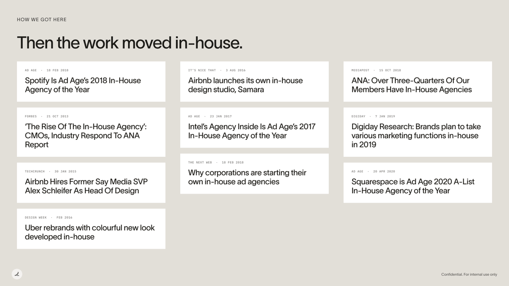
Original (article-image, 3840x2160): https://pbs.twimg.com/media/HQzhM9DXAAABI-E.png

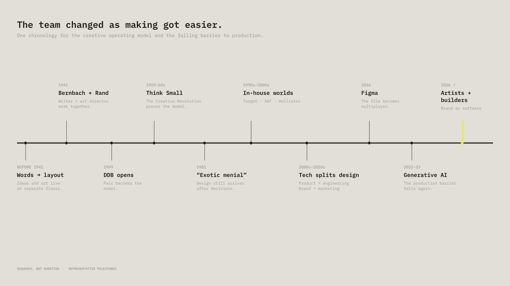
Original (article-image, 3840x2160): https://pbs.twimg.com/media/HRDHUivWYAE9qtj.png

## Author bio (at capture)

Kimchi & Gabagool
Leading brand at @tryramp
Projects: http://10m.co & http://theobservers.co

## Links

- https://x.com/i/article/2086411767148634112
- https://ramp.com/careers
- https://www.britannica.com/biography/William-Bernbach
- https://www.commarts.com/features/paul-rand
- https://time.com/archive/6860716/thinking-small-and-winning-big/
- https://designobserver.com/the-persistence-of-the-exotic-menial/
