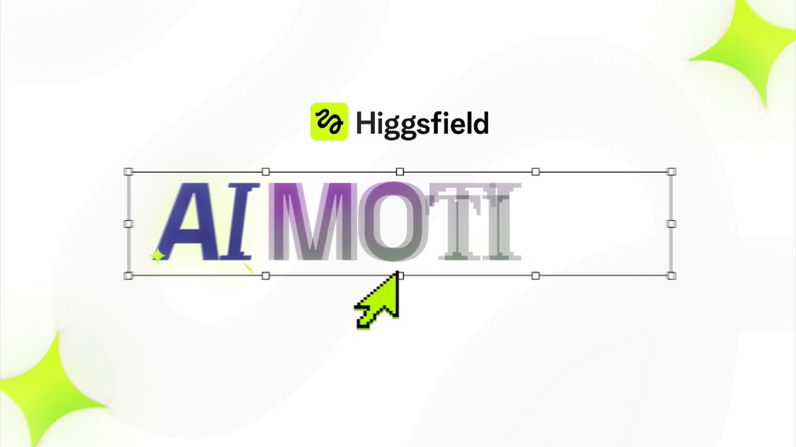

# ChatGPT can now do motion design in After Effects. Introducing Higgsfield AI Motion Designer. Our ChatGPT plugin

> Source: https://x.com/higgsfield/status/2098409362041753708 — Higgsfield AI 🧩 (@higgsfield) — Fri Sep 11 13:52:33 +0000 2026 — likes 8328 · reposts 600 · replies 286 · views 3199757 — captured 2026-09-21T13:54:06Z

> Author bio: The AI-native creative suite

## Post

**Author:** Higgsfield AI 🧩 (@higgsfield)
**URL:** https://x.com/higgsfield/status/2098409362041753708

ChatGPT can now do motion design in After Effects.

Introducing Higgsfield AI Motion Designer.

Our ChatGPT plugin understands animation principles, writes expressions, and retains context in your After Effects projects.

Try Higgsfield’s ChatGPT plugin now in After Effects.
## Media

[media/media_0.mp4](media/media_0.mp4)
Original: https://video.twimg.com/amplify_video/2098407971227398144/vid/avc1/1920x1080/jFycYXjVGgAwzmzi.mp4?tag=29

Original: https://pbs.twimg.com/amplify_video_thumb/2098407971227398144/img/hrp9Hd4kn5VL5Nxx.jpg

## Thread

### @higgsfield
**URL:** https://x.com/higgsfield/status/2098409364344463393

How to Setup Higgsfield's plugin in ChatGPT for After Effects:

## Comments

### @ostonox
**URL:** https://x.com/ostonox/status/2098683921315610722

you didn't even animate this with your own app be honest

### @alohaproxy
**URL:** https://x.com/alohaproxy/status/2098482280817930541

this might be a banger

## Links

(none)
