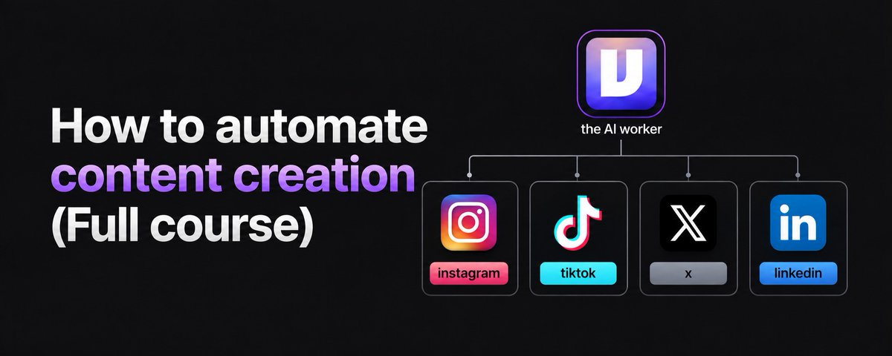
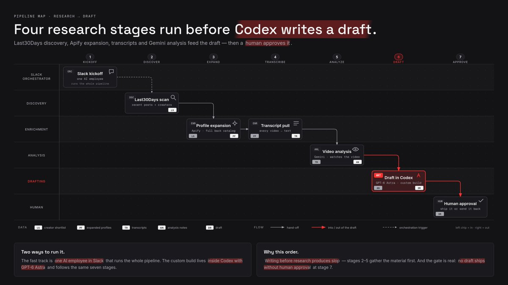
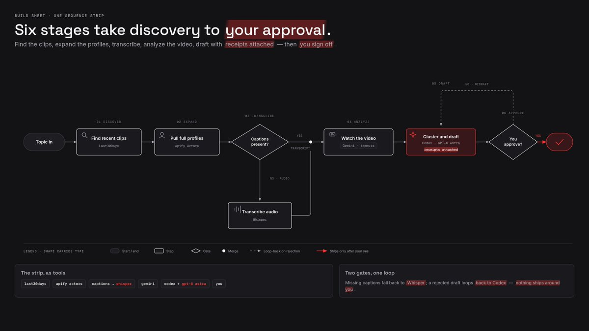
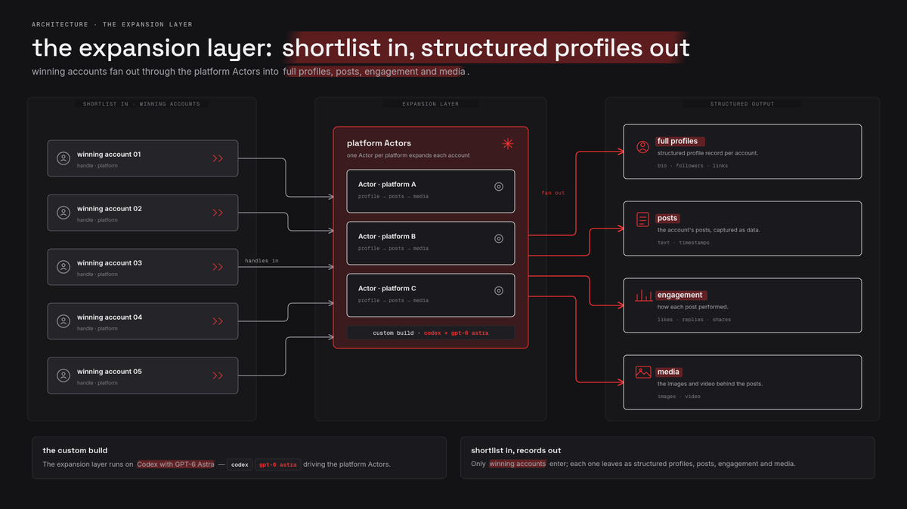
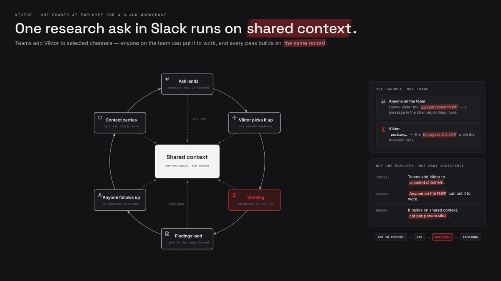
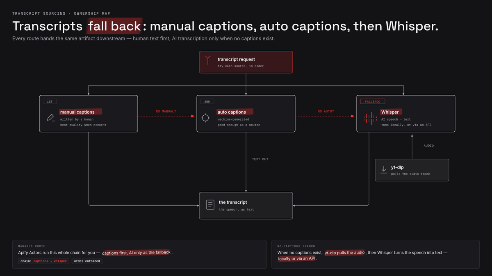

# How to automate content creation (Full Course)

> Source: https://x.com/EXM7777/status/2098414759234457878 — Machina (@EXM7777) — Fri Sep 11 14:13:59 +0000 2026 — likes 1178 · reposts 142 · replies 32 · views 390318 — captured 2026-09-21T13:54:06Z

> Author bio: running ai-powered agencies | https://t.co/fMOmHWBgHG

## Post

**Author:** Machina (@EXM7777)
**URL:** https://x.com/EXM7777/status/2098414759234457878

https://t.co/3djDOvkdsx

## Article

**Title:** How to automate content creation (Full Course)
**Article URL:** https://x.com/i/article/2098414752120913920
**Preview:** I'm basically giving you the full system i'd use to automate content creation for ANY business... every tool in the chain, every step in order, and where it breaks
because a content agent is just a

I'm basically giving you the full system i'd use to automate content creation for ANY business... every tool in the chain, every step in order, and where it breaks
because a content agent is just a research pipeline with a writing step bolted on the end
and the mistake almost everyone makes is building the writing step first
here's what's inside this article:
- why writing before research produces slop
- the fast track: one AI employee in Slack that runs the whole pipeline
- the custom build inside Codex with GPT-6 Astra
- discovery with Last30Days, profile expansion with scrapers, transcripts, and Gemini video analysis
- the limits nobody puts in the sales page
- the build sheet you can run this week
## the mistake: writing before research
a blank prompt asking for a viral post about your product gives the model nothing to stand on, so it reaches for the average of everything it has ever read... and the average of everything is generic
the fix is to invert the order: collect current evidence of what's working on each platform right now, then let the agent write from that evidence
one caveat before we start, and it's the honest one: engagement is not truth, a viral take is still just a popular one
so the pipeline you're about to build ranks attention, and you still do the judging... it does not guarantee truth, it does not replace source checking, and it does not know your audience as well as you do
that division of labor is the whole design: the agent gathers and drafts, the human verifies and approves
## the fast track: build it with Viktor
Viktor is one shared AI employee for a Slack workspace: teams add it to selected channels, anyone on the team can put it to work, and it builds on shared context instead of giving each person a separate assistant
that changes what content work feels like... you type the job in plain english, in the channel where the work already lives, and it comes back with a finished artifact: the research brief, the drafts, the report
it handles the recurring part too... schedule the weekly research run once and it repeats without anyone remembering to trigger it
and anything sensitive waits for a human, review-first approval is built in... so nothing goes out just because an agent felt confident
access follows channel membership: it reads a channel only when it's a member, and joining or leaving a channel requires explicit approval
the part that pays off over time is the shared knowledge... what it learns gets written to files the whole team shares, so a correction one person makes shows up in everyone's next run
and it connects to thousands of tools through managed connectors, most on one-click OAuth... including the kind of scrapers you'll meet below, so the whole research pipeline can run from inside Slack
if you want the simplest route to this system, that's it: Viktor in your Slack, the scrapers as its hands, your approval as the gate
that's the fast track... the rest of the article is the custom build, the one you own end to end
## the custom build: Codex with GPT-6 Astra
the owned version of this system lives inside Codex with GPT-6 Astra as the agent
the loop it runs: discover what's working now, expand the winners into full profiles, turn spoken content into text evidence, let Gemini watch the actual videos, load the business context, draft the weekly batch with receipts attached, wait for your approval
seven steps, in order
1. find what is working now
discovery starts with Last30Days, an Agent Skill you install straight into Codex:
```
npx skills add mvanhorn/last30days-skill -g -a codex
```
it researches a topic across X, Instagram Reels, TikTok and YouTube (plus Reddit and the web), pulling the posts, the engagement and the transcripts of what's winning right now
for X it pulls the timeline and ranks by topic relevance... and it can figure out the right handles and subreddits for a topic on its own
for Instagram and TikTok it searches by keyword, grabs views, likes and comments, and fetches the video transcripts for the top results
for YouTube it uses yt-dlp for both search and transcripts, no API keys needed
one operational truth: sources go down, credentials expire, platforms change their markup... treat discovery as best-effort and re-run what fails
1. expand every winning profile
discovery gives you a shortlist of accounts and posts that are working... now you turn that shortlist into full evidence with platform scrapers, small agents you point at a profile and run on demand
there's a public scraper for each platform:
- X: profiles and timelines with every post's engagement, no X account or cookies needed
- Instagram: posts, reels and comments plus the account-level view
- TikTok: everything a creator has posted, with its numbers
- YouTube: video and channel data, plus the subtitles that already exist
what your content agent needs from them is always the same: who the account is, what they posted, how each post performed, and the media itself
i run mine through Apify, but any scraper that hands back structured data does the job
that's the expansion layer: shortlist in... structured profiles, posts, engagement and media out
1. turn spoken content into evidence
short-form runs on the spoken word, so transcripts are your richest evidence... the rule is captions first, generation last
on YouTube, captions already exist for most videos, and yt-dlp downloads both uploaded subtitles and the auto-generated track
the fallback chain, in order: manual captions, then auto-generated captions, then AI transcription... only generate when no usable caption remains
because if a video has no caption track at all, no caption API can help, the text does not exist yet and has to be generated
the generation route: yt-dlp pulls the audio, then Whisper turns the speech into text, locally or via an API... and there are hosted scrapers that run this whole chain for you, captions first, AI only as the fallback
one infrastructure detail that decides whether any of this works: where your requests come from... one benchmark pulled every transcript successfully from a residential connection, failed on most from a datacenter, and failed on all of them with no proxy
1. let Gemini watch the videos
transcripts tell you what was said... they miss the hook frame, the pacing, the cut rhythm, the proof shown on screen
that's what Gemini is for: it can describe, segment and extract information from videos, answer questions about them, and refer to specific timestamps
and it hears as well as sees: transcription, telling speakers apart, emotion in speech and music... even non-speech sounds
you can feed it uploaded files or just a public YouTube url
so the prompt for each winning video is simple: map the hook, the pacing, the scene changes, the proof moments and the CTA, with a timestamp for each
two processing modes matter here
static is the default: it samples the video at one frame per second in a single pass... fine for short clips, and fast action can lose detail at that rate
agentic mode, on the newer Flash models, lets the model move through the video timeline on its own, rewatching the parts that matter at higher frame rates... on long-form content it burns way fewer tokens and comes back slightly more accurate
if the default sampling misses your niche's pacing, you can raise the frame rate in the config
know the ceilings: on the free tier you can't upload more than 8 hours of YouTube video per day, and only public videos work
1. give the agent the business context
evidence about the market is half the input... the other half is evidence about you
build a knowledge base the agent reads on every run:
- the offer, in one paragraph, with the price and the promise
- the audience: who buys, what they already tried, what they scroll past
- the voice: real posts you published, marked good or bad
- approved examples and rejected angles, so taste accumulates
- permanent corrections... every note you'd otherwise repeat becomes a rule
this is the difference between an agent that drafts for your business and an agent that drafts for a category
1. turn the evidence into the weekly batch
now Codex with GPT-6 Astra earns its seat
the weekly run: cluster the research into patterns, propose angles that match a pattern to your offer, draft each piece from the evidence, attach the receipts (the source posts, the transcript lines, the Gemini timestamps), and stop
it waits for approval... nothing publishes on its own
the receipts are the point: when a draft claims a hook style is working, you can click through to the video that proves it, and when it can't attach a receipt, that's your signal the line is invented
1. make every run improve the next
one run is a batch, the loop is the asset
refresh the research on a schedule, compare the new winners against the library, and save every correction you make as a rule for the next run... the same shared-knowledge idea Viktor uses at the workspace level, applied to your own agent
each cycle the drafts start closer to publishable, because the knowledge base absorbed last cycle's edits
## the limits
everything above is real, and all of it has edges... here they are so you don't learn them in production
- X coverage is partial: some tweets won't appear in search results, and the timeline you scrape is a ranked public feed, not a complete archive
- Instagram: private profiles can't be scraped, and public metrics are logged-out snapshots
- TikTok comment extraction is not guaranteed to be complete
- YouTube subtitle extraction has known failure modes... test it on your target channels before trusting it
- some videos have no caption track at all... an empty response you can fix with a better connection, a missing track you can only fix by generating
- Gemini at one frame per second can miss fast movement, and users report on-screen text extraction going wrong where screenshots of the same video work
- duration limits differ by platform and model, so check your exact stack before batching long videos
- pagination, caps and pricing on every scraper change without notice... re-verify quarterly
- and the standing rule: publishing stays behind human approval, because the agent ranks attention and you own truth
honest limits are what make the system trustworthy enough to actually run
## the build sheet
the whole system in one line:
> Last30Days for discovery → platform scrapers for full profiles → captions then Whisper for transcripts → Gemini for timestamped video analysis → Codex with GPT-6 Astra to cluster, draft and attach receipts → you approve
set it up in an afternoon, run it weekly, save every correction, and each batch starts better than the last
and if you'd rather skip the wiring entirely... Viktor is the fast track: one AI employee in your Slack, the scrapers connected as its hands, tasks typed in plain english, review-first approvals, shared knowledge across your whole team
try for free @viktor_com - you get $100 in credits, no card needed at viktor.com
paid partnership

## Media


Original: https://pbs.twimg.com/media/HR8RE-wbgAEkBMW.jpg


Original: https://pbs.twimg.com/media/HR8RFKTaAAAWeOv.jpg


Original: https://pbs.twimg.com/media/HR8RGI2bgAA9kTl.jpg


Original: https://pbs.twimg.com/media/HR8RFnLbgAApQ57.png


Original: https://pbs.twimg.com/media/HR8RFZPbsAAYITa.jpg


Original: https://pbs.twimg.com/media/HR8RF5FaYAA8xvf.png

## Thread

(no author self-replies found)

## Comments

### @lucas_builds
**URL:** https://x.com/lucas_builds/status/2098445573451833587

The knowledge base takes your posts as voice examples marked good or bad, and leaves their numbers out. That is the only evidence from your own audience. Where does it enter the loop?

### @Nobodys_Perfext
**URL:** https://x.com/Nobodys_Perfext/status/2098530700324446509

I said something is weird about this and it starts with 30 day search… WHY WOULD I INSTALL SMTH THAT EVEN TERMINAL SCREAMS IN RED THAT IT IS “HIGH RISK”?!

### @brightcozytech
**URL:** https://x.com/brightcozytech/status/2098554036651962799

@grok
 please do me a Favour. Break this down into the most simplest form of understanding and like step one do this and so on

### @TPupich9708
**URL:** https://x.com/TPupich9708/status/2101063416467067174

So you actually admit where the whole chain breaks, not just the wins? That honest part is what I want to see.

### @Elev_30
**URL:** https://x.com/Elev_30/status/2098435369897177501

agreed. at our clients the material that decides the piece only lives in someone's head.

### @NextGenByGreg
**URL:** https://x.com/NextGenByGreg/status/2098669830278725977

Soon will be called content co creation

### @traqscales
**URL:** https://x.com/traqscales/status/2099114196122173673

Machina dropping bangers as usual

### @ZacharyMelinger
**URL:** https://x.com/ZacharyMelinger/status/2098452374389923869

Your actually him for this

### @neil_xbt
**URL:** https://x.com/neil_xbt/status/2098540825583988947

Very insightful!

### @Vic_x_Irem
**URL:** https://x.com/Vic_x_Irem/status/2098545165677773197

POV: You open X

### @rewind02
**URL:** https://x.com/rewind02/status/2098424962616873351

this helps


## Links

- https://x.com/i/article/2098414752120913920
