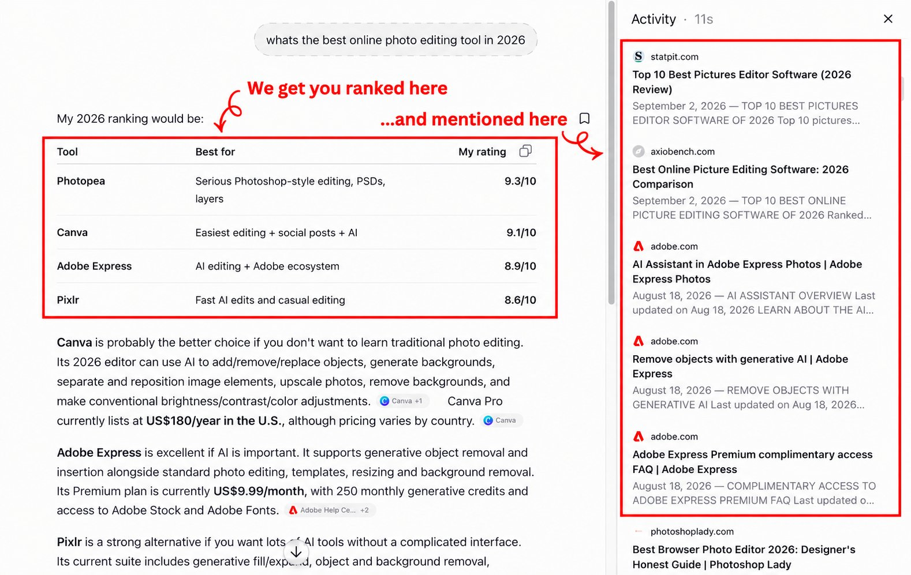

# BREAKING: Today, we witnessed the future of marketing. A tiny brand can now outrank a company doing $6M/month in AI

> Source: https://x.com/Crowdreply_io/status/2098422113594155011 — CrowdReply (@Crowdreply_io) — Fri Sep 11 14:43:13 +0000 2026 — likes 892 · reposts 46 · replies 29 · views 314053 — captured 2026-09-21T13:54:06Z

> Author bio: The new benchmark of ranking in AI Answers

## Post

**Author:** CrowdReply (@Crowdreply_io)
**URL:** https://x.com/Crowdreply_io/status/2098422113594155011

BREAKING: Today, we witnessed the future of marketing.

A tiny brand can now outrank a company doing $6M/month in AI search just by getting mentioned on the pages the models already trust.

This is insane.
## Media

Original: https://pbs.twimg.com/media/HR8W3NLbQAEeXRe.jpg?name=orig

## Thread

(no author self-replies found)

## Comments

### @AiwithSaif7
**URL:** https://x.com/AiwithSaif7/status/2098666413858906604

I'm saif AI, an AI Researcher and Content Creator focused on AI, automation, and emerging technologies. I help innovative projects increase visibility and reach a targeted AI audience through strategic promotion.
If you're looking to grow awareness for your project, I'd be happy

### @JohnsonKin29810
**URL:** https://x.com/JohnsonKin29810/status/2101387902064226608

So a small brand can outrank big names just by getting ranked in those lists? That sounds both exciting and a little terrifying for marketers.

### @knowixbuilds
**URL:** https://x.com/knowixbuilds/status/2098444158444683735

I'm sure we all can see where this is heading lol. marketers are going to start fighting over the sources these models trust most

### @andrewseld
**URL:** https://x.com/andrewseld/status/2098441051342004546

I want to be as resilient as SEO.

That thing came out almost 30 years ago and it still matters, dang

### @aiseomastery
**URL:** https://x.com/aiseomastery/status/2098926644325204423

tiny brand outranking big spenders ngl huge

### @BruInoff
**URL:** https://x.com/BruInoff/status/2098542107816280285

@grok
 explain it to me

### @dawoodkhan254
**URL:** https://x.com/dawoodkhan254/status/2098422854643847442

This is insane

## Links

(none)
