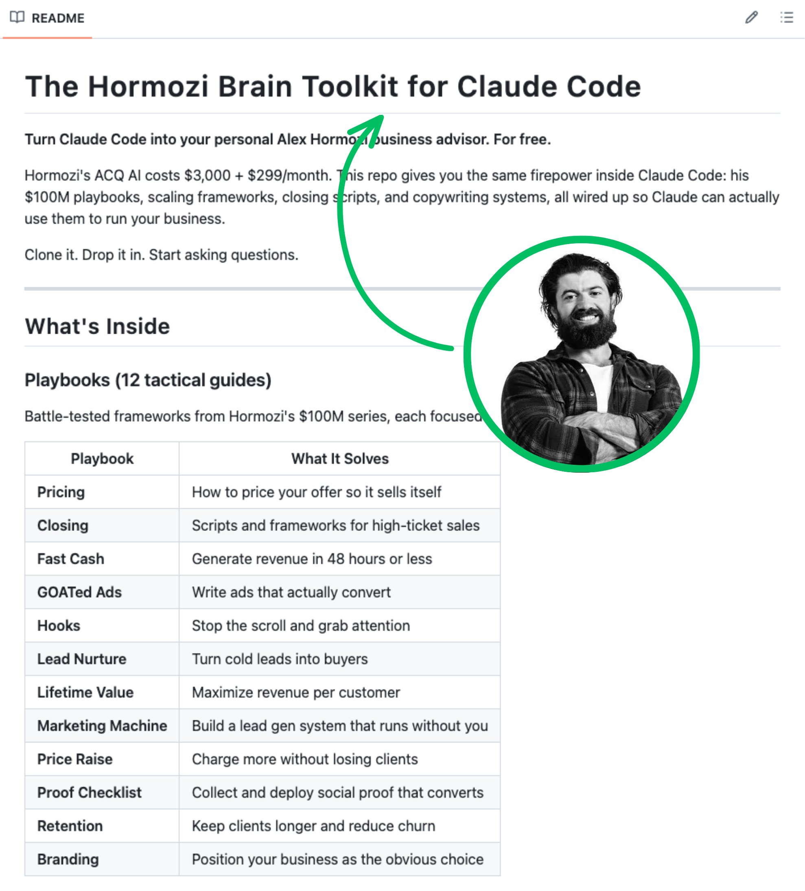

# steal Alex Hormozi's $100M playbook for free with this repo right here. Hormozi's own paid AI advisor, ACQ AI, costs

> Source: https://x.com/oliviscusAI/status/2098448848998068383 — Oliver Prompts (@oliviscusAI) — Fri Sep 11 16:29:27 +0000 2026 — likes 323 · reposts 21 · replies 9 · views 27617 — captured 2026-09-21T13:54:06Z

> Author bio: Helping you understand AI. Software Engineer. Opinions are personal. DM for collabs.

## Post

**Author:** Oliver Prompts (@oliviscusAI)
**URL:** https://x.com/oliviscusAI/status/2098448848998068383

steal Alex Hormozi's $100M playbook for free with this repo right here.

Hormozi's own paid AI advisor, ACQ AI, costs $3,000 upfront plus $299/month. this repo wires the same public frameworks into Claude Code instead.

what's inside:

> 12 playbooks: pricing, closing, ads, hooks, retention, LTV, branding
> the full 10-stage scaling course, $0 to $10M+
> 5 ready-to-use prompts for offers, scripts, & ad copy

use it with:
git clone https://github.com/antonio-clicktoclose/hormozi-claude-code-brain.git
cd hormozi-claude-code-brain && claude
## Media

Original: https://pbs.twimg.com/media/HR8vXsQbcAAHR_g.jpg?name=orig

## Thread

### @oliviscusAI
**URL:** https://x.com/oliviscusAI/status/2098448852244402676

repo: 
https://
github.com/antonio-clickt
oclose/hormozi-claude-code-brain
…

follow me for more useful tools like this.

## Comments

### @AIGryffindor
**URL:** https://x.com/AIGryffindor/status/2098458949347590251

hormozi's paying $3k for this stuff and someone just put it in claude code for free. how does this not break the internet?

### @Spywrites
**URL:** https://x.com/Spywrites/status/2098628740465246275

That's what I am waiting for yesterday I was thinking to put alex harmozi video in notebook lm and here you given this

### @dreamfirms
**URL:** https://x.com/dreamfirms/status/2098753832880689550

Your missing the 3000+ pages of one on one consulting he did

### @kennykamdoum
**URL:** https://x.com/kennykamdoum/status/2098782827051418108

Now do Russell Brunson

### @LuckyPhelps
**URL:** https://x.com/LuckyPhelps/status/2098642630456271284

OP FTW!  TY Oliver!

## Links

- https://github.com/antonio-clicktoclose/hormozi-claude-code-brain.git
