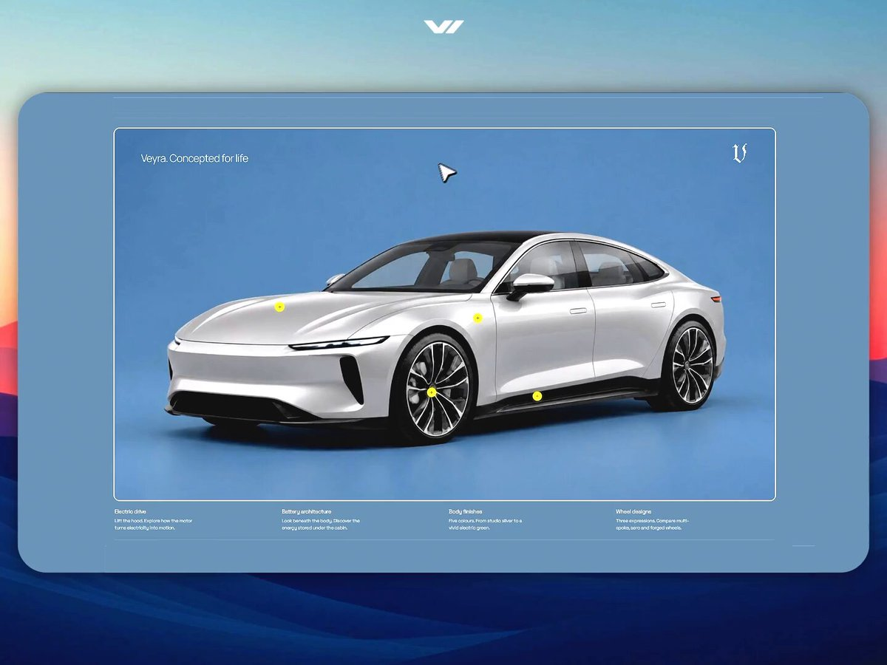

# GPT-6 Astra is a design beast No 3D models used in this demo website I connected LTX API to my coding agent ->

> Source: https://x.com/AmirMushich/status/2098464881498370090 — AmirMušić (@AmirMushich) — Fri Sep 11 17:33:09 +0000 2026 — likes 623 · reposts 60 · replies 73 · views 244311 — captured 2026-09-21T13:54:06Z

> Author bio: Creative architect. Ex-Warner Music, PepsiCo, Spotify fr. designer. Fusing 10+ yr of brand & ad design with AI. Collabs: amir@amirmushich.com

## Post

**Author:** AmirMušić (@AmirMushich)
**URL:** https://x.com/AmirMushich/status/2098464881498370090

GPT-6 Astra is a design beast

No 3D models used in this demo website
I connected LTX API to my coding agent -> generated video transitions + used GPT Images 2.5 to select car colors & wheels

GitHub repo + website prompt + ZIP proj. 👇
## Media

[media/media_0.mp4](media/media_0.mp4)
Original: https://video.twimg.com/amplify_video/2098459847088103424/vid/avc1/1440x1080/Fgbj3y7Hjf1FIKlb.mp4?tag=29

Original: https://pbs.twimg.com/amplify_video_thumb/2098459847088103424/img/8Q85Yp1K30Liqsz0.jpg

## Thread

### @AmirMushich
**URL:** https://x.com/AmirMushich/status/2098468123674390941

Thank you baby

### @AmirMushich
**URL:** https://x.com/AmirMushich/status/2098470145756643549

this is the new world we're living in

### @AmirMushich
**URL:** https://x.com/AmirMushich/status/2098472082593992919

what's the tool sir?

### @AmirMushich
**URL:** https://x.com/AmirMushich/status/2098719628272783754

thank you!

### @AmirMushich
**URL:** https://x.com/AmirMushich/status/2098720036319858836

what a slap!

### @AmirMushich
**URL:** https://x.com/AmirMushich/status/2098472511180624259

do we wanna do one & shill our services sir? :)

### @AmirMushich
**URL:** https://x.com/AmirMushich/status/2098483164146458785

not sure about that, but might be the case on 
@OpenRouter
 or Hermes (or other platforms)

@grok
 any ideas?

## Comments

### @VisionSurge
**URL:** https://x.com/VisionSurge/status/2098474006168940937

The LTX transitions make a huge difference. Without them it could've felt like another nice AI landing page. The motion is what makes the whole thing feel premium.

### @woodchipdaddy
**URL:** https://x.com/woodchipdaddy/status/2098470933602419073

My `pro-cli` tool can be really useful for letting the AI access your chatgpt subscriptions for free from the terminal too

### @DanielOAyo
**URL:** https://x.com/DanielOAyo/status/2098481062774968439

@AmirMushich
 is there a way to get a free test for astra? 

I would love to try it out iwl

### @ai_pmer
**URL:** https://x.com/ai_pmer/status/2098644646767538500

The effect is very cool, and I look forward to seeing more interesting projects

### @CoderGeeta
**URL:** https://x.com/CoderGeeta/status/2098584991839973533

the car has better product instincts than most founders

### @ArtChains_
**URL:** https://x.com/ArtChains_/status/2098468886383386938

can't believe no 3D was used..

### @poletaeviktor
**URL:** https://x.com/poletaeviktor/status/2098472392867602799

Is this a website for Kia?

## Links

(none)
