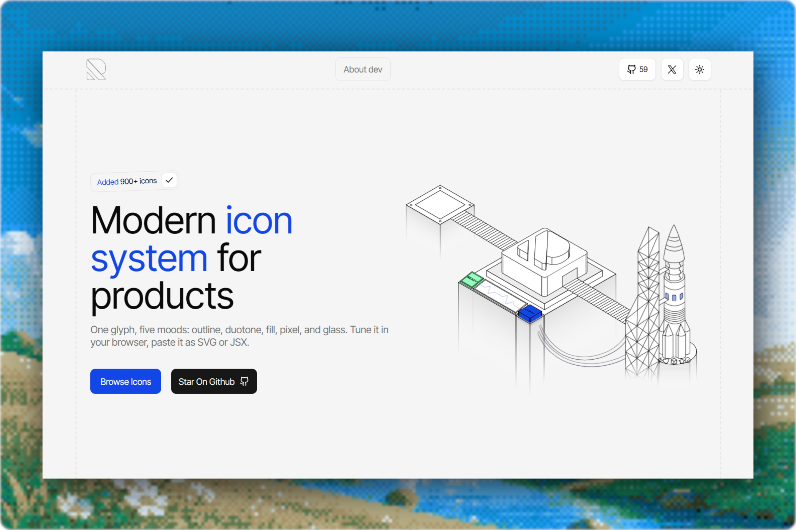

# An open-source icon library where every glyph comes in five styles: outline, duotone, fill, pixelated, and glass. Link

> Source: https://x.com/dhruvtwt_/status/2098478108257185798 — Dhruv (@dhruvtwt_) — Fri Sep 11 18:25:43 +0000 2026 — likes 1523 · reposts 112 · replies 26 · views 145908 — captured 2026-09-21T13:54:06Z

> Author bio: 22 // Observer • Figuring जीवन • DM for Collab

## Post

**Author:** Dhruv (@dhruvtwt_)
**URL:** https://x.com/dhruvtwt_/status/2098478108257185798

An open-source icon library where every glyph comes in five styles: outline, duotone, fill, pixelated, and glass.

Link : https://runeicons.com
## Media

Original: https://pbs.twimg.com/media/HR9KKeAaoAAgHxW.jpg?name=orig

## Quoted post

**Author:** Nexvyn (@nexvyn)
**URL:** https://x.com/nexvyn/status/2098050463820353924

Rune Icons is live. 

900+ icons, each in 5 styles: outline, duotone, fill, pixel, and glass. 

You can reshape any path in the browser and copy it as SVG or JSX.

Free, open source, no sign-up.   runeicons{.}com https://t.co/It6m2nx8T6

## Thread

(no author self-replies found)

## Comments

### @ShubhamJhaDev
**URL:** https://x.com/ShubhamJhaDev/status/2098651131522289988

the real test for any icon lib is tree shaking. 900 icons times 5 styles is 4500 assets, if the unused ones aren't getting cut your bundle analyzer is going to have a bad day

### @akashp1712
**URL:** https://x.com/akashp1712/status/2098671860804436091

I have a different question, where do I get such motion components to show systems? I find it on many YC startup websites.

### @sebuzdugan
**URL:** https://x.com/sebuzdugan/status/2098788380888715533

does path editing preserve stroke alignment, because small icons blur when it shifts

### @itsGrizai
**URL:** https://x.com/itsGrizai/status/2098745584588824621

reshaping paths in the browser is the feature, the styles are the doorway

### @MrBrjan
**URL:** https://x.com/MrBrjan/status/2098597412227240009

the flexibility of having five styles is a huge time-saver for projects

### @alexneyret
**URL:** https://x.com/alexneyret/status/2098780236326359290

Congrats on the edit part, perfect end-to-end +really original !

### @KASHIFALIKHAN94
**URL:** https://x.com/KASHIFALIKHAN94/status/2098629733194117511

reshaping paths right in the browser is super slick

### @guptaaajiii
**URL:** https://x.com/guptaaajiii/status/2098516120181547219

Cool icons.

### @spiderio
**URL:** https://x.com/spiderio/status/2099143577716863468

Icons nice

### @DevJachi_
**URL:** https://x.com/DevJachi_/status/2098857614566150615

great ui!

### @letstri
**URL:** https://x.com/letstri/status/2098825888594874694

Dude

## Links

- https://runeicons.com
