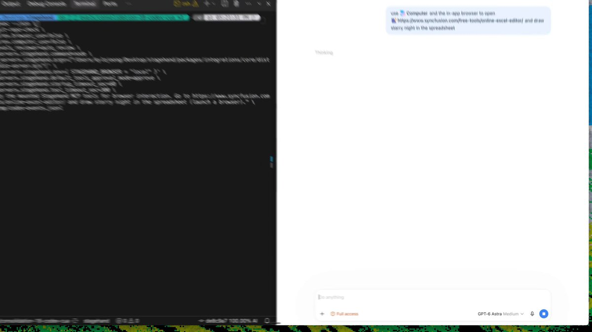

# we reverse engineered astra's computer use and made it 2x faster.

> Source: https://x.com/kylejeong/status/2098478826464702556 — Kyle Jeong (@kylejeong) — Fri Sep 11 18:28:34 +0000 2026 — likes 2701 · reposts 118 · replies 81 · views 193599 — captured 2026-09-21T13:54:06Z

> Author bio: growth engineering @browserbase | also @vestucla @kp_fellows math/cs @ucla

## Post

**Author:** Kyle Jeong (@kylejeong)
**URL:** https://x.com/kylejeong/status/2098478826464702556

we reverse engineered astra's computer use and made it 2x faster.
## Media

[media/media_0.mp4](media/media_0.mp4)
Original: https://video.twimg.com/amplify_video/2098476833075507200/vid/avc1/1924x1080/nbK499BXSKSd1HJQ.mp4?tag=29

Original: https://pbs.twimg.com/amplify_video_thumb/2098476833075507200/img/XM17rdWfGWeYO5i-.jpg

## Thread

(no author self-replies found)

## Comments

### @M_Consistent
**URL:** https://x.com/M_Consistent/status/2098778008542687581

How does the batching work? 

I was working on a similar problem, so curious as to how the LLM is able to predict the right elements showing up on the screen, or even which elements for that matter

### @codeitlikemiley
**URL:** https://x.com/codeitlikemiley/status/2098573380387831819

i built something similar 

https://
github.com/hexuria/revers
e-web-mcp
…

for web and wasm

while

https://
github.com/hexuria/gpui-a
gent
… 

this one i use with my gpui rust based desktop app

### @solarxcryptox
**URL:** https://x.com/solarxcryptox/status/2098665620841836991

This is more interesting than another benchmark. If computer use can be made 2x faster just by optimizing the interaction loop, there is clearly still a lot of headroom.

### @ayaankhan_x
**URL:** https://x.com/ayaankhan_x/status/2098657672685924547

where did the latency actually live - screenshot round trips, or model time? asking because that answer decides whether everyone else can copy the trick

### @Voxlessa
**URL:** https://x.com/Voxlessa/status/2098768592045252930

Is the speedup measured per action or across a completed task, and does the success rate hold? A faster click only tells part of the story.

### @toeknee_kim
**URL:** https://x.com/toeknee_kim/status/2098585455381909943

i am afraid being 2x faster does not make me 2x faster. the usage limit will still be my bottleneck

### @rein_software
**URL:** https://x.com/rein_software/status/2098721261815996916

@NousResearch
 sounds interesting we can now have a swift computer use don't we?

### @micko_solac
**URL:** https://x.com/micko_solac/status/2098907521683698017

How does it handle unfamiliar pages, auth requirements, or uploading files?

### @MnehmosTMRI
**URL:** https://x.com/MnehmosTMRI/status/2098528975543017543

You should try this tool if you don’t already have one.

### @nabendu82
**URL:** https://x.com/nabendu82/status/2099845707012215007

Good work even with Astra been completely closed source

## Links

(none)
