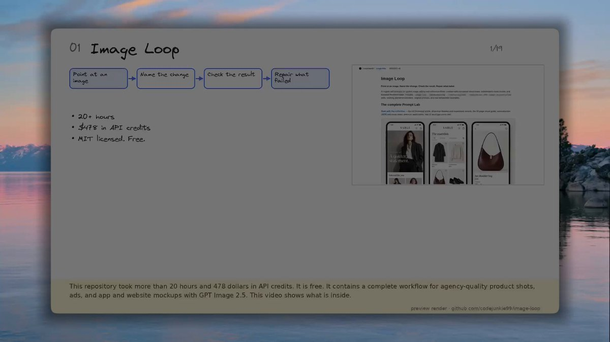

# i can’t believe this is free... i spent 15+ hours and $478 in API credits figuring out how to make GPT Image 2.5

> Source: https://x.com/Av1dlive/status/2098703746436153568 — Avid (@Av1dlive) — Sat Sep 12 09:22:19 +0000 2026 — likes 140 · reposts 17 · replies 26 · views 17190 — captured 2026-09-21T13:54:06Z

> Author bio: I write, read and build | I normie-maxx | builder of agentic-stack (now on MacOS) | upcoming PhD student

## Post

**Author:** Avid (@Av1dlive)
**URL:** https://x.com/Av1dlive/status/2098703746436153568

i can’t believe this is free...

i spent 15+ hours and $478 in API credits figuring out 

how to make GPT Image 2.5 produce agency-quality product shots, app ,webmockups... 

[now you can steal the entire workflow: ↓]

→ 5 agent skills for reconstruction, editing, reverse-engineering, mixing references, and checking + fixing results

→ a 50-page visual guide, the full illustrated article, and 12 visual explainers

→ 95 saved prompts, a searchable library, and 44 illustrated studies

→ interactive image maps, reusable JSON, Python tools, source images, before/afters, experiment records, and repair logs

product shots. ads. app and website mockups. posters. infographics.

the source code and downloadable skill packs are included. 

install them in Codex or Claude Code, add your references, and let your agent build the prompts.
## Media

[media/media_0.mp4](media/media_0.mp4)
Original: https://video.twimg.com/amplify_video/2098703603250974720/vid/avc1/1920x1080/tu-9iB068rRuQYtO.mp4?tag=29

Original: https://pbs.twimg.com/amplify_video_thumb/2098703603250974720/img/-M2h1gcap00oEkBn.jpg

## Quoted post

**Author:** Avid (@Av1dlive)
**URL:** https://x.com/Av1dlive/status/2098055179761525165

https://t.co/ADXxWNbnN1

## Thread

(no author self-replies found)

## Comments

### @0xSecta
**URL:** https://x.com/0xSecta/status/2098705963695939837

the repair logs and experiment records give the prompt library a reproducibility layer

that makes image workflows easier to inspect and repeat than a folder of isolated prompts

### @0xKravn
**URL:** https://x.com/0xKravn/status/2098741932004425785

went through the same trial and error with product shots. the lighting consistency across a whole set was the part that kept breaking, not the single hero image.

### @itsthedonhashim
**URL:** https://x.com/itsthedonhashim/status/2098715202304843973

@Av1dlive
 wow, 15 hours and $478! been there with API costs. curious to see how you optimized it for agency-quality shots.

### @dhinnaship_ico
**URL:** https://x.com/dhinnaship_ico/status/2098732692871237761

Which reconstruction skill param most affects lighting consistency in those product shots?

### @BrianHaDu
**URL:** https://x.com/BrianHaDu/status/2098759095683883250

those hours spent make it clear how valuable this info is for builders like us

### @asaridarr
**URL:** https://x.com/asaridarr/status/2098734676982526213

damn thats rough so did most of it go on failed prompts or the final runs??

### @EgorJioo
**URL:** https://x.com/EgorJioo/status/2098708036273451199

repair logs make future image iterations easier to audit

### @fr_axvra
**URL:** https://x.com/fr_axvra/status/2098773910066188387

damn man since when you got subscription? for your acc?

### @wandermist
**URL:** https://x.com/wandermist/status/2098718036794519807

saved!

## Links

(none)
