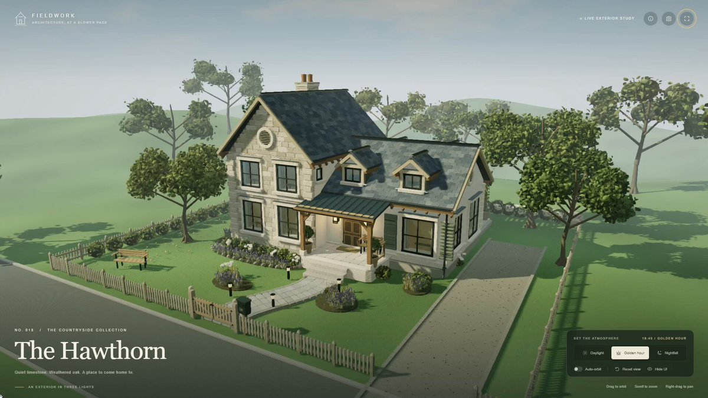
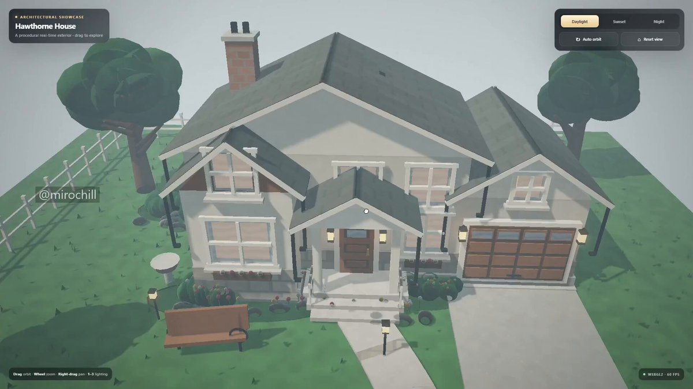

# Bordel, avant sa sortie, je trouvais GPT-5.6 Pro incroyable en 3D… mais maintenant que je le compare à Astra, c’était

> Source: https://x.com/mirochill/status/2098719191817707762 — @mirochill (Mirochill) — posted Sat Sep 12 10:23:42 +0000 2026 — 158,324 views · 1,085 likes · 23 replies · 64 reposts · 580 bookmarks · 6 quotes (at capture)

> Author bio: Je teste les nouveaux modèles d’IA dès leur sortie 🔥 / Fan d'anime et d'IA ! /  / CPP: ArtCraft, PolloAI, Hailuo / Collaboration : mirochill.contact@gmail.com

> Captured: 2026-09-21T14:11:16Z

## Post

@mirochill

Bordel, avant sa sortie, je trouvais GPT-5.6 Pro incroyable en 3D… mais maintenant que je le compare à Astra, c’était vraiment du slop 😭

Regardez l’évolution avec exactement le même prompt : j’ai demandé à GPT-6 Pro de refaire le test, et le résultat est simplement incroyable.

Je préfère toujours les transitions jour/nuit de GPT-5.6 Pro, mais en termes de détails, de modélisation et surtout de qualité de la maison elle-même, on est clairement sur un autre niveau !

## Media

[media/media_0.mp4](media/media_0.mp4)

43.5s video (`media/media_0.mp4`, 1280x720, 10.0 MB).
Original (video): https://video.twimg.com/amplify_video/2098716711994159113/vid/avc1/1920x1080/sGCFvtVbG2vrf622.mp4?tag=29

## Quoted post

[Mirochill (@mirochill), Sun Jun 21 13:42:35 +0000 2026](https://x.com/mirochill/status/2068691050869211648) — 363,968 views · 1,657 likes · 83 replies · 118 reposts · 938 bookmarks

> GPT 5.6 Pro me prouve encore qu'il comprend très bien la 3D.
>
> En seulement 30 minutes, il a généré une maison complète en 3D dans un unique fichier .html, en utilisant uniquement WebGL2.
>
> La structure est cohérente, les volumes sont crédibles et l'ensemble est directement navigable dans le navigateur. Il reste quelques incohérences, notamment sur certaines fenêtres, mais la progression est impressionnante.
>
> À ce rythme, ce type de défauts risque de disparaître bien plus vite qu'on ne l'imagine 👀

[media/quoted-video.mp4](media/quoted-video.mp4)

Quoted 32.9s video (`media/quoted-video.mp4`, 1280x720, 5.4 MB).
Original (quoted video): https://video.twimg.com/amplify_video/2068690363296931840/vid/avc1/1920x1080/qybOcIlM9SygKz30.mp4?tag=28

## Comments

### @andra_volya — [2099049073437532642](https://x.com/andra_volya/status/2099049073437532642)

> how does it handle complex geometry without crashing?

### @henryhill445732 — [2099013791019385187](https://x.com/HenryHill445732/status/2099013791019385187)

> 植被和地形效果不太好，要拿来源去整合

### @moueza — [2099203262893175051](https://x.com/moueza/status/2099203262893175051)

> Vs 3Ds

### @ericdengca — [2098777508208664990](https://x.com/EricDengCa/status/2098777508208664990)

> Worlds apart, I've tested this too.

## Links

- https://x.com/mirochill/status/2068691050869211648
