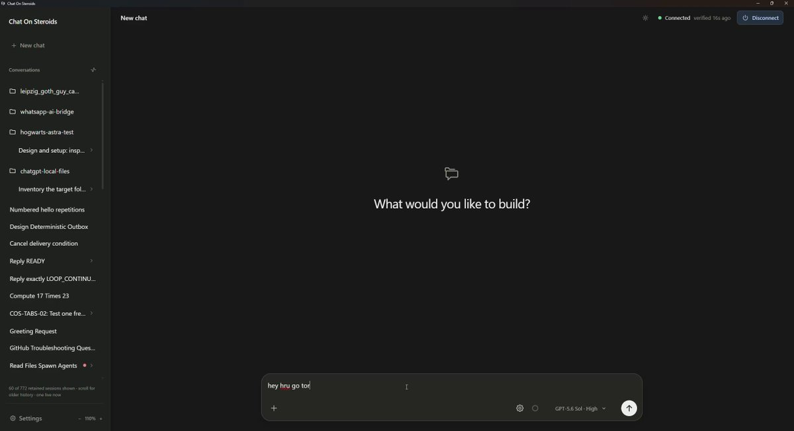
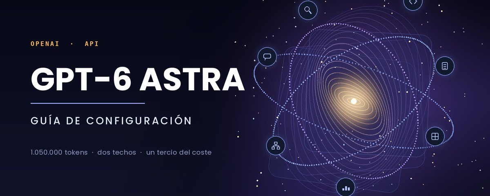

# 🚨UN DESARROLLADOR HA LOGRADO MULTIPLICAR POR 100 EL LÍMITE DE GPT-6 ASTRA SIN COSTE EXTRA Ha creado su propia versión

> Source: https://x.com/nicos_ai/status/2098764217947914722 — @nicos_ai (Nico) — posted Sat Sep 12 13:22:37 +0000 2026 — 684,426 views · 3,382 likes · 85 replies · 421 reposts · 5510 bookmarks · 18 quotes (at capture)

> Author bio: 25 | Tech, AI & startups | infonicosai@gmail.com

> Captured: 2026-09-21T14:11:16Z

## Post

@nicos_ai

🚨UN DESARROLLADOR HA LOGRADO MULTIPLICAR POR 100 EL LÍMITE DE GPT-6 ASTRA SIN COSTE EXTRA

Ha creado su propia versión de Codex usando ChatGPT como motor.

Y ha publicado el código en GitHub.

Se llama Chat On Steroids y permite:

→ Leer y editar archivos de tus proyectos
→ Ejecutar comandos y pruebas
→ Repartir tareas entre varios agentes
→ Dar nuevas instrucciones mientras trabajan
→ Retomar el trabajo en un chat nuevo conservando el contexto

¿Cómo funciona?

En lugar de consumir tu cuota de Codex, utiliza la de ChatGPT que ya tienes incluida en una suscripción compatible.

Sin pagar tokens de API por separado.

Los límites de ChatGPT siguen aplicándose. La diferencia es que puedes trabajar sobre tus proyectos sin gastar la cuota de Codex.

Le das una tarea, trabaja directamente sobre tus archivos y puedes revisar los resultados mientras avanza.

Te dejo el repo con la instalación en los comentarios👇

## Media

[media/media_0.mp4](media/media_0.mp4)

25.6s video (`media/media_0.mp4`, 1326x720, 800 KB).
Original (video): https://video.twimg.com/amplify_video/2098764178936770560/vid/avc1/2560x1390/hoDIvb1JpHAeMJYi.mp4?tag=29

## Quoted post

[Miku (@MikuBTC), Mon Sep 07 11:36:11 +0000 2026](https://x.com/MikuBTC/status/2096925496323813778) — 1,419,957 views · 345 likes · 6 replies · 25 reposts · 441 bookmarks

> https://x.com/i/article/2096913772073963523

### Article: Guía de configuración de GPT-6 Astra: máxima calidad al mínimo coste (config exacta dentro)

[https://x.com/i/article/2096913772073963523](https://x.com/i/article/2096913772073963523)

Preview: Astra tiene 1.050.000 tokens de contexto. Dos límites distintos te impiden usarlos
GPT-6 Astra es, sobre el papel, el modelo más capaz que ha publicado OpenAI.
Un 98% en FrontierMath Tier 4
99,9% en

## Astra tiene 1.050.000 tokens de contexto. Dos límites distintos te impiden usarlos

GPT-6 Astra es, sobre el papel, el modelo más capaz que ha publicado OpenAI.

- Un 98% en FrontierMath Tier 4

- 99,9% en ARC-AGI-3

- 100% en ExploitBench

- Agentic coding 57,9% en Terminal-Bench 4.0, frente al 37,3% de Sol

Además es el primer modelo que OpenAI despliega de forma amplia clasificado en su umbral crítico de capacidad en ciberseguridad.

A eso le suma una ventana de contexto de 1.050.000 tokens y hasta 128.000 tokens de salida por petición.

También es el modelo más caro de su catálogo: 10 dólares por millón de tokens de entrada y 50 por millón de salida.

Dos veces y media lo que cuesta Sol.

Y ahí está el problema.

Ese millón de tokens de contexto no es un permiso, es una capacidad máxima. Entre lo que anuncia la página del modelo y lo que tu cuenta puede ejecutar de verdad hay dos techos que casi nadie ha mirado, y los dos están documentados:

→ Uno es de precio.
A partir de cierto punto la factura se duplica, y no solo por los tokens de más.

→ El otro es de infraestructura.
En la mayoría de cuentas la ventana completa ni siquiera cabe en una sola llamada.

En este artículo vamos a ver dónde está exactamente cada techo, cómo detectarlos antes de que te lleguen en la factura, y qué cuatro ajustes concretos reducen el coste del mismo trabajo a aproximadamente un tercio.

## 
Techo uno: el precipicio de precio en 272K

Está en la página del modelo, no en el anuncio de lanzamiento.

Los prompts con más de 272.000 tokens de entrada se facturan al doble en entrada y en las tarifas de caché, y al 1,5x en salida.

Y aquí viene lo importante: no se aplica al exceso, se aplica a la petición entera.

La salida también se recalcula en esa misma petición. Una respuesta de 30.000 tokens pasa de $1,50 a $2,25 porque tu entrada cruzó una línea que nunca viste.

Las tarifas por millón de tokens, en contexto corto y por encima de 272K:

→ Entrada: $10, sube a $20
→ Entrada cacheada: $1, sube a $2
→ Escritura de caché: $12,50, sube a $25
→ Salida: $50, sube a $75

La ventana es de 1.050.000 tokens.

El recargo empieza en el 26% de esa ventana. 

Todo lo que hay por encima de una cuarta parte de la capacidad anunciada se te vende a un precio distinto del que aparece en el titular.

## 
Techo dos: tu tier no puede enviar la ventana

Este está en la tabla de rate limits. Tokens por minuto según tu nivel de uso:

- Tier 1:    500.000

- Tier 2:  1.000.000

- Tier 3:  2.000.000

- Tier 4:  4.000.000

- Tier 5: 40.000.000

La ventana son 1.050.000 tokens.

En Tier 1 y Tier 2, una única petición de ventana completa se come tu minuto entero y falla.

Tier 3 es el primer nivel donde la ventana anunciada cabe físicamente en una sola llamada.

El nivel gratuito directamente no está soportado para Astra.

Tres números en juego: la ventana, el umbral de precio y tu límite de tokens por minuto.

El más pequeño de los tres es tu techo real.

## 
La comprobación previa

La estimación por caracteres es deliberadamente burda. 

Existe para cazar la petición que te habría costado el doble, no para ser exacta.

La exactitud viene del objeto usage después de la llamada.

## 
La función de coste

Esta es la pieza que merece la pena guardar. 

Convierte cualquier respuesta en dólares, aplicando todos los multiplicadores que usa la tarifa real.

Un apunte: la versión que circula por ahí calcula la penalización como usd - usd / mult_entrada, y eso está mal, porque entrada y salida llevan multiplicadores distintos.

Restar el coste base del coste real es la única forma de que el número signifique algo.

Registra ese diccionario en cada llamada durante un día. Dos campos te lo cuentan todo:

→ supera_umbral en true en cualquier petición significa que pagaste el doble en esa llamada, y penalizacion te dice cuánto.

→ cache_hit_rate cerca de cero a lo largo de una sesión significa que tu prefijo cambia en cada petición. Normalmente es un timestamp, un identificador de sesión, o un system prompt que reconstruyes desde una plantilla.

El caché aquí es automático y basado en prefijo. 

No hay puntos de corte que configurar, lo que también significa que falla en silencio. Esta función es cómo te enteras.

## 
El effort tiene cinco niveles, no tres

El parámetro reasoning.effort acepta low, medium, high, xhigh y max.

Detalle importante: max solo está disponible en la Responses API.

En Chat Completions llegas hasta xhigh. Y como none y minimal se rechazan, tampoco puedes usar temperature con este modelo.

Las evaluaciones del lanzamiento llevan una nota al pie: salvo que se indique lo contrario, los modelos corrieron a effort máximo.

El 98% en FrontierMath, el 99,9% en ARC-AGI-3, el 100% en ExploitBench, todo en el ajuste más lento y más caro que existe.

Para dimensionar la diferencia: Artificial Analysis mide 0,46 dólares por tarea de su índice con effort bajo, frente a 1,67 con el máximo. Un salto de 3,6x en la factura por el mismo trabajo.

Punto de partida en low. Sube a high para el paso que lo necesite de verdad. Reserva xhigh y max para trabajo que de otro modo harías tú a mano.

## 
Dos herramientas que son palancas de coste

En la Responses API, Astra soporta shell alojada, apply patch, computer use, skills, tool search, MCP, búsqueda web, búsqueda en archivos e intérprete de código. Dos de ellas cambian tu factura directamente.

Apply patch. Reescribir un archivo entero se factura como salida, a 50 dólares por millón. Un diff estructurado sobre esa misma edición cuesta una fracción, cada vez que el agente toca un archivo. Es el mayor ahorro disponible del lado de la salida.

Tool search. Las definiciones de herramientas viven en tu prefijo y se envían en cada llamada. Pasada la docena de herramientas, cargarlas bajo demanda las saca por completo de la factura por petición.

## 
Batch y Flex a mitad, Fast al doble

→ Batch y Flex están al 50% del estándar. 5 dólares de entrada y 25 de salida. Todo lo que no tenga a un humano esperando pertenece aquí.

→ El modo Fast es 2x. Estás comprando latencia, no calidad.

→ Si trabajas con residencia de datos en la UE, Fast no está disponible para Astra. Ni service_tier: "fast" ni "priority". Estándar y punto. Dato importante si tu cliente exige que los datos se procesen en Europa.

→ Los límites de cola de Batch son independientes del TPM y mucho más generosos. Tier 3 tiene 2M de tokens por minuto pero una cola de batch de 100M, así que el trabajo diferido nunca compite con tu tráfico en vivo.

Pasa modo="batch" a coste() y aplica el descuento, para que tus registros muestren lo que habría costado el mismo trabajo de las dos formas.

## 
Errores comunes

Planificar sobre la ventana completa.
1,05M en la documentación, recálculo de precio en 272K, e inalcanzable en una sola llamada por debajo de Tier 3.

Copiar el effort de los benchmarks a producción.
Las evaluaciones corrieron a max. Eso es una decisión de compra, no un valor por defecto.

Dejar que el agente reescriba archivos enteros.
La salida está a 50 dólares por millón y apply patch existe exactamente para esto.

Dar por hecho que el caché funciona.
Es automático, así que falla sin lanzar ningún error. El cache_hit_rate es la única prueba.

## El montaje en 10 minutos

1. Pega coste() en tu capa de registro (3 min)

1. Añade comprobacion_previa() antes de cada llamada con el TPM de tu tier (2 min)

1. Pon reasoning.effort en low como punto de partida (1 min)

1. Activa apply patch para todo lo que edite archivos (2 min)

1. Corre una sesión real y lee el diccionario (2 min)

Si supera_umbral sale false y el cache_hit_rate sube turno tras turno, ya está. 

Si falla alguno de los dos, ahora sabes exactamente cuál y cuánto te ha costado.

Una ventana de un millón de tokens se lee como permiso para dejar de pensar en retrieval.

Pero el precio se duplica en 272K y el rate limit te frena incluso antes en la mayoría de cuentas.

Lo que significa que la pregunta de arquitectura nunca fue opcional.

Original (quoted photo): https://pbs.twimg.com/media/HRnG41eXIAA5anL.jpg

Quoted photo (`media/quoted_article_cover.jpg`, 1200x480, 75 KB).

## Comments

### @ai_gachi_oji — [2098890748188114989](https://x.com/ai_gachi_oji/status/2098890748188114989)

> This kind of thinking really gives me chills. I'm learning from the attitude of pushing beyond limits based on existing tools. Thanks for making it public on GitHub, too.

### @samerameeshs — [2099072493877154287](https://x.com/SamerameesHs/status/2099072493877154287)

> Where can I download it from?

### @cesar20984 — [2099165980266045751](https://x.com/cesar20984/status/2099165980266045751)

> hola! como no usa cuota de codex sino la de chatgpt? es la misma cuenta

### @helicerat0x — [2098858542237180243](https://x.com/helicerat0x/status/2098858542237180243)

> clever routing more than a limit increase

### @robotic315 — [2099143164829336046](https://x.com/Robotic315/status/2099143164829336046)

> Solo se puede activar sol de momento si tengo plus?

### @viniai_ — [2098986105744113812](https://x.com/Viniai_/status/2098986105744113812)

> Publishing the code is what makes it real.

### @tester_wander — [2098910471101301038](https://x.com/tester_wander/status/2098910471101301038)

> He's a total piece of shit, and on top of that, the context windows of Sol and Astra are very, very small compared to those of the models within Codex or via API.

### @ka_nek1 — [2098847832396464394](https://x.com/Ka_nek1/status/2098847832396464394)

> I think it's for ChatGPT web linked to ur pc not for ChatGPT Codex app.

### @fgomezserna — [2098867442688630989](https://x.com/fgomezserna/status/2098867442688630989)

> Before putting it into a real repo: limit what it can read/write, where prompts and logs end up, and how to revert a half-done write. Editing and running from the chat demands reviewable diffs and a stop button; 'no extra cost' is usually just cost shifted, not eliminated.

### @optixpro — [2098981318872945131](https://x.com/optixpro/status/2098981318872945131)

> GitHub is going to explode with forks of this in the next 48 hours

### @morais55330 — [2098827552504607052](https://x.com/morais55330/status/2098827552504607052)

> I tried it but it didnt wroked fully as expected, it still didnt had any acess to my windows unfortunately

### @mlavign — [2098883944464674993](https://x.com/mlavign/status/2098883944464674993)

> I mean... A Tampermonkey script + an OpenAI API proxy with a balancer like codex-lb, and you can do that even in your real Codex app.. no need to recreate the app.

### @miu21590 — [2098853992864375002](https://x.com/miu21590/status/2098853992864375002)

> there is much safer and convenient one without Ban risks and plugged inside Codex

### @wongen19 — [2098950710964727860](https://x.com/wongen19/status/2098950710964727860)

> 我直接把Chatgpt Chat包裝成API，而且可以接入原生codex，能支持上下文繼承，吃到原本codex的agent. md、skills routing、plugin、mcp。

### @freza1984 — [2099094792751968724](https://x.com/FReza1984/status/2099094792751968724)

> Long-context coding agents still need clear permission boundaries around execution.

## Links

- https://x.com/MikuBTC/status/2096925496323813778
- https://x.com/i/article/2096913772073963523
