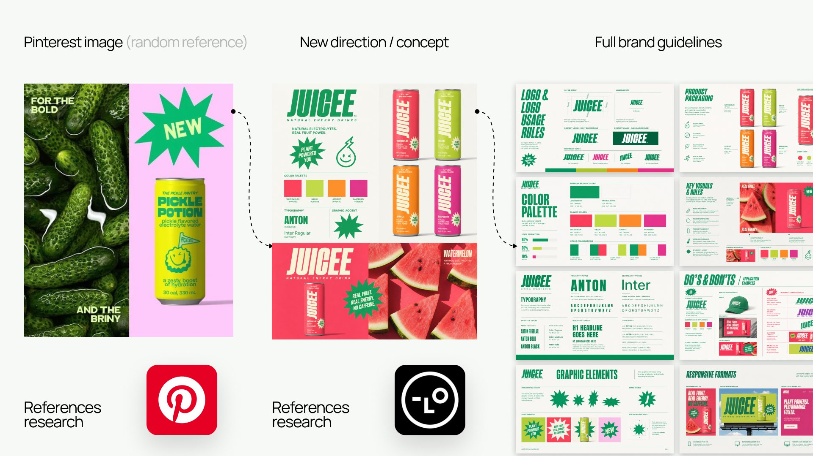
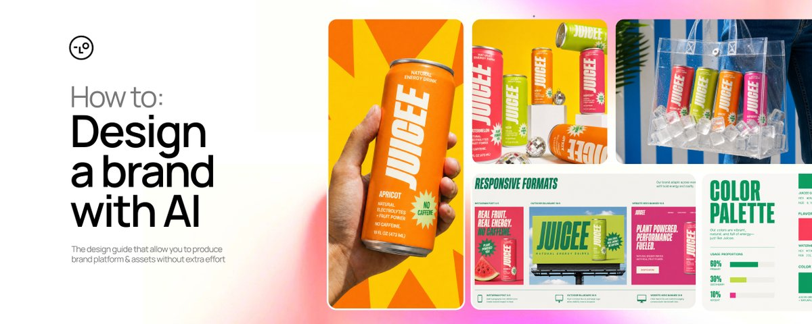

# Brand design - solved for you (no Astra needed) repeatable workflow: any reference -> AI agent -> brand concept ->

> Source: https://x.com/AmirMushich/status/2098787638761136332 — @AmirMushich (AmirMušić) — posted Sat Sep 12 14:55:41 +0000 2026 — 157,180 views · 505 likes · 35 replies · 63 reposts · 730 bookmarks · 2 quotes (at capture)

> Author bio: Creative architect. Ex-Warner Music, PepsiCo, Spotify fr. designer. Fusing 10+ yr of brand & ad design with AI. Collabs: amir@amirmushich.com

> Captured: 2026-09-21T14:11:16Z

## Post

@AmirMushich

Brand design - solved for you (no Astra needed)

repeatable workflow:
any reference -> AI agent -> brand concept -> brand kit -> brand guidelines -> assets -> content

I re-built & gave away my whole brand guidelines building process + simplified it for non-designers

Possibilities are endless now. Use it:

## Media

Original (photo): https://pbs.twimg.com/media/HSBiDe1b0AEOb6Y.jpg?name=orig

photo (`media/media_0.jpg`, 1920x1080, 302 KB).

## Quoted post

[AmirMušić (@AmirMushich), Wed Sep 02 16:11:15 +0000 2026](https://x.com/AmirMushich/status/2095182776249049456) — 421,467 views · 913 likes · 36 replies · 78 reposts · 2456 bookmarks

> https://x.com/i/article/2094805443335831552

### Article: How to design a Brand System from 1 reference image

[https://x.com/i/article/2094805443335831552](https://x.com/i/article/2094805443335831552)

Preview: For 10+ years, I've been creating branding & ads for Warner Music, PepsiCo, and others.
Now I combine that experience with AI to build hi-end visual systems faster. 
This article shows my complete

For 10+ years, I've been creating branding & ads for Warner Music, PepsiCo, and others.

Now I combine that experience with AI to build hi-end visual systems faster. 

## This article shows my complete branding workflow with AI

This time, I turned one reference into an identity, brand guidelines, packaging, key visuals, and a scalable campaign world.

At the end, I’m also sharing the open-source Lovart Brand System Skill - a copy-paste workflow that guides Lovart Agent through the same process.

This article is sponsored by @lovart_ai. Thanks to the team for supporting this post and my work for you.

# ONE REFERENCE -> BRAND SYSTEM

I wanted to test one question:

> Can an AI agent understand why an image works -> not copy it -> and turn that logic into a new brand?

So I found a Pinterest image I like, sent it to the Lovart Agent and gave it a minimal brief of the brand I want to build:

- Brand: Juicee

- Product: natural, caffeine-free energy drink

- Audience: active people aged 20–35

- Flavors: watermelon, melon, apricot, raspberry

From that, we built a visual identity, a complete multi-slide brand system, four connected SKUs, campaign scenes, packaging concepts, videos & more.

Lovart accelerated the design process - and my role was to judge & direct the outputs, remove conflicting directions, define the rules & system.

## My workflow:

Reference → Deconstruction → Anchor (Brand Kit) → Guidelines → Brand Lock → Campaign Assets → Packaging

Turn one reference into a brand system with Lovart Agent: → amirmushich.link/design_agent

# 1. DECODE THE REFERENCE

I found the reference of the Pickle Potion drink - and this visual gave us four transferable rules:

1. Split-screen composition

1. Real ingredient photography

1. Bold typography

1. Simple starburst elements

and more (see below).

Pickle Potion uses those rules to communicate briny shock.
For my brand - Juicee - I translated them into a different idea:

> The intensity of freshness - real fruit that hits.

The instruction I used

Important: A reference should inform the logic - not the design output.

# 2. FROM DRAFT TO BRAND ANCHOR

The first Brand Kit looked okay - but mixed too many styles, patterns, effects, and typography directions.

It was content, not a system.

My feedback was simple:

> “Use more white space, less graphic devices, and one clear direction.”

My first job was not to generate more. It was to remove.

The problem was a lack of hierarchy:

Realistic liquid materials, cartoon mascots, icons, product graphics, and several micro-directions were all competing inside one board. 
Different materials did not match the graphic language, so the brand felt assembled from fragments instead of directed as one world.

I rejected it - because it was creatively inconsistent.

## Correct the direction (if needed):

The second version became a great anchor for the future brand - one approved image the entire brand could obey.

Here's how the whole process looks like:

On this stage, we locked:

- logo concept;

- color palette;

- typography (free Google Fonts);

- brand graphics (vector starbursts);

- can design;

- media rule - "real fruit photography";

- design foundation.

The system is now locked - let's scale it.

# 3. TURN THE ANCHOR INTO A BRAND SYSTEM

From one anchor, Lovart Agent created a connected set of brand-guideline modules:

Logo usage · Typography · Color · Graphic elements · Key visual rules · Packaging · Brand usage rules · Design rules · Photo guidelines

The same rules then produced 4 flavor key visuals with one repeatable mechanism:

[fruit on the left] → [product on the right] → [one headline] → [one starburst claim] → [one consistent hierarchy]

The SKUs feel different without becoming four different brands.

# 4. EXPAND THE CAMPAIGN (and keep the brand consistent)

Once the design system was locked, I introduced 9 additional scene references - to expand the brand campaigns world.

Lovart Agent quickly translated those references into a broad range of explorations - from fruit top views and product close-ups to lifestyle scenes. 

Because each reference carried its own strong visual language, some early outputs began to over-weight its fonts, colors, patterns, and packaging cues alongside the composition.

This wasn’t a lack of generation capability - it was a creative-direction challenge. The Agent needed a clearer hierarchy for deciding which source controlled each part of the output.

One of Lovart’s strengths is that you can combine references and steer the system iteratively. I used that flexibility to define a clearer reference hierarchy - a workflow I call Brand Lock.

Brand Lock isn’t a button or a single prompt. 

It’s a methodology for deciding what each reference is/isn’t allowed to control.

The final scene must still be materially original - not a recreated artwork with a different product.

## Brand Locking with Lovart Agent

combine the scene references, Brand Kit, and packaging board → generate new branded scenes → identify and correct visual drift → reveal the complete scaled canvas

The references could now influence the scene language without owning the scene or redesigning the brand.

By repeating the same Agent workflow across different references and flavors, I expanded one approved system into dozens of connected visuals.

> Agent generated the assets
Brand Lock kept the system consistent.

## Precision editing after generation

The editing tools came after generation. Text Edit, Touch Edit, and Edit Elements were useful for precise corrections to assets.

Refine one completed asset with Text Edit → Touch Edit → Edit Elements

The same connected system also produced front, three-quarter, isometric, and exploded packaging views.

Note: These are conceptual packaging visualizations - not final dielines, vector artwork, prepress files, production-ready 3D models, or manufacturing specifications.

# 5. TURN THE BRAND SYSTEM INTO MOTION WITH SEEDANCE 2.5

Once the visual system was locked, I used Seedance 2.5 inside Lovart to generate the motion assets, then assembled and finished the final Juicee ad in Adobe.

The same approved packaging, colors, typography, and campaign language became the source of truth for video - so motion extended the system.

The Agent kept the creative workflow connected - from static brand assets to video generation on the same Canvas. The brand/character consistency is really strong here.

# ONE REFERENCE TO A COMPLETE BRAND WORLD

The clearest proof of the workflow is my Lovart canvas.

Reference → Brand System → Entire brand world.

Build a consistent brand system with Lovart Agent

→  amirmushich.link/design_agent

# MY BRANDING SKILL (GitHub)

I packaged the complete workflow as a copy-paste Skill for Lovart Agent

Instead of running prompts manually, paste the Skill into a new Lovart project and let the Agent guide you through:

- mass-user-friendly onboarding;

- reference deconstruction;

- Anchor Brand Kit development;

- creative-direction critique;

- fonts selection;

- generation approval gates;

- brand guidelines;

- Brand Lock;

- campaign assets;

- consistency audits;

- packaging concepts.

If you don’t know how to answer his questions - or why a visual direction isn’t working - the Skill can help diagnose the problem before you spend more credits.

## Get the Brand System Skill on GitHub

https://amirmushich.link/brand_skill

# 5 THINGS TO REMEMBER

1. One solid anchor beats twenty disconnected outputs

1. Use references for principles (not for copy-paste)

1. Approve the concept before spending credits on assets

1. Use the Agent to generate complete assets - and editing tools to refine the details

1. AI accelerates concepting; final production still needs human vision

# THE REAL LESSON

We started with one Pinterest image.

Working with Lovart, I turned it into an identity, SKUs, brand guidelines, campaign scenes, packaging concepts, and a complete brand world.

The agent accelerated exploration and execution. My job was to choose the direction, reject visual contradictions, and define what could change - and what had to stay locked.

> AI can create endless images. A brand begins when someone decides what must stay in its visual language.

Turn your next reference into a brand system with Lovart Agent

→ amirmushich.link/design_agent

One reference can become more than an image. 
It can become an entire brand world.

#BuiltWithLovart #AiDesign #AIBranding

Original (quoted photo): https://pbs.twimg.com/media/HRI-fGJW4AAbCgC.jpg

Quoted photo (`media/quoted_article_cover.jpg`, 1200x480, 96 KB).

## Comments

### @librarypath — [2098836357053292692](https://x.com/LibraryPath/status/2098836357053292692)

> The interesting part is that your job became saying "no" more often, not generating more. That's a very different creative workflow.

### @mind_essentials — [2098834586016817595](https://x.com/Mind_Essentials/status/2098834586016817595)

> This is so much more useful than another "here are 50 prompts for designers" post.

### @bysashaemerson — [2098839919225385390](https://x.com/BySashaEmerson/status/2098839919225385390)

> Giving away the actual workflow after spending all that time figuring it out is wild 

### @geniuspothead — [2098844316320071950](https://x.com/GeniusPothead/status/2098844316320071950)

> pinterest reference to full brand kit pipeline is such a good idea

### @aiseomastery — [2098895298299117902](https://x.com/aiseomastery/status/2098895298299117902)

> brand kit from one image, wild

### @sflorimm — [2098901503570219318](https://x.com/sflorimm/status/2098901503570219318)

(media-only reply, no text visible)

### @dev_maruf — [2100136177575583853](https://x.com/dev_maruf/status/2100136177575583853)

> Starting from "any reference" is the step I'd watch, since a non-designer will pick a reference they like rather than one that fits their market. Does your process push back when the reference and the audience don't match?

### @itsthedonhashim — [2098864793343901827](https://x.com/itsthedonhashim/status/2098864793343901827)

> @AmirMushich
>  giving away your brand guidelines process is huge. I hit the wall with branding early on. Making it non-designer friendly is gold.

### @catmanyau — [2098965140666220942](https://x.com/catmanyau/status/2098965140666220942)

> “no Astra needed” is a bold claim; which part of the brand kit still needs human judgment when the reference has conflicting visual cues?

### @nvandewetering — [2099526885168345307](https://x.com/nvandewetering/status/2099526885168345307)

> grok bot does it all for you. Marketing is solved

### @viniai_ — [2098985052944376298](https://x.com/Viniai_/status/2098985052944376298)

> Simplifying it for non designers is the generous part.

### @bysamdavis — [2100036353320956145](https://x.com/BySamDavis/status/2100036353320956145)

> Tough part is down the line when you want to evolve the brand and you're stuck in the uncanny valley of brand identity.

## Links

- https://x.com/AmirMushich/status/2095182776249049456
- https://x.com/i/article/2094805443335831552
