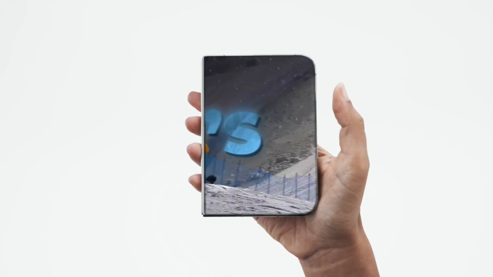

# Today we’re launching Narrative: the AI video editor for the rest of us. This video was made end-to-end in Narrative,

> Source: https://x.com/aryansawhney17/status/2098829123057541586
> Author: Aryan Sawhney (@aryansawhney17)
> Posted: Sat Sep 12 17:40:31 +0000 2026
> Stats (at capture): 36,386 views · 295 likes · 39 replies · 1789241786 reposts · 269 bookmarks · 8 quotes
> Captured: 2026-09-21T13:30:16Z

## Post

Today we’re launching Narrative: the AI video editor for the rest of us.

This video was made end-to-end in Narrative, by prompting our agent.

## Media

[media/video.mp4](media/video.mp4)

Originals:

- https://video.twimg.com/amplify_video/2098829078404927492/vid/avc1/1920x1080/bWU-IWALY0vS94Bz.mp4?tag=29
- thumb: https://pbs.twimg.com/amplify_video_thumb/2098829078404927492/img/lkxyyrj3JjFMCfTH.jpg

## Author bio (at capture)

co-founder @NarrativeVideo | prev CS @BrownUniversity

## Thread

### @aryansawhney17 — [https://x.com/aryansawhney17/status/2098829125217669579](https://x.com/aryansawhney17/status/2098829125217669579) — 2026-09-12T17:40:32.000Z

The idea is simple:

Upload your footage. Tell Narrative what you want or upload a reference video.

It can cut the timeline, build motion graphics, add transitions, work with audio, and keep iterating
with you.

### @aryansawhney17 — [https://x.com/aryansawhney17/status/2098829127394459902](https://x.com/aryansawhney17/status/2098829127394459902) — 2026-09-12T17:40:32.000Z

Narrative handles podcast clips, launch videos,
corporate videos, UGC edits, stunning motion design,
and more.

Create spectacular videos, without needing After Effects and Premier.

Try it free:

### @aryansawhney17 — [https://x.com/aryansawhney17/status/2099185220293460434](https://x.com/aryansawhney17/status/2099185220293460434) — 2026-09-13T17:15:32.000Z

Definitely see that! But this is also a use case we have put some thought into our video understanding does support :) would love to have you try it!

### @aryansawhney17 — [https://x.com/aryansawhney17/status/2100285715934220351](https://x.com/aryansawhney17/status/2100285715934220351) — 2026-09-16T18:08:30.000Z

Try it and out and see if it can complement your expertise :)

### @aryansawhney17 — [https://x.com/aryansawhney17/status/2098936053428092973](https://x.com/aryansawhney17/status/2098936053428092973) — 2026-09-13T00:45:26.000Z

would love to have you give it a try and share :)

### @aryansawhney17 — [https://x.com/aryansawhney17/status/2099187644643090611](https://x.com/aryansawhney17/status/2099187644643090611) — 2026-09-13T17:25:10.000Z

you should definitely try it out!

### @aryansawhney17 — [https://x.com/aryansawhney17/status/2098903668707725401](https://x.com/aryansawhney17/status/2098903668707725401) — 2026-09-12T22:36:45.000Z

Let me know any thoughts!

## Comments

### @Rizwann_ytdc — [https://x.com/Rizwann_ytdc/status/2099144386047304064](https://x.com/Rizwann_ytdc/status/2099144386047304064) — 2026-09-13T14:33:16.000Z

Curious how it handles narration-led edits, where there's no source footage and every line needs a visual decision. Does the agent plan visuals from what the script means, or mostly from transcript timing? That's the hard case for documentary-style channels.

### @bygregorr — [https://x.com/bygregorr/status/2098858291006710007](https://x.com/bygregorr/status/2098858291006710007) — 2026-09-12T19:36:26.000Z

Coming from motion design, the hardest cuts were never about assembly they were about timing. Holding a shot three frames longer than logic dictates. That's the subtle thing I'd watch for in any agent-driven editor.

### @vakada_rohit — [https://x.com/vakada_rohit/status/2099186627323306454](https://x.com/vakada_rohit/status/2099186627323306454) — 2026-09-13T17:21:07.000Z

An AI video editor that can create the whole video just from a prompt is pretty impressive. Excited to see how people use this.

### @mukulagarwalXR — [https://x.com/mukulagarwalXR/status/2098931809224712246](https://x.com/mukulagarwalXR/status/2098931809224712246) — 2026-09-13T00:28:34.000Z

Cool tech. I have lots of feedback on transitions and animations. I wonder how we can make these tools better at the craft.

### @gormankind — [https://x.com/gormankind/status/2098831413365883176](https://x.com/gormankind/status/2098831413365883176) — 2026-09-12T17:49:38.000Z

congrats! enjoyed playing around with narrative this week to make a product demo

### @masony334 — [https://x.com/masony334/status/2098971367836106950](https://x.com/masony334/status/2098971367836106950) — 2026-09-13T03:05:45.000Z

When can I text narrative a video, and have it edit it for me?

### @ravixalgorithm — [https://x.com/ravixalgorithm/status/2098867883522855063](https://x.com/ravixalgorithm/status/2098867883522855063) — 2026-09-12T20:14:33.000Z

how is it different from 
https://
cardboard.ai ??

### @aiseomastery — [https://x.com/aiseomastery/status/2098939912691286202](https://x.com/aiseomastery/status/2098939912691286202) — 2026-09-13T01:00:46.000Z

Just prompting your edits sounds so nice
