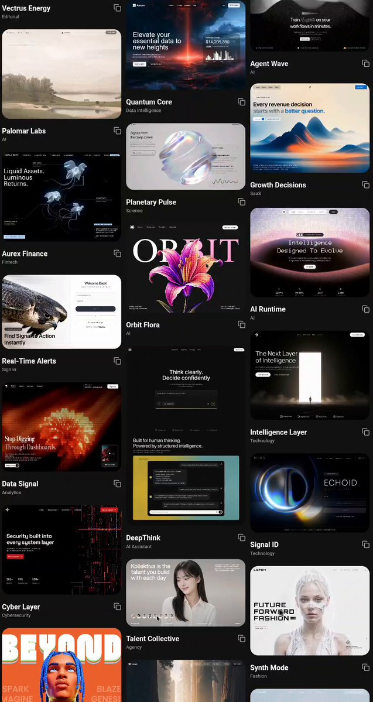

# vibe coders are seriously sleeping on this 😳 Free frontend UI inspiration you can use as a reference for your next

> Source: https://x.com/k2sbhai/status/2099061468771848625 — @k2sbhai (K2S) — posted Sun Sep 13 09:03:47 +0000 2026 — 30,642 views · 555 likes · 19 replies · 62 reposts · 753 bookmarks · 2 quotes (at capture)

> Author bio: content creator | ai & web3

> Captured: 2026-09-21T14:11:16Z

## Post

@k2sbhai

vibe coders are seriously sleeping on this 😳

Free frontend UI inspiration you can use as a reference for your next project

Free UI: https://motionsites.ai

save this for whenever you want to build something 👀

## Media

[media/media_0.mp4](media/media_0.mp4)

5.2s video (`media/media_0.mp4`, 720x1354, 514 KB).
Original (video): https://video.twimg.com/amplify_video/2099061121466707968/vid/avc1/1042x1962/TrWKgdqCWL3Q0b3l.mp4?tag=29

## Comments

### @voxeredge — [2099216070246842847](https://x.com/VoxerEdge/status/2099216070246842847)

> I know this one , this website and all templates are created by 
> @viktoroddy
>  guy from yt

### @codestirring — [2099262281972338779](https://x.com/codestirring/status/2099262281972338779)

> Or they could use 
> https://
> kage.design for free

### @itsjdraven — [2099337525970215185](https://x.com/itsjdraven/status/2099337525970215185)

> Saved it for the next time

### @brianhadu — [2099273834465833318](https://x.com/BrianHaDu/status/2099273834465833318)

> free resources like this can really spark creativity for new ideas

### @wngyngqun247610 — [2099394459394044241](https://x.com/wngyngqun247610/status/2099394459394044241)

> good

### @aiseomastery — [2099317901677465987](https://x.com/aiseomastery/status/2099317901677465987)

> Saving this for later

### @callmecsz — [2099089921474724244](https://x.com/CallMeCSZ/status/2099089921474724244)

(media-only reply, no text visible)

### @turnttfup99 — [2099398241187967284](https://x.com/Turnttfup99/status/2099398241187967284)

> Skills MD?

## Links

- https://motionsites.ai
