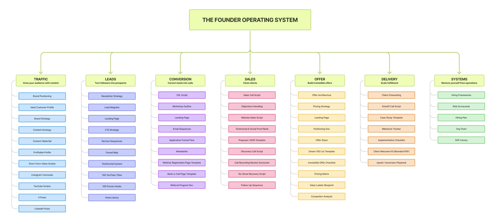

# Business is hard until you have an operating system like this:

> Source: https://x.com/matt_gray_/status/2099110121154499020 — @matt_gray_ (MATT GRAY) — posted Sun Sep 13 12:17:07 +0000 2026 — 194,920 views · 2,205 likes · 29 replies · 125 reposts · 4431 bookmarks · 7 quotes (at capture)

> Author bio: "The Systems Guy" | The operating system behind 7 to 9-figure founder brands.  / Founder & CEO @founderos

> Captured: 2026-09-21T14:11:16Z

## Post

@matt_gray_

Business is hard until you have an operating system like this:

## Media

Original (photo): https://pbs.twimg.com/media/HSGJh34bEAEKt0e.jpg?name=orig

photo (`media/media_0.jpg`, 2514x1124, 198 KB).

## Comments

### @nativeaiagency — [2099146009666306192](https://x.com/NativeAIAgency/status/2099146009666306192)

> Yup

### @josemiguelsais — [2099199299263639960](https://x.com/JoseMiguelSais/status/2099199299263639960)

> This looks a lot like a Marketing agency, heavy on the sale process, very light on the delivery process. But you're right, as a founder, why would you HAVE to worry?

### @constantindevs — [2099226983301357602](https://x.com/constantindevs/status/2099226983301357602)

> Just dont get it implemented as a spreadsheet...

### @favorgrows — [2099282858242158837](https://x.com/favorgrows/status/2099282858242158837)

> You’ve clearly been around the block.

### @amazingdanray — [2099117129752588798](https://x.com/amazingdanray/status/2099117129752588798)

> It remains hard forever, definitely more simple though

### @scotty_inc — [2099428679650812100](https://x.com/scotty_inc/status/2099428679650812100)

> That’s not a business

### @nik2success — [2099174685128929529](https://x.com/nik2success/status/2099174685128929529)

> Amazing

### @javad_karimii_ — [2099515773714653374](https://x.com/javad_karimii_/status/2099515773714653374)

> System us everything
