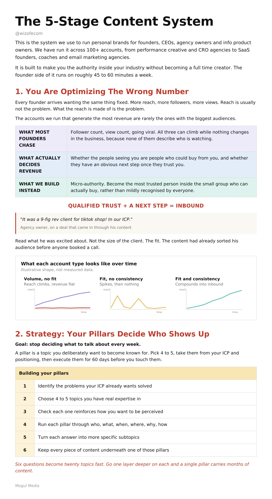
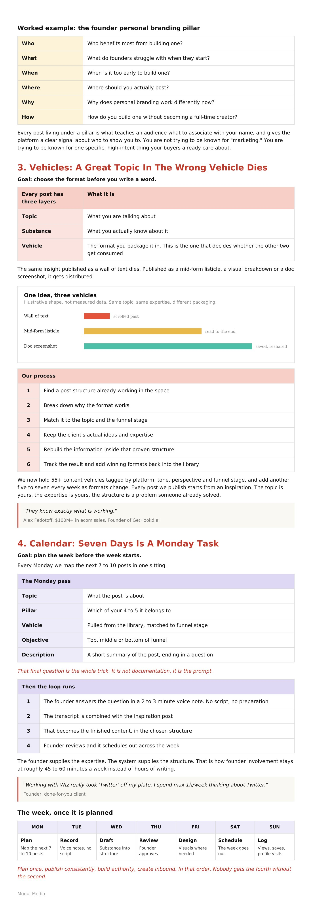
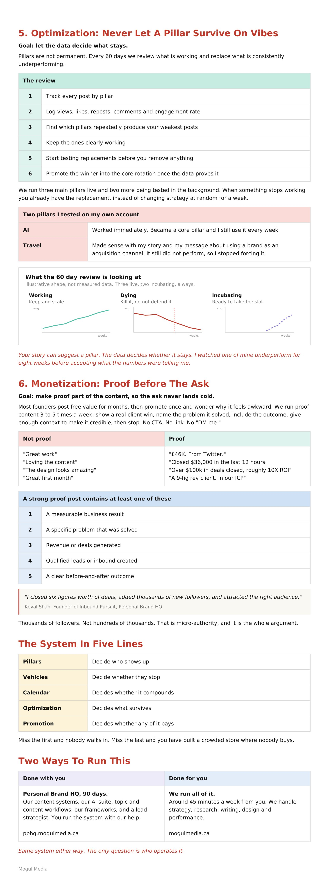
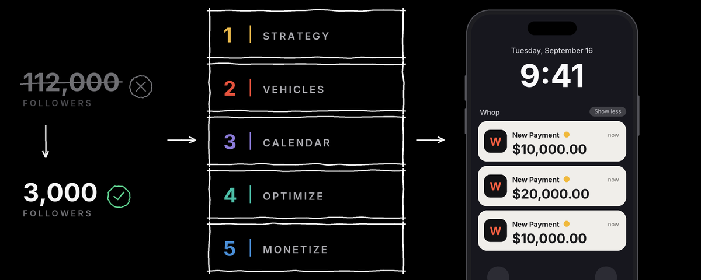

# The ultimate masterclass for founders that turns 45 minutes/week into a HIGH-AUTHORITY brand that attracts QUALIFIED

> Source: https://x.com/wizofecom/status/2099170661830689058 — @wizofecom (Mubbu) — posted Sun Sep 13 16:17:41 +0000 2026 — 18,348 views · 188 likes · 4 replies · 25 reposts · 320 bookmarks · 1 quotes (at capture)

> Author bio: Hi, I'm Mubbu. /  / I run content strategy for 60+ founders doing $1M-$700M/yr. /  / Using this account to share what's working. Co-founder of http://mogulmedia.ca/?el=x

> Captured: 2026-09-21T14:11:16Z

## Post

@wizofecom

The ultimate masterclass for founders that turns 45 minutes/week into a HIGH-AUTHORITY brand that attracts QUALIFIED LEADS:

## Media

Original (photo): https://pbs.twimg.com/media/HSHAkIoWYAI9hVz.jpg?name=orig

photo (`media/media_0.jpg`, 2000x3660, 597 KB).

Original (photo): https://pbs.twimg.com/media/HSHAk8QbMAAoKj-.jpg?name=orig

photo (`media/media_1.jpg`, 1412x4096, 514 KB).

Original (photo): https://pbs.twimg.com/media/HSHAlh-WEAQbsBn.jpg?name=orig

photo (`media/media_2.jpg`, 1526x4096, 547 KB).

## Quoted post

[Mubbu (@wizofecom), Thu Sep 10 15:39:29 +0000 2026](https://x.com/wizofecom/status/2098073885409259778) — 25,520 views · 83 likes · 8 replies · 5 reposts · 145 bookmarks

> https://x.com/i/article/2098071020494036993

### Article: How founders are closing 6-figure deals from X in 45 minutes/week

[https://x.com/i/article/2098071020494036993](https://x.com/i/article/2098071020494036993)

Preview: I'm going to show you the exact five-stage system we use to run personal brands for founders on X and LinkedIn.
We've used this across 100+ accounts, from performance creative and CRO agencies to SaaS

I'm going to show you the exact five-stage system we use to run personal brands for founders on X and LinkedIn.

We've used this across 100+ accounts, from performance creative and CRO agencies to SaaS founders, coaches, email marketing agencies, and info product owners.

And the results have been meaningful for founders.

One agency owner sent us a message saying, “Just closed my biggest deal to date. £46K. From Twitter.”

Another closed $36,000 in 12 hours. Another landed a $40M/year brand from a single inbound lead.

We've seen this system work across completely different industries, offers, and account sizes because the underlying process stays the same.

Some of the accounts you probably follow for personal brand advice are accounts we actually run behind the scenes.

I’m about to show you the entire system we use to build them.

TLDR. The five stages:

1. Strategy. The 4 to 5 content pillars that decide who sees you, and the 6-question engine that turns each one into twenty topics

2. Vehicles. Why your topic is not what makes a post work, and how we match every post to a structure that is already winning

3. Calendar. The seven-day cycle we run once on a Monday for the whole week

4. Optimization. How we know a pillar is dead, what replaces it, and how we test the replacement without disrupting what already works

5. Monetization. The promotion style we run 3 to 5 times a week that carries no call to action

## You are optimizing the wrong number

Every founder comes to us wanting the same thing: more reach, more followers, more views.

But reach usually isn't the problem. The problem is WHO the reach is reaching.

The accounts we run that generate the most revenue are rarely the ones with the biggest audiences.

Followers aren't the asset. Qualified trust is.

One of our agency clients recently messaged us after landing a huge deal through his content:

"It was a 9-fig rev client for tiktok shop! In our ICP"

The goal isn't to become known by everyone. It's to become the most trusted person inside the small group of people who can actually buy from you.

We call this micro-authority.

And every part of the system below is built around it.

# STAGE 1: STRATEGY

# Your pillars decide who shows up, not your writing

Content gets a lot easier when you stop deciding what to talk about every week.

We treat it as a positioning decision you make once, then execute for the next 60 days.

A pillar is a topic you deliberately want to become known for.

You should have 4–5 pillars, and every one should come directly from your ICP and positioning.

Here’s how to build them:

- identify the problems your ICP already wants solved

- choose 4–5 topics you have real expertise in

- make sure each topic reinforces how you want to be perceived

- keep every piece of content underneath one of those pillars

- run each pillar through: who, what, when, where, why, how

- turn each answer into more specific subtopics

For example, if one pillar is founder personal branding:

- who benefits most from building one?

- what do founders struggle with when they start?

- when is it too early to build one?

- where should you actually post?

- why does personal branding work differently now?

- how do you build one without becoming a full-time creator?

Six questions can turn into 20 topics very quickly. Go one layer deeper on each and you can build months of content from a single pillar.

The important part is consistency.

Every content piece you publish should live under a pillar.

That is what teaches your audience what to associate with your name and gives the platform a clearer signal around who should see your content.

One founder who went through our program described the outcome like this:

“Became the thing I became known for.”

That is a pillar doing its job.

You are not trying to become known for “marketing.”

You are trying to become known for one specific, high-intent thing your buyers already care about.

# STAGE 2 : VEHICLES

## A great topic in the wrong format dies

This is where good ideas usually get wasted.

Every post has three layers:

1. topic: what you are talking about

2. substance: what you actually know about it

3. vehicle: the format you package it in

The first two matter, but the vehicle decides whether anyone actually consumes them.

You can take the exact same insight and publish it as a wall of text that dies, or turn it into a mid-form listicle, visual breakdown, or doc screenshot that gets distributed.

So before we write anything, we choose the vehicle first.

Our process looks like this:

- find a post structure already working in the space

- break down why the format works

- match it to the topic and funnel stage

- keep the client's actual ideas and expertise

- rebuild the information inside that proven structure

- track the result and add winning formats back into the library

We now have 55+ content vehicles, tagged by platform, tone, perspective, and funnel stage, and we add another five to seven every week as formats change.

Every post we publish starts with an inspiration.

That does not mean copying someone's ideas.

The topic is yours.
The expertise is yours.
The structure is simply a problem someone has already solved.

The founder of GetHookd.ai, who has done $100M+ in ecom sales, described the value like this:

“They know exactly what is working.”

That is the point of the library.

You should not be reinventing how to package an idea every time you sit down to write.

# STAGE 3: CALENDAR

## Seven days of content is a Monday task, not a daily one

The system only works if the week is planned before the week starts.

Every Monday, we map the next 7–10 posts in one sitting:

> choose the topic

> assign the pillar

> choose the content vehicle

> decide the objective

> write a short description of the post

> end that description with a question for the founder

That final question is what gives us the substance.

The founder answers it in a 2–3 minute voice note with no script or preparation. We take that transcript, combine it with the inspiration post, and turn it into the finished content.

The founder supplies the expertise. The system supplies the structure.

That is how we keep the founder's involvement to roughly 45–60 minutes a week instead of asking them to spend hours writing content.

One of our done-for-you clients explained it pretty simply:

And the founder of Recruiter Mill described what that consistency eventually created:

That is the sequence:

plan once → publish consistently → build authority → create inbound.

# STAGE 4: OPTIMIZATION

## Never let a pillar survive on vibes

Your content pillars are not permanent.

Every 60 days, we review what is actually working and replace the ones that are consistently underperforming.

The process is pretty simple:

- track every post by pillar

- log views, likes, reposts, comments, and engagement rate

- look at which pillars repeatedly produce your weakest posts

- keep the ones that are clearly working

- start testing replacement topics before you remove anything

- promote the winner into your core rotation once the data proves it

We normally have three main pillars running and two more being tested in the background.

That way, when something stops working, you already have a replacement instead of randomly changing your strategy for a week.

I learned this one the annoying way.

I watched one of my own pillars underperform for eight weeks before finally accepting what the data was telling me.

At the same time, I started testing two new directions: AI and travel.

AI worked immediately, so it became one of my main pillars and I still use it every week.

Travel made sense with my story. I work around the world, and it connected back to my message around using a personal brand as an acquisition mechanism.

But it simply did not perform as well.

So I stopped forcing it.

Your story can suggest a pillar. The data decides whether it stays.

You do not need to panic after one weak post. You need enough consistency to see a pattern.

Once the same pillar keeps showing up at the bottom of your performance data, start incubating its replacement.

Then let the winner earn the slot.

# STAGE 5: MONETIZATION

## Followers only matter if they eventually turn into trust, leads, or sales.

A lot of founders build an audience around free value for months, then suddenly promote something and wonder why it feels awkward.

The fix is to make proof part of the content strategy before you ever ask for the sale.

We run this kind of proof content 3–5 times a week:

- show a real client win

- name the problem that was solved

- include the result or outcome

- give enough context to make it credible

- stop there

No CTA. No link. No “DM me.”

You are simply showing people that working with you produces results.

Do that consistently and your audience starts associating your name with outcomes before you ever make a direct promotion.

The highest-status version of this is someone else saying it for you:

You do not need to turn that into a sales pitch.

Someone credible vouched for you. Let the proof do the work.

The important part is knowing what actually counts as proof.

“Great work” is not proof.
“Loving the content” is not proof.
“The design looks amazing” is not proof.

A strong proof post should contain at least one of these:

1. a measurable business result

2. a specific problem that was solved

3. revenue or deals generated

4. qualified leads or inbound created

5. a clear before-and-after outcome

For example:

Or:

Or:

That last one is the point.

He added thousands of followers, not hundreds of thousands, and still closed six figures in deals.

That is micro-authority.

You do not need the biggest audience in the market.

You need the right people to trust that you can solve their problem, then you need to give them somewhere to go.

## CONCLUSION

Pillars decide who shows up.

Vehicles decide whether they stop.

The calendar decides whether it compounds.

Optimization decides what survives.

Promotion decides whether any of it pays.

Miss the first one and nobody walks in. Miss the last one and you have built a crowded store where nobody buys.

You do not need 100,000 followers for this to work. Our largest account has 60,000 and it is not our best performing one. You need the right few thousand people watching consistently, and somewhere for them to go.

## Two ways to run this for your own personal brand

Install the system into your business

Personal Brand HQ is our 90 DAY guided program.

We give you:

→ Our content systems

→ Our AI suite

→ Topic and content workflows

→ Our frameworks

→ A lead strategist

You run the system with our help.

https://pbhq.mogulmedia.ca/?el=xarticle

Have my team run it

You give us around 45 minutes a week.

We handle:

→ Strategy

→ Research

→ Writing

→ Design

→ Performance

https://mogulmedia.ca/?el=xarticle

Book a call and we'll help you figure out which option fits.

Original (quoted photo): https://pbs.twimg.com/media/HR3Ym6QawAAf0Gx.png

Quoted photo (`media/quoted_article_cover.png`, 1200x480, 124 KB).

## Comments

### @maurojpelle — [2099419170857251042](https://x.com/MauroJPelle/status/2099419170857251042)

> the vehicles stage is where most people flatline, picking one and sticking with it beats rotating five

### @writeforsales — [2099176970487509362](https://x.com/writeforsales/status/2099176970487509362)

> Thanks for this gold! Hope more people can see this.

### @atiqullahafzal4 — [2099307045451358691](https://x.com/Atiqullahafzal4/status/2099307045451358691)

> free value

## Links

- https://x.com/wizofecom/status/2098073885409259778
- https://x.com/i/article/2098071020494036993
