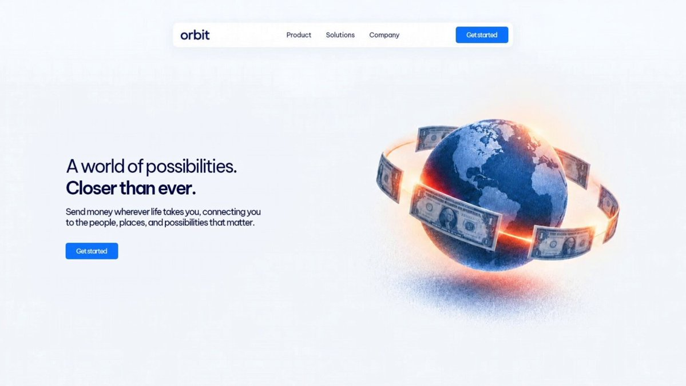

# Another Hero section is designed! Built with Custom Skills + my video tool + Cursor + the client's design.md file + a

> Source: https://x.com/DesignByMoein/status/2099178055201935475
> Author: Moein (@DesignByMoein)
> Posted: Sun Sep 13 16:47:03 +0000 2026
> Stats (at capture): 5,373 views · 58 likes · 7 replies · 1789972232 reposts · 36 bookmarks · 1 quotes
> Captured: 2026-09-21T13:30:16Z

## Post

Another Hero section is designed!

Built with Custom Skills + my video tool + Cursor + the client's design.md file + a little creativity.

## Media

[media/video.mp4](media/video.mp4)

Originals:

- https://video.twimg.com/amplify_video/2099177661805543424/vid/avc1/1916x1080/xHeqnWe1g9zmnrsR.mp4?tag=29
- thumb: https://pbs.twimg.com/amplify_video_thumb/2099177661805543424/img/PekoJfSzWiX1600v.jpg

## Author bio (at capture)

Helping founders design products and websites that attract real users. | AI-Driven Designer & Builder | DM for projects

## Thread

### @DesignByMoein — [https://x.com/DesignByMoein/status/2099473659090137414](https://x.com/DesignByMoein/status/2099473659090137414) — 2026-09-14T12:21:41.000Z

Overall, I’d give it a 6 or 7 out of 10. The main reason is that its fonts, animations, and cards don’t feel fully cohesive or well-matched with each other.

### @DesignByMoein — [https://x.com/DesignByMoein/status/2099255948925870441](https://x.com/DesignByMoein/status/2099255948925870441) — 2026-09-13T21:56:35.000Z

Thanks, I built it by my video tool

### @DesignByMoein — [https://x.com/DesignByMoein/status/2099256175858745599](https://x.com/DesignByMoein/status/2099256175858745599) — 2026-09-13T21:57:29.000Z

It was mostly design tokens

### @DesignByMoein — [https://x.com/DesignByMoein/status/2099288682511700012](https://x.com/DesignByMoein/status/2099288682511700012) — 2026-09-14T00:06:39.000Z

Thank you 

### @DesignByMoein — [https://x.com/DesignByMoein/status/2099422895349121039](https://x.com/DesignByMoein/status/2099422895349121039) — 2026-09-14T08:59:58.000Z

Thank you 

### @DesignByMoein — [https://x.com/DesignByMoein/status/2099192414863073331](https://x.com/DesignByMoein/status/2099192414863073331) — 2026-09-13T17:44:07.000Z

Thank you 

### @DesignByMoein — [https://x.com/DesignByMoein/status/2099238655097458691](https://x.com/DesignByMoein/status/2099238655097458691) — 2026-09-13T20:47:52.000Z

Thank you

## Comments

### @catmanyau — [https://x.com/catmanyau/status/2099212808634212766](https://x.com/catmanyau/status/2099212808634212766) — 2026-09-13T19:05:09.000Z

the useful test is whether the next hero can reuse those custom skills without looking like a clone. does the client’s `design.md` include component constraints, or just visual guidance?

### @panzestudio — [https://x.com/panzestudio/status/2099420317756338372](https://x.com/panzestudio/status/2099420317756338372) — 2026-09-14T08:49:43.000Z

The animation made the hero lively. It was perfect, and so was its execution.

### @immad_jilani — [https://x.com/immad_jilani/status/2099255447798898944](https://x.com/immad_jilani/status/2099255447798898944) — 2026-09-13T21:54:35.000Z

Looks clean , where did you get that globe animation sir?

### @piyushsainii — [https://x.com/piyushsainii/status/2099291255830380956](https://x.com/piyushsainii/status/2099291255830380956) — 2026-09-14T00:16:52.000Z

can you rate my hero section please?

### @simi_uiux — [https://x.com/simi_uiux/status/2101606418847850554](https://x.com/simi_uiux/status/2101606418847850554) — 2026-09-20T09:36:30.000Z

I think I can't stop using gradients

### @Eyeson_Studio — [https://x.com/Eyeson_Studio/status/2099188052853707220](https://x.com/Eyeson_Studio/status/2099188052853707220) — 2026-09-13T17:26:47.000Z

nice design moein

### @0xmustaquenadim — [https://x.com/0xmustaquenadim/status/2099286661884436868](https://x.com/0xmustaquenadim/status/2099286661884436868) — 2026-09-13T23:58:37.000Z

Sooooo cleeeean!

### @ThomasKanze — [https://x.com/ThomasKanze/status/2099238242344153520](https://x.com/ThomasKanze/status/2099238242344153520) — 2026-09-13T20:46:13.000Z

so cool
