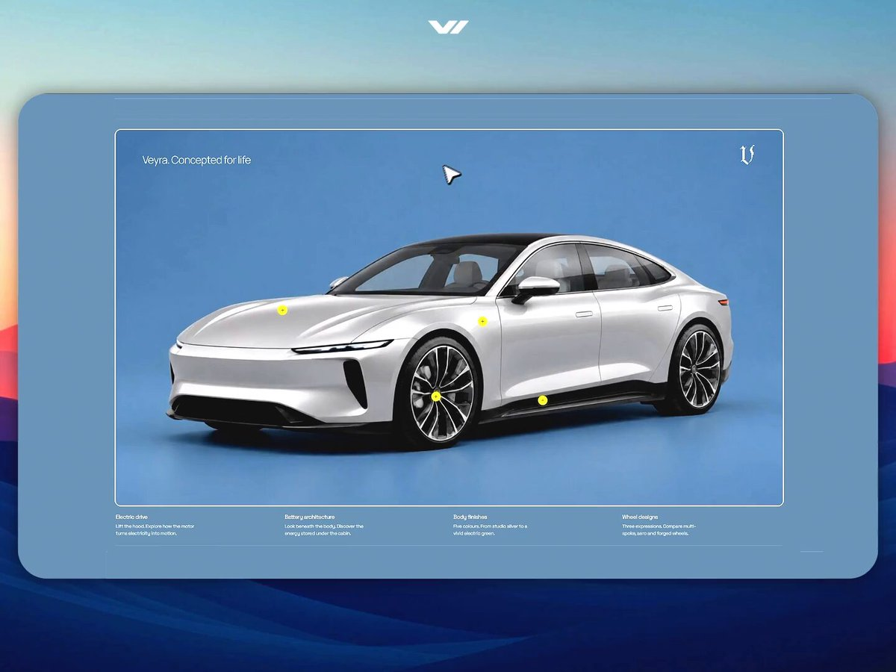

# GPT-6 Astra + After Effects + _____ ..? I'm planning to record my workflows with commentary to build datasets for AI -

> Source: https://x.com/AmirMushich/status/2099196134279573697
> Author: AmirMušić (@AmirMushich)
> Posted: Sun Sep 13 17:58:54 +0000 2026
> Stats (at capture): 126,197 views · 119 likes · 26 replies · 1789340796 reposts · 101 bookmarks · 2 quotes
> Captured: 2026-09-21T13:30:16Z

## Post

GPT-6 Astra + After Effects + _____ ..?  

I'm planning to record my workflows with commentary to build datasets for AI - so your agents will improve the quality of their design work

I see a stable demand on my judgement & vision, and I don't feel comfortable realizing that these are limited and depend on my own physical capacity to share. 
I want to make these serve to others as a more accessible signal

The professional paradigm always was
work → portfolio → reputation

it all ends on someone's body and its mortality

What if we would be able to extend it to
work → portfolio → reputation → machine-readable expertise

More creators sharing their formalized vision = better average quality of creations the world is getting (as the overall level of creativity grows)

This leads to more creative society: more accessible ways of higher-quality self-expression & communication, and, in the end, better avg quality of thought & ideas 

"thought open-source" + AI as a tool is one of the ways where I see the opportunity for billions of people invest into their own future -> future of creator economy -> more advanced & abundant society

## Media

[media/quoted-video.mp4](media/quoted-video.mp4)

[media/video.mp4](media/video.mp4)

Originals:

- https://video.twimg.com/amplify_video/2099187380972630016/vid/avc1/1080x1920/MNN0IfYh8nEH8Rp4.mp4?tag=29
- thumb: https://pbs.twimg.com/amplify_video_thumb/2099187380972630016/img/cYoEOYFnl9E3_c0n.jpg
- quoted: https://video.twimg.com/amplify_video/2098459847088103424/vid/avc1/1440x1080/Fgbj3y7Hjf1FIKlb.mp4?tag=29
- quoted thumb: https://pbs.twimg.com/amplify_video_thumb/2098459847088103424/img/8Q85Yp1K30Liqsz0.jpg

## Author bio (at capture)

Creative architect. Ex-Warner Music, PepsiCo, Spotify fr. designer. Fusing 10+ yr of brand & ad design with AI. Collabs: amir@amirmushich.com

## Quoted post

[AmirMušić (@AmirMushich)](https://x.com/AmirMushich/status/2098464881498370090) — Fri Sep 11 17:33:09 +0000 2026
— 244,300 views · 623 likes · 73 replies · 60 reposts · 587 bookmarks

> GPT-6 Astra is a design beast
> 
> No 3D models used in this demo website
> I connected LTX API to my coding agent -> generated video transitions + used GPT Images 2.5 to select car colors & wheels
> 
> GitHub repo + website prompt + ZIP proj. 👇

## Thread

### @AmirMushich — [https://x.com/AmirMushich/status/2099404541707812878](https://x.com/AmirMushich/status/2099404541707812878) — 2026-09-14T07:47:02.000Z

you can use it for free as it's open sourced (the hardware requirements are solid, tho)

I use it via API and here are the ~ costs:
LTX-2.5 Fast, 720p, 6sec = ~$0.54/run
LTX-2.5 Pro, 1080p, 6sec = ~$1.02/run

### @AmirMushich — [https://x.com/AmirMushich/status/2099581165187240429](https://x.com/AmirMushich/status/2099581165187240429) — 2026-09-14T19:28:52.000Z

thank you sm Cobi!
me & Trav X-know each other for years now 

### @AmirMushich — [https://x.com/AmirMushich/status/2099404915420385603](https://x.com/AmirMushich/status/2099404915420385603) — 2026-09-14T07:48:31.000Z

thank you Horace!

### @AmirMushich — [https://x.com/AmirMushich/status/2099581389330907349](https://x.com/AmirMushich/status/2099581389330907349) — 2026-09-14T19:29:46.000Z

Thank you sir!

### @AmirMushich — [https://x.com/AmirMushich/status/2099404593994105031](https://x.com/AmirMushich/status/2099404593994105031) — 2026-09-14T07:47:14.000Z

thank you!

### @AmirMushich — [https://x.com/AmirMushich/status/2099198695358988754](https://x.com/AmirMushich/status/2099198695358988754) — 2026-09-13T18:09:04.000Z

kind of

## Comments

### @bygregorr — [https://x.com/bygregorr/status/2099221958944502133](https://x.com/bygregorr/status/2099221958944502133) — 2026-09-13T19:41:31.000Z

The 'stable demand on judgment and vision' part is what I'd push on. Is the discomfort specifically about recording commentary today that trains the agent to not need your commentary tomorrow?

### @BySashaEmerson — [https://x.com/BySashaEmerson/status/2099232587604431233](https://x.com/BySashaEmerson/status/2099232587604431233) — 2026-09-13T20:23:45.000Z

I think the corrections will matter as much as the successful steps. Experts often know something is wrong before they can even fully explain why. Capturing that process is fascinating.

### @DeepFlowMDL — [https://x.com/DeepFlowMDL/status/2099228769542119508](https://x.com/DeepFlowMDL/status/2099228769542119508) — 2026-09-13T20:08:35.000Z

The rejected versions might end up being some of the most useful data. "This doesn't work and here's why" contains so much judgment that never makes it into a portfolio.

### @ZoltiumHQ — [https://x.com/ZoltiumHQ/status/2099231370765603142](https://x.com/ZoltiumHQ/status/2099231370765603142) — 2026-09-13T20:18:55.000Z

AI already has endless examples of finished creative work. What it needs more of is high-quality signal around WHY one creative decision is better than another.

### @LibraryPath — [https://x.com/LibraryPath/status/2099230599307247990](https://x.com/LibraryPath/status/2099230599307247990) — 2026-09-13T20:15:51.000Z

This feels like the next logical step after tutorials. Tutorials teach people what you know. A structured dataset could eventually teach agents how you work.

### @MUSCLESURGE — [https://x.com/MUSCLESURGE/status/2099230936894201933](https://x.com/MUSCLESURGE/status/2099230936894201933) — 2026-09-13T20:17:11.000Z

This is one of the better arguments I've seen for creators documenting their process now. We might not even know all the ways that data becomes useful later.

### @Mind_Essentials — [https://x.com/Mind_Essentials/status/2099228065133957365](https://x.com/Mind_Essentials/status/2099228065133957365) — 2026-09-13T20:05:47.000Z

Recording the commentary might actually be more valuable than recording the screen. The screen shows what you did. Your voice captures why you did it.

### @1FlowState — [https://x.com/1FlowState/status/2099229479641940124](https://x.com/1FlowState/status/2099229479641940124) — 2026-09-13T20:11:24.000Z

I hadn't really thought about creative work this way before. The output is temporary, but the decision-making process behind it is reusable.

### @VisionSurge — [https://x.com/VisionSurge/status/2099232907948695641](https://x.com/VisionSurge/status/2099232907948695641) — 2026-09-13T20:25:01.000Z

More creators should probably be recording their workflows now, even if they don't know exactly what they'll do with the data yet.

## Links

- https://x.com/AmirMushich/status/2098464881498370090
