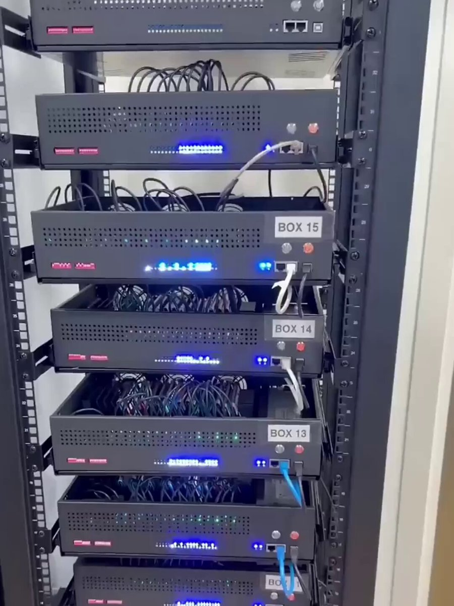

# We FINALLY shipped an MCP so your AI Agent can rent 100s of iPhones 🚀 not "another AI wrapper" not "a dashboard you

> Source: https://x.com/yurahulei/status/2099301416468652506
> Author: Yura Hulei (@yurahulei)
> Posted: Mon Sep 14 00:57:15 +0000 2026
> Stats (at capture): 55,676 views · 329 likes · 39 replies · 1789374185 reposts · 664 bookmarks · 6 quotes
> Captured: 2026-09-21T13:30:16Z

## Post

We FINALLY shipped an MCP so your AI Agent can rent 100s of iPhones 🚀

not "another AI wrapper"
not "a dashboard you open once"

5 things Claude / Codex / GrokBot can do DIRECTLY now:

1. Create TikTok & IG accounts + start warming (niche-tailored)
2. Create + schedule posts for MONTHS
3. Analyze TikTok FYP → find winners in your niche
4. Spin highly realistic AI influencers + build accounts around them
5. Scale worldwide — localized influencers for EU / Asia / everywhere else

manage hundreds of iPhones from your desktop
or even your phone 😭

this is the distribution OS agents were missing

Get started → http://minionix.com/apps

## Media

[media/video.mp4](media/video.mp4)

Originals:

- https://video.twimg.com/amplify_video/2099301263003492352/vid/avc1/1080x1440/wiv9WzGzthDWdOnt.mp4?tag=29
- thumb: https://pbs.twimg.com/amplify_video_thumb/2099301263003492352/img/cCslOOu7e0cWVPMC.jpg

## Author bio (at capture)

Scaling B2C mobile apps & B2B SaaS.
CMO at http://slideyourapp.com & http://minionix.com/apps

## Thread

### @yurahulei — [https://x.com/yurahulei/status/2099521757757448384](https://x.com/yurahulei/status/2099521757757448384) — 2026-09-14T15:32:48.000Z

1 and up to 150 posts/month
we don't create multiple accounts on 1 device currently

### @yurahulei — [https://x.com/yurahulei/status/2099361414888534188](https://x.com/yurahulei/status/2099361414888534188) — 2026-09-14T04:55:40.000Z

no we have built our internal automations 
all other was shit

### @yurahulei — [https://x.com/yurahulei/status/2099335664483369375](https://x.com/yurahulei/status/2099335664483369375) — 2026-09-14T03:13:20.000Z

they arent connected between each other

### @yurahulei — [https://x.com/yurahulei/status/2099336405700751751](https://x.com/yurahulei/status/2099336405700751751) — 2026-09-14T03:16:17.000Z

we have both VAs and Automations

### @yurahulei — [https://x.com/yurahulei/status/2099410722832675089](https://x.com/yurahulei/status/2099410722832675089) — 2026-09-14T08:11:36.000Z

for sure man we're on tiktok now

### @yurahulei — [https://x.com/yurahulei/status/2099410239439175903](https://x.com/yurahulei/status/2099410239439175903) — 2026-09-14T08:09:40.000Z

if it would be that simple...

### @yurahulei — [https://x.com/yurahulei/status/2099332240903664012](https://x.com/yurahulei/status/2099332240903664012) — 2026-09-14T02:59:44.000Z

stability and better views

## Comments

### @camperologist — [https://x.com/camperologist/status/2099375820070342675](https://x.com/camperologist/status/2099375820070342675) — 2026-09-14T05:52:54.000Z

if you have all those phones sitting in the same physical building pinging the exact same cell towers and GPS grid, platform risk engines see the density immediately. Cellular data doesn't save you from tower overlap and local telemetry. How are you dodging cluster-shadows?

### @catmanyau — [https://x.com/catmanyau/status/2099327145558335688](https://x.com/catmanyau/status/2099327145558335688) — 2026-09-14T02:39:29.000Z

hundreds of iphones is a wild scale claim — what happens when tiktok flags the first device cluster or the ai influencer gets stuck in a verification loop?

### @eddyvustg — [https://x.com/eddyvustg/status/2099346769767436634](https://x.com/eddyvustg/status/2099346769767436634) — 2026-09-14T03:57:28.000Z

Exposing physical iPhones directly as tool calls via MCP is such a clever unlock for autonomous mobile workflows.

### @yevloop — [https://x.com/yevloop/status/2099309646859411794](https://x.com/yevloop/status/2099309646859411794) — 2026-09-14T01:29:57.000Z

this is the kind of MCP that feels like a real product, not a demo. the distribution OS line is spot on

### @AlexYates24910 — [https://x.com/AlexYates24910/status/2099410193503150190](https://x.com/AlexYates24910/status/2099410193503150190) — 2026-09-14T08:09:29.000Z

Bro still spamming this  
Gotta pay that interest on the credit cards for this with the wild AF pricing

### @Tony_Halik__ — [https://x.com/Tony_Halik__/status/2099377632164913163](https://x.com/Tony_Halik__/status/2099377632164913163) — 2026-09-14T06:00:06.000Z

lol $80/month for just ADB connection... just buy old iphone and connect it to Astra/Fable.

### @GarrethDottin — [https://x.com/GarrethDottin/status/2099520268691460343](https://x.com/GarrethDottin/status/2099520268691460343) — 2026-09-14T15:26:53.000Z

Per device do we have access to just one account or as many as we'd like on the device?

### @FReza1984 — [https://x.com/FReza1984/status/2099355675860361498](https://x.com/FReza1984/status/2099355675860361498) — 2026-09-14T04:32:51.000Z

On-device iPhone access turns agent automation into a concrete workflow primitive.

## Links

- http://minionix.com/apps
