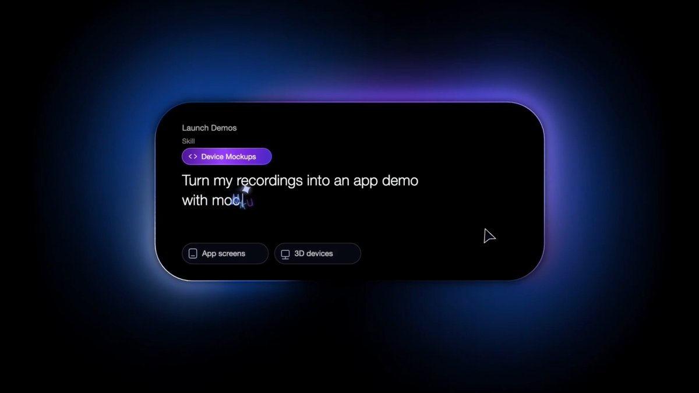

# POV: Cinematic Product Demos & Shots built with AI Agents 🎬✨ (sound on 🔈) Added a collection of Ultra Realistic 3D

> Source: https://x.com/rege_dev/status/2099378611979768270
> Author: rege (@rege_dev)
> Posted: Mon Sep 14 06:04:00 +0000 2026
> Stats (at capture): 3,486 views · 68 likes · 31 replies · 1789413855 reposts · 42 bookmarks · 1 quotes
> Captured: 2026-09-21T13:30:16Z

## Post

POV: Cinematic Product Demos & Shots built with AI Agents 🎬✨ (sound on 🔈)

Added a collection of Ultra Realistic 3D Mockups, including the new iPhone Duo, with high-detail cinematic shot templates. 📱🎬

Let me know if you want to try it. 👇

## Media

[media/video.mp4](media/video.mp4)

Originals:

- https://video.twimg.com/amplify_video/2099182484206616576/vid/avc1/3840x2160/HDkY656d5HrosnoF.mp4?tag=29
- thumb: https://pbs.twimg.com/media/HSK66uXbUAA1nVn.jpg

## Author bio (at capture)

Building @coanimator & @YourGPTAI

## Thread

### @rege_dev — [https://x.com/rege_dev/status/2099484248160014641](https://x.com/rege_dev/status/2099484248160014641) — 2026-09-14T13:03:45.000Z

Sure! I’ll be shipping these animation templates in our app. I’ll share them with you once they’re live! 

### @rege_dev — [https://x.com/rege_dev/status/2099542399890731255](https://x.com/rege_dev/status/2099542399890731255) — 2026-09-14T16:54:50.000Z

Sure! I’ll be shipping these animation templates in our app. I’ll share them with you once they’re live! 

### @rege_dev — [https://x.com/rege_dev/status/2099420597101232639](https://x.com/rege_dev/status/2099420597101232639) — 2026-09-14T08:50:50.000Z

Sure! I’ll be shipping these with the templates in our app. I’ll share them with you once they’re live! 

### @rege_dev — [https://x.com/rege_dev/status/2099388494548443365](https://x.com/rege_dev/status/2099388494548443365) — 2026-09-14T06:43:16.000Z

Glad you liked it! 

### @rege_dev — [https://x.com/rege_dev/status/2099433825004830966](https://x.com/rege_dev/status/2099433825004830966) — 2026-09-14T09:43:24.000Z

Love to hear that! 

### @rege_dev — [https://x.com/rege_dev/status/2099421623875158502](https://x.com/rege_dev/status/2099421623875158502) — 2026-09-14T08:54:55.000Z

Glad you liked it! 

### @rege_dev — [https://x.com/rege_dev/status/2099396044417306912](https://x.com/rege_dev/status/2099396044417306912) — 2026-09-14T07:13:16.000Z

Glad you liked it! 

## Comments

### @AliceInfoAi — [https://x.com/AliceInfoAi/status/2099555437884612678](https://x.com/AliceInfoAi/status/2099555437884612678) — 2026-09-14T17:46:38.000Z

Those ultra-realistic cinematic shots are straight out of a Hollywood ad  incredible work!

### @AinaAiTech — [https://x.com/AinaAiTech/status/2099730409219400133](https://x.com/AinaAiTech/status/2099730409219400133) — 2026-09-15T05:21:55.000Z

AI made cinematic product videos using ultra realistic 3D mockups like iPhone shots

### @EliseTechAi — [https://x.com/EliseTechAi/status/2099715477052510305](https://x.com/EliseTechAi/status/2099715477052510305) — 2026-09-15T04:22:35.000Z

Those cinematic mockups look insanely realistic - iPhone Duo shots are next level

### @aaapinen — [https://x.com/aaapinen/status/2099451117465682086](https://x.com/aaapinen/status/2099451117465682086) — 2026-09-14T10:52:06.000Z

the interesting part is when the demo updates itself after the product changes

### @EllaTech0 — [https://x.com/EllaTech0/status/2099585724303741196](https://x.com/EllaTech0/status/2099585724303741196) — 2026-09-14T19:46:59.000Z

That looks so pro  Ultra realistic  cinematic  chef’s kiss. Yes please!

### @AskZaratech — [https://x.com/AskZaratech/status/2099769365545570680](https://x.com/AskZaratech/status/2099769365545570680) — 2026-09-15T07:56:43.000Z

Those cinematic shots are unreal  iPhone Duo mockup goes crazy clean

### @razaaitech — [https://x.com/razaaitech/status/2099615326279250257](https://x.com/razaaitech/status/2099615326279250257) — 2026-09-14T21:44:37.000Z

These cinematic product shots look incredibly polished. Great work.

### @neha_d4 — [https://x.com/neha_d4/status/2099385926053249243](https://x.com/neha_d4/status/2099385926053249243) — 2026-09-14T06:33:04.000Z

This tool is fire  Definitely useful for all product builders.
