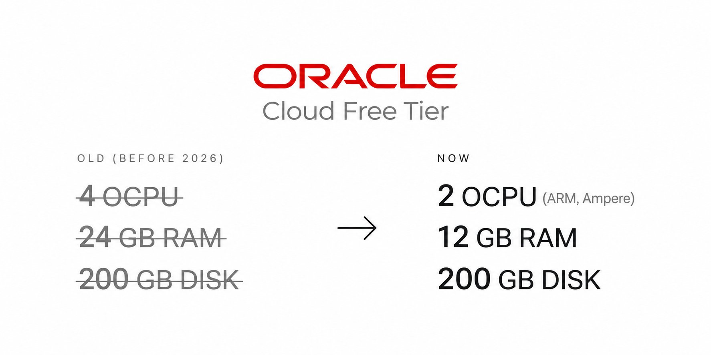

# everyone posting the old oracle free vps but 4 ocpu / 24gb got cut to this in june: - 2 ocpu (arm, ampere) - 12 gb ram

> Source: https://x.com/ibocodes/status/2099412868026552447
> Author: ibo (@ibocodes)
> Posted: Mon Sep 14 08:20:07 +0000 2026
> Stats (at capture): 148,905 views · 1,167 likes · 49 replies · 1789413682 reposts · 856 bookmarks · 8 quotes
> Captured: 2026-09-21T13:30:16Z

## Post

everyone posting the old oracle free vps but 

4 ocpu / 24gb got cut to this in june:

- 2 ocpu (arm, ampere)
- 12 gb ram
- 200 gb disk
- always free, no card charge

still more than a $20/month hetzner box

## Media

Originals:

- https://pbs.twimg.com/media/HSKc0sHaMAAIq1A.jpg?name=orig

## Author bio (at capture)

22 || http://devmarketing.co, http://businessideasdb.com.

## Thread

### @ibocodes — [https://x.com/ibocodes/status/2099515474304475528](https://x.com/ibocodes/status/2099515474304475528) — 2026-09-14T15:07:50.000Z

just upgrade your account to PAYG, put $1 limit, thats it

## Comments

### @3c685ab5014bb3d — [https://x.com/3c685ab5014bb3d/status/2099522365554123134](https://x.com/3c685ab5014bb3d/status/2099522365554123134) — 2026-09-14T15:35:13.000Z

> Oracle sends email to reduce OCPU+RAM
> oh, maybe it's a good opportunity to rebuild my vps from scratch after all that various testing, there is much crap leftovers.
> deletes the machine.
> tries to set up a new one with lower specs.
> No available resources.
> Thanks Oracle.

### @cubadox — [https://x.com/cubadox/status/2099484514489672089](https://x.com/cubadox/status/2099484514489672089) — 2026-09-14T13:04:49.000Z

As others have said this has been out of stock in most availability zones for a long while. Their other free offering were enough for me to try. They randomly shut down my compute instance and when I wrote support I got a message back "oh they weren't supposed to do that"...

### @iAjittiwari — [https://x.com/iAjittiwari/status/2099458367777620382](https://x.com/iAjittiwari/status/2099458367777620382) — 2026-09-14T11:20:55.000Z

Free tier is fine until Oracle reclaims an "idle" instance with your n8n and 40 workflows on it. Seen it happen twice.

Free compute isn't free if you're the one rebuilding it on a Sunday.

### @ruanbekker — [https://x.com/ruanbekker/status/2100473829596299761](https://x.com/ruanbekker/status/2100473829596299761) — 2026-09-17T06:36:00.000Z

Nice move oracle cloud, i had a 24gb instance which they deleted, and trying to provision a 12gb instance they are out of capacity (for a while now) so their free tier is pretty useless

### @TheDevSerdarius — [https://x.com/TheDevSerdarius/status/2099444502591078893](https://x.com/TheDevSerdarius/status/2099444502591078893) — 2026-09-14T10:25:49.000Z

just enable billing aka PAYG and cost guards in place and u can still have always free 4 cores 24gb 200gb disk. i run a small llm writer model that i trained there. works like a charm.

### @MMIA18EMV — [https://x.com/MMIA18EMV/status/2099579275225469070](https://x.com/MMIA18EMV/status/2099579275225469070) — 2026-09-14T19:21:22.000Z

12GB sounds fine until you try anything AI-adjacent on it, system RAM fills up way faster than people expect once you stack a few containers plus any model loading.

### @DevBredda — [https://x.com/DevBredda/status/2099465108200001663](https://x.com/DevBredda/status/2099465108200001663) — 2026-09-14T11:47:42.000Z

this is BS, I tried it and I NEVER was able to get allocation for the free tier.. its always out of stock. so I dont know why people keep recommending it..

### @borche — [https://x.com/borche/status/2099438018788471012](https://x.com/borche/status/2099438018788471012) — 2026-09-14T10:00:04.000Z

Oracle randomly decided to cut my free tier VPS a while back. All I ever used it for was to test some local cli apps I was developing.

### @wsquarepa — [https://x.com/wsquarepa/status/2099502082579374481](https://x.com/wsquarepa/status/2099502082579374481) — 2026-09-14T14:14:38.000Z

this is only for "true" free tier customers, if you upgrade to PAYG you still get 4 ocpu / 24 gb RAM (for free) it seems.

### @3Ammaross — [https://x.com/3Ammaross/status/2099442126845087768](https://x.com/3Ammaross/status/2099442126845087768) — 2026-09-14T10:16:23.000Z

they turn off mine and i cant reshape it, is there a way to resize it or a workaround?, i dont want to loose the machine

### @paulNL — [https://x.com/paulNL/status/2099551958520431045](https://x.com/paulNL/status/2099551958520431045) — 2026-09-14T17:32:49.000Z

Still running the old vps with 24GB currently. If you had payment actived you are still getting the old plan currently.

### @ALES324381 — [https://x.com/ALES324381/status/2099541220661862587](https://x.com/ALES324381/status/2099541220661862587) — 2026-09-14T16:50:09.000Z

I have still 4/24, its only for new users, its hard to get without switch account to paid one but free on paid account

### @lumistill — [https://x.com/lumistill/status/2099504900501872990](https://x.com/lumistill/status/2099504900501872990) — 2026-09-14T14:25:49.000Z

Thanks for the heads up on this. I was able to get in and cancel mine before I started getting billed.

### @trendingteller — [https://x.com/trendingteller/status/2099507207557787875](https://x.com/trendingteller/status/2099507207557787875) — 2026-09-14T14:34:59.000Z

I think this cut is only on free tier. If you were on pay as you go and created earlier, no change.
