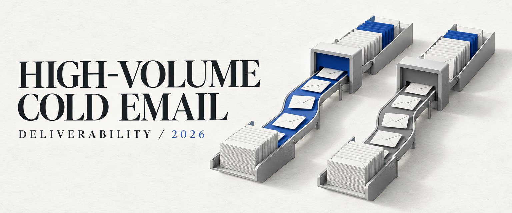

# The Ultimate Guide to High-Volume Cold Email Deliverability in 2026

> Source: https://x.com/MitchellKeller_/status/2099497668049609150
> Author: Mitchell Keller (@MitchellKeller_)
> Posted: Mon Sep 14 13:57:05 +0000 2026
> Stats (at capture): 7,612 views · 44 likes · 7 replies · 1789394487 reposts · 108 bookmarks · 1 quotes
> Captured: 2026-09-21T13:30:16Z

## Post

https://x.com/i/article/2099497661728747520

## Article

[The Ultimate Guide to High-Volume Cold Email Deliverability in 2026](https://x.com/i/article/2099497661728747520)

Cover: https://pbs.twimg.com/media/HSLp_W4bMAEgIYv.jpg

On a recent consult, the team told me they were replacing their sending infrastructure every two weeks.

I wanted to know how they were deciding what needed replacing.

Buying on a schedule could mean taking working domains out of service while a domain with poor results keeps running until its turn comes around.

I wanted them to know which domains needed attention and have replacements ready, without spending the morning checking every account. That's the peace of mind I'd want from this setup.

That means deciding who to email first, measuring each domain against the right campaign, and preparing spare capacity before you need it.

I'll walk through the rules I'd use, including when I'd stop buying infrastructure and change the campaign instead.

These are the operating rules I'd use. The calculations below are worked examples, not results from that team.

## Start by separating the people you're trying to reach

Before I'd change this team's sending setup, I'd split the audience by the email protection they're using.

A secure email gateway, or SEG, screens mail before it reaches the recipient. Keep prospects behind those gateways separate from the rest of the campaign.

Otherwise, the campaign's overall reply rate can hide a problem with one part of the audience.

I'd record the receiving provider as well. Don't assume that knowing a company uses Microsoft tells you every security product sitting in front of its inboxes.

Keep an unknown category when you can't establish the setup. Record what you found, when you checked it, and what supported the classification.

For the SEG group, I'd consider LinkedIn first. If the account is worth reaching, email doesn't have to be the first channel you spend money on.

If we're going to email that group, I'd run a separate campaign and test aged Azure infrastructure against the current setup.

That's a test, not a promise that an older domain gets through a security gateway.

Keep the offer and audience as comparable as you can while testing the infrastructure. Changing the copy, list and sending setup at once makes it hard to tell which change helped.

Use the same definition of a positive conversation for LinkedIn and email, then track each channel separately. Include tool costs and the time spent reaching people. Compare cost per positive conversation, not LinkedIn conversations against every email reply.

You might find that the expensive part of the email setup is serving people you'd be better off reaching somewhere else.

## Decide what the reply rate actually counts

For this team's monitoring, I'd use seven-day windows, per campaign, with at least 500 sends per domain before applying my reply-rate rotation rules.

Count human replies. Exclude out-of-office replies and other automated responses.

A holiday message isn't interest, and a long conversation shouldn't become five separate replies in the report.

Before building the automation, write down the counting convention. For the calculations below, I'd use unique human responders attributed to that domain and campaign, divided by recorded sends in the same seven-day window.

That's the proposed convention for this setup. Check what your sequencer actually counts before comparing its dashboard with the report.

Keep follow-up sends in the send count, and record unique contacts separately. A campaign that sends more follow-ups has a different denominator from one that sends a single email per person.

Keep replies to older sends in a separate column. For the examples below, count a person once only if both their reply and the send it answers fall inside the seven-day window. This misses replies that arrive later, so compare at the same cutoff and use similar sending schedules.

Use the same counting method for each domain. If the tool can't tie a reply to its sending domain and campaign, mark it unknown.

## Apply the thresholds after 500 sends

My rotation rule is below 70% of campaign-average reply rate or below 1% reply rate.

If the campaign average is 2%, the relative threshold is 1.4%:

"2% x 70% = 1.4%."

For this report, divide the campaign's qualifying human responders by its total sends. Use the same reply rules as the domain report. If a person received mail from more than one domain, attribute their reply once to the domain of the message they answered.

Compare within the same campaign and recipient group. A domain serving only the SEG group shouldn't get judged against a campaign serving a different group. If there's only one sending domain in the comparison, its rate equals the average, so the relative rule can't identify a weak domain.

Here are hypothetical counts at the 500-send minimum, using a 2% campaign average:

7 human responders / 500 sends = 1.4% reply rate. At the relative threshold, not below it

6 human responders / 500 sends = 1.2% reply rate. Below the 1.4% relative threshold

5 human responders / 500 sends = 1% reply rate. At the absolute threshold, but below 1.4% in this example

4 human responders / 500 sends = 0.8% reply rate. Below both thresholds

Exactly 1% doesn't trigger the absolute rule, though it can still trigger the relative rule.

At 499 sends, the domain hasn't reached the minimum. Flag it for review rather than make an automatic performance-based swap.

That doesn't mean ignoring a restriction or authentication failure until send number 500. Those problems need their own stop-and-investigate path.

At 500 sends, one reply changes the rate by 0.2 percentage points. Review the counts before treating a threshold crossing as evidence of a delivery problem.

---

## Check whether the campaign deserves more capacity

A low reply rate can mean the message didn't reach the inbox. It can also mean the person read it and didn't care.

Before replacing domains for this team, I'd look at whether the problem is concentrated in a few domains or spread across the campaign.

My benchmark for a healthy campaign is more than one positive reply per 500 contacts, or above 0.2%. With exactly 500 contacts, that means at least two people replying positively.

That's contacts, not sends. It's also a positive reply, not a booked meeting.

Keep a written definition of positive interest and review borderline replies. An objection that opens a real conversation is different from an automated response or a request to stop.

If the whole campaign is under 1% reply rate, I'd rethink the strategy from the ground up. Buying another batch of domains shouldn't be the default response.

Read the replies. Check whether you're solving a specific problem for the people on the list and whether the email explains it in language they use.

Look at what changed during the window too. A new list source or weaker offer can affect results across working domains.

Keep spare capacity ready, but use the campaign's results to decide whether it needs replacement domains or a different message.

## Give each domain a record you can act on

I'd put this team's domain records in one place, with enough detail to explain a decision later.

Context - campaign, recipient provider, gateway group and script version

Inventory - purchase date, previous use, inbox setup date and preparation history

Ownership - actual sender, responsible operator and current status

Activity - window start and end, sends, unique contacts and last send

Replies - unique human responders, automated replies and positive replies

Capacity - configured daily volume, currently usable volume and ready reserve

Problems - bounces, complaints, provider errors and account restrictions

Keep the decision beside the data: which rule triggered, whether the sample was large enough, and who approved the next action.

If a domain falls below the threshold, I'd check whether its settings correctly identify and verify the sender. That's email authentication. I'd also check errors and restrictions before assuming it needs replacing.

Check the recipient group and script version next. Then compare with domains doing similar work in the same campaign.

Provider restrictions and complaints aren't a reason to move the same sending activity onto another domain. Stop and resolve the underlying issue.

## Hold 2,000 daily sends ready if you're using 2,000

For the reserve plan, let's use a hypothetical campaign that needs 2,000 daily sends of usable capacity.

I'd hold another 2,000 ready in reserve:

"2,000 active + 2,000 ready reserve = 4,000 total daily capacity."

The reserve isn't permission to send 4,000 emails today. It's capacity you can use when part of the active setup needs to come out.

Purchased domains with no inboxes don't count. Neither do inboxes that still need preparation or can't support the volume you're assigning to them.

The typical Azure setup I'm talking about has up to 100 inboxes per domain, with up to five cold emails per inbox per day.

In terms of warming up start at 2 sends per day and carefully scale to 5 per day.

personally I never exceed 3 per inbox per day. 

FOR WARMING SENDS: you are going to set your warming sends to 5 to start and scale to a max of 10 per day per inbox

Scale over 3 weeks of sending after 3 weeks minimum of warming.

That gives 500 configured daily sends per domain. It's my configuration, not a Microsoft quota or a guarantee that each domain can safely support it.

At that configuration, the example would require four fully usable domains for the active capacity and four for reserve. If their actual usable capacity is lower, the domain count needs to rise.

Track what those eight domains can actually send before counting them as ready.

---

## Start purchasing before the reserve is empty

For this team, I'd stagger purchases instead of wait for a problem and order everything at once.

Choose general-purpose domains that fit the business and check their history. General-purpose doesn't mean pretending to represent a different company.

The purchasing process I described on the consult leaves two weeks before inbox setup. The inboxes then need further preparation before they're ready to use.

That two-week delay is part of the purchasing process we've discussed, not a provider requirement.

I'd give each purchase a status so there's no confusion between something we've paid for and something the campaign can use:

Purchased - domain owned, history reviewed

Provisioned - inboxes and authentication configured

Preparing - sending history and readiness being assessed

Ready - approved for a stated amount of usable capacity

Active - assigned to a campaign

Also keep held or restricted inventory out of the ready count.

When a ready domain moves into the campaign, the reserve falls. That's the point to replenish it, while there's still capacity available.

## Ramp toward these settings

I'd prioritize .com domains and give inboxes time to prepare rather than rush them into a campaign. Build toward 40 warm-up messages per inbox per day. That's a target to ramp toward, not where I'd start a new inbox.

For Google, I'd use two or three inboxes per domain. Once a campaign is working, I'd ramp cold sending toward 20 per inbox per day while keeping the 40 warm-up messages running. At those settings, that's 60 outgoing messages per inbox per day, with only 20 going to prospects.

For the Azure setup, I'd use 50-100 inboxes per domain and up to five cold sends per inbox per day. Count warm-up messages separately so you know how many emails can actually go to prospects.

These are my operating targets, not provider-approved limits or a guarantee of inbox placement. Build up gradually. If you get provider warnings or delivery problems, stop increasing volume and look into what's happening.

---

## When I'd pay for aged domains

Aged domains and prepared inboxes are especially worth evaluating for the Azure setup, and when a large share of the market sits behind security gateways.

I'd ask what the domain was used for, not just how old it is.

For prepared inboxes, I'd want the actual sending history and any known restrictions. A date on a listing doesn't tell you how the accounts have behaved.

I've discussed 90 days of preparation for gateway-heavy audiences. I wouldn't treat day 90 as a reason to jump straight to full volume.

Increase volume based on what those accounts have actually been sending and how they're performing. If that history isn't available, don't count the advertised capacity as ready reserve.

For the SEG group, compare the cost of this preparation with prioritizing LinkedIn. The more useful decision might be to reduce how much email capacity that group needs.

## Review the repeated patterns in the emails

If you replace a domain but keep sending the same emails, you may end up paying for new infrastructure without fixing why the emails were being filtered.

The concern we discussed on the consults is that providers may connect those emails through repeated copy, links, signatures and sender details, even when the sending domain changes. That's what I mean by fingerprinting.

We haven't established which of those details causes filtering or whether changing them prevents it. But I wouldn't assume a new domain means the same emails will be treated differently. Check the messages and the campaign before putting more money into replacements.

For this campaign, I'd use at least 20 subject lines and write new scripts weekly.

The subjects should reflect real angles for the segment, not misleading replies or little word swaps made to look like a different email.

Keep the script version attached to the results. Otherwise, weekly changes make it harder to explain why performance moved.

I'd vary signatures and have a different, real sender every 10-20 inboxes. If the business can't support that with actual people, don't fill the remaining accounts with fictional identities.

Keep the company being represented clear. You can change the wording and layout without changing who you're claiming to be.

The same applies to the domain and landing page. A visitor should be able to understand the business behind the email, not land on something that contradicts it.

## What domain masking does and doesn't do

EmailGuard's domain masking proxy can show your website under a secondary domain. Its feature page describes shared or dedicated internet addresses and a secure connection.

If the website host is incompatible, it can fall back to a redirect and lose the mask.

For this setup, I'd check what actually happens when someone visits the sending domain. Don't assume the proxy is working because the domain was added to a dashboard.

I wouldn't promise that it makes the domain inaccessible to bots or completely protects the main domain's reputation.

I'd also keep the basic sender requirements in the checklist. Google's guidelines address authentication, accurate sender information and unwanted mail; a proxy doesn't replace those requirements.

Authentication helps the receiving service check that you're allowed to send using that domain. It doesn't establish that the person wants the email.

Microsoft says Exchange Online isn't intended for bulk mailing. "Azure" is shorthand for the supplier setup we've been discussing, not a precise sending product. Confirm the actual service and its rules before buying capacity; the 100-inbox example isn't Microsoft approval to use it this way.

## Automate the actions that have clear limits

For the team from the consult, the useful automation would start with collecting the report and proposing decisions.

It should explain why a domain was flagged and identify a ready replacement with enough usable capacity. It shouldn't take the old domain out and then discover there's nothing ready.

For a restricted account, stop and investigate. For campaign-wide weak performance, route the campaign to a strategy review rather than trigger purchases.

Once the decision rules have been checked, I'd automate eligible swaps and start purchasing and preparation to refill the reserve, within a spending cap.

Set that cap before giving the system buying access. Also stop duplicate orders and require review when the inventory data is missing or stale.

Log what changed, what it cost, and the remaining usable reserve after each action. Alert the owner if a replacement or purchase fails.

I'd test those decisions against real reports before allowing unattended purchases or swaps.

## Give your agent the first audit

You can hand this article to your agent with the prompt below. Start with read-only access to the sequencer and inventory records.

---

## Source notes

The opening draws on an August 31 consult. The purchasing and preparation detail also draws on a September 10 consult. The thresholds are my operating recommendations, not provider rules.

The worked counts and capacity plan are examples, not reported client results.

Google's email sender guidelines, Microsoft's Exchange Online limits, and EmailGuard's domain masking feature are the provider references for the relevant sections.

## Media

Originals:

- article cover: https://pbs.twimg.com/media/HSLp_W4bMAEgIYv.jpg

## Author bio (at capture)

B2B Growth ⊚ Sprinter, Washed up Basketballer - Daily Tips from Raw GTM and knowledge work with AI.

## Thread

### @MitchellKeller_ — [https://x.com/MitchellKeller_/status/2099511148395528531](https://x.com/MitchellKeller_/status/2099511148395528531) — 2026-09-14T14:50:39.000Z

Hmm actually you can stick domains on SMTP inboxes for cheap to warm them

## Comments

### @MaxAIoutreach — [https://x.com/MaxAIoutreach/status/2099834530807066849](https://x.com/MaxAIoutreach/status/2099834530807066849) — 2026-09-15T12:15:39.000Z

what about high volume linkedin outbound

### @M1keLuka — [https://x.com/M1keLuka/status/2099507698148450736](https://x.com/M1keLuka/status/2099507698148450736) — 2026-09-14T14:36:56.000Z

What about SMTP

### @chrislevan24 — [https://x.com/chrislevan24/status/2099498766025761158](https://x.com/chrislevan24/status/2099498766025761158) — 2026-09-14T14:01:27.000Z

fire

## Links

- https://x.com/i/article/2099497661728747520
- https://support.google.com/mail/answer/81126
- https://learn.microsoft.com/en-us/office365/servicedescriptions/exchange-online-service-description/exchange-online-limits
- https://emailguard.io/features/domain-masking-proxy
