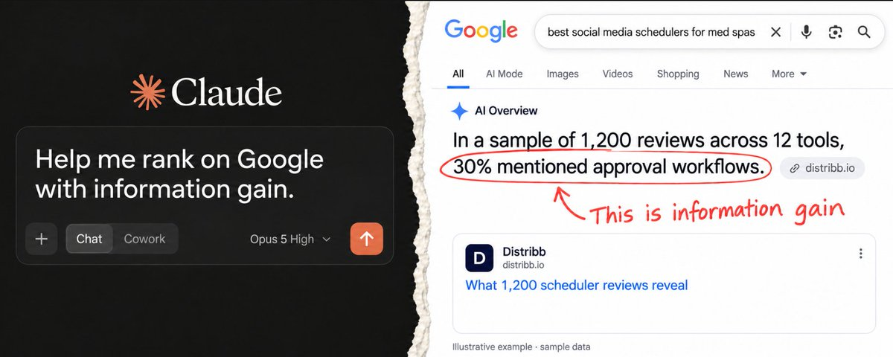

# Across 184 customer websites with comparable Google Search Console data, search clicks increased by an average of

> Source: https://x.com/borjafat/status/2099501928942063910
> Author: borja (@borjafat)
> Posted: 2026-09-14T14:14:01Z
> Stats (at capture): 6,230 views · 38 likes · 6 replies · 2 reposts · 77 bookmarks
> Captured: 2026-09-21T13:37:09Z

## Post

Across 184 customer websites with comparable Google Search Console data, search clicks increased by an average of 269.5% over their first 90 days after joining Distribb and applying information gain, with median growth of 35.1% MoM...see what I did there? https://x.com/i/article/2099460553211105280

## Article

Title: 6 Prompts to rank #1 in AI by adding information gain to your content
URL: https://x.com/i/article/2099460553211105280

If you want your articles found on Google and cited in AI answers, but:

↳ Your AI drafts repeat what already ranks.
↳ You think you have nothing new to add

Then use AI to find unanswered questions and help you answer them with your experience, data and scraping information.

Across 184 customer websites with comparable Google Search Console data, search clicks increased by an average of 269.5% over their first 90 days after joining Distribb and applying information gain, with median growth of 35.1% MoM

I built this entire system into an AI agent skill to save time 👈

See what I did there? Information gain.

Imagine you're booking a beachfront hotel with friends. Everyone shares the same travel guide.

A friend who stayed there sends a photo: there's a busy road between the hotel and the beach. The nearest crossing is a long walk away.

Now you have something else to consider before booking.

That friends photo and opinion is considered over everyone else's.

That's information gain in content: useful information your reader hasn't found in the other articles.

Google's content guidance asks for original research and firsthand experience. For GEO (generative engine optimization), clear findings with evidence give AI answers something specific to reference. 

 

Let's use "Best post scheduler tools for med spas" as the example.

Step 1: Find what the existing content leave unanswered

 

Ask AI to collect the top 10 organic Google results and 10 relevant YouTube videos. Have it read the pages and available transcripts.

Look for repeated advice, weak evidence, and questions a buyer still needs answered. For GEO, check the answers and sources in your target AI search tools too.

For example, every article might mention approvals. Can an owner approve a post from their phone without creating another account?

Copy this prompt:

 

 

Step 2: Let AI interview you

 

Ask AI to interview you one question at a time, using the gaps it found.

If you say approvals were slow, it should ask about the last delayed post: when you sent it, when it was approved, and what happened in between.

Save the answers in a knowledge base. Keep observed events separate from opinions and untested ideas.

Copy this prompt:

 

 

Step 3: Find a useful statistic in your data

 

Connect relevant records and ask AI to plan a deep research investigation. Use a spreadsheet or code to calculate the results.

For our example, submission and approval timestamps could reveal how long posts wait for approval. Count completed approvals and pending drafts separately.

Remove private details and keep the calculations so you can check the result.

Copy this prompt:

 

 

Step 4: Analyze public reviews

 

Collect customer reviews across the 12 schedulers in your roundup. Choose the sources, date range, and sampling rules before collecting them.

Ask AI to identify each feature mentioned and classify the comment as praise, a complaint, a request, or unclear. Check a varied sample yourself before counting.

In a hypothetical sample of 1,200 reviews across 12 tools, 360 reviews mention approval workflows. That is 30% of the sampled reviews.

Report that as mentions. Claim a preference only when reviewers state one, and identify med-spa reviewers only when their industry is known.

Check current features and plan limits before recommending tools. Any "only these tools" claim must cover just the tools you verified.

Copy this prompt:

 

 

Step 5: Test the workflow yourself

 

Create the same fictional promotion in each shortlisted scheduler. Send it to a test approver, request a change, and approve the revision from a phone.

Record the plan, account requirements, and any problems. Save screenshots so readers can see how you reached your recommendation.

Copy this prompt:

 

 

Step 6: Write the article with evidence beside each finding

 

Give AI your research, confirmed interview notes, and checked results. Ask it to explain which tool suits which buyer and why.

Place each screenshot beside the finding it supports. Keep sample sizes and limitations with the numbers so they survive being quoted.

Copy this prompt:

 

Start with one unanswered buyer question. Use the interview, data analysis, or test that can answer it, then publish what you learned.

Thanks for reading.

Borja

## Media

Original (Article cover image): https://pbs.twimg.com/media/HSLofieXAAAWzg_.jpg

## Author bio (at capture)

building https://distribb.io so it grows itself

## Thread

### borja ([@borjafat](https://x.com/borjafat)) — [2099292549126971709](https://x.com/borjafat/status/2099292549126971709) — 2026-09-14

> Vibe SEO
> 
> "Hey Claude, I want to rank #1 on ChatGPT"
> 
> -Check Google Search Console
> -Topical authority
> -Internal links
> -Select buying intent keywords
> -Programmatic SEO
> -Information gain
> -Backlinks
> -Citation outreach
> 
> And MAKE NO MISTAKES...

### borja ([@borjafat](https://x.com/borjafat)) — [2099522761513218396](https://x.com/borjafat/status/2099522761513218396) — 2026-09-14

> Use Distribb to add information gain to your content and automate your entire SEO, try it free today

### borja ([@borjafat](https://x.com/borjafat)) — [2099625990863405124](https://x.com/borjafat/status/2099625990863405124) — 2026-09-14

> Can’t sleep?

## Comments

### Florian Darroman ([@floriandarroman](https://x.com/floriandarroman)) — [2099624331534082512](https://x.com/floriandarroman/status/2099624331534082512) — 2026-09-14

> Taking notes

### Mykhailo Sorochuk ([@sir4K_zen](https://x.com/sir4K_zen)) — [2099549919736402137](https://x.com/sir4K_zen/status/2099549919736402137) — 2026-09-14

> solid checklist, but programmatic SEO on a single query feels overkill

### Scs Ai ([@Scs_ai_](https://x.com/Scs_ai_)) — [2101282558193590553](https://x.com/Scs_ai_/status/2101282558193590553) — 2026-09-19

> The median tells the real story — means get wrecked by outliers.

### Vishal Patel ([@Vishalaii](https://x.com/Vishalaii)) — [2099548551323779374](https://x.com/Vishalaii/status/2099548551323779374) — 2026-09-14

> Average up 269% with median 35% MoM is the honest way to report it. Outliers hide how most sites actually move.

### c ([@dhaundiyalcp](https://x.com/dhaundiyalcp)) — [2099585226062406045](https://x.com/dhaundiyalcp/status/2099585226062406045) — 2026-09-14

> information gain is the part everyone skips because it actually requires knowing something, not just prompting nicely. good breakdown

## Links

- https://x.com/i/article/2099460553211105280
