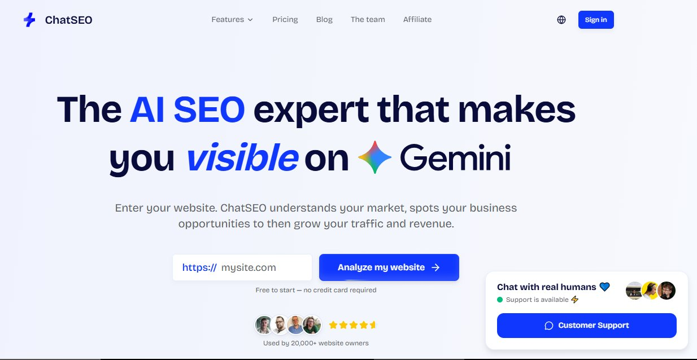

# Dashboard tools vs. ChatSEO Semrush, Ahrefs, GSC dashboards: Data everywhere No clear next step Built for people who

> Source: https://x.com/samigrows/status/2099524324218765775
> Author: Sami | SEO AI (@samigrows)
> Posted: 2026-09-14T15:43:00Z
> Stats (at capture): 3,147 views · 10 likes · 1 replies · 0 reposts · 1 bookmarks
> Captured: 2026-09-21T13:37:09Z

## Post

Dashboard tools vs. ChatSEO

Semrush, Ahrefs, GSC dashboards:

Data everywhere
No clear next step
Built for people who already know SEO

ChatSEO:

One conversation
Clear priorities
Built for people who don't

Try yourself here:

https://chatseo.app/?ref=muhammadsami

## Media

Original (Post image): https://pbs.twimg.com/media/HSMCPWWbAAAmj1H.jpg?name=orig

## Author bio (at capture)

📈 Helping SaaS and ECOM brands increase revenue with SEO
🕒 2+ Years of Experience
📩 DM "SEO" for a Customized Package/ SEO Consultancy

Profile website: https://chatseo.app/?ref=muhammadsami

## Thread

### Sami | SEO AI ([@samigrows](https://x.com/samigrows)) — [2102025396460114016](https://x.com/samigrows/status/2102025396460114016) — 2026-09-21

> I do not take every client who reaches out.
> 
> If your site has no foundation, we fix that first.
> If your content has no strategy, we build that before anything else.
> If you want instant results, I am not your person.
> 
> If you want compounding organic growth built properly, DM me.

## Comments

1 reply on the original at capture; only the author follow-up above was visible without further login.

## Links

- https://chatseo.app/?ref=muhammadsami
