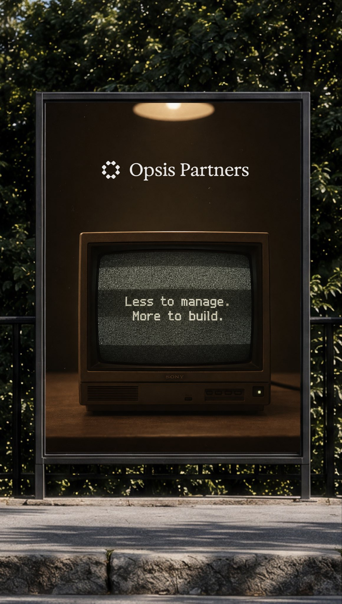
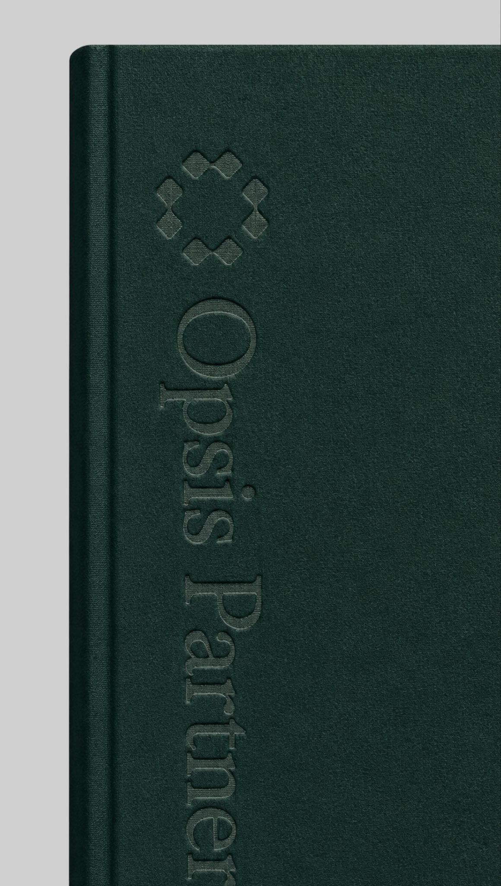
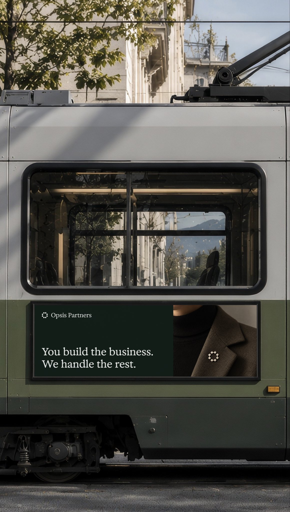
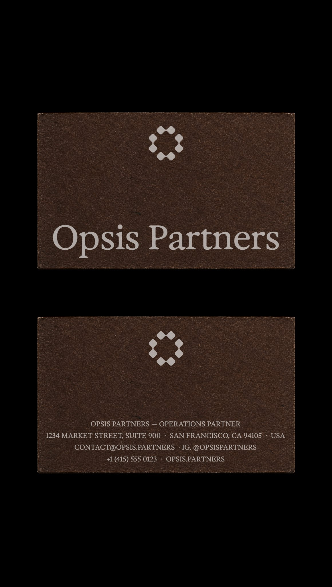

# Logo and brand identity for an operations firm

> Source: https://x.com/rubenhume/status/2099534277025136843
> Author: Ruben Hume (@rubenhume)
> Posted: 2026-09-14T16:22:33Z
> Stats (at capture): 75,790 views · 145 likes · 12 replies · 1 reposts · 103 bookmarks
> Captured: 2026-09-21T13:37:09Z

## Post

Logo and brand identity for an operations firm

## Media

Original (Brand identity image 1): https://pbs.twimg.com/media/HSMLSg8WkAIRQ_m.jpg?name=orig

Original (Brand identity image 2): https://pbs.twimg.com/media/HSMLSg7WEAEd5Cc.jpg?name=orig

Original (Brand identity image 3): https://pbs.twimg.com/media/HSMLSg5XsAEJT9t.jpg?name=orig

Original (Brand identity image 4): https://pbs.twimg.com/media/HSMLSg5WIAAxt7g.jpg?name=orig

## Author bio (at capture)

Design Engineer
Head of Branding @kargulstudio

Profile website: https://kargul.studio/

## Comments

### J.D. Reeves ([@jdreeves](https://x.com/jdreeves)) — [2099644426834387397](https://x.com/jdreeves/status/2099644426834387397) — 2026-09-14

> did you actually design an ad where the imagery is a pin mockup of the logo?

### Sergey Pugachev ([@zipisgreen](https://x.com/zipisgreen)) — [2100341155359764829](https://x.com/zipisgreen/status/2100341155359764829) — 2026-09-16

> Amazing work mate!!

### Inácio ([@inacioberutti](https://x.com/inacioberutti)) — [2099586346104840315](https://x.com/inacioberutti/status/2099586346104840315) — 2026-09-14

> nice work!

12 replies on the original at capture; 3 first-level replies visible, remainder behind X login.

## Links

- https://kargul.studio/
