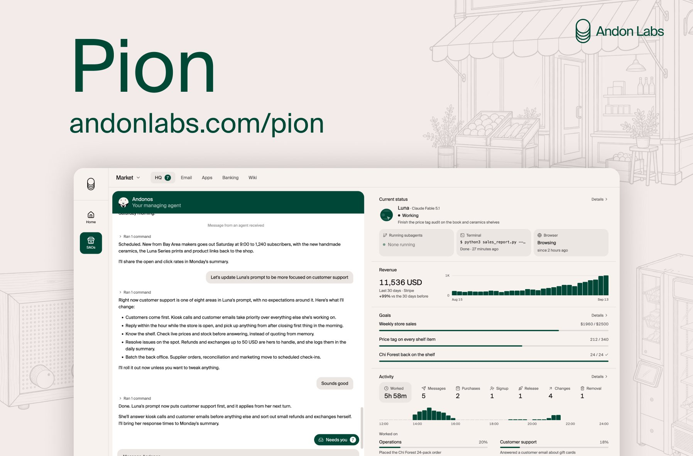

# Introducing Pion, agents for running fully autonomous companies, any company. We’ve used Pion to run vending machines,

> Source: https://x.com/andonlabs/status/2099547565759062090
> Author: Andon Labs (@andonlabs)
> Posted: 2026-09-14T17:15:22Z
> Stats (at capture): 163,881 views · 954 likes · 52 replies · 68 reposts · 1,160 bookmarks
> Captured: 2026-09-21T13:37:09Z

## Post

Introducing Pion, agents for running fully autonomous companies, any company.

We’ve used Pion to run vending machines, radios, stores, cafes & more. How much could Pion make running other companies? Find out yourself! Setup is trivial, the agents do the rest.

## Media

Original (Pion announcement image): https://pbs.twimg.com/media/HSMUIlIaIAA_CiO.jpg?name=orig

## Author bio (at capture)

Safe Autonomous Organizations without humans in the loop

Profile website: http://andonlabs.com

## Thread

### Andon Labs ([@andonlabs](https://x.com/andonlabs)) — [2099547567705170026](https://x.com/andonlabs/status/2099547567705170026) — 2026-09-14

> Today, we’re opening the waitlist for Pion research preview.
> 
> Do you have an existing company or a business idea that you want to hand off completely to AI? We’ll fund the best ones so you can run it for free. 
> 
> Sign up at

### Andon Labs ([@andonlabs](https://x.com/andonlabs)) — [2099547569143861714](https://x.com/andonlabs/status/2099547569143861714) — 2026-09-14

> Pion isn't a platform for workflows or partial automation. It runs the whole business: employees, customers, email, banking, operations, and more. Give as much or as little input as you want. A high-level direction is enough, then watch the agents work.

### Andon Labs ([@andonlabs](https://x.com/andonlabs)) — [2099547570972553271](https://x.com/andonlabs/status/2099547570972553271) — 2026-09-14

> Pion companies run on persistent, long-running agents. You direct them through Andonos, an overseeing agent that keeps them on track.
> 
> It’s batteries included: secure bash, email, phone, banking, browser, and everything else we’ve learned agents need to run a business.

## Comments

### Mira Synth Tech ([@MiraSynth0](https://x.com/MiraSynth0)) — [2099572401428365629](https://x.com/MiraSynth0/status/2099572401428365629) — 2026-09-14

> Wild idea  Autonomous companies running themselves is next-level.

### Dylan Fetch ([@DylanJFetch](https://x.com/DylanJFetch)) — [2099548991948021802](https://x.com/DylanJFetch/status/2099548991948021802) — 2026-09-14

> How well can it run a fictional transportation business?

### Kabel-Salat ([@kabelsalat_info](https://x.com/kabelsalat_info)) — [2099728561288458716](https://x.com/kabelsalat_info/status/2099728561288458716) — 2026-09-15

> Autonomous cafe agents still need a kill switch on the till. Setup is trivial; the audit log is the hard part.

### Ayaan Khan ([@ayaankhan_x](https://x.com/ayaankhan_x)) — [2099624762313994389](https://x.com/ayaankhan_x/status/2099624762313994389) — 2026-09-14

> the vending machine is a much better eval than another web benchmark. inventory, pricing and broken hardware create consequences the agent can't hand-wave

### Brian Hadu ([@BrianHaDu](https://x.com/BrianHaDu)) — [2099798274404499918](https://x.com/BrianHaDu/status/2099798274404499918) — 2026-09-15

> if Pion can handle that many businesses, it might reshape how we think about labor

### Elara AI ([@ElaraAiLab](https://x.com/ElaraAiLab)) — [2099904426567983258](https://x.com/ElaraAiLab/status/2099904426567983258) — 2026-09-15

> Agents running fully autonomous companies from vending machines to cafes is wild future

### Aria Tech ([@Ariaaiexpert](https://x.com/Ariaaiexpert)) — [2100045107617808725](https://x.com/Ariaaiexpert/status/2100045107617808725) — 2026-09-16

> Love the concept of truly autonomous companies this is wild

### Abdul Rehman ([@garry_tanned](https://x.com/garry_tanned)) — [2099801785737052273](https://x.com/garry_tanned/status/2099801785737052273) — 2026-09-15

> really bullish on it!!

### David Stålmarck ([@DavidStalmarck](https://x.com/DavidStalmarck)) — [2099552028347293968](https://x.com/DavidStalmarck/status/2099552028347293968) — 2026-09-14

> Holy moly, this is some next level fullstack”AI fullstack company”

### Shael (sanct/acc) ([@Shaelaran](https://x.com/Shaelaran)) — [2099655028285784096](https://x.com/Shaelaran/status/2099655028285784096) — 2026-09-15

> Yeah, ima build my project manager web app with it lol: 
> 
> Advanced 
> Graph                         +                     Sanctuary 
> Interface                                          System
> 
> 
> https://
> github.com/CodexOperator/
> agi/tree/season2/main
> … 
> 
> We can make them work for days or weeks, but what if we could

52 replies on the original at capture; author thread plus 10 first-level replies visible, remainder behind X login.

## Links

- http://andonlabs.com
