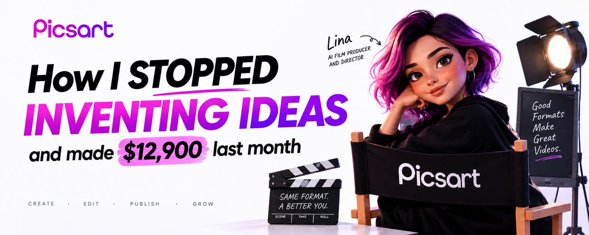

# I Told AI to Stop Being Creative. It Made Me $12,900 Last Month.

> Source: https://x.com/0x_fokki/status/2099566345511657974
> Author: Fokki (@0x_fokki)
> Posted: 2026-09-14T18:29:59Z
> Stats (at capture): 959,824 views · 98 likes · 13 replies · 7 reposts · 178 bookmarks
> Captured: 2026-09-21T13:37:09Z

## Post

https://x.com/i/article/2099555039974993921

## Article

Title: I Told AI to Stop Being Creative. It Made Me $12,900 Last Month.
URL: https://x.com/i/article/2099555039974993921

GPT-6 Astra finds the hit. An agent I hired rebuilds it around me.

This is what came back when I gave Lina the exact brief from her own onboarding thread.

 

Grabbed this straight from her own template. Linked at the bottom if you want to run the same brief.

I spent four weeks asking one question.

What if I stopped inventing concepts and started improving the ones already proven.

Every solo filmmaker makes the same mistake twice. First they invent a concept nobody has tested, so half the ideas were dead before the first shot. Then even the ones worth keeping fall apart by scene six, because nothing held the visual plan while each shot got made one at a time.

The fix for both is the same build. Find the format that already hit somewhere. Hand it to an agent whose only job is directing, not generating.

 

The Pipeline

GPT-6 Astra → Picsart → Make find the video that already hit → rebuild the format as your own, improved scene by scene → publish and track what holds

Research finds the proof. Picsart plans the rebuild. Make ships it and reports back.

 

 

Step 1 · The Research Pass

This step costs nothing, and skip it and everything after is a guess instead of a plan.

I don't ask GPT-6 Astra to invent an idea. I ask it to find one that already worked.

Prompt for the research pass:

 

GPT-6 Astra's own browsing does the search. No cost, no tool to hire, and it decides whether everything after it is worth building. The one-sentence format it gives you per video is what goes to Lina next, not the original video itself.

 

Step 2 · Hire the Director

Picsart runs an AI Agents Marketplace, 19 of them, each trained on your own output the longer you keep it. Search "film," open the card for Lina: AI film producer and director, cinematic short films, planned scene by scene. One click adds her to your roster.

 

Her opening message is a job description, not a pitch:

 

 

Step 3 · Hand Her the Reference, Never the Concept

The move is already sitting in her own onboarding example, before I typed a word: someone attached a magic trick, a red cloth pulled off a table to reveal a rabbit, and asked for the same trick with one variable swapped.

 

I hand her the same thing: the format from Step 1, my own subject, and one instruction that never changes.

Brief for Lina:

 

She returns a director's plan built on a proven shape, with the weak point already fixed, not a copy of it. I feed each generated shot back to her before the next one gets built, the way you'd show a director dailies. She checks it against her own plan and flags what breaks the rule she set. A normal plan comes back with one or two scenes flagged before the rest gets touched.

 

Step 4 · Make Publishes and Tracks What Holds

The scenario runs on a schedule:

 

The formats that keep holding attention get searched for again first. GPT-6 Astra's next research pass starts from what already worked, not a blank query.

Setup time: 2 hours once. Runs on every new reference after.

 

How You Make Money

Platform payouts. A reworked format that already proved it holds attention elsewhere, with its weak point fixed, starts past the 20-30% completion floor most solo shorts sit at. The view difference at the same posting volume clears $2,000-5,000/month.

Done-for-you shorts. Brands and agencies pay $300-700 for a short built on a proven format instead of an invented one. 8 shorts a month on retainer clears $2,500-5,500.

Selling the pipeline. The GPT-6 Astra research prompt plus the Lina brief, tuned per niche, sells as a kit. No per-sale labor once it's written.

 

The Cost

Picsart Pro       $15/month 
GPT-6 Astra    $20/month 
Make Core       $9/month

Total: $44/month in. $12,900 out.

 

The Bottom Line

Most solo shorts fail twice. Once when the concept gets invented instead of proven, again when nobody holds the plan while the shots get built.

This runs the other way. Research finds what already hit. Lina rebuilds it around you, scene by scene, without losing the shape that made it hit in the first place.

Research finds the proof. One director rebuilds it as mine.

The research prompt and Lina's brief for this exact short are in the article above.

 

My Picsart template, the same one behind this clip: https://picsart.go.link/825Ls

## Media

Original (Article cover image): https://pbs.twimg.com/media/HSMeTe_XkAAL_5R.jpg

## Author bio (at capture)

AI & Tech Creator | Vibe Coding | Making AI simple, useful & exciting for everyone | DM for Collab

## Thread

### Fokki ([@0x_fokki](https://x.com/0x_fokki)) — [2101310552811135168](https://x.com/0x_fokki/status/2101310552811135168) — 2026-09-19

> try here:

## Comments

### Ridark ([@ridark_eth](https://x.com/ridark_eth)) — [2099609017341362528](https://x.com/ridark_eth/status/2099609017341362528) — 2026-09-14

> Nice article, added it for myself

### Aleiah ([@AleiahLock](https://x.com/AleiahLock)) — [2099577590662971503](https://x.com/AleiahLock/status/2099577590662971503) — 2026-09-14

> This videos inside looks like real movie already

### 0xSlyth ([@0xSlyth](https://x.com/0xSlyth)) — [2099761977258319963](https://x.com/0xSlyth/status/2099761977258319963) — 2026-09-15

> this is how you scale without burning out

### slash1s ([@slash1sol](https://x.com/slash1sol)) — [2099600450618089568](https://x.com/slash1sol/status/2099600450618089568) — 2026-09-14

> worth to read it 100%

### Archive ([@ArchiveExplorer](https://x.com/ArchiveExplorer)) — [2099594758553260238](https://x.com/ArchiveExplorer/status/2099594758553260238) — 2026-09-14

> an incredibly useful article
> 
> highly recommend everyone give it a read

### Crio Songo ([@shuizhuyu](https://x.com/shuizhuyu)) — [2099775321658552456](https://x.com/shuizhuyu/status/2099775321658552456) — 2026-09-15

> This approach is genuinely clever—using AI to repurpose existing content for production, without obsessing over originality, while still steadily making money. Isn't this exactly what low-cost, scalable monetization is all about?

### rewind ([@rewind02](https://x.com/rewind02)) — [2099584889859264763](https://x.com/rewind02/status/2099584889859264763) — 2026-09-14

> Wow, great article g!

### grokked ([@grokkedd](https://x.com/grokkedd)) — [2099790110015271279](https://x.com/grokkedd/status/2099790110015271279) — 2026-09-15

> Great article bruh

### Lyren_o ([@0xAIlabs](https://x.com/0xAIlabs)) — [2099610429404086617](https://x.com/0xAIlabs/status/2099610429404086617) — 2026-09-14

> This is a damn cool video generator! It's time to give it a try, seeing as everyone is writing about it.

### Auren ([@0x_auren](https://x.com/0x_auren)) — [2099577043285372994](https://x.com/0x_auren/status/2099577043285372994) — 2026-09-14

> i will drop my sample soon

### ZDNK ([@Zdonuk94](https://x.com/Zdonuk94)) — [2099567948272644299](https://x.com/Zdonuk94/status/2099567948272644299) — 2026-09-14

> Good article bro

13 replies on the original at capture; author follow-up plus 11 first-level replies visible, remainder behind X login.

## Links

- https://x.com/i/article/2099555039974993921
- https://picsart.go.link/825Ls
