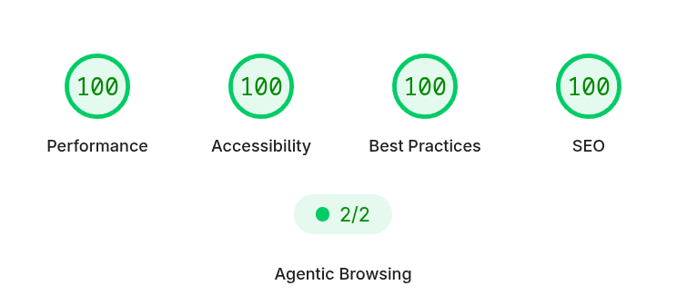

# This is my website. Guess the stack.

> Source: https://x.com/denicmarko/status/2099800150218772953
> Author: Marko Denic (@denicmarko)
> Posted: 2026-09-15T09:59:02Z
> Stats (at capture): 141,085 views · 847 likes · 371 replies · 9 reposts · 284 bookmarks
> Captured: 2026-09-21T13:37:09Z

## Post

This is my website. Guess the stack.

## Media

Original (Website screenshot): https://pbs.twimg.com/media/HSP9HBoa4AASiD8.png?name=orig

## Author bio (at capture)

Software Engineer - Content Creator - Community Builder -
Let's grow together → http://activebuilders.dev

Profile website: https://markodenic.tech/

## Thread

### Marko Denic ([@denicmarko](https://x.com/denicmarko)) — [2099905360182043064](https://x.com/denicmarko/status/2099905360182043064) — 2026-09-15

> You are allowed to say "I don't know"

### Marko Denic ([@denicmarko](https://x.com/denicmarko)) — [2099829128627147217](https://x.com/denicmarko/status/2099829128627147217) — 2026-09-15

> Yes. wordpress .net

### Marko Denic ([@denicmarko](https://x.com/denicmarko)) — [2099866455776862439](https://x.com/denicmarko/status/2099866455776862439) — 2026-09-15

> Which one Jack?

### Marko Denic ([@denicmarko](https://x.com/denicmarko)) — [2099861117455458722](https://x.com/denicmarko/status/2099861117455458722) — 2026-09-15

> F12

### Marko Denic ([@denicmarko](https://x.com/denicmarko)) — [2100153860098539794](https://x.com/denicmarko/status/2100153860098539794) — 2026-09-16

> ... come true.

### Marko Denic ([@denicmarko](https://x.com/denicmarko)) — [2099958363199094852](https://x.com/denicmarko/status/2099958363199094852) — 2026-09-15

> No James. And, you won't like the answer.

### Marko Denic ([@denicmarko](https://x.com/denicmarko)) — [2099834429791146065](https://x.com/denicmarko/status/2099834429791146065) — 2026-09-15

> GPI

### Marko Denic ([@denicmarko](https://x.com/denicmarko)) — [2099863290159489234](https://x.com/denicmarko/status/2099863290159489234) — 2026-09-15

> Sure. What else?

### Marko Denic ([@denicmarko](https://x.com/denicmarko)) — [2100153883989328314](https://x.com/denicmarko/status/2100153883989328314) — 2026-09-16

> Show me

## Comments

### Milan Jovanović ([@mjovanovictech](https://x.com/mjovanovictech)) — [2099826484160454940](https://x.com/mjovanovictech/status/2099826484160454940) — 2026-09-15

> Obviously .NET

### Peter Mick ([@ThePeterMick](https://x.com/ThePeterMick)) — [2099808122399289532](https://x.com/ThePeterMick/status/2099808122399289532) — 2026-09-15

> gotta be PHP!!! :)

### Jack ([@jcampbell242](https://x.com/jcampbell242)) — [2099866109574869307](https://x.com/jcampbell242/status/2099866109574869307) — 2026-09-15

> That status pill is hallmark codex

### Himanshu Sharma ([@Himanshush__](https://x.com/Himanshush__)) — [2099855854547968405](https://x.com/Himanshush__/status/2099855854547968405) — 2026-09-15

> Inspect Dev Tools

### James Welbes - AI Bro ([@JamesWelbes](https://x.com/JamesWelbes)) — [2099955735283024327](https://x.com/JamesWelbes/status/2099955735283024327) — 2026-09-15

> It's a txt file that says hello, world

### Joha (조하) ⓞ ([@IjustResearch](https://x.com/IjustResearch)) — [2099832749771145638](https://x.com/IjustResearch/status/2099832749771145638) — 2026-09-15

> You use 
> @lanesra_ai
>  to analyze?

371 replies on the original at capture; author thread plus 6 first-level replies visible, remainder behind X login.

## Links

- https://markodenic.tech/
- http://activebuilders.dev
