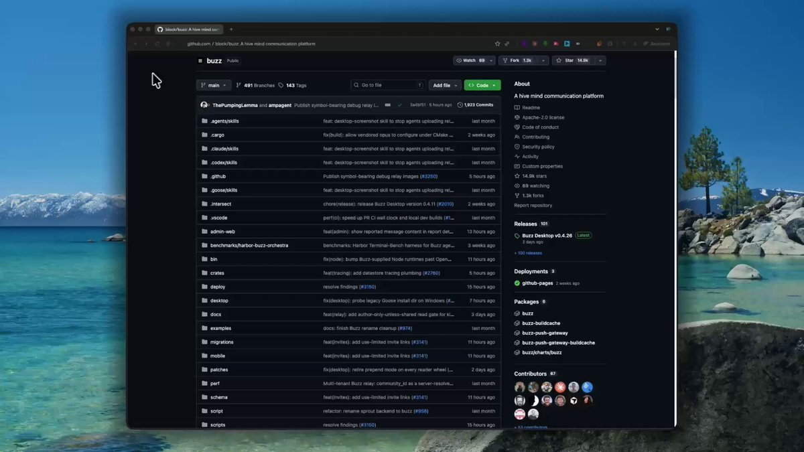

# ESTO ES UNA LOCURA Jack Dorsey (ex-CEO de Twitter) acaba de lanzar gratis un framework completo para crear un negocio

> Source: https://x.com/liambraus/status/2099852769389604973
> Author: liam. (@liambraus)
> Posted: 2026-09-15T13:28:08Z
> Stats (at capture): 228,308 views · 2,209 likes · 59 replies · 312 reposts · 5,394 bookmarks
> Captured: 2026-09-21T13:28:31Z

## Post

ESTO ES UNA LOCURA  

Jack Dorsey (ex-CEO de Twitter) acaba de lanzar gratis un framework completo para crear un negocio gestionado al 100% por agentes de IA.  

ya supera las 29.000 estrellas en GitHub.  

cómo configurarlo (5min):  

1. clona el repositorio. 
2. despliega tu propio servidor: canales, búsqueda, Git y automatizaciones funcionan desde ahí. 
3. añade tu agente a un canal como si fuera un compañero más, define sus permisos y deja que el equipo colabore con él en tiempo real.  

guárdate este post. os dejo el repo abajo.

## Media

[media/media_video_0.mp4](media/media_video_0.mp4)
Original: https://video.twimg.com/amplify_video/2099852210410487808/vid/avc1/1920x1080/E2_mn4AM5HcNs0br.mp4?tag=29 (1920x1080, 43.63s)

## Author bio (at capture)

26 | powered by Claude Code and bad sleep 
ex @elevenlabs CMO & building @aiscwork ✦ liambraus1@gmail.com

## Thread

### liam. @liambraus · Sep 15 ([@liambraus](https://x.com/liambraus)) — [2099888047827427706](https://x.com/liambraus/status/2099888047827427706)

2026-09-15T15:48:19.000Z

> Good point, total autonomy without the ability to pause is where most people burn out when starting.
> 1
> 2.9K

### liam. @liambraus · Sep 16 ([@liambraus](https://x.com/liambraus)) — [2100108975354040788](https://x.com/liambraus/status/2100108975354040788)

2026-09-16T06:26:12.000Z

> the product is not complete, I switched to claude code + slack, it works well
> 1
> 983

### liam. @liambraus · Sep 15 ([@liambraus](https://x.com/liambraus)) — [2099935170895712762](https://x.com/liambraus/status/2099935170895712762)

2026-09-15T18:55:34.000Z

> You can define different permissions per agent, so not everyone has to have the same level of access within the channel.
> 1
> 2.1K

### liam. @liambraus · Sep 16 ([@liambraus](https://x.com/liambraus)) — [2100109414283833799](https://x.com/liambraus/status/2100109414283833799)

2026-09-16T06:27:57.000Z

> haha the timing is way too blatant to be a coincidence
> 1.2K

### liam. @liambraus · Sep 16 ([@liambraus](https://x.com/liambraus)) — [2100109090521243991](https://x.com/liambraus/status/2100109090521243991)

2026-09-16T06:26:39.000Z

> haha good test, it says a lot more than any demo
> 1
> 1.5K

### liam. @liambraus · Sep 16 ([@liambraus](https://x.com/liambraus)) — [2100109050960621574](https://x.com/liambraus/status/2100109050960621574)

2026-09-16T06:26:30.000Z

> totally, that's where everything really changes
> 1.1K

### liam. @liambraus · Sep 16 ([@liambraus](https://x.com/liambraus)) — [2100109187380314335](https://x.com/liambraus/status/2100109187380314335)

2026-09-16T06:27:03.000Z

> and yet here we are still giving it to him
> 485

### liam. @liambraus · Sep 16 ([@liambraus](https://x.com/liambraus)) — [2100087378736001069](https://x.com/liambraus/status/2100087378736001069)

2026-09-16T05:00:23.000Z

> yeah!
> 1
> 535

## Comments

59 replies on the original; 7 captured below via logged-in browser extract. 8 author self-replies in Thread above.

### IA en Bruto @IAenBruto · Sep 15 ([@IAenBruto](https://x.com/IAenBruto)) — [2099870785036849617](https://x.com/IAenBruto/status/2099870785036849617)

2026-09-15T14:39:43.000Z

> Before delegating a business 100% to agents, measure cost per task and human intervention rate. A good MVP can pause the flow in front of permissions or errors; it doesn't need to promise total autonomy.
> 1
> 4
> 3.4K

### ShadoWhisper @ShadoWhisper1 · Sep 16 ([@ShadoWhisper1](https://x.com/ShadoWhisper1)) — [2099990467727282371](https://x.com/ShadoWhisper1/status/2099990467727282371)

2026-09-15T22:35:18.000Z

> I tested it, I really like the idea but it's the product is not complete so I switched to Claude code + slack witch is pretty comfortable
> 1
> 1
> 1.1K

### merii @mariaaturii · Sep 15 ([@mariaaturii](https://x.com/mariaaturii)) — [2099905424996618720](https://x.com/mariaaturii/status/2099905424996618720)

2026-09-15T16:57:22.000Z

> How do you manage permissions if you have multiple agents with different access levels in the same channel?
> 1
> 1
> 2.4K

### brien g @bg_gr_a90 · Sep 16 ([@bg_gr_a90](https://x.com/bg_gr_a90)) — [2100026048867963130](https://x.com/bg_gr_a90/status/2100026048867963130)

2026-09-16T00:56:41.000Z

> Releasing this on Grok Bot Galaxy day is wild
> 1
> 1.3K

### Momina Sheikh @themominasheikh · Sep 15 ([@themominasheikh](https://x.com/themominasheikh)) — [2099937551465476151](https://x.com/themominasheikh/status/2099937551465476151)

2026-09-15T19:05:01.000Z

> if agents can actually collaborate in real time, the org chart starts looking very different.
> 1
> 1.3K

### Warren David Horak @WarrenHorak · Sep 16 ([@WarrenHorak](https://x.com/WarrenHorak)) — [2100324699943420174](https://x.com/WarrenHorak/status/2100324699943420174)

2026-09-16T20:43:25.000Z

> @grok
>  can you verify this? Is this any good for me
> 1
> 32

### EinfachAI @einfachai · Sep 16 ([@einfachai](https://x.com/einfachai)) — [2100107780220932516](https://x.com/einfachai/status/2100107780220932516)

2026-09-16T06:21:27.000Z

> "Just released"...half a year ago.
> 51
