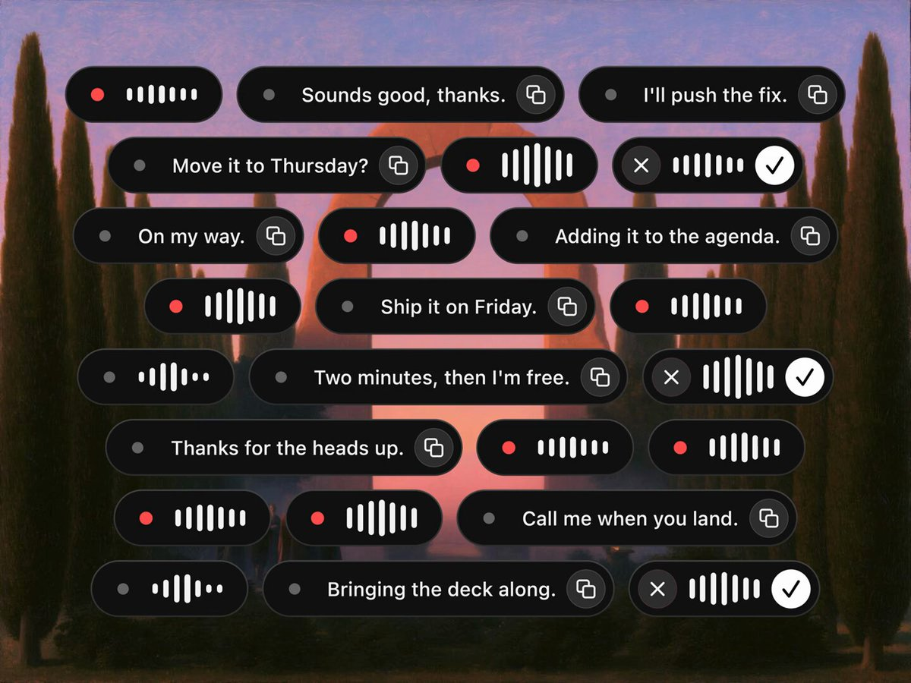

# used wispr flow for a long time but not anymore. aside has dictation now and it's 100% local → https://heyaside.com

> Source: https://x.com/dominikmartn/status/2099857235539284362
> Author: Dom (@dominikmartn)
> Posted: 2026-09-15T13:45:53Z
> Stats (at capture): 169,499 views · 1,765 likes · 93 replies · 40 reposts · 2,516 bookmarks
> Captured: 2026-09-21T13:28:31Z

## Post

used wispr flow for a long time but not anymore.
aside has dictation now and it's 100% local → https://heyaside.com

## Media

[media/media_video_0.mp4](media/media_video_0.mp4)
Original: https://video.twimg.com/amplify_video/2099857209207459840/vid/avc1/1440x1080/AhKlWnxBA8fQeGQC.mp4?tag=16 (1600x1200, 12s)

## Author bio (at capture)

Designer but I also build. Aesthetics & longevity. Currently building http://heyaside.com

## Comments

93 replies on the original; 15 captured below via logged-in browser extract.

### Phani Motamarri @phani2930 · Sep 16 ([@phani2930](https://x.com/phani2930)) — [2100055819673018852](https://x.com/phani2930/status/2100055819673018852)

2026-09-16T02:54:59.000Z

> For a sec I thought it is 
> @voicenotesai
> 1
> 2
> 44

### Domi @frmdomi · Sep 15 ([@frmdomi](https://x.com/frmdomi)) — [2099958936929538080](https://x.com/frmdomi/status/2099958936929538080)

2026-09-15T20:30:00.000Z

> First i thought you mean 
> @AsideAI
>
> 2
> 54

### Georgy ✪ @GeorgyDesign · Sep 16 ([@GeorgyDesign](https://x.com/GeorgyDesign)) — [2100001344794886210](https://x.com/GeorgyDesign/status/2100001344794886210)

2026-09-15T23:18:31.000Z

> Genuinely curious how is it different from Handy?
> 1
> 37

### Johny @Johny8701 · Sep 15 ([@Johny8701](https://x.com/Johny8701)) — [2099947968715784593](https://x.com/Johny8701/status/2099947968715784593)

2026-09-15T19:46:25.000Z

> The bottom of the legal privacy texts are overlapping with the image man!
>
> See if you can fix this
> 2
> 78

### Gokul Bala @GokulsVision · Sep 16 ([@GokulsVision](https://x.com/GokulsVision)) — [2100096124581294221](https://x.com/GokulsVision/status/2100096124581294221)

2026-09-16T05:35:08.000Z

> Handy vs this anyone got any preferences?
> 1
> 30

### Leonhard Breuer @cheetahbyte · Sep 16 ([@cheetahbyte](https://x.com/cheetahbyte)) — [2100095821454712970](https://x.com/cheetahbyte/status/2100095821454712970)

2026-09-16T05:33:56.000Z

> 75$ for BYOK????
> 1
> 24

### Michael Voccola @MobileMikeV · Sep 15 ([@MobileMikeV](https://x.com/MobileMikeV)) — [2099964375897412008](https://x.com/MobileMikeV/status/2099964375897412008)

2026-09-15T20:51:37.000Z

> But do they have an iOS keyboard that isn't very good for typing?
> 1
> 39

### Kyle Wolt @Kyle_Wolt · Sep 16 ([@Kyle_Wolt](https://x.com/Kyle_Wolt)) — [2100255102816678038](https://x.com/Kyle_Wolt/status/2100255102816678038)

2026-09-16T16:06:52.000Z

> Any relation to the YC backed web browser, Aside?
> 29

### James Geiger, M.Ed.  @TheGeigerUX · Sep 16 ([@TheGeigerUX](https://x.com/TheGeigerUX)) — [2099997700762575214](https://x.com/TheGeigerUX/status/2099997700762575214)

2026-09-15T23:04:02.000Z

> How does it handle atypical speech patterns?
> 1
> 45

### Jon Williams @yesthatjon · Sep 15 ([@yesthatjon](https://x.com/yesthatjon)) — [2099873266697445719](https://x.com/yesthatjon/status/2099873266697445719)

2026-09-15T14:49:35.000Z

> You mean you forked 
> https://
> megaphone.dev?
> 2
> 1
> 302

### Weiran Zhang @weiran · Sep 15 ([@weiran](https://x.com/weiran)) — [2099960598339424685](https://x.com/weiran/status/2099960598339424685)

2026-09-15T20:36:36.000Z

> How does it compare to FluidVoice and all the other similar apps out there?
> 47

### Mohit Agrawal @mohitify · Sep 16 ([@mohitify](https://x.com/mohitify)) — [2100012035576660467](https://x.com/mohitify/status/2100012035576660467)

2026-09-16T00:01:00.000Z

> How’s it different than Muesli?
> 1
> 31

### Brittany C. Bakek @bakek_c · Sep 15 ([@bakek_c](https://x.com/bakek_c)) — [2099886398585086143](https://x.com/bakek_c/status/2099886398585086143)

2026-09-15T15:41:46.000Z

> and why it's a subscription, does not make any sense
> 1
> 106

### Fred Carlsen @sjelfull · Sep 15 ([@sjelfull](https://x.com/sjelfull)) — [2099918638232838492](https://x.com/sjelfull/status/2099918638232838492)

2026-09-15T17:49:52.000Z

> does it work on my ios and android mobiles?
> 1
> 1
> 69

### ˏˋNordˎˊ @solidoxx · Sep 16 ([@solidoxx](https://x.com/solidoxx)) — [2100038211363807329](https://x.com/solidoxx/status/2100038211363807329)

2026-09-16T01:45:01.000Z

> Which transcription model is it using?
> 19

## Links

- https://heyaside.com
