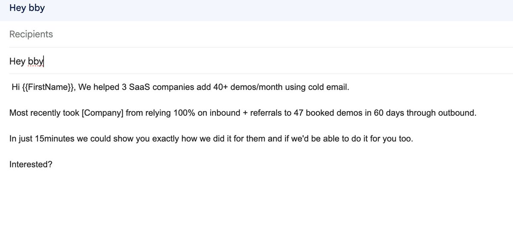

# This is the ONLY cold email framework you'll ever need: BLUF (Bottom, Line, Up, Front) → First line: outcome + proof →

> Source: https://x.com/seanlongden/status/2099935143238475839
> Author: Sean Longden (@seanlongden)
> Posted: 2026-09-15T18:55:27Z
> Stats (at capture): 4,455 views · 59 likes · 8 replies · 4 reposts · 141 bookmarks
> Captured: 2026-09-21T13:28:31Z

## Post

This is the ONLY cold email framework you'll ever need:

BLUF (Bottom, Line, Up, Front)
→ First line: outcome + proof
→ Second line: who you've done it for
→ Third line: CTA

Straight to the point
They INSTANTLY know if they're interested or not

## Media

## Author bio (at capture)

Founder of Closing Clients System + Lead Formatter. Installing AI powered client acquisition systems

## Comments

8 replies on the original; 3 captured below via logged-in browser extract.

### Mitchell Keller @MitchellKeller_ · 12h ([@MitchellKeller_](https://x.com/MitchellKeller_)) — [2101833819410100538](https://x.com/MitchellKeller_/status/2101833819410100538)

2026-09-21T00:40:07.000Z

> So you can finally confidently spintax to your hearts content. 
>
> Jev will grammar check every unique variant to ensure accuracy for around 1 cent for 20,000 variants - you can even get it to check that the offer still presents itself effectively. 
>
> No opt-in -> get it below.
> 3
> 3
> 39
> 1.7K

### Christian @coldemailchris · 23h ([@coldemailchris](https://x.com/coldemailchris)) — [2101671981372538919](https://x.com/coldemailchris/status/2101671981372538919)

2026-09-20T13:57:02.000Z

> If you sell anything to restaurants, coffee shops or local businesses, you're sitting on the easiest cold email market in B2B right now.
>
> We generated 1,061 leads in 70 days for a foodservice manufacturer:
>
> > 100,000+ emails a month
> > 1,061 interested leads
> > 86% qualified, 8
> Show more
> 80
> 5
> 103
> 6.2K

### Grant Miller @AIGuide_ · 23h ([@AIGuide_](https://x.com/AIGuide_)) — [2101672522043273681](https://x.com/AIGuide_/status/2101672522043273681)

2026-09-20T13:59:11.000Z

> Jev should probably be all over your GTM stack...
>
> Here are 10 high-value use cases for it:
>
> 1) Inbound lead qualification
>
> Every time a lead comes in, Jev looks at:
>
> • Company size
> • Role
> • Intent
> • Source
> • Website activity
> • CRM history
>
> Then decides:
>
> • Route to sales
> Show more
> 2
> 2
> 32
> 8.5K
