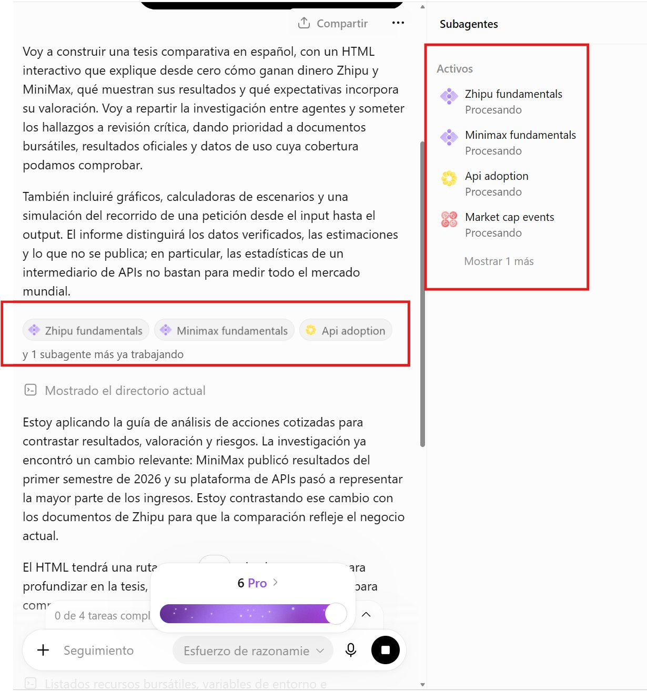

# 🚨This might be the biggest ChatGPT update since it launched, You can now launch multiple agents directly from the

> Source: https://x.com/SPAC89/status/2100055717566644585
> Author: Iam_ (@SPAC89)
> Posted: 2026-09-16T02:54:34Z
> Stats (at capture): 341,180 views · 1,671 likes · 88 replies · 76 reposts · 1,632 bookmarks
> Captured: 2026-09-21T13:28:31Z

## Post

🚨This might be the biggest ChatGPT update since it launched, You can now launch multiple agents directly from the normal ChatGPT chat using GPT 6 Astra Pro, basically at no extra cost since the limits are almost unlimited, This means we can save a ton of our separate Codex usage too, I’m testing it heavily right now to see just how many agents I can run in parallel on the Pro x20 plan, Enjoy!

## Media

## Author bio (at capture)

Really excited about AGI, learning more every day about LLMs and the future of technology, and sharing my own thoughts along the way

## Comments

88 replies on the original; 15 captured below via logged-in browser extract.

### TJ @tjaichamp · Sep 16 ([@tjaichamp](https://x.com/tjaichamp)) — [2100181764664881415](https://x.com/tjaichamp/status/2100181764664881415)

2026-09-16T11:15:26.000Z

> Small correction: GPT-6 Pro is capped at 50 messages/week on $100 Pro (shared with Sol Pro), or 200/week on $200 Pro. 
>
> Chat’s allowance is separate from Codex/Work, but separate doesn’t mean almost unlimited.
> 2
> 412

### JMT @jmt_os · Sep 16 ([@jmt_os](https://x.com/jmt_os)) — [2100092324248227982](https://x.com/jmt_os/status/2100092324248227982)

2026-09-16T05:20:02.000Z

> Dam I’ve got FOMO. I downgraded to plus while I focus on supergrok heavy for Hermes.
> 1
> 1.3K

### Hussain Hashim | Building SundayBack @itsthedonhashim · Sep 16 ([@itsthedonhashim](https://x.com/itsthedonhashim)) — [2100200152216531154](https://x.com/itsthedonhashim/status/2100200152216531154)

2026-09-16T12:28:30.000Z

> @SPAC89
>  that's huge! Saving on Codex usage is a game changer. Makes juggling multiple agents so much smoother without worrying about the costs piling up.
> 1
> 1
> 147

### Steve McCain @SCRX89 · Sep 16 ([@SCRX89](https://x.com/SCRX89)) — [2100139880840044921](https://x.com/SCRX89/status/2100139880840044921)

2026-09-16T08:29:00.000Z

> Astro Pro is not unlimited. 200 messages per week for Pro 20x
> 1
> 341

### Youwei @zhngzhn36182130 · Sep 16 ([@zhngzhn36182130](https://x.com/zhngzhn36182130)) — [2100103017886634214](https://x.com/zhngzhn36182130/status/2100103017886634214)

2026-09-16T06:02:32.000Z

> How do you use it? Do you use it directly on the web version?
> 1
> 1.2K

### ThisMightWork @ThisMightWrk · Sep 16 ([@ThisMightWrk](https://x.com/ThisMightWrk)) — [2100236582599135469](https://x.com/ThisMightWrk/status/2100236582599135469)

2026-09-16T14:53:16.000Z

> Launching them from the chat I'm already in removes the step where I forget to go set it up somewhere else. Small change, I'll use it constantly.
> 315

### Emilz @emilheap · Sep 16 ([@emilheap](https://x.com/emilheap)) — [2100240183471780264](https://x.com/emilheap/status/2100240183471780264)

2026-09-16T15:07:34.000Z

> Pro tip:
>
> Don’t ever fork a long ChatGPT thread that used a PRO model, if you don’t wanna reach the “unlimited” limit
> 222

### Tao · AI workflows @TaoHu923868 · Sep 16 ([@TaoHu923868](https://x.com/TaoHu923868)) — [2100224417699623412](https://x.com/TaoHu923868/status/2100224417699623412)

2026-09-16T14:04:56.000Z

> Multi-agent from normal ChatGPT chat on Astra Pro. That's Codex usage you don't have to burn twice.
> 217

### Amine Yaakoubi | E-commerce & AI Tech Lead @amineyaakoubii · Sep 16 ([@amineyaakoubii](https://x.com/amineyaakoubii)) — [2100327374239699351](https://x.com/amineyaakoubii/status/2100327374239699351)

2026-09-16T20:54:02.000Z

> That's chatgpt work so its basically using your codex limits
> 84

### VR Pill @thevrpill · Sep 17 ([@thevrpill](https://x.com/thevrpill)) — [2100453063215768047](https://x.com/thevrpill/status/2100453063215768047)

2026-09-17T05:13:29.000Z

> Finally got around to testing this out as I also have a $200 pro account.  Didn’t work.  I think they either have some internal build or are part of an A/B test.
> 42

### AutomatioNation @_AInation · Sep 16 ([@_AInation](https://x.com/_AInation)) — [2100149771394834697](https://x.com/_AInation/status/2100149771394834697)

2026-09-16T09:08:19.000Z

> You're still using quota however it's from a separate pool from codex.
> 465

### Raul @Raulinvests · Sep 17 ([@Raulinvests](https://x.com/Raulinvests)) — [2100427847496077682](https://x.com/Raulinvests/status/2100427847496077682)

2026-09-17T03:33:17.000Z

> CHAT?! Not work??
> 24

### Ibesh @ibesh_tech · Sep 16 ([@ibesh_tech](https://x.com/ibesh_tech)) — [2100250034260611162](https://x.com/ibesh_tech/status/2100250034260611162)

2026-09-16T15:46:43.000Z

> moving multi agent into normal chat on the pro plan is the real cost shift, if limits stay near unlimited it quietly replaces separate codex spend for parallel work
> 1
> 287

### Shubham Sharma | Video Editor @editxshub · Sep 16 ([@editxshub](https://x.com/editxshub)) — [2100212880570482942](https://x.com/editxshub/status/2100212880570482942)

2026-09-16T13:19:05.000Z

> You get 200 GPT 6 Pro prompts before it moves down to 5.6. 
> They already patched this.
> 267

### Hekmon @hhkkmon · Sep 16 ([@hhkkmon](https://x.com/hhkkmon)) — [2100143473357926739](https://x.com/hhkkmon/status/2100143473357926739)

2026-09-16T08:43:17.000Z

> Damn, that’s huge.
>
> ChatGPT Pro can already build a full app in one run. If it can spawn sub-agents too, that’s insane.
> 676
