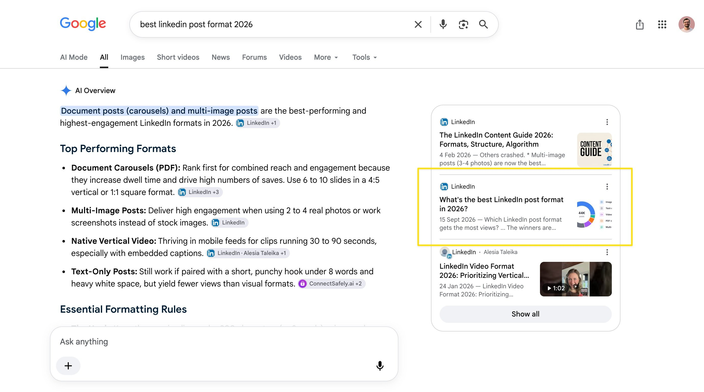

# It worked !! 🎉🎉 I published a LinkedIn article yesterday. And this morning it appears within the AI overview! The query

> Source: https://x.com/aschapmann/status/2100129118524260579
> Author: Axel Schapmann (@aschapmann)
> Posted: 2026-09-16T07:46:15Z
> Stats (at capture): 43,600 views · 50 likes · 6 replies · 2 reposts · 126 bookmarks
> Captured: 2026-09-21T13:28:31Z

## Post

It worked !! 🎉🎉

I published a LinkedIn article yesterday. And this morning it appears within the AI overview! 

The query is a little bit niche, but if people wants to know what to publish on LinkedIn, my article could come up. And show that MyFeedIn is great for analytics! 

I'll experiment more on this matter and try to make other articles! 

Thank you @RobHofmann_

## Media

## Author bio (at capture)

Shipping my way to freedom

⛵️ http://RedShip.io - Reddit marketing ($1k/m)
🦑 http://SquidX.io
⛓️ http://MyFeedIn.co ($1k/m)
🔎 http://Rankr.so

## Quoted post

**Author:** Rob Hoffman (@RobHoffman_)
**URL:** https://x.com/RobHoffman_/status/2098812378582503643
**Posted:** 2026-09-12T16:33:59Z
**Stats (at capture):** 39,340 views · 211 likes · 231 replies · 5 reposts · 555 bookmarks

It’s true: just used this cheat code to rank in AI Search in <24 hours 

we’re now ranking 1st for a money-making, bottom-of-funnel keyword

but: we didn’t have to buy a stinking Mention on someone else’s site 

we just abused LinkedIn 😈

here’s how👇

Quoted-post media (saved locally):

[media/qmedia_video_0.mp4](media/qmedia_video_0.mp4)
Original: https://video.twimg.com/amplify_video/2098812262190600192/vid/avc1/1080x1920/COV0aQp7OX5GgcsI.mp4?tag=29

## Thread

### Axel Schapmann @aschapmann · Sep 16 ([@aschapmann](https://x.com/aschapmann)) — [2100202227042288024](https://x.com/aschapmann/status/2100202227042288024)

2026-09-16T12:36:45.000Z

> The pirate technique that maybe stole nothing 
> 375

### Axel Schapmann @aschapmann · Sep 16 ([@aschapmann](https://x.com/aschapmann)) — [2100201985119047823](https://x.com/aschapmann/status/2100201985119047823)

2026-09-16T12:35:47.000Z

> yep, LinkedIn ranks pretty well !
> 370

### Axel Schapmann @aschapmann · Sep 16 ([@aschapmann](https://x.com/aschapmann)) — [2100202105688478150](https://x.com/aschapmann/status/2100202105688478150)

2026-09-16T12:36:16.000Z

> You can go on Rob content to get it :)
> 205

## Comments

6 replies on the original; 4 captured below via logged-in browser extract. 3 author self-replies in Thread above.

### Vlad Mukhachev @vladmukhachev · Sep 16 ([@vladmukhachev](https://x.com/vladmukhachev)) — [2100182416333701447](https://x.com/vladmukhachev/status/2100182416333701447)

2026-09-16T11:18:02.000Z

> wow didn't know it would index a linkedin post that quickly
> 1
> 1
> 447

### Masfiq Mahmud @masfiq018 · Sep 16 ([@masfiq018](https://x.com/masfiq018)) — [2100179448851226761](https://x.com/masfiq018/status/2100179448851226761)

2026-09-16T11:06:14.000Z

> can you share the sop in dm ?  
> 1
> 248

### Vincent @VincentBuilds · Sep 16 ([@VincentBuilds](https://x.com/VincentBuilds)) — [2100191503318466681](https://x.com/VincentBuilds/status/2100191503318466681)

2026-09-16T11:54:08.000Z

> Great find!
> 165

### Mac @mac_dev9 · Sep 17 ([@mac_dev9](https://x.com/mac_dev9)) — [2100491826889449914](https://x.com/mac_dev9/status/2100491826889449914)

2026-09-17T07:47:31.000Z

> That’s a great SEO/GEO signal  Getting into AI Overviews from a fresh article is definitely worth experimenting with. Curious to see if you can repeat it across broader queries.
> 69

## Links

- https://x.com/RobHoffman_/status/2098812378582503643
