# How To Write, Build, And Deploy Beautiful Landing Pages With AI (Without An Ounce Of AI Slop)

> Source: https://x.com/dickiebush/status/2100205836677079183 — @dickiebush — captured 2026-09-21T12:52:00Z
> Author: Dickie Bush (@dickiebush)
> Posted: Wed Sep 16 12:51:06 +0000 2026
> Stats (at capture): 120449 views · 415 likes · 21 replies · 33 reposts · 1163 bookmarks
> Captured: 2026-09-21T12:52:00Z

## Post

@dickiebush

https://x.com/i/article/2100184542648651776

## Article

[How To Write, Build, And Deploy Beautiful Landing Pages With AI (Without An Ounce Of AI Slop)](https://x.com/i/article/2100184542648651776)

Preview: AI can now build websites that used to cost $10,000.
But not on the first try. And not if you let it write and design the entire thing itself.
Unfortunately, I see a lot of people doing something like

AI can now build websites that used to cost $10,000.

But not on the first try. And not if you let it write and design the entire thing itself.

Unfortunately, I see a lot of people doing something like this:

- Describing their product or service in one sentence

- Asking AI to generate a “high-converting” landing page based on that

- And then immediately thinking whatever it produces is good enough to publish

And as a result, they end up with the dreaded “Claude Slop” landing page that anyone can now produce.

[article media: 2100200497248382976]

Luckily, with just a little bit of manual work on the writing & design side, you can get all of the benefits of this technology without producing something that looks like everyone else.

And that process is what I want to walk you through today.

Over the last week, I’ve rebuilt the landing page for our 30-day writing challenge: Ship 30 for 30.

And following that process is what allowed me to go from the purple slop version to this ready-to-publish version.

[article media: 2100200768577921024]

(This page is live at ship30for30.com if you want to see the result. And the next cohort starts October 5th if you want to join us and 500+ other writers in writing every day for 30 days!).

In this guide we’re going to cover:

- The problem with AI-generated landing pages

- How to stop your landing page from sounding like everyone else

- How to stop your landing page from looking like everyone else

- A full step-by-step guide to write, build, and deploy your landing page inside Codex

And if you want every template, prompt, and asset I used bundled in one place so you can follow the same process for your own business, I’ve put together a complete Landing Page Build Kit. It’s linked at the bottom of this piece.

Now let’s get into it.

# The Problem With AI-Generated Landing Pages

A landing page has two main jobs:

- Clearly explain what you’re selling (using words)

- Make it easy to read and understand for the person you’re selling to (using design)

So you need to figure out what to say and how to present it.

How you go about figuring this out will sit on a spectrum with two extremes:

- Fully human-generated

- Fully AI-generated

On one side you can choose to use no AI whatsoever and write every word and every line of code yourself. But then you’re leaving all of the efficiency and productivity benefits that AI can provide for you.

On the other side, you can use AI to write every word and every line of code for you. But then you’re ending up with the same writing and design choices everyone else gets.

The correct answer is to land somewhere in the middle. You need to know:

- Which parts to do yourself

- Which parts AI can help you think through

- And which parts you can hand off entirely

And that’s what this guide will help you figure out, starting with your copy.

# Stop Your Landing Page From Sounding Like Everyone Else

The first mistake most people make is letting AI write every word of your landing page.

In general, I think it’s a bad idea to have AI write and produce words on your behalf. And I think producing words yourself is the easiest way to “stand out” in 2026.

Why?

Because AI allows everyone to write “polished copy” now.

And since more and more people are using AI to write for them, more and more people are getting used to seeing the same language, writing style, and writing rhythms. They may or may not “consciously recognize” it’s AI written (though more people are starting to), but they just get a sense that it’s something they’ve already read. And as a result, their eyes start to glaze over and they pay less attention.

This creates an opportunity to do the opposite.

Instead of having AI write for you, there has never been a better time to write things yourself. My co-founder Nicolas Cole just published a full piece breaking down the best way to do this, which I highly recommend you read. The one-sentence summary is that you want AI to write things that anyone can say, while you fully write the things only you can say.

So applying that to our landing page, my recommendation is simple: before you ask AI to write anything for you, take the first pass at describing every element of your offer in your own words. This prevents AI from giving you a polished draft that you say you’ll go back and tweak (but you never actually end up doing).

Now, this doesn’t mean you don’t follow good copywriting principles or structure your page in a way that increases a reader’s likelihood of buying. You should still do both of those things (which I’ve included in a template below). But you shouldn’t let AI do it for you.

You should be the one that provides that foundation, then use AI to identify what’s confusing, repetitive, missing, or could be strengthened.

So how do you put this into practice?

Here’s the 3-step process to use to make sure your landing page sounds like you and not like Claude.

## Step 1: Write your copy yourself, then plug it into a proven landing page template

We break down writing landing page copy into two substeps:

1. Writing out every element of our offer in plain English, as if describing it to a potential customer asking questions

1. Turn that raw material into landing page copy using a proven template

First, to get your gears churning, answer each of these questions in your own words.

Don’t worry about trying to craft the perfect headline or benefit-focused copy. Just answer these as if someone came up to you in a cafe with questions about what you sell.

1. What is it, and what will it help me do?
Product/service name: [Name]
Format: [Course, service, cohort, template, etc.]
The specific result it helps someone achieve: [Result]
Time frame, if applicable: [Time frame]

1. Is this for me?
This is for: [Specific person in a specific situation]
Right now, they’re struggling with: [Describe the problem in words they would use]
They want to: [Describe what they want instead]

1. What exactly do I get?
Included: [Name each deliverable]
What it contains or how it works: [Concrete description]
How it helps: [Connect it to their problem or desired result]
Repeat for each meaningful part of the offer.

1. Why should I trust you?
Your relevant experience: [Facts that qualify you to help]
Why you created this: [The actual story]
Evidence: [Real results, examples, or customer testimonials]

1. What does it cost, and how do I get started?
Price: [Price and payment terms]
Timing: [Start date, delivery time, or immediate access]
Next action: [Buy, apply, subscribe, join the waitlist, etc.]
What happens afterward: [Explain what they receive or do next]

1. What else do I need to know?
[Actual question a potential customer asks]
[Direct answer]
Cover relevant questions about prerequisites, support, access, delivery, and refunds.

With all those questions answered, you now have the raw material you need to structure it into a landing page.

The next step is to organize your answers into these sections:

1. Above the fold
Headline describing the outcome
Description of the offer and who it’s for
Key details: format, price, and timing
Primary button text

1. Is this for you?
Who the offer is built for
The problem they’re experiencing
What they want instead
Any prerequisites or fit criteria

1. What’s included?
Name of each deliverable
What it contains or how it works
How it helps the customer
A screenshot, preview, or example where useful

1. Who’s behind it?
Your name and relevant experience
Why you created the offer
Specific evidence of your credibility

1. The offer and next step
Summary of what they get
Price and payment terms
Start date or access details
Button text and what happens next

1. Customer proof
Real testimonials or documented results
Customer names and relevant context
Omit this section if you don’t have proof yet

1. Frequently asked questions
Actual customer questions or objections
Direct answers about support, access, delivery, prerequisites, and refunds

It’s kind of hard to “visualize” how this turns into a landing page with just text, so I’ve packaged these prompts up into a Notion doc that makes them easier to fill in. You’ll find it in the Landing Page Build Kit linked at the bottom of this piece.

Armed with our V1 copy, we can now move onto the next phase of using AI to strengthen it.

## Step 2: Run your V1 through the 5 checks that catch AI writing

Now hopefully you actually followed the first step and wrote the V1 yourself.

If you did, congratulations for continuing to use your brain. If you skipped it and had AI take the first pass, this step is going to take longer.

Either way, the goal is the same: make sure your writing is clear and doesn’t sound like AI, so your reader’s eyes don’t glaze over when they start scrolling.

There are 5 patterns that make writing scream “AI wrote this”:

1. Unnecessary contrast framing

1. Excessive usage of “the rule of 3”

1. Intangible language

1. Throat-clearing

1. AI buzzwords

AI writing does all of these. And human writing does a few of them as well, so this pass is for everyone.

Our AI-generated Ship 30 for 30 landing page gives us a clear set of examples to see each one.

1. Unnecessary contrast framing

AI loves to tell you what it’s not more than it loves to tell you what it is.

- It’s not X, it’s Y

- You don’t need X. You need Y

- This is more than X. It’s Y

Exhibit A from our Claude-slop page:

[article media: 2100200853235752960]

What do you mean it isn’t a writing challenge? That’s literally what it is.

Calling it a “transformation” tells the reader less about what they’re signing up for.

Just tell them what they’ll do: write and publish 30 Atomic Essays in 30 days.

2. The constant rule of 3

AI loves to repeat three short phrases to make its writing sound exciting, dramatic, and persuasive (see what I did there?).

- Bold. Intelligent. Disruptive.

- Unlock your potential. Find your voice. Transform your future.

- Create more. Connect deeper. Become unstoppable.

- Less friction. More freedom. Endless possibilities.

There’s nothing wrong with a three-part structure. The human brain is quite good at memorizing things in groups of three. But repeating that structure constantly throughout the page, especially when the words add little to the reader’s understanding, is no good.

For example, our Claude-slop page drops two of them in the above the fold section.

[article media: 2100200992159510528]

3. Intangibility

This is the one AI repeats the most (and also the one human writers repeat the most).

Tangible things are things you can “hold” or “see.” Intangible things are things you cannot hold and cannot see.

For example, intangible language looks like:

- A world of possibility

- A completely new life

- Your fullest potential

Versus tangible language:

- 30 pieces of published writing

- 3 new friendships formed

- 100 new followers

Good writing is a constant game of making the intangible tangible.

For example on our Claude-slop page:

[article media: 2100201079329767424]

[article media: 2100201142374334464]

[article media: 2100201205443989504]

These all “sound good” until you realize they don’t mean anything.

4. Throat-clearing

These are sentence introductions that delay the actual point.

- “It’s important to note that…”

- “It’s worth mentioning that…”

- “It’s important to remember that…”

- “The first thing to understand is…”

- “Before we dive in, let’s take a moment to…”

- “When it comes to…”

- “At its core…”

- “At the end of the day…”

- “In today’s fast-paced world…”

- “In an ever-evolving digital landscape…”

- “Now more than ever…”

- “The load-bearing point that’s worth recognizing…”

The test is try removing this part of the sentence and see if the point still stands. If it does, you can remove it.

For example, here are two throat-clears that add nothing to the landing page:

[article media: 2100201329993957376]

Get rid of these and start with the useful information upfront.

5. AI buzzwords

Lastly, AI has a familiar set of vocabulary it loves to use when it wants to sound impressive.

These are words that the average person would never use in conversation:

- Delve

- Foster

- Unlock

- Robust

- Holistic

- Elevate

- Unleash

- Harness

- Tapestry

- Navigate

- Empower

- Leverage

- Seamless

- Landscape

- Ecosystem

- Supercharge

- Revolutionize

- Cutting-edge

- Transformative

- Game-changing

These aren’t “forbidden” in that you can never use them again. But when a bunch of them appear together, ask instead what the sentence is actually trying to say. Then describe that clearly like you would to someone in conversation.

Once again, Claude delivers the perfect examples for us:

[article media: 2100201375443402752]

[article media: 2100201426035089410]

[article media: 2100201464916221952]

## Step 3: Use AI Hunter to review your copy

Now that you know what you’re looking for, you can run your draft through the same checks.

To make this easy for you, we’ve put together an “AI Hunter Skill” during some of our AI Writing Skool bootcamps. I’ve included that skill in the Landing Page Build Kit linked at the bottom of this piece.

All you have to do is take your landing page draft and run the AI Hunter Skill on it.

Here’s how:

1. Open the AI Hunter file from the Landing Page Build Kit linked at the bottom of this piece

1. Start a new chat in Claude or ChatGPT

1. Paste the AI Hunter rules, then paste in your landing page copy underneath + this snippet

> Apply these rules to my copy. For every issue you find, quote the exact line, name which of the 5 checks it fails, and suggest a rewrite. Don't rewrite anything without showing me first.

This will give you a starting point of areas to cut or strengthen. If you wrote it yourself, chances are it won’t have nearly as many things to change versus if you had AI create the first draft.

Prevent AI from adding its own words back in

Now that you’ve got “approved language” to use for your landing page, you need to make sure it’s maintained when you turn it into HTML.

Unless you give AI explicit instructions to NOT add anything on its own, it will take your copy as “guidance” and then ignore most of it.

I’ll show you how to do this when we get to the full build example, but you want to make sure that the words you approved are what end up on the page. And it must flag anything it writes itself to you for manual approval.

From here, you now have everything you need to prevent your landing page from sounding like everyone else’s.

But we’re not done yet, because even the best copy can get lost if you let AI give you its default design.

So let’s fix that next.

# Stop Your Landing Page From Looking Like Everyone Else

The same way that AI writing is making everyone sound the same, AI design is making everyone look the same.

Again, this is because most people do not take the time to do the major decision-making and direction-setting themselves. They default to AI’s recommendation, which means their landing page has the same colors, fonts, and useless stylistic elements that everyone else has.

And so even if you have the best copy in the world, if you present it using AI’s default design choices, your reader’s eyes will gloss over immediately.

Luckily, AI has made it extremely easy to create a design system that is unique to you. And you do not need to be a professional designer to do this. You just need to know how to set the direction on a couple key elements.

So first let me show you the most common default AI designs so you can avoid using them.

Then I’ll walk you through how to create your personal design system with just a few key decisions.

## Step 1: Learn to spot AI’s 5 default design choices

Spend any time on the internet these days and you will notice many websites are starting to look the same.

This is because the non-technical beginner is building landing pages with a single prompt and defaulting to whatever AI thinks is best.

As a result, you will notice “sameness” across 5 design choices. And our Claude-slop landing page gives us the perfect examples.

1. The same fonts

Most AI landing pages have the same default fonts:

- Large serif headlines with a few words italicized (usually in an accent color)

- Plain sans-serif body text underneath throughout the rest of the page

Once you see this combo, you cannot unsee it.

[article media: 2100201499376709634]

Even when we clean it up with our approved copy, you can tell your eyes still want to glaze over.

[article media: 2100201552078139392]

To prevent this, you need to be intentional with selecting fonts that fit your style.

2. The same colors

For some reason, AI loves to use:

- The color purple

- With a gradient to blue

Our Claude-slop landing page has a few elements of this:

[article media: 2100201604267884544]

And if you google “AI Purple” you’ll see tons more examples:

[article media: 2100201660643500032]

https://impeccable.style/slop/

Luckily, AI makes it easy to design your unique color palette.

3. The same “textures”

AI loves to make everything “round” and “soft”:

- Rounded corners on buttons

- Soft shadows behind floating boxes

- Super faint borders around everything

- Pill-shaped labels placed above headlines

[article media: 2100201710438232064]

Again, none of these are “wrong” as long as you intentionally choose them.

But chances are, your unique style will better present the “vibe” you’re trying to create with your landing page.

4. The same formats

Left to decide the format on its own, AI will almost always generate the exact same page structure:

- Centered headline

- Subtitle

- Two buttons

- A row of 3 stats

- 3 “feature cards”

- Testimonial

- CTA

- FAQ

There’s nothing wrong with any of these sections on its own. But when every offer gets squeezed into the same arrangement, your page starts to feel interchangeable with all the others. Choose the layout based on what your reader needs to understand, and what deserves the most attention.

5. The same decorative commentary

Lastly, these are by far the biggest giveaway of an AI landing page.

They just love to sneak in these little “light grey commentary” elements underneath buttons and to close out major sections.

[article media: 2100201834015055872]

This is fine if it is a genuinely-useful element that answers a question someone has when they are taking that exact step, like on a checkout CTA:

[article media: 2100201881440022528]

But when AI throws them in randomly, it cheapens the look of your page.

So, now that we know the most common “AI-default” design choices, how do we avoid them?

We simply provide direction for each of these, then generate our own design system.

## Step 2: Create your design system in 30 minutes

Rather than let this turn into a massive exercise in productive procrastination, I want to help you create your design system in the next 30 minutes.

To do that, we are going to do 4 things:

1. Spend 10 minutes collecting 10 screenshots

Navigate to Lapa Ninja, a great site for design inspiration.

Spend a few minutes scrolling through and save anything that catches your eye.

You don’t have to justify why or even understand why - just follow your intuition and save 10 screenshots of pages you liked.

2. Use AI to help put words to your intuitive taste

Take the 10 screenshots you saved and upload them all to Claude or ChatGPT.

Ask it to help you understand your design preferences with the following prompt:

> Study these reference screenshots and help me describe my taste across five elements: fonts, colors, textures (corners, borders, shadows, backgrounds), formats (layout), and decorative commentary (small labels and accents).

For each, point to specific examples and suggest a “More ___, less ___” preference. Ask me to confirm or adjust—don’t assume I like everything in every screenshot.

Then create a short design brief with my preferences and concrete starting recommendations for each element: font names, color codes, surface treatments, layout rules, and rules for decorative details. This brief will guide three potential design systems.

Once you’ve finished this exercise, you should have a “V1” of your design system preferences in plain text.

3. Have AI create three possible design systems for you

Using that V1, you will ask AI to create 3 different design systems with this prompt:

> Using my approved design brief and reference screenshots, create three visually distinct design systems for my landing page. Respect my preferences, but explore different ways to apply them. 

For each, show:
- Fonts: headline and body samples, with font names.
- Colors: swatches with hex codes and their intended uses.
- Textures: example buttons and cards showing corners, borders, shadows, and backgrounds.
- Formats: a sample hero and content section using my approved landing-page copy.
- Decorative commentary: how useful labels and captions are treated, using only approved wording.

Use the same copy and sections across all three so I can compare the designs. Preserve my wording exactly.

Give each direction a short name and explain its main choices. Show me the visual options before asking which I want to refine.

This will give you 3 visually-different systems that still reflect the preferences you discovered in the previous step.

From here, all you need to do is refine.

4. Iterate on your favorite one a couple times until you like the result

The reason you create 3 examples is that you can pick the one you like most, then ask it to create 3 small variations of that one.

Doing that one time might be enough. Or you might need to do it a couple times.

As long as you give it a few statements of “more X, less Y” or specific parts you want it to iterate, you should have a system you like within a couple refinements.

Once you like the result, ask AI to save the visual design sheet and its written rules: fonts, color codes, textures, layouts, and supporting details.

Boom alright - now you have everything you need to build your landing page.

You have your approved words that you wrote yourself, then used AI to sharpen.

And you have your design system that you can have AI use to build your page.

Now let’s walk through a full example of doing it.

# Step By Step: Build And Publish Your Landing Page With Codex And Vercel

Alright now onto the fun part — let’s get your landing page launched.

If you’re anything like me, there’s a chance you assume this is going to either be:

- Very technical (it’s not)

- Very time-consuming (again, it’s not)

Connecting the tools you need to host a website takes under 3 minutes. And once you do, you can edit entire landing pages with just your voice or some text. What used to take hours of tedious testing and button-clicking can now be done in minutes.

Now let’s get into it.

We are going to walk through 8 steps:

- Step 1: Write your landing page copy (already done)

- Step 2: Build your design system (already done)

- Step 3: Connect Codex to Github

- Step 4: Connect Codex to Vercel

- Step 5: Build V1 of your landing page

- Step 6: Iterate and give feedback to Codex

- Step 7: Publish your landing page to Vercel

- Step 8: Connect your custom domain

Note: I am using Codex for this build because OpenAI’s latest model is absolutely cracked. You can do everything I’m about to do in Claude Code and get the same result. I am just documenting the exact tools I am using, so that’s why I am referencing Codex. Side note - if you have been a Claude user for a long time (like I was), I highly recommend checking out the latest OpenAI improvements. They’re absurd.

## Step 1: Write your landing page copy

If you’ve been following along, you should already have this part done.

Once completed, save it as a copy.md file (or keep it as a Notion doc and connect Notion to Codex).

For reference, here is the .md file I used for the V1 of our landing page:

Ship 30 — Landing Page Copy (copy.md)

Once you have that, it’s onto step 2.

## Step 2: Build your design system

Same as the step above, you should have this done already if you’ve been following along. If you haven’t done that yet, go knock that out now.

Save that as design-system.md (or keep it as a Notion page and connect Notion to Codex).

For reference, here is the system we used if you want even more inspiration:

Ship 30 — Design System

Once you have your copy and design system files, it’s time to deploy a V1 using Codex.

## Step 3: Connect Codex to Github

GitHub is where you’ll save your website’s code and keep track of changes.

- Create a GitHub account if you don’t already have one.

- Open Plugins in Codex, search for GitHub, and install it.

- Follow the prompts to connect your account and approve access to the repositories you want Codex to use.

If your account is already connected, you can skip this step.

## Step 4: Connect Codex to Vercel

Vercel is where you’ll publish your website so other people can visit it.

- Create a Vercel account if you don’t already have one.

- Open Plugins in Codex, search for Vercel, and install it.

- Follow the prompts to connect your account. Sign-in may briefly open a browser.

Once both plugins are connected, start a new Codex task so they’re available for your build. If either asks you to sign in on first use, follow that prompt.

## Step 5: Build V1 of your landing page

With your tools connected and your design & copy in hand, you can now build the V1 of your landing page.

Simply run this prompt below and attach your design system and copy files:

> Build the first version of my landing page using the attached copy and design system.

- Preserve my copy exactly. Don’t add headlines, labels, claims, or testimonials. If something is missing, ask me.
- Follow the design system’s fonts, colors, textures, layouts, and rules for supporting details.
- Make the page work on both desktop and mobile.
- Ask me where the main button should send visitors if I haven’t provided a destination.
- Build it so we can publish it on Vercel.

Open a local preview so we can review and improve it before publishing.

After it works for a few minutes, it will pop open your V1 page as a locally-hosted file (meaning the only way to access it is on your computer, no one else’s).

Now let’s dial it in to our liking.

## Step 6: Iterate and give feedback to Codex

Assuming that you gave it enough copy & a clear design system, your V1 should be significantly better than the default AI-generated version.

From here, you can describe your improvements in plain English for Codex to go improve.

Building the most-optimized landing page possible is beyond the scope of what I can cover in a single newsletter. And for most people and most products, you’re only a few tweaks away from having a landing page that will convert “good enough.”

To help give you some structure on what to improve, landing page improvements will generally fall into one of 4 buckets:

1. Creating visuals that help explain the offer or deliverables

The current landing page you have will be mostly plain-text. This is by design, because clear text always beats clever graphics when explaining your offer.

However, there are usually some things that a reader will better understand (or see the value in) if you add in visuals.

For example, I turned the “list” version of our cohort calendar into a visual calendar element so people can see the full 30-day agenda

[article media: 2100201924679086080]

And I added in visuals for each of our core deliverables so a viewer could “see” what’s included.

[article media: 2100201970849992704]

If you’re not sure, you can run this quick prompt:

> Identify 5 places in my landing page where a visual would improve my potential customer's understanding and likelihood of buying. Then create an outline for what the visual would include + ideas for how to best visualize it.

2. Making the layout feel consistent

One area AI is still improving is on the “spacing” it gives certain elements when it places them side by side. I found it often would have one side with a bunch of text, then a super small visual on the other side that made it look out of whack.

To fix these, I would just take a screenshot of the section and say “distribute the text and visuals here to make them take up a balanced amount of space.”

As a result, I got sections that looked like this:

[article media: 2100202028907577344]

3. Refining something on mobile without changing desktop

Make sure you are tweaking things based on both the desktop version and the mobile version.

If you’re on Codex, click the three dots in the top right of the browser, then select “Show device toolbar.”

[article media: 2100202072901636096]

Then under Dimensions you can select “iPhone 15 Pro Max” or “iPhone 15 Pro” to view your landing page in mobile format.

[article media: 2100202116019032064]

To make changes on mobile formatting, just ask it to “change XYZ part on mobile, but keep desktop the same.” Don’t ask me how it’s able to so easily & reliably do that, but it works.

I’ve written a full piece on how to optimize the above the fold section if you want to take a deep dive.

4. Giving a “once over” with fresh eyes a couple times

Lastly, I also find it helpful to return to this with fresh eyes a couple of times over the next couple of days.

Each time I’ll do a full pass of the entire page and share a list of small upgrades I notice in pure stream-of-consciousness format.

I’ll then do a quick pass to see that nothing major broke, then move on.

## Step 7: Publish your landing page to Vercel via Github

Once you’re happy with your page, it’s time to put it on the internet.

Give Codex this prompt:

> Save the current version of my landing page to GitHub, then publish it to production on Vercel. Ask me for any missing repository or project details, and walk me through any additional sign-in steps.

Check that the build succeeds, then give me the public website link. Verify the live page loads and its buttons go to the correct destinations.

It will likely ask you a couple questions and have you confirm a few things to make sure the pieces are correctly connected. Just follow the directions on the screen and it should work out just fine.

Also open it in an incognito window. Vercel sometimes puts a login screen in front of new deployments, and you won’t see it because you’re already signed in. If you hit one, tell Codex: “Turn off deployment protection so this page is public.”

Also, this does not have to be your “final” version. Making tweaks to a live landing page on Vercel is very easy - you just make the tweaks locally like you were just doing, then ask it to push your changes live to Github when you want to make a “live” update.

And just like that, your landing page is live!

## Step 8: Connect your custom domain

You can use the vercel.app landing page link as-is, but I think it looks nice to have a dedicated URL when I host products or newsletters.

There are dozens of different domain name providers, so I’m not going to walk through all of them. In general, the steps look like:

- Buying the domain

- Updating the DNS records to “point” to the same place your Vercel app is pointing

- Then waiting a few minutes for it to go live

I prefer buying my domains through Namecheap, but you can use whichever provider you like.

If you’re using Namecheap, the setup looks like this:

- Add your domain to your Vercel project under Settings → Domains.

- In Namecheap, go to Domain List → Manage → Advanced DNS.

- Under Host Records, add or update the exact records Vercel gives you, then save.

- Wait for Vercel to confirm the connection.

These records tell your domain where to send visitors. If your DNS is managed somewhere else, you’ll make the changes there instead.

Importantly, you don’t need to figure all of this out yourself.

One of my biggest realizations using Codex is that I can ask it to handle the browser work, too. With browser access enabled, it can navigate the settings and help make the changes. You can also have it walk you through each click if you prefer.

We’re using Namecheap’s website for this, so you don’t need a Namecheap integration. You’ll still handle signing in and any verification prompts.

To do this, give Codex this prompt:

> Connect [your domain or subdomain] from Namecheap to this Vercel project.

Use the browser to help complete the setup. If browser access isn’t ready, help me enable it or walk me through the clicks.

Check where my DNS is managed, get the exact records Vercel requires, and apply the necessary changes. Preserve my email settings and flag any change that would replace an existing website.

Let me handle any sign-in or verification prompts. Once the changes take effect, verify that my page loads at the custom address with HTTPS.

And just like that, you should have a fully-built landing page live on your own domain!

# [FREE TOOLKIT] The Complete Landing Page Build Kit

[article media: 2100202152119435264]

If you made it this far, you might be thinking:

“Dickie… This makes sense. But do I have to scroll back through this entire guide and piece together all the templates and prompts myself?”

Nope. I’ve put them all in one place for you.

The Complete Landing Page Build Kit includes:

- The copy worksheet and landing page template

- The AI Hunter resource to help you spot and clean up AI writing

- The three prompts to create your design system

- Our Ship 30 copy and design system as examples

- The prompts to build, improve, and publish your page with Codex

- Links to the Claude-slop version and our finished page so you can see the before and after

So you can pull it up alongside your own project and follow the same process.

# Here’s the link to The Complete Landing Page Build Kit.

And if you have any other questions about anything we covered today, please leave a reply below to let me know. I read and reply to every single one of them.

I hope you found this piece valuable.

Talk soon,

Dickie

PS: We’re heads down revamping the entire Ship 30 for 30 curriculum updated for 2026. If you want to learn the new rules of writing online (in a world where AI can write anything), our next Ship 30 for 30 cohort kicks off October 5th. Here’s the link to join.

## Media

Original (article-cover, 1983x793): https://pbs.twimg.com/media/HSVtMbrWgAAxdxJ.jpg

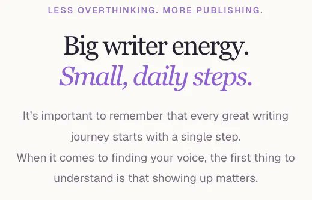
Original (article-image, 519x333): https://pbs.twimg.com/media/HSVp-3cXwAATEuk.jpg

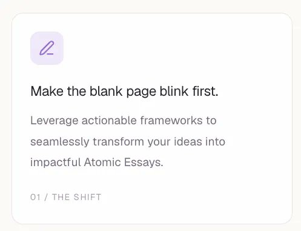
Original (article-image, 497x381): https://pbs.twimg.com/media/HSVqGuEWIAAAzk3.jpg

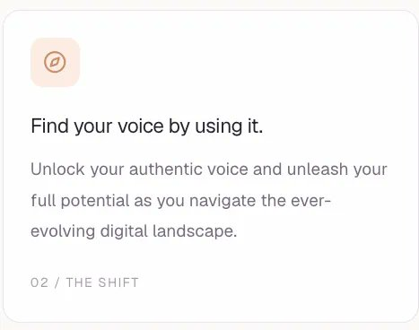
Original (article-image, 467x368): https://pbs.twimg.com/media/HSVqEdOXIAI60vB.jpg

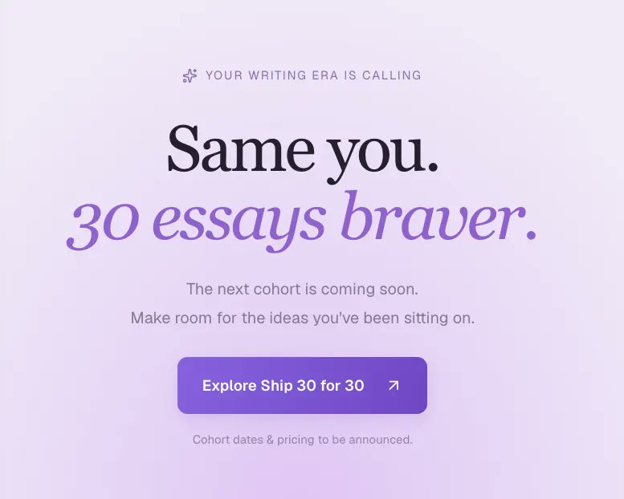
Original (article-image, 777x622): https://pbs.twimg.com/media/HSVqO1MXwAAVgLj.jpg

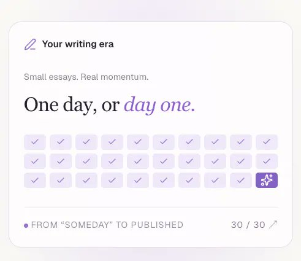
Original (article-image, 491x425): https://pbs.twimg.com/media/HSVqVAtWsAAcnhl.jpg

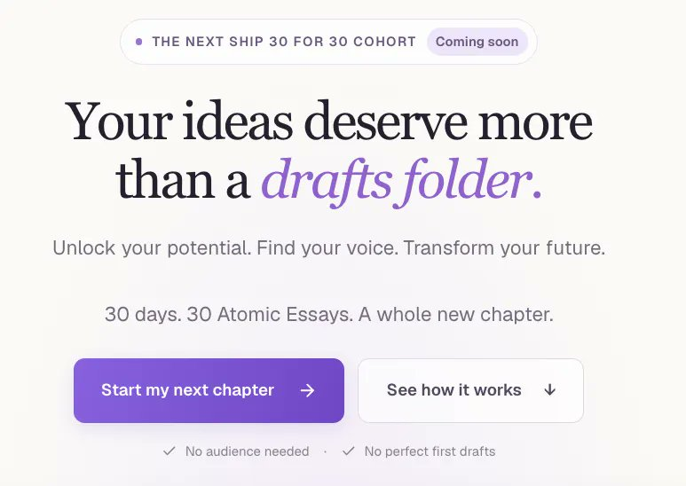
Original (article-image, 773x548): https://pbs.twimg.com/media/HSVprM6XMAA5C5y.jpg

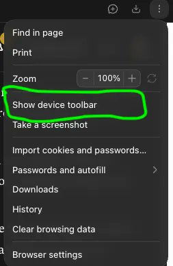
Original (article-image, 253x387): https://pbs.twimg.com/media/HSVqqG_XUAA_KAf.jpg

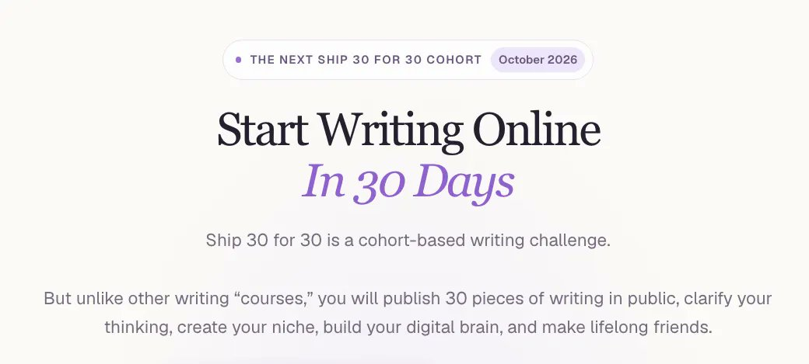
Original (article-image, 1040x469): https://pbs.twimg.com/media/HSVqLyxXcAAue1e.jpg

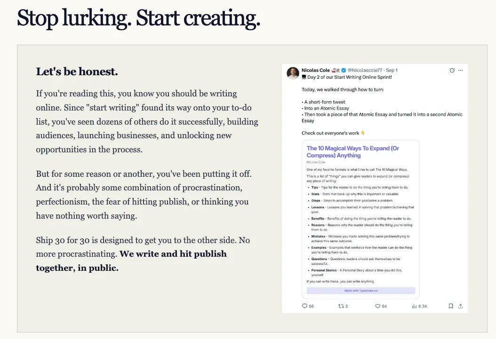
Original (article-image, 1054x721): https://pbs.twimg.com/media/HSVqnjGXQAAaUhC.jpg

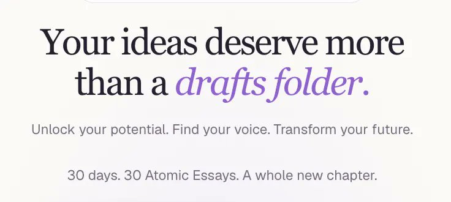
Original (article-image, 736x330): https://pbs.twimg.com/media/HSVqIucXcAI8MXH.jpg

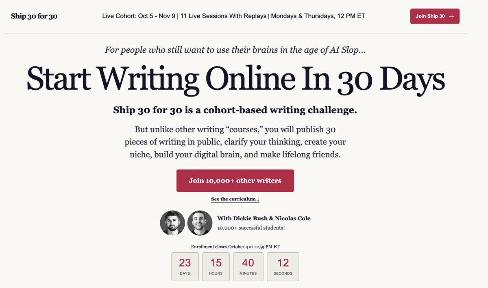
Original (article-image, 1532x906): https://pbs.twimg.com/media/HSVpeMAW4AAz_iu.jpg

Original (article-image, 665x539): https://pbs.twimg.com/media/HSVqSHNXYAANn6W.jpg

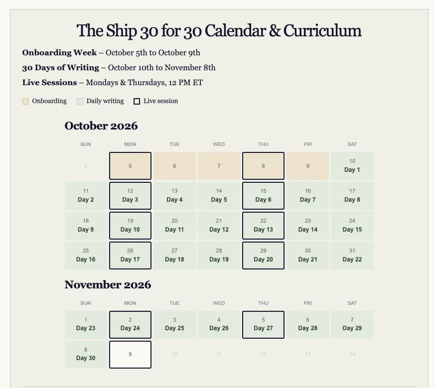
Original (article-image, 873x779): https://pbs.twimg.com/media/HSVqhe0WsAALuzc.jpg

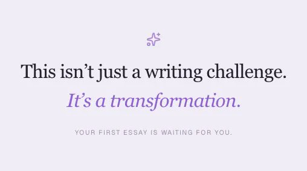
Original (article-image, 508x283): https://pbs.twimg.com/media/HSVpjHYW4AA6AvO.jpg

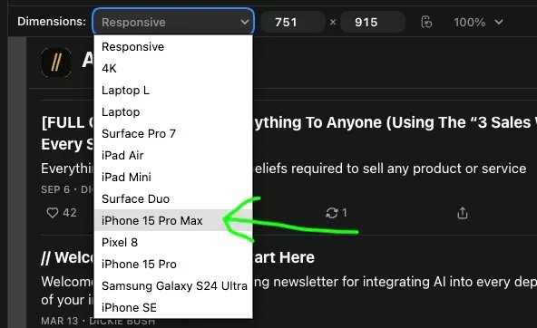
Original (article-image, 592x362): https://pbs.twimg.com/media/HSVqsnnWkAA3lF7.jpg

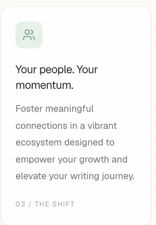
Original (article-image, 320x461): https://pbs.twimg.com/media/HSVp3ndWEAAkDSa.jpg

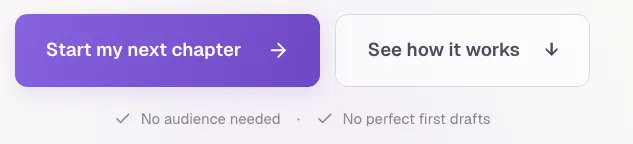
Original (article-image, 633x144): https://pbs.twimg.com/media/HSVqcNEXYAAAVoQ.jpg

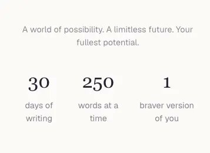
Original (article-image, 357x260): https://pbs.twimg.com/media/HSVpz8gXgAAwKQC.jpg

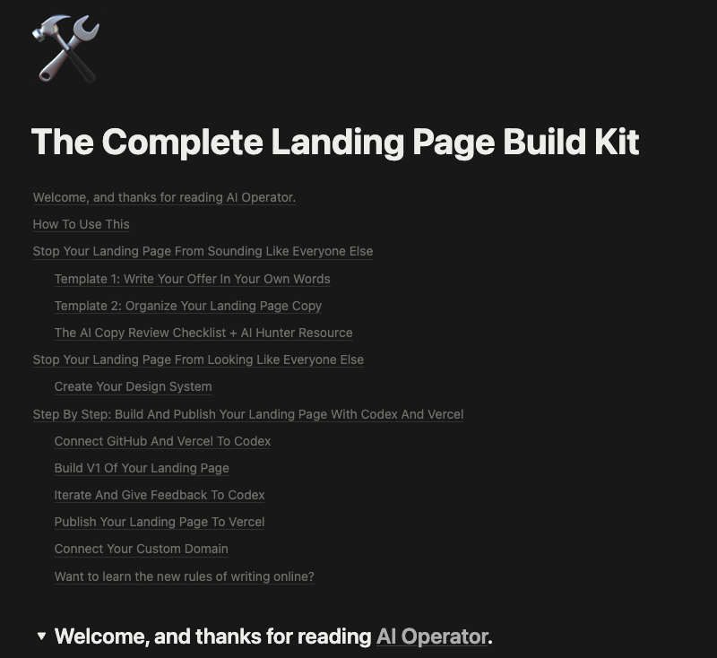
Original (article-image, 800x734): https://pbs.twimg.com/media/HSVquuGXAAAgr9a.png

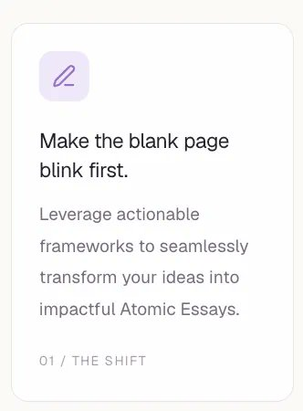
Original (article-image, 332x450): https://pbs.twimg.com/media/HSVpwRpXwAAW1C7.jpg

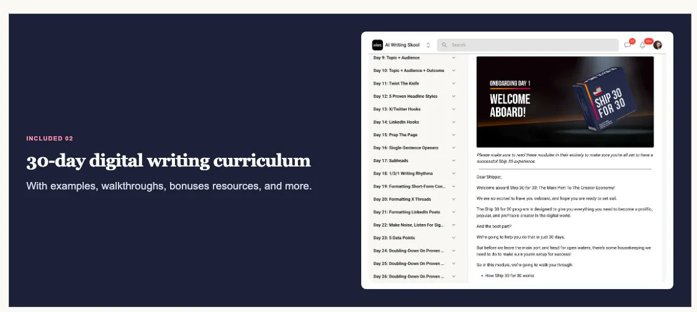
Original (article-image, 1123x504): https://pbs.twimg.com/media/HSVqkK0W0AAeuJS.jpg

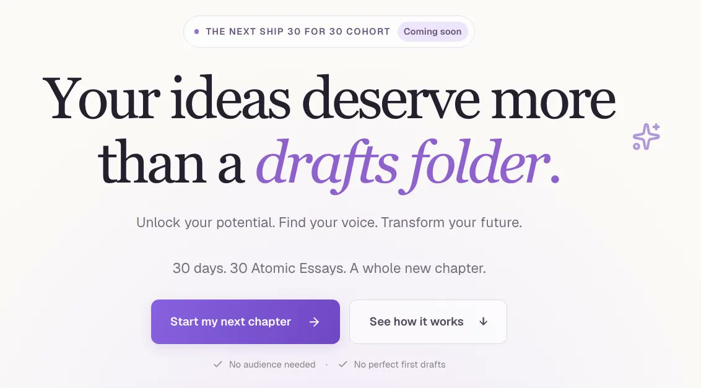
Original (article-image, 1132x627): https://pbs.twimg.com/media/HSVpOZOWsAACw_1.jpg

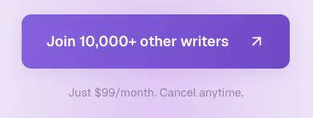
Original (article-image, 390x148): https://pbs.twimg.com/media/HSVqe9vW8AApeox.jpg

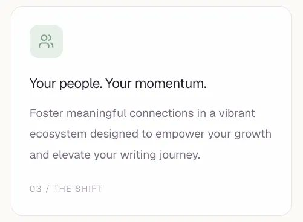
Original (article-image, 501x368): https://pbs.twimg.com/media/HSVqBgwXQAAGRYW.jpg

## Author bio (at capture)

I talk about digital writing, internet business, and personal growth | Former @blackrock hedge fund trader turned writer & operator

## Links

- https://x.com/i/article/2100184542648651776
- https://ship30-newsletter-assets.vercel.app/claude-slop/
- http://ship30for30.com/
- https://artandbiz.substack.com/p/the-right-way-to-write-with-ai
- https://impeccable.style/slop/
- https://www.lapa.ninja/
- https://ship30-newsletter-assets.vercel.app/ship30-copy.md
- https://ship30-newsletter-assets.vercel.app/design-system/
- https://github.com/
- https://vercel.com/
- https://aioperatornewsletter.substack.com/p/full-guide-optimize-your-landing
- http://vercel.app/
- https://www.namecheap.com/
- https://vine-perch-730.notion.site/The-Complete-Landing-Page-Build-Kit-3d801b956bb681e981bbf00ec35a4e05
