# I Showed GPT-6 Astra 600,000 Websites and It Became CRACKED at Design. Here's the Full Workflow.

> Source: https://x.com/PrajwalTomar_/status/2100211370897920136 — @PrajwalTomar_ — captured 2026-09-21T12:52:00Z
> Author: Prajwal Tomar (@PrajwalTomar_)
> Posted: Wed Sep 16 13:13:05 +0000 2026
> Stats (at capture): 216045 views · 174 likes · 8 replies · 12 reposts · 640 bookmarks
> Captured: 2026-09-21T12:52:00Z

## Post

@PrajwalTomar_

https://x.com/i/article/2100207651531726848

## Article

[I Showed GPT-6 Astra 600,000 Websites and It Became CRACKED at Design. Here's the Full Workflow.](https://x.com/i/article/2100207651531726848)

Preview: GPT-6 Astra has been out for about two weeks now and it is still winning every benchmark people throw at it. Coding, computer use, long agent runs. My feed is full of demos.
 
The thing I actually

GPT-6 Astra has been out for about two weeks now and it is still winning every benchmark people throw at it. Coding, computer use, long agent runs. My feed is full of demos.

[article media: 2100207516823289856]

The thing I actually wanted to know was a lot more boring. Can it design a website that doesn't look like AI made it? That is what clients pay us for at the agency, and every model I have tried so far has failed at it.

Short answer, not on its own. And a better prompt doesn't fix it either.

You can't prompt taste into a model. You have to show it what good looks like.

Here's what's inside this article.

- Why the best coding model in the world still makes websites that look like AI made them

- Round one, Astra on its own, and exactly what gave it away

- Round two, Astra with 600,000 real websites to study

- The research prompt that does all the work, and the report it wrote

- How I actually run this for clients (the part the demos skip)

- The limits nobody talks about

- The build sheet you can run tonight

## Why Every AI Website Looks the Same

Last week a consulting client got on a call with me and told me he was tired of generic websites. He had tried every AI builder out there and they all gave him a version of the same thing. The tasteful serif font, the sage green, the floating phone, the poetic one liners.

And honestly, GPT-6 Astra is the best coding model I have used and it still did the same thing.

So the model isn't the problem. The prompt isn't the problem either. Everyone writes "premium, editorial, magazine feel" and then spends two hours fighting with the output.

Those are taste words. The model has no idea what premium looks like for a travel brand versus a dev tool versus a bank. So it goes with the average of every website it has ever seen that called itself premium. And that average always looks the same.

Same week I saw a video from Griffin Wooldridge that solved exactly this, you can watch it here. Huge shoutout to him, this whole workflow started there.

What he did was simple. He connected Astra to Mobbin, which is a library of 600,000+ screens from real apps and websites that actually shipped, and made the model study real work before designing anything. Research first, then build.

I watched it, thought this is exactly what my client is dealing with, and tried it on one of our own projects the same night. It worked way better than I expected. So the idea is Griffin's. What's below is my run of it, what actually came out, and the extra steps we add at the agency so it works on real client projects.

[article media: 2100207521051111424]

## The Setup

For this experiment I used TripGlide, a travel booking app I built a few weeks back. The app was done but it never got a landing page, and a travel brand is the perfect test because in travel the design is the product. Nobody books a trip from an ugly website.

I ran it twice with the same product, the same model and the same brief.

Round one was GPT-6 Astra on its own, inside ChatGPT, building the site with Sites.

Round two was GPT-6 Astra with the Mobbin MCP connected, so it could go through 600,000+ real screens from shipped apps and websites before touching the page.

One quick note on Mobbin so nobody has to wonder. This is not sponsored. We have paid for it at the agency for about a year and the MCP just means the model gets to browse it instead of me. If you don't want to pay for it, there is a free version of this workflow further down.

## Round One, Astra on Its Own

Here is the exact brief I gave it, word for word.

"Build a polished, responsive marketing website for TripGlide, a travel booking app that feels like a high-end digital travel magazine that happens to let you book. Sections: hero with a product UI preview of the app, how it works, curated destinations, itinerary feature, social proof, pricing, FAQ, footer. It should feel like a premium consumer travel brand: editorial typography, generous whitespace, subtle interactions, fully responsive. Generate your own imagery where needed."

It worked for 10 minutes and 13 seconds and came back with a full site. Every section was there. Responsive, with its own images. It even told me that bookings and payments were previews and that the testimonial and pricing were sample copy.

At first glance it looks good. That is the trap.

This is not the ugly grey bootstrap page you would get from a weaker model. This is the other kind of generic. The "AI premium" kind. Once you have seen fifty of these you can spot it in a second.

[article media: 2100207526767968256]

Here is what gave it away.

- A phone tilted five degrees, a floating "reassurance" card, GPS coordinates printed on a generated photo, sparkles, a sun icon, a postcard number. Six random things all trying to look editorial and none of them saying anything about the product.

- The same headline formula in every section. Upright serif, then a sage green italic phrase. "From what if to we're here." "A plan for the trip. Room for the magic." "Travel well. Keep it simple." One good idea repeated until it became a template.

- Copy like "Less tabs, more takeoffs" and "Less planning. More living." Sounds like travel, says nothing about what the app does.

- The same Amalfi photo used four times. Hero, phone, card and the itinerary popup.

- 6px labels inside the phone mockup. You could not read the product preview, it was just there to look like a product.

- Made up pricing (two plans, monthly and annual) and a testimonial it labelled "illustrative traveler story, sample copy."

[article media: 2100207545843687424]

None of that is a code problem. The code was fine. The model had just never been shown what a great travel website actually does, so it guessed, and it made the same guess every AI tool makes.

[article media: 2100207549635330048]

## Round Two, Astra With 600,000 Real Websites

Connecting Mobbin takes two minutes.

- In ChatGPT, go to Apps, search Mobbin, add it and sign in to authorize.

- You need a Mobbin Pro plan or above. The free plan cannot connect.

Small honest note, the MCP did not connect on my first try. Astra told me it failed, then picked it up on the second try and apologised for the back and forth. Just plan for that.

Now the important part. I did not ask it to redesign anything yet. I asked it to research first and write me a report.

"Use this MCP to research design patterns for the current TripGlide landing page before making any changes. Study real, shipped travel and premium consumer brand websites and apps. Then write a report that: 1) identifies exactly where the current page feels generic or AI-generated, 2) summarizes the recurring patterns in the strongest real examples you found, 3) proposes a clearer visual direction for TripGlide, 4) lists every change you would make and why. Do not build anything until I approve the report."

This is the step everyone skips. They connect the tool and say "make it better." The model then redesigns without really looking at anything and you get a different flavour of the same generic page.

[article media: 2100207555545038848]

The report is the real product here. It is the model showing you what it learned before it spends any of it on your page.

[article media: 2100207588092866560]

## What the Report Actually Said

It went through 14 real screens across travel sites, travel apps and consumer brands and came back with a 28 change plan. The first line was the best line.

"TripGlide has the right broad ingredients, but currently communicates premium travel through accumulated decoration and interchangeable language."

Accumulated decoration and interchangeable language. That is the entire AI premium problem in seven words.

On its own hero it wrote "Too many familiar landing-page devices compete. The composition lacks a single organizing idea."

On its own type system "A useful treatment becomes a formula when repeated in almost every section."

On its own copy "Repeated contrast, fragments, and polished sentiment create a manufactured cadence."

On the destination cards "Almost no decision support. 'Big mountains. A quieter mind' could describe many places."

Then it went through the references. KOBU's hotel pages, Airbnb's discovery screen, Wanderlog's day by day itinerary, TravelPerk's hero, KÖPPEN, Face Formula. And it pulled out six things the real ones have in common.

- One dominant visual idea. One named stay or one product demo leads and everything else supports it.

- Specific things people actually want. Properties, activities, dates, named places instead of broad promises.

- Clear actions. Book, search, save, labelled and placed where they belong.

- Information right next to the image. A travel card should help you decide something.

- Big and small used on purpose. Big editorial photos, compact practical details, each doing a different job.

- Real product evidence. Actual useful screens that show what the app does.

[article media: 2100207592488493056]

It proposed a direction in one sentence. "TripGlide: a travel editor's selection, with your journey ready to plan." A chalk background, near black text, deep olive for buttons. One serif for headlines and one sans for everything practical. Italics used sparingly instead of on every single heading.

And the change list was not cosmetic. Remove the floating card, the sun, the coordinates, the sparkles. Stop repeating the Amalfi photo. Bump the 6px labels up to readable sizes. Rewrite the hero to say what the product does. And two I did not expect. Delete the sample testimonial completely because "a fabricated quote cannot fulfill social proof," and pull the made up pricing until there is a real business model behind it.

It also did not over claim. It flagged mobile as a risk instead of a confirmed bug because it had not run a browser check yet. And it wrote in its own report that "generic" was its design judgment and "not a reliable method for detecting AI authorship."

That is a better design review than most agencies deliver in a week.

## Round Two, the Rebuild

I sent one line back.

"Approved. Implement the report on the existing site."

It worked for about eleven minutes and put the new version live at the same URL. Its own summary said it updated the editorial layouts, imagery, typography and destination specific itineraries, and removed the invented testimonials and pricing.

[article media: 2100207595881635840]

Here is the new hero, same crop as round one.

[article media: 2100207599379742720]

Now go back to the report and check things off, because this is where you find out if the model actually used its own research or just said it did.

- The hero has one idea now, which is exactly what the report asked for. The phone is still there but now it is in someone's hand and it is doing something. Discover, Plan and Travel tabs under it, and the screen changes with each one. That is the TravelPerk pattern the report pulled out, a product in a hand with useful callouts around it, instead of a prop tilted five degrees.

- The cards around the phone say real things now. "A stay with a sea view. Positano, Amalfi Coast." "Let's add Ravello." In round one the floating card said "A journey that feels like you," which means nothing.

- The coordinates, the sparkles, the sun icon and the postcard number are gone. The nav says Destinations, How it works, The experience, and the one button says exactly what it is, "Explore the preview."

- Every destination finally has its own itinerary. Kyoto opens six days in Kyoto with Ninenzaka and Higashiyama. The Dolomites opens five days out of Dobbiaco. In round one every card opened the same Amalfi week. The report called this "decision support" and now the cards actually have some.

[article media: 2100207602319986688]

- The itinerary went from a tilted piece of "paper" to a dark olive product panel you can actually read. Day 01, 02, 03. Morning, afternoon, evening. It even prints "Example stay, not reserved" on it because nothing on this site can be booked yet and it says so.

[article media: 2100207605255995392]

- It deleted its own lies. The sample testimonial is gone. The made up pricing is gone. Instead the FAQ answers real questions like "Can I book a stay or experience?" and "Are the photographs of bookable places?"

[article media: 2100207609257295873]

Now the honest part, because this is the bit the demos never show you.

It is not perfect. The serif plus italic headline formula is still on the page. "Your whole trip. Beautifully together." "A little structure. A lot of freedom." "A good trip. Without the juggling." The report called that exact pattern out as the tell and the model still went for it three times. If this were a client site, that copy is the one thing I would send back.

But look at the two heroes next to each other.

[article media: 2100207641620582400]

Same model. Same brief. Same product. The only thing that changed is what the model got to look at before it started.

## What to Do After Round Two

There is always one thing still off. Always. The mistake is fixing it with "make the headlines less poetic" and letting the model loose on the whole page again, because then something that was already right comes back wrong.

Every pass after the rebuild gets a fence around it. The prompt shape is the same every time.

"One fix pass, scoped to [section]. [The one change]. Change nothing else."

For this site it would be "One fix pass, scoped to headline copy only. Rewrite the three serif and italic headlines to say something specific about the product. Change nothing else."

That one sentence does more work than anything in the original brief.

## How I Actually Run This for Clients

Griffin's video stops at the before and after, which is fair, it is a demo. At the agency we add a few more steps and they are the reason this holds up on real client work.

1. Design system before anything. Colours, type scale, spacing, components. One short doc the model reads first. Without this the research pass pulls patterns that fight your brand.

2. Research pass on the page. The report prompt above. Never "make it better." Always research, report, wait.

3. Build, then check mobile, then run a second research pass on the one section that still feels off. There is always one. Ask for research on just that section instead of touching the whole page.

4. Save the patterns. The change list goes into the project notes. The next client in the same category starts from those patterns instead of from zero.

That last step is the one that compounds. The research is not just for one page. It becomes a taste file that gets better with every project.

(I send the full pattern list from each run to the people on my newsletter, The AI Head Start, at https://theaiheadstart.com/ ... the travel one goes out this week.)

[article media: 2100207646460788736]

## The Free Version

If you don't want to pay for Mobbin the workflow still works, it is just slower.

- Open 10 to 12 real websites in your category, the ones you actually admire.

- Screenshot the hero, one content section and the footer of each.

- Drop them into the chat and run the same research prompt, just replace "use this MCP" with "study the attached screenshots."

- Everything else stays the same.

You lose the breadth. 600,000 screens is a very different reference set from 12. But you keep the part that matters, which is doing the research before you build.

## The Limits

Everything above is real and all of it has rough edges, so here they are before you learn them on a client call.

- Mobbin MCP needs a Pro plan or above, and every search spends Mobbin AI credits with no published rate. Budget for it.

- The MCP can fail on the first connect. It did for me. Reconnect and run it again.

- The report is only as good as the research prompt. "Research design patterns" gets you a summary. The four part prompt above gets you a 28 item plan.

- Astra loves to rebuild the whole page when you asked for one section. Name the section in every fix prompt.

- The model can copy too closely. If the report keeps pointing at one reference site, tell it to widen the set before it builds.

- Images still need a pass. The layout gets good fast, the photos lag behind.

- This is a marketing site workflow. For the actual app screens I still start from a design system (will try this workflow though for that too and share the results).

## The Build Sheet

The whole system in one line.

> Brief → Draft 1 → connect real references → research report (wait for it) → Draft 2 → annotate every change → mobile check → one fix pass on the weak section

Set it up once, run it on every landing page, save the patterns, and every build after this one starts from taste instead of from zero.

The client got his site the same week. The workflow stayed at the agency. That is the whole experiment.

If you want the next one of these in your inbox instead of hoping the algorithm shows it to you, that is what The AI Headstart is for. https://theaiheadstart.com/

## Media

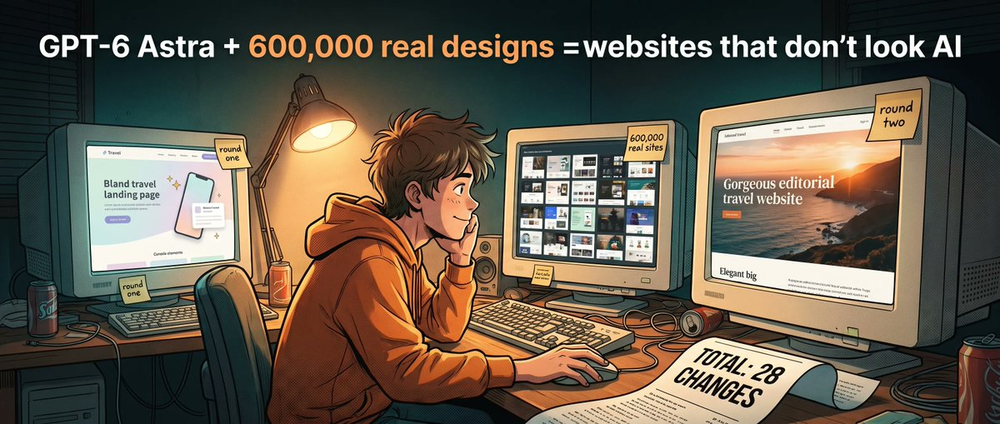
Original (article-cover, 3168x1344): https://pbs.twimg.com/media/HSVvmnqboAA96vO.jpg

[media/article-video-0.mp4](media/article-video-0.mp4)
Original (article-video, 23.6s): https://video.twimg.com/amplify_video/2100207526767968256/vid/avc1/1280x720/UM0mWt7v85M1EaZx.mp4?tag=16

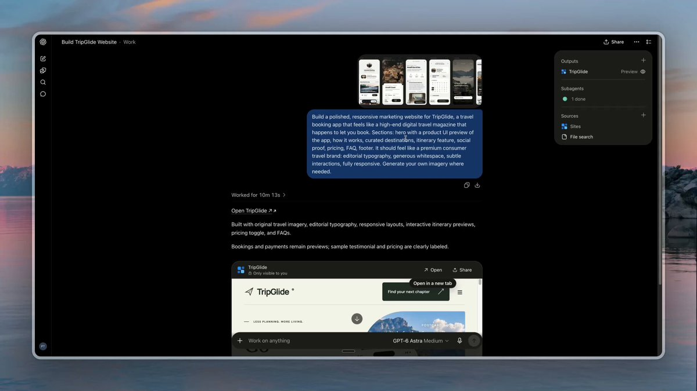
Original (article-video-thumb): https://pbs.twimg.com/amplify_video_thumb/2100207526767968256/img/JbCqAzAxWijkK9Lx.jpg

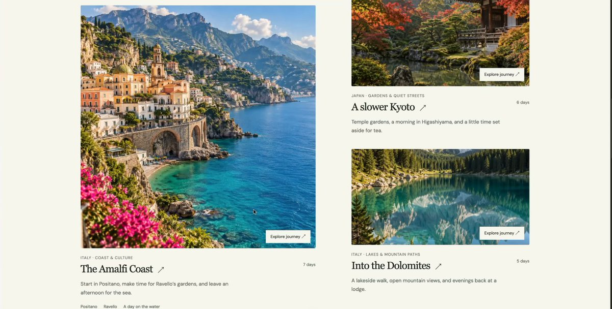
Original (article-image, 1720x871): https://pbs.twimg.com/media/HSVvr9rbkAAMcXp.jpg

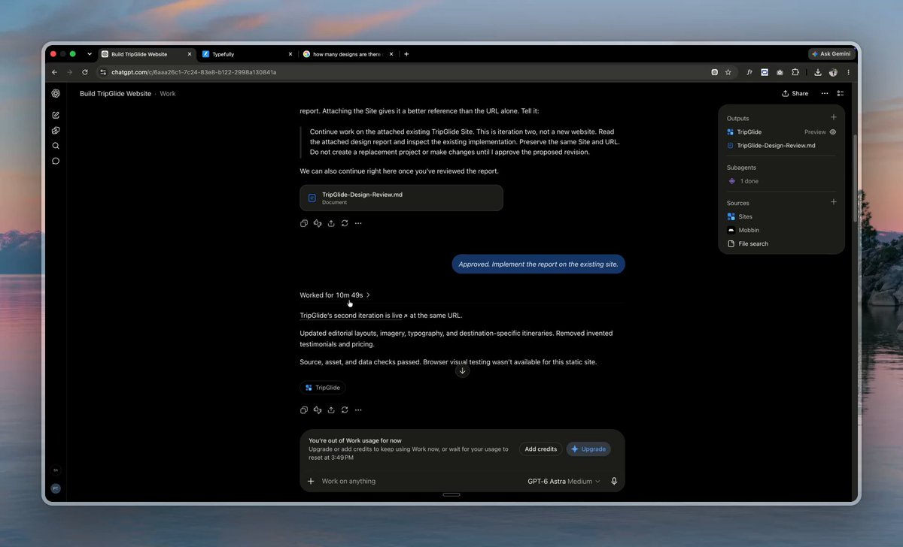
Original (article-image, 1920x1164): https://pbs.twimg.com/media/HSVvrlsaIAANBUE.jpg

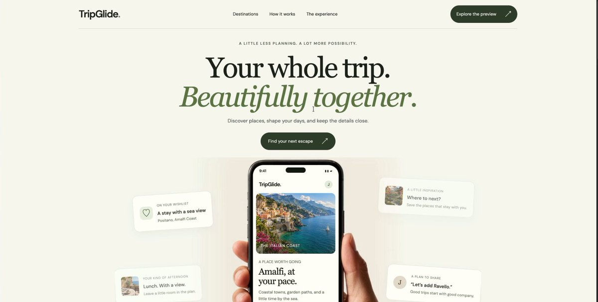
Original (article-image, 1720x871): https://pbs.twimg.com/media/HSVvryubAAAmzY9.jpg

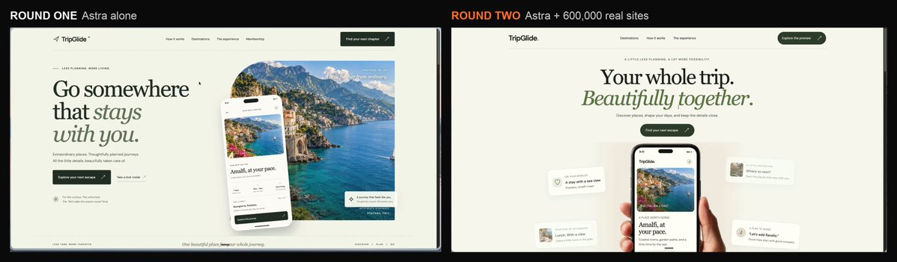
Original (article-image, 3585x1050): https://pbs.twimg.com/media/HSVvuQFbEAAxdWj.jpg

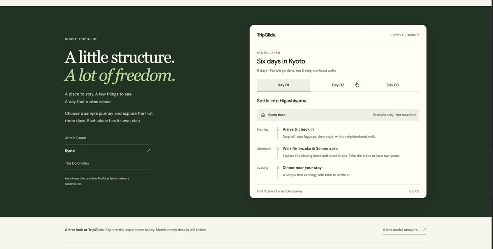
Original (article-image, 1720x871): https://pbs.twimg.com/media/HSVvsInbgAA16y4.jpg

[media/article-video-6.mp4](media/article-video-6.mp4)
Original (article-video, 38.6s): https://video.twimg.com/amplify_video/2100207555545038848/vid/avc1/1186x720/EtsGJ_JUWzOjblfs.mp4?tag=16

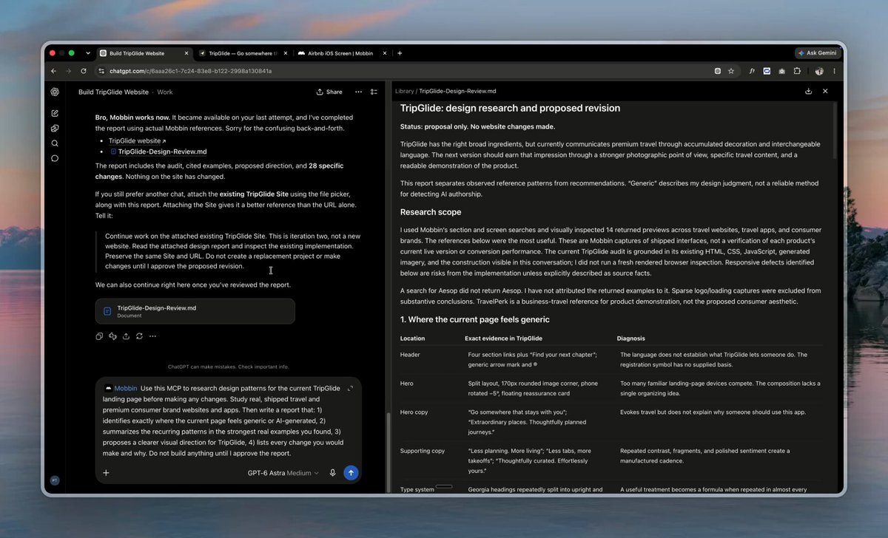
Original (article-video-thumb): https://pbs.twimg.com/amplify_video_thumb/2100207555545038848/img/mOs5PCKg39z4nNk7.jpg

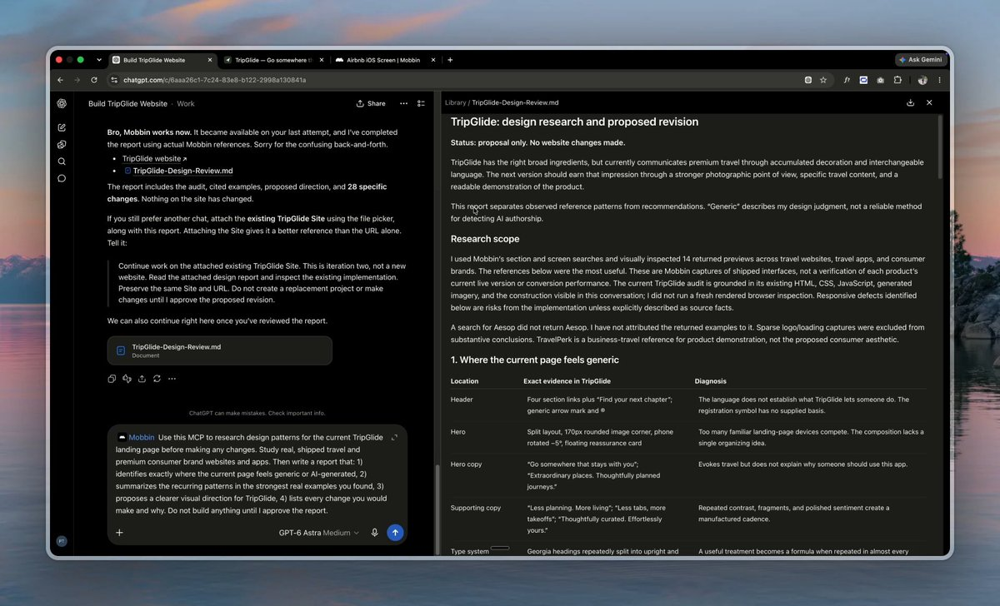
Original (article-image, 1920x1164): https://pbs.twimg.com/media/HSVvrIra8AASWRO.jpg

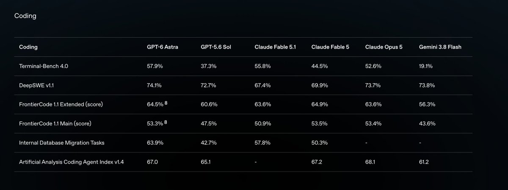
Original (article-image, 2534x950): https://pbs.twimg.com/media/HSVvm_LbgAALodD.jpg

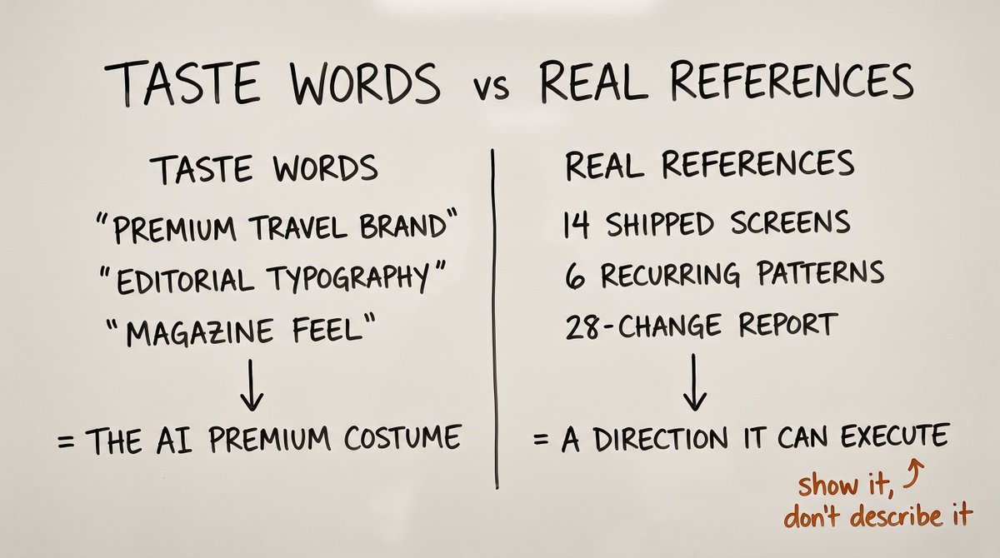
Original (article-image, 2752x1536): https://pbs.twimg.com/media/HSVvnO7a8AAliBT.jpg

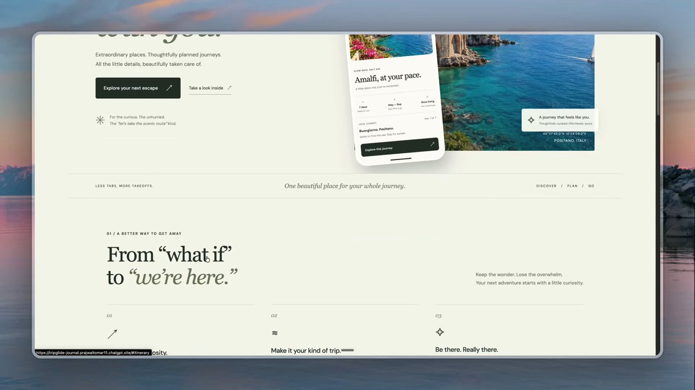
Original (article-image, 1920x1080): https://pbs.twimg.com/media/HSVvorSboAAGEgL.jpg

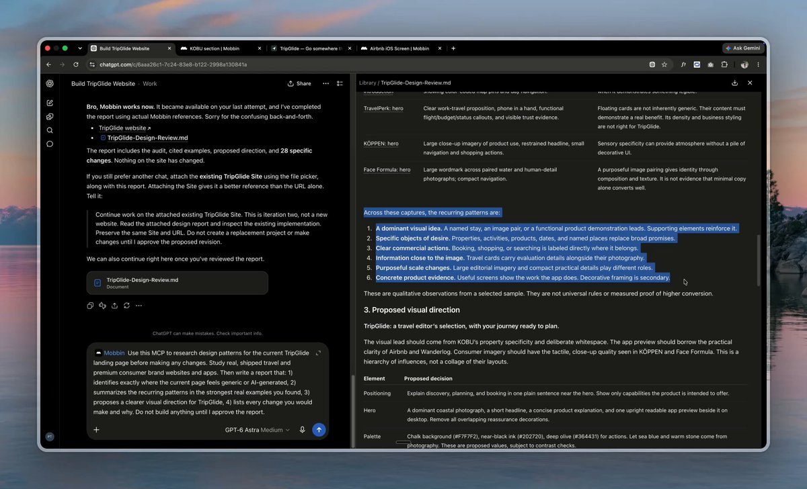
Original (article-image, 1920x1164): https://pbs.twimg.com/media/HSVvrZDa4AAGYRf.jpg

[media/article-video-12.mp4](media/article-video-12.mp4)
Original (article-video, 32.8s): https://video.twimg.com/amplify_video/2100207609257295873/vid/avc1/1186x720/t4TINhtQHHh2KG1I.mp4?tag=16

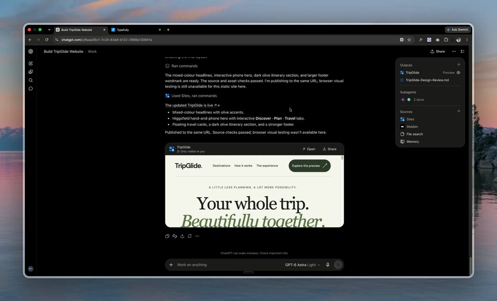
Original (article-video-thumb): https://pbs.twimg.com/amplify_video_thumb/2100207609257295873/img/oxBcuvT02DSQCIuZ.jpg

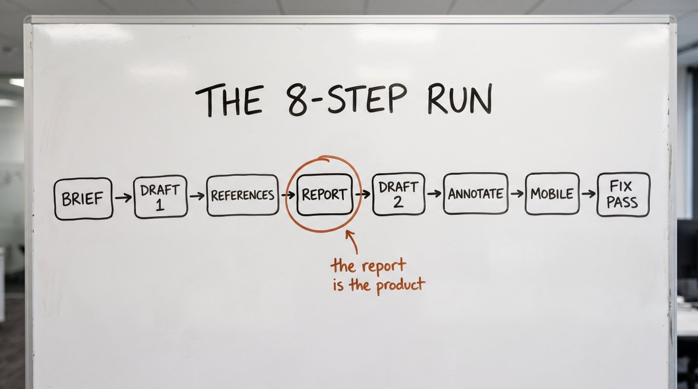
Original (article-image, 2752x1536): https://pbs.twimg.com/media/HSVvuiHawAApxUt.jpg

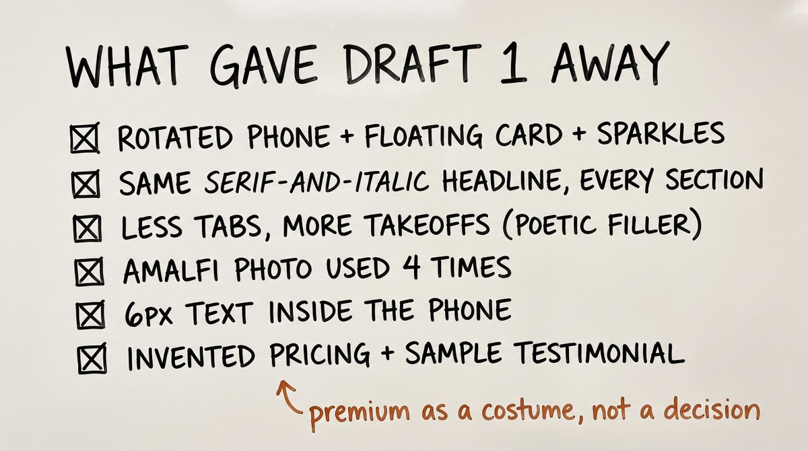
Original (article-image, 2752x1536): https://pbs.twimg.com/media/HSVvo5abgAAtn9J.jpg

## Author bio (at capture)

I run 5 businesses on AI and experiment with it every day so you don't have to. The experiments that actually make money end up here.

## Links

- https://x.com/i/article/2100207651531726848
- https://www.youtube.com/watch?v=L_EXYLmyFSA
