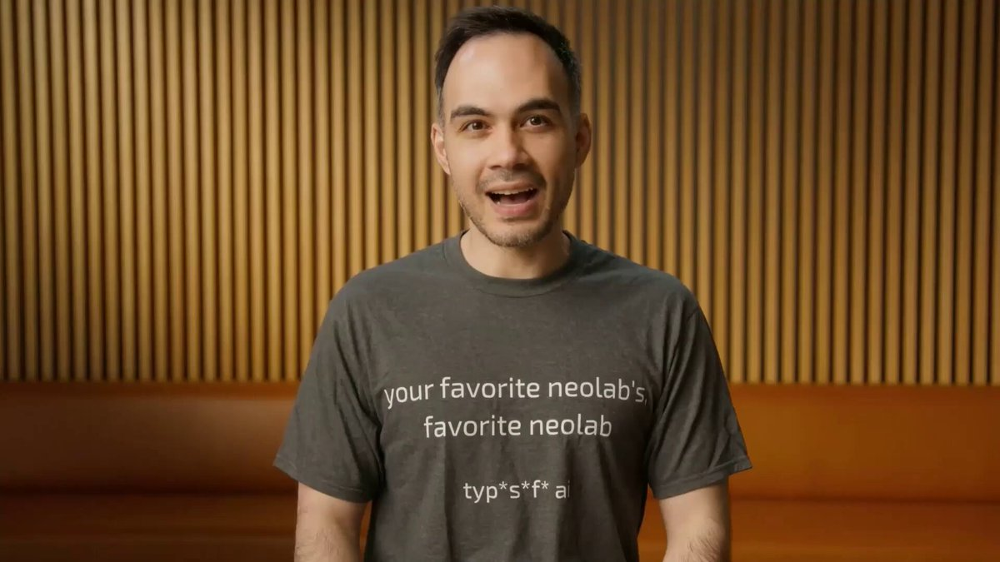

# We've been reading the comments. Weights are on Hugging Face.

> Source: https://x.com/george_onx/status/2100293114808119379 — George Maloney (@george_onx) — Posted: Wed Sep 16 18:37:54 +0000 2026 — Stats (at capture): 225,008 views · 1,586 likes · 56 replies · 94 reposts · 1,338 bookmarks · 27 quotes · Buffer — Captured: 2026-09-21T13:29:16Z

## Post

**Author:** George Maloney (@george_onx)
**URL:** https://x.com/george_onx/status/2100293114808119379
**Bio:** Co-founder @ http://fastino.ai | Creators of GLiNER

We've been reading the comments. Weights are on Hugging Face.
https://x.com/completeskeptic/status/2099925682726002904?s=46&t=QZrJQF-Xao6DyvFx6NWcnQ

## Media

Originals: https://pbs.twimg.com/media/HSW9dLpXkAAJuUy.jpg?name=orig (4386×2187)

## Quoted post

[Diogo Almeida (@CompleteSkeptic), Tue Sep 15 18:17:52 +0000 2026](https://x.com/CompleteSkeptic/status/2099925682726002904) — 38,469,658 views · 74,362 likes · 3,938 replies · 8,027 reposts · 58,428 bookmarks · 6,631 quotes

After co-inventing ChatGPT, I kept asking myself: why have superhuman chat models not led to AGI?

I’ve spent the last 2 years in stealth building a new way to train models (RLCD), and a new type of frontier AI model that we are releasing today: Jev

• 20-200x faster
• 40-400x cheaper (w/ output tokens free)
• Frontier composable intelligence optimized for decisions

AFAICT the shortest path to AI-based economic revolution

Quoted video local: [media/quoted-media_0.mp4](media/quoted-media_0.mp4) —  — Original: https://video.twimg.com/amplify_video/2099925575637057536/vid/avc1/1920x1080/cy2CDedAjnEfjJZk.mp4?tag=29 (1920×1080, 176.085s)

## Thread

56 replies counted; no author self-replies visible in rendered conversation at capture.

## Comments

### Oleg Ataeff ([@olegataeff](https://x.com/olegataeff)) — [2100713440956269004](https://x.com/olegataeff/status/2100713440956269004)

> why all this hype about Jev? and i love his comparisson to how transformers moved llm lol. hate this visioner like style. Jev suxx

### Igor Blink ([@IgorBlinkk](https://x.com/IgorBlinkk)) — [2100459781286691116](https://x.com/IgorBlinkk/status/2100459781286691116)

> Haha was using gliner for pii detection for life

### Bruno Skvorc ([@bitfalls](https://x.com/bitfalls)) — [2100635704824856693](https://x.com/bitfalls/status/2100635704824856693)

> Quote
> Bruno Skvorc
> @bitfalls
> ·
> Sep 17
> Introducing: JevGPT.
>
> Who says @typesafeai Jev can't chat? (make sure you turn on Ogden mode though!)
>
> Explanation below.

### Thao N. ([@thaooowinnn](https://x.com/thaooowinnn)) — [2100293551485784171](https://x.com/thaooowinnn/status/2100293551485784171)

> i got chills

### Sumit Datta ([@sumitdatta](https://x.com/sumitdatta)) — [2100457397055783048](https://x.com/sumitdatta/status/2100457397055783048)

> I commented the same on the HN post. Struck me too, even though I am not a domain expert but used GliNER before.

### Robert Dylina ([@rdylina](https://x.com/rdylina)) — [2100732453854101822](https://x.com/rdylina/status/2100732453854101822)

> I sense distillation incoming ..

### Alex Vu ([@robberviet](https://x.com/robberviet)) — [2100445196374991211](https://x.com/robberviet/status/2100445196374991211)

> This is exactly what I think about Jev, however is it though? Haven't got access but I have the impression that Jev is much more generic. I am fine tuning ModernBert too but it's no where near LLM capable.

### Nauron ([@ArtFacility](https://x.com/ArtFacility)) — [2100482620316365277](https://x.com/ArtFacility/status/2100482620316365277)

> Seems to be exactly what i need, small, local, multilingual classifier, thanks for sharing

### Egor Merkushev ([@egormerkushev](https://x.com/egormerkushev)) — [2100645399354859848](https://x.com/egormerkushev/status/2100645399354859848)

> But these models do different things

### Sakib ([@zsakib_](https://x.com/zsakib_)) — [2100918505960800267](https://x.com/zsakib_/status/2100918505960800267)

> That’s exactly what I was thinking!

### Sebastian Buzdugan ([@sebuzdugan](https://x.com/sebuzdugan)) — [2100596786440061193](https://x.com/sebuzdugan/status/2100596786440061193)

> 200x needs matched quality and hardware or it is not a useful benchmark

### Oscar Codes Life. e/acc ([@o_codes_life](https://x.com/o_codes_life)) — [2100482310097281131](https://x.com/o_codes_life/status/2100482310097281131)

> How fast it is? does it compare in performance to Jev?

### Jo Sef ([@JoSef5140162141](https://x.com/JoSef5140162141)) — [2100552713046053155](https://x.com/JoSef5140162141/status/2100552713046053155)

> This is for extraction but can it extrapolate and make decisions?

### Jim Havrilla ジム・ハブリラ ([@jim_havrilla](https://x.com/jim_havrilla)) — [2100632722255364466](https://x.com/jim_havrilla/status/2100632722255364466)

> Yeah, honestly, it's just hype marketing.

### Richard Hefner ([@hefx00](https://x.com/hefx00)) — [2100657726259126694](https://x.com/hefx00/status/2100657726259126694)

> Cool. But in:
>
> "Introducing GLiNER2.5: Efficient Span-Free Information Extraction with Schema-Driven Interface"
>
> ...You forgot "We're making the world a better place"
> youtube.com
> Silicon Valley - Making the World a Better Place
> Montage of all the "Making the World a Better Place" style hype fro...

## Links

- https://x.com/completeskeptic/status/2099925682726002904?s=46&t=QZrJQF-Xao6DyvFx6NWcnQ
- https://x.com/CompleteSkeptic/status/2099925682726002904
